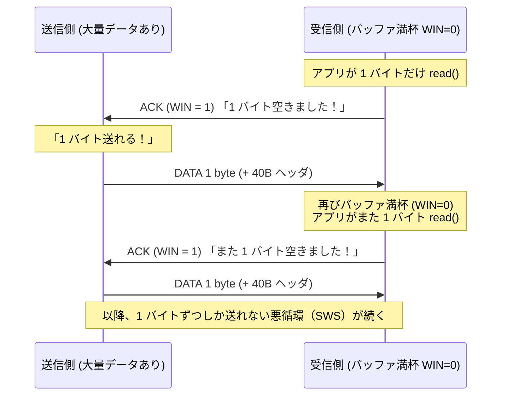

# SWS（Silly Window Syndrome / 愚かなウィンドウ症候群）と回避策

> **関連章**: [第 3 章: 送信 (1): `tcp_sendmsg` と送信キュー](../03-sendmsg.md) / [第 4 章: 送信 (2): `tcp_write_xmit` からワイヤまで](../04-write-xmit.md) / [第 6 章: 受信 (2): データキューイングと `tcp_recvmsg`](../06-data-queue-recvmsg.md) / [第 10 章: ウィンドウとメモリ管理](../10-window-memory.md)

## Q. 第 3 章などで出てくる「SWS（Silly Window Syndrome）」って何ですか？ Nagle アルゴリズムとは何が違うのですか？

**SWS（Silly Window Syndrome：愚かなウィンドウ症候群）** とは、1982 年に David D. Clark（[RFC 813](https://www.rfc-editor.org/rfc/rfc813)）が指摘した TCP の古典的な性能劣化現象で、**「送受信ウィンドウのやり取りが噛み合わなくなった結果、数バイトしかデータの入っていない極小パケット（ヘッダ 40 バイト＋データ数バイト）ばかりが延々と往復し続け、回線効率が壊滅する現象」** です。

## どうやって SWS が起きるのか？（具体例）

たとえば受信側のバッファ（`RCV.BUFF`）が 4000 バイトで、送信側が大量のデータを送りたいとします。

1. まず送信側が 4000 バイト送り、受信側のバッファが満杯になって **`RCV.WND = 0`（ゼロウィンドウ）** になります。
2. ここで受信側のアプリケーションが、ゆっくり **1 バイトだけ `read()`** したとします。
3. もし受信側 TCP が素直に **「1 バイト空いたよ！（`WIN = 1`）」** という Window Update ACK を送ってしまうと……
4. 送信側 TCP も素直に **「1 バイト送れるぞ！」と 1 バイトのデータ（＋40 バイトの TCP/IP ヘッダ）** を即座に送信してしまいます。
5. するとまた受信バッファが満杯（`WIN = 0`）になり、アプリが次の 1 バイトを `read()` するとまた `WIN = 1` → 1 バイト送信……という **「1 バイトずつのバケツリレー」が永久に続いてしまいます**。

## SWS の 2 つの原因と 2 つの対策（RFC 9293 §3.8.6.2）

SWS は **受信側** と **送信側** のどちらが原因でも起きるため、TCP では **両側** で対策（SWS Avoidance）を行います。

1. **受信側 SWS 回避（Clark のアルゴリズム、[RFC 9293 §3.8.6.2.2](https://www.rfc-editor.org/rfc/rfc9293#section-3.8.6.2.2)）**:
   - **原則**: 「受信バッファがほんの少し空いたくらいでは、新しいウィンドウを開いて広告してはいけない（右端を固定して `WIN = 0` などのまま我慢する）」。
   - **いつ開くか**: 空き容量が **「`1 MSS` 以上」** または **「受信バッファ全体の半分（ $\frac{1}{2} \times \text{RCV.BUFF}$ ）以上」** に回復するまで待ってから、まとめて大きなウィンドウを広告します。
   - **Linux の実装**（第 6 章・第 10 章）: `__tcp_select_window()` と `tcp_cleanup_rbuf()` が担当します。アプリが `recvmsg()` で少しずつ読んでも、開ける窓が現在の残り窓の 2 倍以上になるか、ウィンドウ右端が十分に（MSS 単位で）進むまで Window Update ACK を送りません。

2. **送信側 SWS 回避（[RFC 9293 §3.8.6.2.1](https://www.rfc-editor.org/rfc/rfc9293#section-3.8.6.2.1)）と Nagle（[RFC 896](https://www.rfc-editor.org/rfc/rfc896)）**:
   - **原則**: 万が一、受信側が小さなウィンドウ（例: `WIN = 10`）を広告してきたり、送信アプリが少しずつデータを書いたりしても、送信側が勝手に極小パケットを作って送らないようにします。
   - RFC の送信側ルールでは、次のどれかを満たすときだけ送信を許します：
     1. **フルサイズのセグメント（`1 MSS`）** を送れるとき。
     2. 未確認データ（In-Flight）が空で、**手持ちのデータをすべて** 送れるとき（Nagle の条件）。
     3. 相手がこれまでに教えてくれた **最大ウィンドウ（`tp->max_window`）の半分（ $F_s = \frac{1}{2}$ ）以上** のまとまったサイズを送れるとき。
     4. PSH フラグが付いていて、かつ override timeout が経過したとき。

## Nagle アルゴリズムと SWS 回避の違いは？

よく混同されますが、守っている相手が違います。

- **Nagle アルゴリズム（RFC 896）**: **送信側アプリ** が `write(fd, buf, 1)` のように **1 バイトずつチョロチョロ書いてくる** とき、In-Flight がある間は送信キューに溜めてまとめる仕組みです。
- **SWS 回避（RFC 813 / RFC 9293 §3.8.6.2）**: **受信側の空きウィンドウ（`SND.WND`）が小さくなっている** ときに、小分けのセグメントが飛び交うのを防ぐ仕組みです（送信アプリが 1MB まとめて `write()` していても、受信側の窓が 10 バイトしか開かなければ SWS が起きます）。

## 第 3 章のコードで SWS が登場する理由

第 3 章（`03-sendmsg.md`）の 2 つの関数に、上の **「最大ウィンドウの半分（`tp->max_window >> 1`）」** という送信側 SWS 回避の定数（ $F_s = \frac{1}{2}$ ）が登場します。

- `tcp_bound_to_half_wnd()`: 1 個の `sk_buff`（TSO チャンク）の目標サイズ `size_goal` を決める際、相手の最大ウィンドウ `tp->max_window` の半分（`tp->max_window >> 1`）で頭打ちにします。これにより、ウィンドウ全体を 1 個の巨大 `sk_buff` で使い切らず、最低 2 パケット以上に分けてパイプに流せるようにします。
- `forced_push()`: 大量データの `sendmsg()` 中、最後に PSH を立ててから `tp->max_window >> 1`（最大ウィンドウの半分）以上のデータを積んだら、メッセージの途中でも強制的に PSH を立てて送信（`__tcp_push_pending_frames()`）します。
