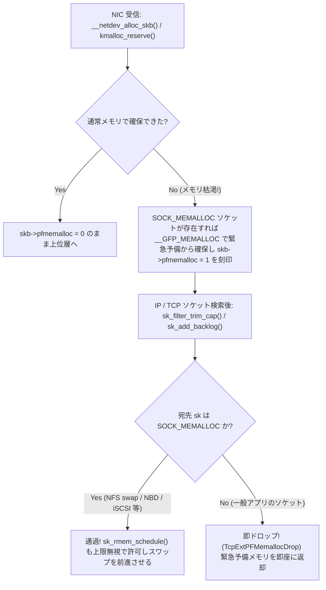

# `PF_MEMALLOC` / `pfmemalloc` / `SOCK_MEMALLOC` とは？

> **関連章**: [第 4 章: 送信 (2): `tcp_write_xmit` からワイヤまで](../04-write-xmit.md) / [第 5 章: 受信 (1): `tcp_v4_rcv` と `tcp_rcv_established`](../05-rcv-established.md) / [第 10 章: ウィンドウとメモリ管理](../10-window-memory.md)

## Q. 第 4 章・第 5 章・第 10 章に出てくる `pfmemalloc`（`PF_MEMALLOC` / `__GFP_MEMALLOC` / `SOCK_MEMALLOC`）って何ですか？

**`PF_MEMALLOC`**（**P**rocess **F**lag: **MEM**ory **ALLOC**ation）に由来する名前で、一言で言うと **「空きメモリを解放（reclaim / swap-out）するために、今まさにメモリを確保しなければならない処理だけに開放される『緊急予備メモリ（emergency memory reserves）』の仕組みと、そこから確保された `sk_buff` に付く目印（`skb->pfmemalloc`）」** です。

## なぜネットワーク（TCP）に緊急予備メモリが必要なのか？（ネットワーク越しのスワップとデッドロック）

スワップ領域やブロックデバイスがローカルディスクではなく、**ネットワークの先**（Swap over NFS、NBD、iSCSI、NVMe/TCP、あるいはそれらを運ぶ WireGuard トンネルなど）にあるマシンを想像してください。

1. マシンの空きメモリが枯渇すると、VM（メモリ管理サブシステム、`kswapd` や direct reclaim）はページを空けるために **汚れたページをネットワーク越しにスワップアウト（送信）** しようとします。
2. しかし、TCP でスワップデータを送るにも（`skb_clone()` など）、相手ストレージから **「書き込み完了＋TCP ACK」を受信する** にも（NIC ドライバでの受信ページ・ `sk_buff` 確保）、**新たなメモリ確保が必要** です。
3. もし空きメモリ枯渇時に「メモリがないから」と送信や ACK 受信のパケット確保が失敗（またはドロップ）してしまうと、
   **「ACK が受け取れないのでスワップアウトが完了しない → ページを解放できない → 空きメモリが増えないので一生 ACK も受け取れない」**
   という完全な **デッドロック** に陥ってしまいます。

## 4 つのフラグの役割分担

Linux は次の 4 つのフラグを連携させて、このデッドロックを防ぎつつ、無関係な一般ソケットに緊急予備メモリを食い潰されないようにしています。

| 名前 | 付く場所 | 役割 |
| --- | --- | --- |
| `PF_MEMALLOC` | `task_struct->flags`（[include/linux/sched.h#L1807](https://git.kernel.org/pub/scm/linux/kernel/git/netdev/net-next.git/tree/include/linux/sched.h?id=279d5c8afcd38bd841832a39bfe1aa4f8518d98e#n1807)） | メモリ回収（reclaim）中のタスク自身に立つフラグ。ページアロケータの水位制限（watermark）を無視して緊急予備メモリを使える |
| `__GFP_MEMALLOC` | `gfp_t`（メモリ確保フラグ） | タスクが `PF_MEMALLOC` でなくても（softirq などからでも）緊急予備メモリへのアクセスを許可する割り当てフラグ |
| `SOCK_MEMALLOC` | `struct sock` のフラグ（`sk_set_memalloc()`、[net/core/sock.c#L304](https://git.kernel.org/pub/scm/linux/kernel/git/netdev/net-next.git/tree/net/core/sock.c?id=279d5c8afcd38bd841832a39bfe1aa4f8518d98e#n304)） | NFS swap、NBD、iSCSI、NVMe/TCP などの「メモリ解放を支えるソケット」に付く特権フラグ。`sk->sk_allocation` に `__GFP_MEMALLOC` を足し、static key `memalloc_socks_key` を有効化する |
| `skb->pfmemalloc` | `struct sk_buff` の 1 ビットフラグ（[include/linux/skbuff.h#L967](https://git.kernel.org/pub/scm/linux/kernel/git/netdev/net-next.git/tree/include/linux/skbuff.h?id=279d5c8afcd38bd841832a39bfe1aa4f8518d98e#n967)） | **「この `sk_buff`（またはデータページ）は緊急予備メモリを切り崩して確保された非常食です」** という目印 |

## 受信パスでなぜ「先に確保してから後で捨てる」のか？

ここが一番面白い設計ポイントです。

NIC ドライバ（NAPI softirq）がパケットを受信して `__netdev_alloc_skb()`（[net/core/skbuff.c#L762](https://git.kernel.org/pub/scm/linux/kernel/git/netdev/net-next.git/tree/net/core/skbuff.c?id=279d5c8afcd38bd841832a39bfe1aa4f8518d98e#n762)）や `kmalloc_reserve()`（[net/core/skbuff.c#L607](https://git.kernel.org/pub/scm/linux/kernel/git/netdev/net-next.git/tree/net/core/skbuff.c?id=279d5c8afcd38bd841832a39bfe1aa4f8518d98e#n607)）を呼ぶ時点では、**まだパケットのヘッダ（IP アドレスや TCP ポート番号）を解析する前なので、そのパケットが「NFS スワップ用の大事な ACK」なのか「一般の HTTP サーバー宛ての無関係な通信」なのか見分けがつきません**。

そこで Linux は次の 2 段階で処理します。

1. **まず確保して刻印する**: システム上に `SOCK_MEMALLOC` ソケットが 1 つでもあれば（`sk_memalloc_socks()` が真）、通常割り当て（`__GFP_NOMEMALLOC`）に失敗したときだけ緊急予備メモリから確保し、`skb->pfmemalloc = 1`（ページ由来なら `page_is_pfmemalloc(page)` から伝播）を付けます。
2. **ソケット特定後に検問する（第 5 章・第 10 章）**:
   - TCP が宛先ソケット `sk` を見つけた直後、`sk_filter_trim_cap()`（[net/core/filter.c#L137](https://git.kernel.org/pub/scm/linux/kernel/git/netdev/net-next.git/tree/net/core/filter.c?id=279d5c8afcd38bd841832a39bfe1aa4f8518d98e#n137)）および `sk_add_backlog()`（[include/net/sock.h#L1163](https://git.kernel.org/pub/scm/linux/kernel/git/netdev/net-next.git/tree/include/net/sock.h?id=279d5c8afcd38bd841832a39bfe1aa4f8518d98e#n1163)）で `skb_pfmemalloc(skb) && !sock_flag(sk, SOCK_MEMALLOC)` を検査します。
   - **一般ソケットだった場合**: その場で即座にドロップ（MIB カウンタ `TcpExtPFMemallocDrop` を加算）して緊急予備メモリを回収します。
   - **`SOCK_MEMALLOC` ソケットだった場合**: 検問を通過させ、第 10 章の `__sk_rmem_schedule()`（[include/net/sock.h#L1590](https://git.kernel.org/pub/scm/linux/kernel/git/netdev/net-next.git/tree/include/net/sock.h?id=279d5c8afcd38bd841832a39bfe1aa4f8518d98e#n1590)）でも受信バッファ上限を超えて受け入れます。さらに backlog から処理する際（`__sk_backlog_rcv()`、[net/core/sock.c#L329](https://git.kernel.org/pub/scm/linux/kernel/git/netdev/net-next.git/tree/net/core/sock.c?id=279d5c8afcd38bd841832a39bfe1aa4f8518d98e#n329)）は `memalloc_noreclaim_save()` で一時的に `PF_MEMALLOC` を立て、ACK 処理中に再帰的なメモリ回収が走らないように守ります。

## 第 4 章の送信パスにある 2 箇所の意味

ここまで分かると、第 4 章（`04-write-xmit.md`）に出てきた 2 行の理由がすっきり繋がります。

- `__tcp_push_pending_frames()` の `sk_gfp_mask(sk, GFP_ATOMIC)`:
  送信ソケットが `SOCK_MEMALLOC` を持っていれば `GFP_ATOMIC | __GFP_MEMALLOC` に変換し、メモリ枯渇中でもスワップアウト送信用の `skb_clone()` が緊急予備メモリを使えるようにします。
- `__tcp_transmit_skb()`（[net/ipv4/tcp_output.c#L1536](https://git.kernel.org/pub/scm/linux/kernel/git/netdev/net-next.git/tree/net/ipv4/tcp_output.c?id=279d5c8afcd38bd841832a39bfe1aa4f8518d98e#n1536)）の **`skb->pfmemalloc = 0;`**:
  もし送信時に緊急予備メモリで確保したクローン `skb` に `skb->pfmemalloc = 1` が付いたまま loopback 経由で同一マシン内の別ソケット（たとえばローカルで動いている NBD / iSCSI ターゲットデーモンなど、`SOCK_MEMALLOC` を持たないユーザー空間ソケット）に折り返されると、受信側の検問で「一般ソケット宛ての `pfmemalloc` パケットだ！」と誤認されて全パケットがドロップしてしまいます。物理 NIC から外へ出るパケットにはそもそも `pfmemalloc` の印は不要なので、送信直前に必ず `0` にクリアしています。
