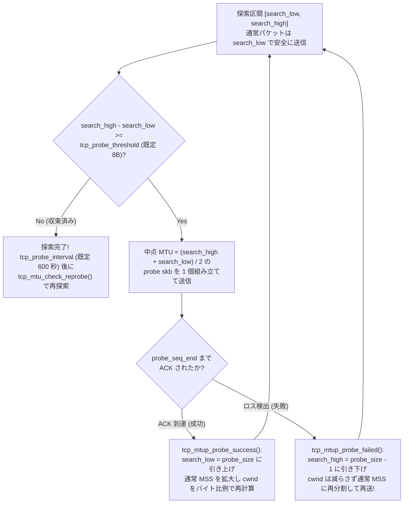

# MTU Probing（ `tcp_mtu_probe()` / PLPMTUD ）とは？

> **関連章**: [第 4 章: 送信 (2): `tcp_write_xmit` からワイヤまで](../04-write-xmit.md) / [第 7 章: ACK 処理と RTT 推定](../07-ack-processing.md) / [第 8 章: ロス検出と回復](../08-loss-recovery.md) / [第 9 章: タイマー](../09-timers.md)

## Q. 第 4 章の `tcp_write_xmit()` 冒頭に出てくる「 MTU probe（ `tcp_mtu_probe()` ）」って何ですか？

一言で言うと、**ICMP エラーに頼らずに TCP 自身が「わざと少し大きなお試しデータパケット（ probe ）」を送って ACK が返るか確かめることで、経路が通せる本当の最大パケットサイズ（ Path MTU ）を二分探索で見つけ出す仕組み** です。RFC では **PLPMTUD（ Packetization Layer Path MTU Discovery 、 [RFC 4821](https://www.rfc-editor.org/rfc/rfc4821) / [RFC 8899](https://www.rfc-editor.org/rfc/rfc8899) ）** と呼ばれます。

## なぜ古典的な Path MTU Discovery ではダメなのか？（ PMTU ブラックホール問題）

従来の **古典的 PMTUD（ [RFC 1191](https://www.rfc-editor.org/rfc/rfc1191) / [RFC 8201](https://www.rfc-editor.org/rfc/rfc8201) ）** は、IP ヘッダに `DF` （ Don't Fragment ：分割禁止）を立てて最初から最大サイズ（たとえば 1500 バイトや Jumbo Frame 9000 バイト）で送信し、途中の狭いリンク（ PPPoE や VPN トンネルで MTU 1400 バイトになっているルータなど）を通れなかったときにルータが返してくれる **ICMP `Fragmentation Needed` （ IPv4 ）や ICMPv6 `Packet Too Big`** を受け取ってサイズを下げます。

ところが現実のインターネットには、ファイアウォールの設定ミスなどで **ICMP パケットを一律に遮断してしまう経路** が存在します。すると次の現象が起きます。

1. **3-way handshake は成功する**: `SYN` / `SYN-ACK` は数十バイトの小さなパケットなので、狭いトンネルも難なく通過します。
2. **大きなデータ送信だけが無言で消える**: いざ 1500 バイトのフルサイズセグメントを送ると、途中のルータで捨てられるのに ICMP エラーが送信元まで届きません。
3. **通信が完全フリーズする（ PMTU ブラックホール）**: 送信元は「サイズが大きすぎる」ことに気づけないまま同じサイズで再送を繰り返してタイムアウトします。これを **PMTU Blackhole（ブラックホール）** と呼びます。

そこで PLPMTUD（ MTU Probing ）は、問題の発見を「ルータからの ICMP（逆方向の通知）」に頼るのをやめ、**「確実に通ると分かっている小さなサイズ（ `search_low` ）で普段の通信を流しつつ、時々もっと大きな probe パケットを混ぜて、相手から TCP ACK が返ってくるかどうか（順方向の到達確認）」** だけで安全な最大 MTU を探ります。

## `net.ipv4.tcp_mtu_probing` の 3 つのモード

ソケットごとの状態は `inet_csk(sk)->icsk_mtup` に保持され、sysctl `net.ipv4.tcp_mtu_probing` で動作モードを選びます。

| 設定値 | モード | 動き |
| --- | --- | --- |
| `0` （既定） | 無効 | `icsk_mtup.enabled = 0` のまま。第 4 章で `tcp_mtu_probe()` 冒頭の `if (likely(!icsk->icsk_mtup.enabled || ...))` に `likely()` が付いているのは、既定では常にここで即 return するからです |
| `1` | ブラックホール検知時のみ有効化 | 最初は無効（通常の PMTU で送信）。もし RTO（再送タイムアウト）が起きたら、第 9 章の `tcp_mtu_probing()` （ [net/ipv4/tcp_timer.c#L166](https://git.kernel.org/pub/scm/linux/kernel/git/netdev/net-next.git/tree/net/ipv4/tcp_timer.c?id=279d5c8afcd38bd841832a39bfe1aa4f8518d98e#n166) ）が「ブラックホールかもしれない」と判断して `enabled = 1` に切り替え、MSS を一旦 `tcp_base_mss` （既定 1024 バイト、さらに失敗すれば半分ずつ `tcp_mtu_probe_floor` まで縮小）へ落として通信を救出してから、二分探索で引き上げます |
| `2` | 常時有効 | コネクション確立時の `tcp_mtup_init()` （ [net/ipv4/tcp_output.c#L2042](https://git.kernel.org/pub/scm/linux/kernel/git/netdev/net-next.git/tree/net/ipv4/tcp_output.c?id=279d5c8afcd38bd841832a39bfe1aa4f8518d98e#n2042) ）から `enabled = 1` にし、最初から `tcp_base_mss` で安全に始めつつ二分探索で上限まで育てます |

## 二分探索のライフサイクル

`icsk_mtup` は探索区間 `[search_low, search_high]` （ MTU バイト単位）を持ちます。普段の通常セグメントの MSS（ `tp->mss_cache` ）は `tcp_sync_mss()` （ [net/ipv4/tcp_output.c#L2079](https://git.kernel.org/pub/scm/linux/kernel/git/netdev/net-next.git/tree/net/ipv4/tcp_output.c?id=279d5c8afcd38bd841832a39bfe1aa4f8518d98e#n2079) ）によって **`search_low` 以下** に制限されており、`tcp_mtu_probe()` （ [net/ipv4/tcp_output.c#L2692](https://git.kernel.org/pub/scm/linux/kernel/git/netdev/net-next.git/tree/net/ipv4/tcp_output.c?id=279d5c8afcd38bd841832a39bfe1aa4f8518d98e#n2692) ）だけが中点サイズのパケットを 1 個作って試します。

## 第 4 章の `tcp_mtu_probe()` で押さえておくべき 3 つの設計ポイント

この全体像を踏まえると、第 4 章のコードにあった細かな条件の意味がはっきり分かります。

1. **なぜ戻り値 `0` で「何も送らずに待つ」のか？**
   `tcp_mtu_probe()` は probe を撃ちたいのに現在の `cwnd` や送信ウィンドウの空きが足りないとき、`0` を返して `tcp_write_xmit()` ごと中断させます。もしここで妥協して「空いている 1 MSS 分だけ通常セグメントを送る」ことを許すと、ACK が返るたびにまた小パケットで枠を埋めてしまい、**2 パケット分の大きさを持つ probe パケットを作る隙間がいつまで経っても空かない** からです（ただし in-flight が `0` のときはデッドロックしないよう `-1` を返して通常送信に進みます）。
2. **なぜ `size_needed = probe_size + (tp->reordering + 1) * tp->mss_cache` もの未送信データが必要なのか？（ `reordering + 1` の意味）**
   - `tp->reordering` は **Fast Retransmit （高速再送）を発動するのに必要な DupACK / SACK パケット数（ RFC 5681 の `DupThresh` ）** で、初期値は `net.ipv4.tcp_reordering = 3` です（通信中に実際の順序逆転が観測されると動的に増えます）。もし送信キューの末尾ギリギリで probe パケットだけを単発で送り、それが MTU 超過で途中のルータに無言ドロップされたら、後続パケットがないため **数百 ms の RTO タイムアウトまで失敗に気づけません**。
   - ではなぜ `tp->reordering` 個（ `3` 個）ではなく **`+ 1` （初期値なら `4` MSS 分）** なのかというと、 `tcp_mtu_probe()` がパケット数ではなく **未送信バイト数（ `write_seq - snd_nxt` ）** で判定しているからです（コミット `91cc17c0e5e5` ）。もし `+ 1` が無く、残りバイト数が `3 * mss_cache` ギリギリ（または `FIN` の 1 シーケンス番号を含んで実データが `3 * mss_cache - 1` バイトなど）だった場合、最後の 1 セグメントが **1 MSS 未満の端数** になって **Nagle アルゴリズムや `TCP_CORK` 等で送信保留** されてしまい、実際にワイヤへ出る後続パケットが 2 個に減って Fast Retransmit が発動しなくなる恐れがあります。 `(tp->reordering + 1) * mss_cache` 以上のバイト数を要求しておけば、たとえ末尾の端数が送信保留されても **確実にフルサイズの通常セグメントを `tp->reordering` 個（ 3 個）ワイヤへ送り出し、 DupACK / SACK で 1 RTT で失敗を検出** できます。
3. **なぜ送信成功時に `packets_out` を `+ 2` せず `cwnd` を `- 1` するのか？ そしてロス時に `cwnd` を半減しない理由は？**
   - **送信時（ `tcp_transmit_skb()` が `0` を返したとき）**: 通常の TSO skb なら 2 MSS 分のデータに対して `pcount = 2` （ `gso_segs = 2` ）を設定し、 `tcp_event_new_data_sent()` で `packets_out += 2` します。しかし **MTU probe で `pcount = 2` にしてしまうと、下位層の GSO / TSO が親切にも元の小さい `mss_now` サイズ 2 個に分割してしまい、大きな MTU のテストになりません**。そのため `tcp_init_tso_segs(nskb, nskb->len)` は第 2 引数に `nskb->len` 自身を渡して強制的に **`pcount = 1` （分割禁止の巨大な 1 パケット）** にします。すると `tcp_event_new_data_sent()` では実質約 2 MSS 分のバイト数を送り出したのに `packets_out` が **`+ 1`** しか増えません。そのままでは `cwnd - in_flight` の空き枠が 1 パケット分余って送信しすぎてしまうため、 **`packets_out` を `+ 1` 増やしつつ `snd_cwnd` の方を一時的に `- 1` 減らす** ことで、差し引き **2 パケット分の `cwnd` 枠を消費したことに帳尻を合わせています**。
   - **失敗時**: 第 8 章の `tcp_fastretrans_alert()` （ [net/ipv4/tcp_input.c#L3425](https://git.kernel.org/pub/scm/linux/kernel/git/netdev/net-next.git/tree/net/ipv4/tcp_input.c?id=279d5c8afcd38bd841832a39bfe1aa4f8518d98e#n3425) ）で `snd_una == tp->mtu_probe.probe_seq_start` のロスを見つけると、それは **「ネットワークが混雑していたせいではなく、probe が大きすぎたせい」** と分かるため、`tcp_enter_recovery()` （ `cwnd` 削減）には入らず `tcp_mtup_probe_failed()` （ [net/ipv4/tcp_input.c#L3074](https://git.kernel.org/pub/scm/linux/kernel/git/netdev/net-next.git/tree/net/ipv4/tcp_input.c?id=279d5c8afcd38bd841832a39bfe1aa4f8518d98e#n3074) ）で `search_high = probe_size - 1` に下げ、減らしていた `cwnd` を `+ 1` で元に戻してから `tcp_simple_retransmit()` で小さい通常 MSS に切り直して再送します（ MIB カウンタ `TCPMTUPFail` ）。
   - **成功時**: 第 7 章の `tcp_clean_rtx_queue()` （ [net/ipv4/tcp_input.c#L3739](https://git.kernel.org/pub/scm/linux/kernel/git/netdev/net-next.git/tree/net/ipv4/tcp_input.c?id=279d5c8afcd38bd841832a39bfe1aa4f8518d98e#n3739) ）で `probe_seq_end` までの ACK を確認すると、`tcp_mtup_probe_success()` （ [net/ipv4/tcp_input.c#L3083](https://git.kernel.org/pub/scm/linux/kernel/git/netdev/net-next.git/tree/net/ipv4/tcp_input.c?id=279d5c8afcd38bd841832a39bfe1aa4f8518d98e#n3083) ）が `search_low = probe_size` に引き上げて通常 MSS を拡大します（ MIB カウンタ `TCPMTUPSuccess` ）。このとき 1 パケットあたりのバイト数が大きくなるため、インフライトの総バイト数が急増しないよう `cwnd = cwnd * old_mtu / probe_size` とパケット数ベースの `cwnd` を比例縮小します。
