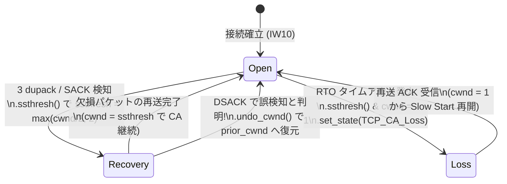

# トラック 1: TCP Reno ハンズオン — すべての輻輳制御の原点

[English](README.en.md)

このトラックでは、現代のすべての TCP 輻輳制御アルゴリズムの原点である **TCP Reno（RFC 5681）** を、Linux カーネルの BPF `struct_ops`（`struct tcp_congestion_ops`）を使ってゼロから実装します。

Reno や CUBIC の知識は前提としません。まずは「そもそもなぜ輻輳制御が必要なのか」「Reno はどのような仕組みでネットワークの空き容量を探しているのか」を第一原理から整理しましょう。

---

## 1. そもそも輻輳制御（Congestion Control）とは何か？

TCP でデータを送るとき、送信側が「いま確認応答（ACK）を待たずにネットワークへ送り出せる最大量（In-Flight パケット数の上限）」を決める仕組みには、実は **2 つの異なるブレーキ** があります。

| ブレーキの種類 | カーネル変数 (`struct tcp_sock`) | 何を守るための限界か？ | 誰が決めるか？ |
| :--- | :--- | :--- | :--- |
| **フロー制御（Flow Control）** | `snd_wnd` | **受信側の部屋（受信バッファ）** が溢れないようにする限界 | 受信側が計算し、TCP ヘッダの Window フィールドで毎パケット通知する |
| **輻輳制御（Congestion Control）** | `snd_cwnd` | **途中の道路（ルータやスイッチのキュー）** が渋滞・パンクしないようにする限界 | 送信側が ACK の返り方やパケットロスを手がかりに **自分で推定する** |

いくら受信側のサーバが巨大なメモリ（大きな `snd_wnd`）を持っていたとしても、途中のルータの回線容量を超えてパケットを一気に流し込めば、ルータのバッファが溢れて大量のパケットロス（輻輳崩壊：Congestion Collapse）が発生します。逆に、途中の道路がどれだけ空いていても（大きな `snd_cwnd`）、受信側のアプリがデータを読み出すのが遅ければ `snd_wnd` で止める必要があります。

そのため、TCP の送信側は常に **2 つのウィンドウの小さい方** で送信量を抑えます。

$$\text{送信可能な上限 (In-Flight 上限)} = \min(\text{snd}_{\text{cwnd}}, \text{snd}_{\text{wnd}})$$

問題は、**途中のルータが「いま道路がどれくらい空いているか」を直接教えてはくれない** ということです。そこで送信側が「少しずつ送る量を増やして道路の限界を探り、パケットが落ちたら減速する」という試行錯誤を行うアルゴリズムが **輻輳制御（Congestion Control）** です。

---

## 2. Reno の基本原理：AIMD（Additive Increase / Multiplicative Decrease）

1980 年代後半に Van Jacobson によって確立された TCP Reno の核心は、**AIMD（加算的増加・乗算的減少）** というシンプルなルールです。

- **Additive Increase（足し算で増やす）**: パケットが落ちずに ACK が返ってくる間は、1 往復（1 RTT）ごとに `snd_cwnd` を **`+1` パケットずつ** じわじわ増やします。
- **Multiplicative Decrease（掛け算で減らす）**: パケットロスを検知したら、「道路の容量を超えた」と判断し、`snd_cwnd` を一気に **半分（`× 1/2`）** に減らします。

### なぜ「足し算で増やし、掛け算で減らす」と公平になるのか？

もし増やすときも減らすときも「足し算・引き算（AIAD）」だったらどうなるでしょうか？
たとえば容量 30 パケットのボトルネック回線を、先行していたフロー A（`cwnd = 24`）と後から来たフロー B（`cwnd = 6`）が共有しているとします。

- もし両方とも「1 RTT ごとに `+1` 増やし、ロスしたら `-5` 減らす」というルールだと、2 つのフローの差（ $24 - 6 = 18$ ）はいつまで経っても縮まりません。
- しかし **「減らすときは半分（`× 1/2`）にする」** という掛け算（Multiplicative Decrease）にすると、ロスした瞬間にフロー A は `24 → 12`（`-12`）と大きく譲るのに対し、フロー B は `6 → 3`（`-3`）しか減りません。差が一気に `18 → 9` に半減します。
- その後、両方とも同じペース（`+1 / RTT`）で足し算していくため、ノコギリの歯のように増減を繰り返すうちに、2 つのフローは自動的に `15 : 15` の **完全な公平（Fairness）** へと収束します。

```text
snd_cwnd (パケット数)
  ^
  |        /\              /\              /\          <-- ボトルネック限界 + バッファ上限
  |       /  \            /  \            /  \             (ここでパケットロス発生！)
  |      /    \          /    \          /    \
  |     /      \        /      \        /      \       Additive Increase (+1 / RTT)
  |    /        \      /        \      /        \      & Multiplicative Decrease (× 1/2)
  |   /          \    /          \    /          \
  |  /            \  /            \  /            \    <-- ssthresh = cwnd / 2
  | /              \/              \/              \
  +----------------------------------------------------> 時間 (RTT)
  [Slow] [------- Congestion Avoidance (AIMD) -------]
  [Start]
```

この特徴的なギザギザの波形を **TCP のノコギリ波（Sawtooth）** と呼びます。

---

## 3. 2 つの増加フェーズと `snd_ssthresh` の役割

とはいえ、最初から最後まで「1 RTT ごとに `+1`」の足し算だけで増やしていると、高速な回線（たとえば `cwnd = 10,000` が必要な回線）で空き帯域を使い切るまでに何千往復もの時間がかかってしまいます。

そこで Reno は、**スロースタート閾値 `snd_ssthresh`（Slow Start Threshold）** という境界線を設け、ウィンドウの増やし方を 2 段階に分けています。

### フェーズ 1：Slow Start（スロースタート：`snd_cwnd < snd_ssthresh`）

- コネクション確立直後、`snd_cwnd` は初期ウィンドウ **IW10（10 パケット）** からスタートし、`snd_ssthresh` は無限大（`TCP_INFINITE_SSTHRESH`）に設定されています。
- `snd_cwnd < snd_ssthresh` の間は、**「1 パケット分 ACK されるごとに `snd_cwnd` を `+1` する」** という急加速モードで動きます。
- 10 パケット送って 10 個すべて ACK されると `snd_cwnd` は `+10` されて `20` になります。次の RTT では `20 → 40`、その次は `40 → 80` と、**1 RTT ごとに倍々（指数関数的）** に増え、空き帯域の限界付近まで一気に駆け上がります。
  - ※「Slow Start」という名前は、「いきなり最大速度で送るのではなく 10 パケットから始める」という意味で付けられた歴史的な名称ですが、増加ペース自体は指数関数的で非常に速いフェーズです。

### フェーズ 2：Congestion Avoidance（輻輳回避：`snd_cwnd >= snd_ssthresh`）

- 一度パケットロスを経験して `snd_ssthresh` が「前回の限界の半分」に設定された後、`snd_cwnd` がその `snd_ssthresh` 以上（`snd_cwnd >= snd_ssthresh`）に達したら、そこからは限界が近い危険地帯です。
- 倍々ゲームをやめ、**「1 RTT（`snd_cwnd` パケット分の ACK）ごとに `snd_cwnd` を `+1` する」** という直線的な増加（Additive Increase）に切り替えます。
- **Linux カーネルでの整数計算の工夫（`tp->snd_cwnd_cnt`）**:
  - カーネル内（および BPF プログラム内）では浮動小数点（`float`）が使えないため、「1 パケット ACK されるごとに `1 / snd_cwnd` を足す」という小数の足し算ができません。
  - そこで Linux は、`struct tcp_sock` の中にある端数バケツ **`tp->snd_cwnd_cnt`** に ACK されたパケット数 `acked` を足していき、バケツが満杯（`tp->snd_cwnd_cnt >= tp->snd_cwnd`）になったら `tp->snd_cwnd` を `+1` してバケツから `tp->snd_cwnd` を引く、という仕組みで「1 RTT あたり `+1`」を正確に実現しています。

---

## 4. パケットロスへの反応と Undo（誤検知からの復元）

パケットが落ちた（あるいは落ちたと疑われる）とき、Linux の TCP コアは輻輳制御アルゴリズムのフック関数を呼び出して相談します。



1. **Fast Recovery（`TCP_CA_Recovery`）— 軽い渋滞**:
   - 3 回の重複 ACK（3 dupack）や SACK（Selective ACK）によって「途中のパケットが抜けたが、後続のパケットは届いている」と検知したとき、TCP コアは `TCP_CA_Recovery` に遷移します。
   - このとき BPF CC の **`.ssthresh(sk)`** フックが呼ばれ、Reno は `max(tp->snd_cwnd / 2, 2)` を返して `snd_ssthresh` を半減させます（ウィンドウ自体も Recovery を抜けるまでにこの `snd_ssthresh` まで縮小します）。
2. **RTO タイムアウト（`TCP_CA_Loss`）— 深刻な渋滞**:
   - ACK がまったく返ってこなくなり再送タイムアウト（RTO）が発火したときは、道路が完全に詰まったと判断して `TCP_CA_Loss` に遷移します。
   - `.ssthresh(sk)` で閾値を半減させたうえで、**`snd_cwnd = 1`** にリセットし、`1` パケットから再び Slow Start をやり直します。このとき **`.set_state(sk, TCP_CA_Loss)`** フックが呼ばれるため、Congestion Avoidance 中に貯めていた端数バケツ `tp->snd_cwnd_cnt` を `0` にクリアします。
3. **Spurious Retransmission と `.undo_cwnd(sk)` — 勘違いの取り消し**:
   - インターネットでは、パケットが消えたのではなく **「ルータの経路切り替えなどで到着順序が入れ替わった（Reordering）だけ」** なのに、3 dupack が発生して Fast Recovery に入り、ウィンドウを半分に減らしてしまうことがあります。
   - 直後に受信側から **DSACK（Duplicate SACK：同じパケットが 2 回届いたという報告）** が返ってくると、TCP コアは「さっきの再送とウィンドウ半減は勘違い（Spurious Retransmission）だった！」と気づきます。
   - すると TCP コアは **`.undo_cwnd(sk)`** フックを呼び出し、ロス検知前に退避しておいた元のウィンドウサイズ（`prior_cwnd` / `loss_cwnd`）へ `snd_cwnd` を即座に復元します。

---

## 5. なぜ最初に Reno を作り、その次に CUBIC に進むのか？

「いまの Linux のデフォルトは CUBIC なのに、なぜわざわざ Reno から作るの？」と思うかもしれません。理由は **2 つ** あります。

### 理由 1：`struct tcp_sock` 自体が Reno のために設計されているから

Linux の TCP スタックは歴史的に Reno をベースに作られたため、Reno に必要な 4 つの変数（`snd_cwnd`、`snd_ssthresh`、`snd_cwnd_cnt`、`prior_cwnd`）は、すべて最初から **`struct tcp_sock` 本体のフィールドとして埋め込まれています**。
そのため、Reno を書くと「TCP コアがどの変数をどう読み書きしているか」という土台が最もシンプルな形で理解できます。

### 理由 2：CUBIC は Reno の「2 箇所」を差し替えた進化形だから

次のトラック（Track 2）で実装する **CUBIC** は、実はゼロから別物を作っているわけではありません。Reno と CUBIC を比較すると、骨格は驚くほど共通しています。

| 要素 | Track 1: TCP Reno | Track 2: TCP CUBIC |
| :--- | :--- | :--- |
| **使う BPF フック** | `.init`, `.ssthresh`, `.cong_avoid`, `.set_state`, `.undo_cwnd` | **まったく同じ**（＋ HyStart 用の `.cwnd_event`, `.pkts_acked`） |
| **Slow Start の動き** | 1 ACK ごとに `+1`（指数増加） | **Reno と同じ**（＋ HyStart による早期終了判定） |
| **ロス時の減衰（`.ssthresh`）** | `0.5` 倍（`cwnd / 2`）に減らす | **`0.7` 倍**（`cwnd * 717 / 1024`）に減らす |
| **Congestion Avoidance（`.cong_avoid`）** | **直線**（1 RTT ごとに `+1`）で増やす | 前回の最大値 $W_{\max}$ を目指す **3 次関数（Cubic 曲線）** で増やす |
| **Undo（`.undo_cwnd`）** | `max(snd_cwnd, loss_cwnd)` で復元 | **まったく同じ**（`max(snd_cwnd, loss_cwnd)`） |

つまり、このトラックの 2 ステップで Reno を完成させてしまえば、**BPF 輻輳制御のフックの仕組みと、次の CUBIC の土台の 8 割が一気に手に入る** のです。

---

## 6. ステップ一覧と実行コマンド

このトラックは以下の 2 ステップで構成されています。

| ステップ | ディレクトリ | 実装する内容 |
| :--- | :--- | :--- |
| **Step 1** | [`step01-slow-start-ai/`](step01-slow-start-ai/README.md) | 最小の BPF CC 骨格（`.init`, `.ssthresh`, `.cong_avoid`, `.undo_cwnd`）と、Slow Start から Reno Additive Increase への境界遷移を実装します。 |
| **Step 2** | [`step02-loss-undo/`](step02-loss-undo/README.md) | ソケット私有領域 `inet_csk_ca(sk)`（`icsk_ca_priv`）を使ったカスタム構造体管理、Fast Recovery / RTO Loss 時の状態遷移（`.set_state`）、および DSACK による `.undo_cwnd` 復元を実装します。 |

### 実行コマンド

`labs/` ディレクトリ（`/usr/local/google/home/kuniyu/tcp-eli5/labs`）から `run_test.sh` を使って各ステップをビルド・検証できます。

```sh
# Step 1: まず starter が失敗することを確認し、TODO を実装してテストする
./run_test.sh 01-reno/step01-slow-start-ai starter
# Step 1 の模範解答 (solution.bpf.c) を実行する
./run_test.sh 01-reno/step01-slow-start-ai solution

# Step 2: starter の確認と模範解答の実行
./run_test.sh 01-reno/step02-loss-undo starter
./run_test.sh 01-reno/step02-loss-undo solution
```

それでは、[`step01-slow-start-ai/README.md`](step01-slow-start-ai/README.md) に進んで最初の BPF 輻輳制御アルゴリズムを書いてみましょう！
