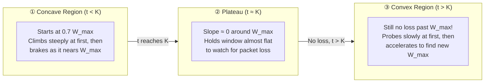
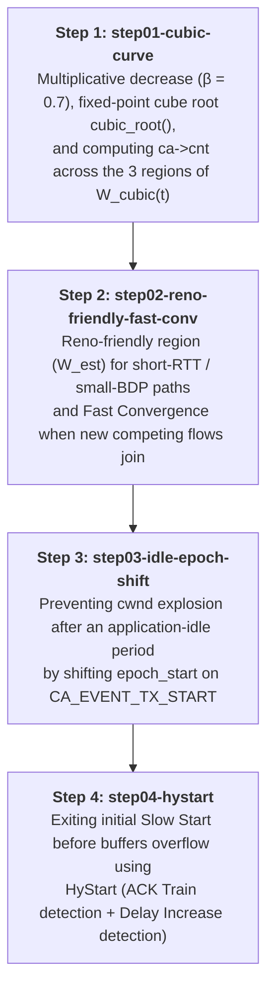

# Track 2: TCP CUBIC Hands-on — Mastering High-BDP Networks with a Cubic Function

In Track 1 (TCP Reno), you built the foundations of congestion control from scratch in BPF: **Slow Start (exponential growth)**, **AIMD (Additive Increase / Multiplicative Decrease: $+1$ segment per RTT, halving on loss)**, and **Loss Undo** to recover from spurious congestion events.

However, the default congestion control algorithm running in the Linux kernel across modern data centres and the Internet is not Reno — it is **CUBIC** ([RFC 9438](https://www.rfc-editor.org/rfc/rfc9438), `net/ipv4/tcp_cubic.c`).
In this track, you will first see with concrete numbers why Reno collapses on high-speed, long-distance networks. Then, step by step, you will build CUBIC's **cubic window growth curve** and the **four mechanisms (Steps 1–4)** that make it production-ready using BPF `struct_ops` and `packetdrill`.

---

## 1. Why Reno Fails on Long Fat Networks (LFNs)

TCP Reno's AIMD rule — increasing `cwnd` by $+1$ packet per RTT and cutting it by $0.5\times$ on a loss — worked admirably on the low-speed links of the 1980s and 1990s. Once link capacities scaled to gigabits per second, however, Reno hit two fatal walls.

### Wall 1: Recovering from a Single Packet Loss Takes 69 Minutes

Let's work through a concrete example on a **Long Fat Network (LFN)** — a path with both high bandwidth and long round-trip delay:

- **Link bandwidth**: $10\text{ Gbps}$ ($= 10 \times 10^9\text{ bits/s}$)
- **Round-Trip Time (RTT)**: $100\text{ ms}$ ($= 0.1\text{ s}$, e.g. a transoceanic or transcontinental optical fibre link)
- **Packet size**: $1,500\text{ Bytes} = 12,000\text{ bits}$

The number of in-flight packets required to keep this pipe completely full — its **Bandwidth-Delay Product (BDP)** — is:

$$\text{BDP} = \frac{10 \times 10^9\text{ bits/s} \times 0.1\text{ s}}{12,000\text{ bits/packet}} \approx 83,333\text{ packets (approx. }83,000\text{ packets)}$$

In other words, the sender must sustain `cwnd = 83,000` packets just to utilise 100% of the $10\text{ Gbps}$ pipe.

Now suppose Reno is cruising at `cwnd = 83,000` and suffers **a single packet loss**. What happens next?

1. **Multiplicative Decrease (halving)**: Reno cuts `cwnd` in half on a loss, dropping `cwnd` immediately from $83,000$ to $41,500$ packets.
2. **Additive Increase ($+1$ packet per RTT)**: Once Fast Recovery finishes and Congestion Avoidance begins, Reno can only grow `cwnd` by **1 packet per RTT ($0.1\text{ s}$)** — just $10$ packets per second.
3. **Time required to recover**: To climb back up by the $41,500$ packets it lost and return to $83,000$ packets, Reno needs:

$$41,500\text{ RTTs} \times 0.1\text{ s/RTT} = 4,150\text{ seconds} \approx \mathbf{69\text{ minutes }10\text{ seconds!}}$$

Dropping **just one packet** forces Reno to spend **over an hour (approx. 69 minutes)** crawling back to full link speed. Worse still, if even a single random bit error or transient micro-burst drops another packet during those 69 minutes, `cwnd` is slashed in half all over again. As a result, a $10\text{ Gbps}$ link running Reno often achieves only a few megabits per second in practice.

### Wall 2: Severe RTT Unfairness (Short-RTT Flows Starve Long-RTT Flows)

Reno's second flaw is that its Congestion Avoidance growth rate is clocked by **arriving ACKs (once per RTT)**.

Imagine two flows sharing the exact same bottleneck router:

- **Flow A (short-distance)**: $\text{RTT} = 10\text{ ms}$ ($100\text{ RTTs}$ per second) $\rightarrow$ grows `cwnd` by **`+100` packets per second**.
- **Flow B (long-distance)**: $\text{RTT} = 100\text{ ms}$ ($10\text{ RTTs}$ per second) $\rightarrow$ grows `cwnd` by only **`+10` packets per second**.

After both flows experience a packet loss at the bottleneck, short-distance Flow A expands its window **10 times faster** than long-distance Flow B and hogs the bottleneck bandwidth. This structural bias against long-distance connections is known as **RTT unfairness**.

---

## 2. The Two Core Ideas of CUBIC

**CUBIC** was designed to shatter both walls at once — recovering rapidly on high-BDP paths while treating flows of different RTTs fairly. Its design rests on two core ideas.

### Idea 1: Reduce `cwnd` to $\beta = 0.7\times$ Instead of $0.5\times$ on Loss

Emptying half the pipe on every loss event is far too drastic on a high-BDP link.
CUBIC raises the multiplicative decrease factor $\beta$ from $0.5$ to **$0.7$ (a 30% reduction, retaining 70% of the window)**:

- Because floating-point arithmetic cannot be used inside the Linux kernel (`net/ipv4/tcp_cubic.c`) or BPF programs, Linux expresses $\beta$ in fixed-point with a denominator of $2^{10} = 1024$ (`BICTCP_BETA_SCALE = 1024`) and numerator `beta = 717`:
  $$\beta = \frac{717}{1024} \approx 0.7002$$
- Retaining 70% of `cwnd` immediately keeps the pipe much fuller after a loss event.

### Idea 2: Make the Window a Cubic Function of Elapsed Time $t$ Since the Last Loss

CUBIC's defining invention is to replace ACK-counted linear growth with a **cubic function of the wall-clock time $t$ elapsed since the start of the current Congestion Avoidance epoch**:

$$W_{\text{cubic}}(t) = C(t - K)^3 + W_{\max}$$

Let's examine every symbol in this formula from first principles:

- **$W_{\max}$ (`ca->last_max_cwnd` in code)**: **The `cwnd` right when the previous packet loss occurred.**
  - A packet loss tells us something crucial: *"`cwnd` reached $W_{\max}$, and that was the ceiling where the bottleneck pipe overflowed."* Reno throws this information away after halving `cwnd`. CUBIC **remembers $W_{\max}$ as its target ceiling** and centres the inflection point of its cubic curve right at $W_{\max}$.
- **$t$**: **Elapsed wall-clock time** since exiting loss recovery and entering the current Congestion Avoidance epoch (measured in seconds in the RFC, and in `BICTCP_HZ` units where $1\text{ s} = 2^{10} = 1024$ inside the kernel).
- **$C$**: The scaling constant controlling how aggressively the cubic curve bends, set to **$C = 0.4\text{ packets/s}^3$** (`410 / 1024 ≈ 0.4004` in fixed-point).
- **$K$ (`ca->bic_K` in code)**: **The time it takes for $W_{\text{cubic}}(t)$ starting from $\beta W_{\max}$ ($= 0.7 W_{\max}$) at $t = 0$ to climb back to $W_{\max}$.**
  - Setting $W_{\text{cubic}}(0) = \beta W_{\max}$ at $t = 0$ and solving for $K$ yields the cube root formula:
    $$C(0 - K)^3 + W_{\max} = \beta W_{\max} \implies K = \sqrt[3]{\frac{W_{\max}(1 - \beta)}{C}}$$
  - (More generally, if the epoch starts at window $\text{cwnd}_{\text{epoch}}$, then $K = \sqrt[3]{\frac{W_{\max} - \text{cwnd}_{\text{epoch}}}{C}}$.)

Let's plug our earlier $10\text{ Gbps}$, $100\text{ ms}$ RTT example ($W_{\max} = 83,000$) into this formula:

$$K = \sqrt[3]{\frac{83,000 \times (1 - 0.7)}{0.4}} = \sqrt[3]{62,250} \approx \mathbf{39.6\text{ seconds}}$$

Where Reno needed **69 minutes (4,150 seconds)** to recover from a single loss, CUBIC climbs back to $83,000$ packets in **under 40 seconds — over 100 times faster!**
Better yet, because $t$ is real wall-clock time rather than an ACK counter, a flow with a $10\text{ ms}$ RTT and a flow with a $100\text{ ms}$ RTT sharing the same $W_{\max}$ trace the exact same $W_{\text{cubic}}(t)$ curve over time, dramatically improving **RTT fairness**.

---

## 3. The Three Regions of the Cubic Curve and Converting to `ca->cnt`

Why choose a **cubic function $(t - K)^3$** instead of a quadratic or exponential curve?
Because a cubic polynomial naturally creates **three distinct behavioural regions** around its inflection point $(t = K,\ W = W_{\max})$ using a single formula: **rapid recovery $\rightarrow$ cautious plateau $\rightarrow$ accelerated probing**.

```text
  cwnd (W_cubic(t))
   ^
   |                                                  /  (3) Convex / Probing Region
   |                                                 /       t > K:
   |                                                /        No loss occurred at W_max, so
   |                                               /         extra bandwidth exists — accelerate!
   |                            (2) Plateau       /
   |                             (t ≈ K)         /
W_max - - - - - - - - - - - - - - -.- - - - - - -    <-- Previous overflow ceiling (last_max_cwnd)
   |                    . '
   |                . '   Near the danger zone W_max, the slope drops
   |             . '      to ~0, holding cwnd steady to test for loss
   |           .'
   |         .'   (1) Concave Region (t < K)
   |        /         Starts at 0.7 * W_max. Leaps upward quickly at first,
   |       /          then brakes progressively as it nears W_max
0.7*W_max +
   |
   +-------------------------------------------------------------> Elapsed time t
   0                               K
```



### ① Concave Region ($t < K$)
- Covers the recovery climb from $0.7 W_{\max}$ back towards the previous high-water mark $W_{\max}$.
- When $t$ is small (far from $K$), $|t - K|^3$ has a steep slope, so CUBIC takes large steps to reclaim unused bandwidth quickly.
- As `cwnd` approaches the known danger zone $W_{\max}$, the slope of $(t - K)^3$ flattens out automatically, applying the brakes for a smooth, cautious landing at $W_{\max}$.

### ② Plateau ($t \approx K$)
- Right around $t = K$, $(t - K)^3 \approx 0$ and the derivative of the cubic curve vanishes, forming a flat plateau at $W_{\max}$.
- CUBIC holds `cwnd` nearly constant at the exact ceiling where the pipe overflowed last time, quietly observing whether the network can sustain $W_{\max}$ without dropping packets. If available capacity has not changed, the flow maximises throughput while avoiding unnecessary self-induced losses.

### ③ Convex / Max Probing Region ($t > K$)
- If the flow cruises through the plateau at $W_{\max}$ without losing a packet, network conditions must have improved (for instance, a competing flow finished).
- Once $t > K$, $(t - K)^3$ turns positive. CUBIC starts probing upward in tiny, careful increments near $t \approx K$, and if still no loss occurs, accelerates rapidly as $(t - K)^3$ grows to discover the new ceiling (**Max Probing**).

### Converting $W_{\text{cubic}}(t)$ into `ca->cnt` in Fixed-Point Arithmetic

While the mathematical equation computes a target window size $W_{\text{cubic}}(t)$, the Linux kernel's congestion control framework (`tcp_cong_avoid_ai(tp, w, acked)`) does not overwrite `tp->snd_cwnd` directly with $W_{\text{cubic}}(t)$. Instead, it paces window increments smoothly using **`ca->cnt` — the number of ACKed segments required before `tp->snd_cwnd` is incremented by $+1$**.

On each incoming ACK in Congestion Avoidance, `bictcp_update()` translates the cubic curve into `ca->cnt` in three steps:

1. **Look ahead 1 RTT to compute `bic_target`**:
   Add the connection's minimum RTT (`ca->delay_min`) to the elapsed time since `ca->epoch_start` ($t = \text{now} - \text{epoch}_{\text{start}} + \text{delay}_{\min}$) and evaluate $W_{\text{cubic}}(t)$. This gives **`bic_target`**, the window size CUBIC wants to reach **one RTT from now**.
2. **Convert the desired 1-RTT window gain into an ACK interval `ca->cnt`**:
   Over the next RTT, roughly `cwnd` segments will be acknowledged. To grow the window from `cwnd` to `bic_target` over those `cwnd` ACKs, we need `bic_target - cwnd` increments of $+1$:
   - **When `bic_target > cwnd`**:
     $$\text{ca}\to\text{cnt} = \frac{\text{cwnd}}{\text{bic}_{\text{target}} - \text{cwnd}}$$
     For example, if `cwnd = 100` and `bic_target = 110` ($+10$ segments wanted over the next RTT), then `ca->cnt = 100 / (110 - 100) = 10`. Incrementing `snd_cwnd` by $+1$ every $10$ ACKed segments yields $+10$ segments after $100$ ACKs (1 RTT).
   - **When `bic_target <= cwnd` (at the plateau)**:
     No immediate growth is needed, so CUBIC sets `ca->cnt = 100 * cwnd` (requiring 100 full RTTs just to gain $+1$ segment), effectively freezing window growth.
   - **Safety lower bound**:
     Finally, `ca->cnt = max(ca->cnt, 2U)` clamps the interval so `cwnd` never grows faster than $+1$ per $2$ ACKs ($+0.5 \times \text{cwnd}$ per RTT) during Congestion Avoidance.
3. **Pass `ca->cnt` to `tcp_cong_avoid_ai(tp, ca->cnt, acked)`**:
   Just as in Reno, `tp->snd_cwnd_cnt` accumulates `acked` credits, and whenever `tp->snd_cwnd_cnt >= ca->cnt`, the kernel subtracts `ca->cnt` and increments `tp->snd_cwnd` by $+1$.

---

## 4. The Four Pillars that Make CUBIC Production-Ready (Overview of Steps 1–4)

The pure cubic curve $W_{\text{cubic}}(t) = C(t - K)^3 + W_{\max}$ is elegant, but deploying it across the real Internet — from sub-millisecond LANs to heavily contested bottlenecks, bursty web applications, and fresh connections — requires **three essential safeguards plus HyStart**.

Across the four steps of this track, you will implement each mechanism in turn until you have a complete BPF implementation matching Linux's `net/ipv4/tcp_cubic.c`.



| Step | Directory | Problem Solved | Core Mechanism Implemented |
| --- | --- | --- | --- |
| **Step 1** | `step01-cubic-curve` | Hour-long recovery on LFNs and RTT unfairness | $\beta = 0.7$ (`717/1024`), integer cube root `cubic_root()`, and `ca->cnt` from $W_{\text{cubic}}(t)$ |
| **Step 2** | `step02-reno-friendly-fast-conv` | Underperforming Reno on short-RTT paths, and slow convergence when new flows join | Parallel linear estimate $W_{\text{est}}$ (`ca->tcp_cwnd`) and Fast Convergence ($\approx 0.85\times$ when `cwnd < last_max_cwnd`) |
| **Step 3** | `step03-idle-epoch-shift` | `cwnd` exploding after an idle pause because elapsed time $t$ kept ticking | Shifting `ca->epoch_start += delta` in `.cwnd_event_tx_start` (`CA_EVENT_TX_START`) |
| **Step 4** | `step04-hystart` | Initial Slow Start overshooting BDP by up to $2\times$ and causing massive burst losses | **HyStart** in `.pkts_acked` (ACK Train + Delay Increase detectors setting `ssthresh = cwnd` early) |

### Step 1 (`step01-cubic-curve`): The Cubic Curve and Fixed-Point Cube Root
- **What you will build**:
  - In `.ssthresh`, save the pre-loss window in `ca->last_max_cwnd` ($W_{\max}$) and return a multiplicative decrease threshold of $\beta = 717 / 1024 \approx 0.7\times$.
  - Implement the integer cube root helper `cubic_root()` without floating-point hardware by combining `fls64()` (find last set bit), a 64-entry lookup table `v[]`, a verifier-friendly bounds guard, and one Newton-Raphson iteration.
  - Evaluate $W_{\text{cubic}}(t)$ across the concave ($t < K$), plateau ($t \approx K$), and convex ($t > K$) regions to compute `bic_target` and `ca->cnt`, verifying all three regions with `packetdrill`.

### Step 2 (`step02-reno-friendly-fast-conv`): Reno-Friendly Region and Fast Convergence
- **Part 1 — Reno-Friendly Region ($W_{\text{est}}$ / `ca->tcp_cwnd`)**:
  - When RTT is short and $W_{\max}$ is small, real time $t$ advances very little per RTT, so the cubic curve near its plateau can grow more slowly than standard TCP Reno.
  - To ensure CUBIC never loses out to Reno on low-BDP paths, CUBIC computes a parallel linear window $W_{\text{est}}$ (`ca->tcp_cwnd`) that achieves the **exact same average window as TCP Reno** ($\beta_{\text{reno}} = 0.5,\ \alpha_{\text{reno}} = 1$) while using CUBIC's $\beta = 0.7$. That linear slope is $\alpha = \frac{3(1 - \beta)}{1 + \beta} \approx 0.529$ segments per RTT — i.e. $+1$ segment every $\frac{1 + \beta}{3(1 - \beta)} \approx 1.875\text{ RTTs}$ (`beta_scale = 15`).
  - Whenever $W_{\text{est}} > W_{\text{cubic}}(t)$, CUBIC uses $W_{\text{est}}$ to clamp `ca->cnt` downward so its window grows at least as fast as Reno.
- **Part 2 — Fast Convergence**:
  - When an existing CUBIC flow is cruising at a large $W_{\max}$ and a new flow enters the bottleneck, the existing flow's fair share shrinks. If it stubbornly keeps aiming for its old $W_{\max}$, it will repeatedly overflow the queue.
  - CUBIC detects new competition whenever a packet loss occurs **before `cwnd` has climbed back to the previous $W_{\max}$ (`cwnd < ca->last_max_cwnd`)**. When that happens, Fast Convergence lowers $W_{\max}$ further to $\text{cwnd} \times \frac{1 + \beta}{2} \approx 0.85 \times \text{cwnd}$ (`(cwnd * 1741) / 2048`), dropping the next plateau lower so bandwidth is yielded quickly.

### Step 3 (`step03-idle-epoch-shift`): Shifting `epoch_start` After an Idle Period
- **What you will build**:
  - Because Reno only advances its window when ACKs arrive, its clock naturally pauses whenever the application stops sending data. CUBIC, however, computes $W_{\text{cubic}}(t)$ from wall-clock elapsed time $t = \text{now} - \text{ca}\to\text{epoch}_{\text{start}}$.
  - If an application goes idle (`in_flight == 0`) for several seconds during Congestion Avoidance and then resumes sending, `ca->epoch_start` would remain stuck in the past. On the very first ACK after resuming, $t$ would leap several seconds forward into the steep convex region ($t \gg K$), causing `bic_target` to explode and `cwnd` to jump by $1.5\times$ in a single RTT (a bug explicitly forbidden by [RFC 9438 §5.8](https://www.rfc-editor.org/rfc/rfc9438#section-5.8)).
  - You will implement the `.cwnd_event_tx_start` hook (`CA_EVENT_TX_START`) to measure the idle duration `delta = now - tp->lsndtime` and shift `ca->epoch_start += delta` forward (clamped at `now`), cleanly excluding idle periods from the cubic clock.

### Step 4 (`step04-hystart`): HyStart (Hybrid Slow Start) for a Safe Soft Landing
- **What you will build**:
  - On a newly established connection, $W_{\max}$ is still $0$ and `snd_ssthresh` starts at infinity (`0x7fffffff`). Standard Slow Start doubles `cwnd` every RTT until the bottleneck buffer overflows — injecting up to $2 \times \text{BDP}$ of packets into the pipe and triggering catastrophic tail-drop burst losses.
  - **HyStart (Hybrid Slow Start)** watches incoming ACKs inside `.pkts_acked` during Slow Start using **two complementary sensors** to detect that the pipe is nearly full *before* a single packet is dropped, setting `tp->snd_ssthresh = tp->snd_cwnd` to transition smoothly into Congestion Avoidance:
    1. **ACK Train Detector (bandwidth saturation sensor)**: When packets fill the bottleneck pipe, the bottleneck router spaces them out at the line rate, and their ACKs return back-to-back ($\le 2\text{ ms}$ apart). Once this closely spaced ACK train spans at least half of the connection's minimum RTT (`delay_min / 2`) within a round, the flight has reached BDP.
    2. **Delay Increase Detector (queueing sensor)**: Once at least 8 RTT samples (`HYSTART_MIN_SAMPLES = 8`) have been collected in the current round, if the round's minimum RTT (`curr_rtt`) exceeds the connection's baseline minimum RTT (`delay_min`) by at least `clamp(delay_min >> 3, 4ms, 16ms)`, packets have begun queueing in the bottleneck buffer.

---

## How to Work Through This Track

Each step directory (`step01-cubic-curve` through `step04-hystart`) contains four files:

- `README.md` / `README.en.md`: Theory, **Design Checkpoints (4 design questions to think through before coding)**, and code walkthrough
- `starter.bpf.c`: Skeleton BPF implementation with `TODO` markers for you to complete
- `solution.bpf.c`: Reference BPF solution
- `test.pkt`: `packetdrill` test script executed inside `vng` (`virtme-ng`) to verify exact kernel behaviour

From the `labs/` directory, use `run_test.sh` to start with Step 1 (`step01-cubic-curve`):

```sh
# 1. Confirm that the unimplemented starter fails the packetdrill assertions
./run_test.sh 02-cubic/step01-cubic-curve starter

# 2. Fill in the TODOs in step01-cubic-curve/starter.bpf.c and re-test
./run_test.sh 02-cubic/step01-cubic-curve starter

# 3. Run the reference solution (solution.bpf.c)
./run_test.sh 02-cubic/step01-cubic-curve solution
```
