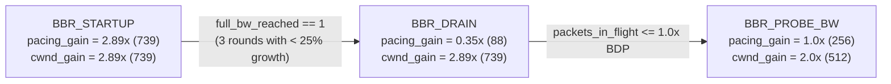

# Step 3: Transitioning from STARTUP to DRAIN and PROBE_BW (Full Pipe Detection)

## 1. Goal

In this step, you will implement BBR's state transitions from its initial **`BBR_STARTUP`** mode (exponential bandwidth search) to **`BBR_DRAIN`** (draining the excess queue created during STARTUP) and finally into steady-state **`BBR_PROBE_BW`** (cruising at the estimated bottleneck bandwidth). You will implement `bbr_check_full_bw_reached()` to detect when the bottleneck pipe is full without relying on packet loss, `bbr_check_drain()` to drain the resulting queue and enter steady state, and `bbr_update_gains()` to switch pacing and congestion window gains across modes (see [../README.md](../README.md) for the full BBR track overview).

---

## 2. How the Algorithm Works (Read This First)

### Why Can BBR Detect a Full Pipe Without Waiting for Packet Loss?

When a TCP connection starts, the sender has no idea whether the bottleneck link capacity (`BtlBw`) is 1 Mbps or 10 Gbps. To discover the available bandwidth quickly, it must double its sending rate every round trip (1 RTT).

Traditional **loss-based** congestion control algorithms (such as Reno and CUBIC) double `cwnd` every RTT during Slow Start and **only stop accelerating when the bottleneck router's buffer overflows and drops packets**. This behaviour inevitably fills router queues to capacity on every new connection, causing burst losses and severe queueing delay (bufferbloat).

In contrast, BBR begins in **`BBR_STARTUP`** mode with both `pacing_gain` and `cwnd_gain` set to $2 / \ln(2) \approx 2.885\text{x}$ (`bbr_high_gain`), doubling its sending rate each round whilst monitoring whether the **measured delivery rate (`max_bw`) has plateaued (stopped growing)**:

- **Whilst the pipe is not yet full (sending rate $< \text{BtlBw}$)**: Doubling the sending rate every round causes the rate at which packets arrive at the receiver (the delivery rate `max_bw` measured from ACKs) to also grow rapidly (roughly doubling every round).
- **Once the pipe is full (sending rate $\ge \text{BtlBw}$)**: The bottleneck link is already 100% utilised. Sending even faster cannot make packets arrive any faster than `BtlBw` — the measured delivery rate `max_bw` **plateaus at `BtlBw`**, and any excess packets simply pile up in the bottleneck router's queue (increasing RTT without increasing delivery rate).

Using this physical property, BBR detects that the pipe is full (`full_bw_reached = 1`) with the following rule:

> **Full Pipe Detection Rule**:
> At the end of each non-application-limited (`rs->is_app_limited == 0`) packet-timed round trip (`round_start == 1`), compare the current maximum delivery rate `max_bw` against the baseline `full_bw`:
> - If `max_bw` grew by **at least 25% (`1.25x`)** over `full_bw` ($\text{max}_{\text{bw}} \ge 1.25 \times \text{full}_{\text{bw}}$), the pipe is still filling: update the baseline `full_bw = max_bw` and reset the plateau counter `full_bw_cnt = 0`.
> - If `max_bw` grew by **less than 25%**, increment `full_bw_cnt`. Once this happens for **3 consecutive non-app-limited rounds (`full_bw_cnt >= 3`)**, BBR concludes that the pipe is full and sets `full_bw_reached = 1`.

In fixed-point arithmetic (`BBR_SCALE = 8`, where `BBR_UNIT = 256` represents `1.0x`), the `1.25x` growth factor is `bbr_full_bw_thresh = BBR_UNIT * 5 / 4 = 320`, and the threshold is computed as:

$$\text{bw}_{\text{thresh}} = \frac{\text{full}_{\text{bw}} \times \text{full}_{\text{bw,thresh}}}{2^{\text{BBR}_{\text{SCALE}}}} = \left(\text{full}_{\text{bw}} \times 320\right) \gg 8$$

### Counting Packet-Timed Round Trips Without Wall-Clock Timers

To check whether bandwidth has failed to grow by 25% for 3 consecutive rounds, BBR needs a reliable way to mark the boundaries of each round trip without relying on noisy wall-clock timers. It does this using the socket's cumulative delivered packet counter (`tp->delivered`):

1. At the start of a round, BBR records the current `tp->delivered` value as the target boundary `ca->next_rtt_delivered = tp->delivered`.
2. Whenever the kernel transmits a data packet, it snapshots the current `tp->delivered` into the packet's `skb` metadata.
3. One RTT later, when the ACK for that packet returns, the kernel copies that snapshot into `rs->prior_delivered` and passes `rs` to `.cong_control()`.
4. As soon as an ACK arrives with `rs->prior_delivered >= ca->next_rtt_delivered` (checked via `!before(rs->prior_delivered, ca->next_rtt_delivered)` for 32-bit wrap-around safety), BBR knows that a packet sent at or after the start of the current round has completed a full round trip. It then advances the boundary (`ca->next_rtt_delivered = tp->delivered`), increments `ca->round_cnt++`, and sets `ca->round_start = 1`.

### Why BBR Enters `BBR_DRAIN` Before `BBR_PROBE_BW`

During `BBR_STARTUP`, BBR paces and caps `cwnd` at `bbr_high_gain` (`~2.89x BDP`), and waits 3 plateau rounds to confirm that bandwidth growth has stopped. Consequently, by the time `full_bw_reached` becomes `1`, the amount of data in flight has grown up to roughly `2.89x BDP`. Because the pipe itself only holds `1.0x BDP`, the remaining **`~1.89x BDP` is sitting in the bottleneck router's queue**.

If BBR switched directly from `BBR_STARTUP` to steady-state `BBR_PROBE_BW` (`pacing_gain = 1.0x`), it would inject packets at the exact bottleneck drain rate (`1.0x BtlBw`), so **that `1.89x BDP` standing queue would never drain**, inflating RTT permanently.

Therefore, upon detecting a full pipe in `BBR_STARTUP`, BBR first transitions to **`BBR_DRAIN`**:



The table below summarises the three modes, their fixed-point gains (`BBR_SCALE = 8`, `BBR_UNIT = 256`), and their transition rules:

| Mode | `pacing_gain` | `cwnd_gain` | Role and Transition Rule |
| :--- | :--- | :--- | :--- |
| **`BBR_STARTUP`** | `bbr_high_gain = 739` ($\approx 2.89\text{x}$) | `bbr_high_gain = 739` ($\approx 2.89\text{x}$) | Doubles sending rate each round to discover `BtlBw`. When `full_bw_reached == 1`, transition to `BBR_DRAIN` and record `tp->snd_ssthresh = BDP`. |
| **`BBR_DRAIN`** | `bbr_drain_gain = 88` ($\approx 0.35\text{x}$) | `bbr_high_gain = 739` ($\approx 2.89\text{x}$) | Paces at the reciprocal of `bbr_high_gain` ($1 / 2.885 \approx 0.35\text{x}$) to drain the queue built during STARTUP, whilst keeping `cwnd_gain` at `2.89x` so pacing — not an abrupt `cwnd` clamp — smoothly slows transmission. When `tcp_packets_in_flight(tp) <= 1.0x BDP`, transition to `BBR_PROBE_BW` (which can happen on the very same ACK if in-flight packets are already $\le \text{BDP}$). |
| **`BBR_PROBE_BW`** | `BBR_UNIT = 256` ($1.0\text{x}$) | `bbr_cwnd_gain = 512` ($2.0\text{x}$) | Cruises at `1.0x` the estimated bottleneck bandwidth whilst maintaining a `2.0x BDP` congestion window to accommodate delayed or stretched ACKs. |

Setting `full_bw_reached = 1` also changes how `bbr_set_pacing_rate()` and `bbr_set_cwnd()` behave:
- **`bbr_set_pacing_rate()`**: Before the pipe is full (`!ca->full_bw_reached`), `sk->sk_pacing_rate` is only allowed to increase (`rate > sk->sk_pacing_rate`) so noisy or low early rate samples do not stall STARTUP's ramp-up. Once `ca->full_bw_reached == 1`, `bbr_set_pacing_rate()` unconditionally updates `sk->sk_pacing_rate = rate` so BBR can reduce its pacing rate down to `0.35x BtlBw` in `BBR_DRAIN` and `1.0x BtlBw` in `BBR_PROBE_BW`.
- **`bbr_set_cwnd()`**: Once `ca->full_bw_reached == 1`, `cwnd` is clamped down to the target window via `cwnd = min(cwnd + acked, target_cwnd)` (with a floor of `BBR_CWND_MIN_TARGET = 4`).

### Concrete Numerical Example (`BtlBw = 100 KB/s` Constant Bottleneck)

Consider a connection over a constant `100 KB/s` bottleneck (`MSS = 1000` bytes, `RTT = 10 ms`, delivering 1 packet per 10 ms so `bw = 1677` in `BW_SCALE = 24` units):

1. **Round 1 (first non-app-limited round)**:
   - `ca->full_bw` is initially `0`, so `bw_thresh = (0 * 320) >> 8 = 0`.
   - Since `ca->max_bw = 1677 >= bw_thresh (0)`, BBR updates the baseline `ca->full_bw = 1677` and resets `ca->full_bw_cnt = 0`.
   - The flow remains in `BBR_STARTUP` with a pacing rate of roughly `2.89x * 0.99 * 100 KB/s ≈ 286 KB/s`.
2. **Round 2**:
   - `bw_thresh = (1677 * 320) >> 8 = 2096` (`1.25x` of `1677`).
   - Because the bottleneck is capped at `100 KB/s`, `ca->max_bw` stays at `1677 < 2096` (0% growth $< 25\%$).
   - `ca->full_bw_cnt` increments to `1` (still `< 3`, so the flow remains in `BBR_STARTUP`).
3. **Round 3**:
   - Again `ca->max_bw (1677) < bw_thresh (2096)`, so `ca->full_bw_cnt` increments to `2` (still in `BBR_STARTUP`).
4. **Round 4**:
   - For the 3rd consecutive non-app-limited round, `ca->max_bw (1677) < bw_thresh (2096)`. `++ca->full_bw_cnt` reaches `3`, setting **`ca->full_bw_reached = 1`**!
   - `bbr_check_drain()` transitions `BBR_STARTUP -> BBR_DRAIN` and sets `tp->snd_ssthresh = BDP`. If `tcp_packets_in_flight(tp) <= BDP` at that moment, it immediately transitions to `BBR_PROBE_BW` (`pacing_gain = 1.0x`, `cwnd_gain = 2.0x`), dropping `sk->sk_pacing_rate` to `~99 KB/s` (`100 KB/s` minus the 1% pacing margin).

### Kernel Struct Fields Provided vs. `icsk_ca_priv`

Before writing the BPF code, review what the kernel already provides on each socket and rate sample, and what we store in our private congestion control state (`icsk_ca_priv`):

1. **`struct sock *sk` (generic socket state)**:
   - `sk->sk_pacing_status`: set to `SK_PACING_NEEDED` in `.init()` to enable kernel packet pacing.
   - `sk->sk_pacing_rate`: current pacing rate in bytes per second.
   - `sk->sk_max_pacing_rate`: optional application-configured pacing cap (`SO_MAX_PACING_RATE`, `0` if unset).
2. **`struct tcp_sock *tp` (retrieved via `tcp_sk(sk)`)**:
   - `tp->snd_cwnd`: congestion window in segments (packets).
   - `tp->snd_ssthresh`: slow-start threshold in segments (initialised to `TCP_INFINITE_SSTHRESH`; BBR stores `1.0x BDP` here upon leaving `BBR_STARTUP` for observability).
   - `tp->snd_cwnd_clamp`: upper bound on `snd_cwnd`.
   - `tp->mss_cache`: current Maximum Segment Size (MSS) in bytes.
   - `tp->srtt_us`: smoothed RTT in $\mu\text{s}$ shifted left by 3 (`tp->srtt_us >> 3` gives $\mu\text{s}$).
   - `tp->delivered`: cumulative count of data packets delivered over the connection's lifetime.
   - `tcp_packets_in_flight(tp)`: kernel helper returning the number of packets currently in flight on the network.
3. **`struct rate_sample *rs` (passed by the kernel to `.cong_control()`)**:
   - `rs->rtt_us`: RTT measured by this ACK in $\mu\text{s}$ (`<= 0` if unavailable).
   - `rs->delivered`: number of packets delivered during the measurement interval.
   - `rs->interval_us`: elapsed time in $\mu\text{s}$ for that delivery interval.
   - `rs->prior_delivered`: snapshot of `tp->delivered` taken when the newly ACKed packet was originally transmitted.
   - `rs->acked_sacked`: number of packets newly ACKed or SACKed on this ACK.
   - `rs->is_app_limited`: `1` if the measurement was application-limited (write queue emptied or receiver window limited), or `0` if network-limited.
4. **`icsk_ca_priv` and `struct bpf_bbr3_ca` (retrieved via `inet_csk_ca(sk)`)**:
   - Every `struct inet_connection_sock` includes an inline scratchpad `icsk_ca_priv` dedicated to the active congestion control algorithm.
   - Calling `inet_csk_ca(sk)` returns a pointer to `icsk_ca_priv` cast to `struct bpf_bbr3_ca *`, which holds our per-connection BBR state:
     - `min_rtt_us`: minimum RTT observed ($\mu\text{s}$)
     - `max_bw`: maximum delivery rate observed (fixed-point `packets / us << 24`)
     - `round_cnt`: packet-timed round-trip counter
     - `next_rtt_delivered`: `tp->delivered` threshold marking the end of the current round trip
     - `full_bw`: baseline `max_bw` used for the 25% growth check
     - `full_bw_cnt`: count of consecutive non-app-limited rounds without $\ge 25\%$ growth (`0` to `3`)
     - `mode`: current BBR state (`BBR_STARTUP`, `BBR_DRAIN`, or `BBR_PROBE_BW`)
     - `pacing_gain`, `cwnd_gain`: active gains for the current mode (`BBR_SCALE = 8`, `256 = 1.0x`)
     - `round_start`: `1` if the current ACK crossed a packet-timed round boundary, `0` otherwise
     - `full_bw_reached`: `1` once the 3-round bandwidth plateau has been detected, `0` otherwise

---

## 3. Design Checkpoints (Translate the Algorithm into Code)

Using the concepts from Section 2, think through the following three design questions before implementing the TODOs in [starter.bpf.c](starter.bpf.c).

### Q1. When should `bbr_check_full_bw_reached()` return early without touching `ca->full_bw_cnt`?

`bbr_check_full_bw_reached()` is called on every ACK inside `.cong_control()`. If it incremented `ca->full_bw_cnt` on every ACK, a flow sending dozens of packets per RTT would hit `full_bw_cnt == 3` within a single round trip! Which three conditions (`ca->full_bw_reached`, `!ca->round_start`, and `rs->is_app_limited`) require an immediate early `return`, and how should `bw_thresh`, `ca->full_bw`, and `ca->full_bw_cnt` be updated when none of those early-return conditions apply?

<details>
<summary>Hint and Answer</summary>

- **Early-return guard**:
  1. `ca->full_bw_reached`: if the pipe is already marked full, there is nothing left to check.
  2. `!ca->round_start`: bandwidth growth is evaluated once per packet-timed round trip, not on intermediate ACKs within a round.
  3. `rs->is_app_limited`: if the sender ran out of data to send or was receiver-window-limited, a flat delivery rate does not mean the network pipe is full.
  - Together: `if (ca->full_bw_reached || !ca->round_start || rs->is_app_limited) return;`
- **Threshold comparison and state update**:
  - Compute `bw_thresh = ((__u64)ca->full_bw * bbr_full_bw_thresh) >> BBR_SCALE;` using 64-bit arithmetic to avoid overflow.
  - If `ca->max_bw >= bw_thresh`, bandwidth grew by at least 25%: set `ca->full_bw = ca->max_bw;`, reset `ca->full_bw_cnt = 0;`, and `return`.
  - Otherwise, increment `++ca->full_bw_cnt`; once `++ca->full_bw_cnt >= bbr_full_bw_cnt` (`3`), set `ca->full_bw_reached = 1;`.

</details>

### Q2. Why must `bbr_check_drain()` use two separate `if` statements instead of `if (...) ... else if (...)`?

`bbr_check_drain()` handles two transitions: (1) `BBR_STARTUP -> BBR_DRAIN` when `ca->full_bw_reached` is set, and (2) `BBR_DRAIN -> BBR_PROBE_BW` when `tcp_packets_in_flight(tp) <= bbr_bdp(sk, ca->max_bw, BBR_UNIT)`. What would go wrong if you connected them with `else if` on a connection whose in-flight packets are already at or below `1.0x BDP` on the ACK that sets `full_bw_reached = 1`?

<details>
<summary>Hint and Answer</summary>

- With `else if`, the transition into `BBR_DRAIN` would prevent the second check from running on the same ACK. Even if `tcp_packets_in_flight(tp)` is already $\le 1.0\text{x BDP}$ (i.e. there is no excess queue left to drain), the socket would remain stuck in `BBR_DRAIN` with `pacing_gain = 0.35x` until a subsequent ACK arrives.
- Writing two independent `if` statements allows execution to **fall through**:
  1. The first `if (ca->mode == BBR_STARTUP && ca->full_bw_reached)` sets `ca->mode = BBR_DRAIN` and records `tp->snd_ssthresh = bbr_bdp(sk, ca->max_bw, BBR_UNIT)`.
  2. The second `if (ca->mode == BBR_DRAIN && tcp_packets_in_flight(tp) <= bbr_bdp(sk, ca->max_bw, BBR_UNIT))` immediately evaluates to true if in-flight packets are already $\le \text{BDP}$, advancing `ca->mode = BBR_PROBE_BW` on the very same ACK (which is exactly what happens in Round 4 of [test.pkt](test.pkt)).

</details>

### Q3. How should `bbr_update_gains()` assign `pacing_gain` and `cwnd_gain` in each of the three modes?

Using the constants defined at the top of [starter.bpf.c](starter.bpf.c) (`bbr_high_gain`, `bbr_drain_gain`, `BBR_UNIT`, and `bbr_cwnd_gain`), what values should `bbr_update_gains()` assign to `ca->pacing_gain` and `ca->cwnd_gain` for `BBR_STARTUP`, `BBR_DRAIN`, and `BBR_PROBE_BW`?

<details>
<summary>Hint and Answer</summary>

- **`BBR_STARTUP`**:
  - `ca->pacing_gain = bbr_high_gain;` (`739` $\approx 2.89\text{x}$)
  - `ca->cwnd_gain = bbr_high_gain;` (`739` $\approx 2.89\text{x}$)
- **`BBR_DRAIN`**:
  - `ca->pacing_gain = bbr_drain_gain;` (`88` $\approx 0.35\text{x}$, pacing slower than `BtlBw` to drain the queue)
  - `ca->cwnd_gain = bbr_high_gain;` (`739` $\approx 2.89\text{x}$, keeping `cwnd` high so pacing smoothly controls the drain)
- **`BBR_PROBE_BW` (and `default`)**:
  - `ca->pacing_gain = BBR_UNIT;` (`256` $= 1.0\text{x}$, cruising at the estimated bottleneck rate)
  - `ca->cwnd_gain = bbr_cwnd_gain;` (`512` $= 2.0\text{x}$, providing `2.0x BDP` headroom for delayed ACKs)

</details>

---

## 4. Step-by-step Code Walkthrough (`solution.bpf.c`)

Let's walk through each helper and fixed-point calculation in [solution.bpf.c](solution.bpf.c).

### 1. Fixed-Point Scales and Gain Constants

- `BW_SCALE = 24` (`BW_UNIT = 1 << 24`): fixed-point scale for delivery rates `bw` in packets per microsecond.
- `BBR_SCALE = 8` (`BBR_UNIT = 1 << 8 = 256`): fixed-point scale for gains and growth factors where `256` equals `1.0x`:
  - `bbr_high_gain = BBR_UNIT * 2885 / 1000 + 1 = 739` ($\approx 2.89\text{x}$)
  - `bbr_drain_gain = BBR_UNIT * 1000 / 2885 = 88` ($\approx 0.35\text{x}$)
  - `bbr_cwnd_gain = BBR_UNIT * 2 = 512` ($2.0\text{x}$)
  - `bbr_full_bw_thresh = BBR_UNIT * 5 / 4 = 320` ($1.25\text{x}$)
  - `bbr_full_bw_cnt = 3U`

### 2. Packet-Timed Rounds and Peak Bandwidth Tracking: `bbr_update_bw()`

`bbr_update_bw()` runs on every ACK. It resets `ca->round_start = 0` and, for valid rate samples (`rs->delivered > 0 && rs->interval_us > 0`), performs two steps:

1. **Detecting round-trip boundaries**:
   When `!before(rs->prior_delivered, ca->next_rtt_delivered)` is true, a packet sent at or after the start of the current round has been acknowledged. BBR advances the boundary `ca->next_rtt_delivered = tp->delivered`, increments `ca->round_cnt++`, and sets `ca->round_start = 1`.
2. **Computing delivery rate and updating `ca->max_bw`**:
   It computes `bw = div64_u64((__u64)rs->delivered * BW_UNIT, (__u64)rs->interval_us)` and updates `ca->max_bw` whenever the sample is not app-limited (`!rs->is_app_limited`) or exceeds the current `ca->max_bw`.

### 3. Full Pipe Detection: `bbr_check_full_bw_reached()`

```c
static __always_inline void bbr_check_full_bw_reached(struct sock *sk,
						      const struct rate_sample *rs)
{
	struct bpf_bbr3_ca *ca = inet_csk_ca(sk);
	__u32 bw_thresh;

	if (ca->full_bw_reached || !ca->round_start || rs->is_app_limited)
		return;

	bw_thresh = ((__u64)ca->full_bw * bbr_full_bw_thresh) >> BBR_SCALE;
	if (ca->max_bw >= bw_thresh) {
		ca->full_bw = ca->max_bw;
		ca->full_bw_cnt = 0;
		return;
	}

	if (++ca->full_bw_cnt >= bbr_full_bw_cnt)
		ca->full_bw_reached = 1;
}
```

- Runs only at the end of a packet-timed round (`ca->round_start == 1`) on non-application-limited samples (`!rs->is_app_limited`).
- Compares `ca->max_bw` against `bw_thresh` (`1.25x` of `ca->full_bw`). After 3 consecutive rounds without 25% growth, it sets `ca->full_bw_reached = 1`.

### 4. Mode Transitions and Gain Updates: `bbr_check_drain()` and `bbr_update_gains()`

```c
static __always_inline void bbr_check_drain(struct sock *sk)
{
	struct tcp_sock *tp = tcp_sk(sk);
	struct bpf_bbr3_ca *ca = inet_csk_ca(sk);

	if (ca->mode == BBR_STARTUP && ca->full_bw_reached) {
		ca->mode = BBR_DRAIN;
		tp->snd_ssthresh = bbr_bdp(sk, ca->max_bw, BBR_UNIT);
	}

	if (ca->mode == BBR_DRAIN &&
	    tcp_packets_in_flight(tp) <= bbr_bdp(sk, ca->max_bw, BBR_UNIT))
		ca->mode = BBR_PROBE_BW;
}
```

- Transitions from `BBR_STARTUP` to `BBR_DRAIN` once `ca->full_bw_reached` is set, saving `1.0x BDP` into `tp->snd_ssthresh`.
- Immediately checks whether `tcp_packets_in_flight(tp) <= bbr_bdp(sk, ca->max_bw, BBR_UNIT)`, transitioning to `BBR_PROBE_BW` as soon as in-flight packets are at or below `1.0x BDP`.
- `bbr_update_gains()` then sets `ca->pacing_gain` and `ca->cwnd_gain` for the active `ca->mode`, which `bbr_set_pacing_rate()` and `bbr_set_cwnd()` apply to `sk->sk_pacing_rate` and `tp->snd_cwnd`.

---

## 5. Understanding `test.pkt` and How to Run

[test.pkt](test.pkt) drives a connection across a constant `100 KB/s` bottleneck (1 segment of 1,000 bytes every 10 ms) and verifies the transition out of `BBR_STARTUP` after 3 plateau rounds:

1. **Handshake and 5,000-Byte Bulk `write()`**:
   - Establishes a connection with `MSS = 1000` bytes and receive window `win 1000` (1 segment).
   - Calls `write(4, ..., 5000)` to queue 5 segments at once so the socket write queue stays non-empty across rounds, ensuring `rs->is_app_limited == 0` after the warmup segment.
2. **Warmup (`1:1001`) and Round 1 (`1001:2001`)**:
   - The ACK for `1:1001` clears the initial application-limited period.
   - In Round 1 (`1001:2001`, ACKed after 10 ms), `ca->max_bw` (`100 KB/s`) is recorded as the baseline `ca->full_bw` with `ca->full_bw_cnt = 0`.
   - Because the flow is in `BBR_STARTUP` (`pacing_gain = 739 / 256 ≈ 2.89x`), `tcpi_pacing_rate` is `~286 KB/s` (`250000 < tcpi_pacing_rate < 320000`) and `tcpi_snd_ssthresh` is `0x7fffffff` (`TCP_INFINITE_SSTHRESH`).
3. **Rounds 2 (`2001:3001`) and 3 (`3001:4001`)**:
   - Each 1,000-byte segment is ACKed 10 ms later, so the measured bandwidth stays flat at `100 KB/s` (0% growth $< 25\%$).
   - `ca->full_bw_cnt` increments to `1` in Round 2 and `2` in Round 3. Since `full_bw_cnt < 3`, the flow remains in `BBR_STARTUP` at `~286 KB/s`.
4. **Round 4 (`4001:5001`) Transition and Assertions**:
   - On the 3rd consecutive round without 25% bandwidth growth, `ca->full_bw_cnt` reaches `3` and sets `ca->full_bw_reached = 1`.
   - `bbr_check_drain()` transitions `BBR_STARTUP -> BBR_DRAIN` (`tp->snd_ssthresh = BDP = 1`) and, because all 5,000 bytes have now been acknowledged (`tcp_packets_in_flight(tp) == 0 <= BDP`), immediately transitions to `BBR_PROBE_BW` (`pacing_gain = 1.0x`, `cwnd_gain = 2.0x`).
   - **Why `starter.bpf.c` fails and `solution.bpf.c` passes**:
     - In `starter.bpf.c`, the three TODO functions are unimplemented, so `ca->full_bw_reached` stays `0` and the flow remains stuck in `BBR_STARTUP` at `~286 KB/s`, failing the line 56 assertion `assert 90000 < tcpi_pacing_rate < 110000`.
     - In `solution.bpf.c` (and in `starter.bpf.c` once you complete the TODOs), the flow transitions to `BBR_PROBE_BW` in Round 4, lowering `tcpi_pacing_rate` to `~99 KB/s` (`90000 < tcpi_pacing_rate < 110000`), setting `1 <= tcpi_snd_ssthresh <= 4`, and clamping `tcpi_snd_cwnd == 4` (`BBR_CWND_MIN_TARGET = 4`), passing all assertions.

### How to Run the Test

Run the commands below to verify that `starter` fails before your changes and `solution` passes:

```sh
../../run_test.sh 03-bbr/step03-startup-drain starter
../../run_test.sh 03-bbr/step03-startup-drain solution
```
