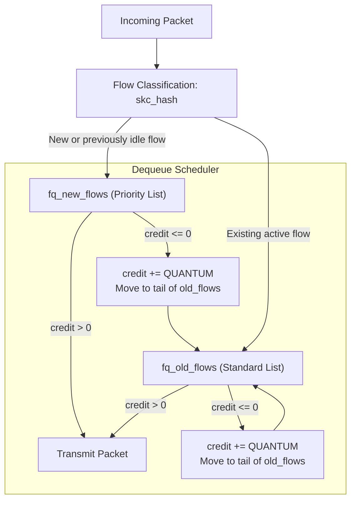

# Track 5: Fair Queueing (FQ) and EDT Pacing Hands-on

[Japanese](README.md)

In this track, you will build **Fair Queueing (FQ) and Earliest Departure Time (EDT) pacing**—the essential kernel traffic scheduling infrastructure that unlocks modern high-speed TCP algorithms like BBR and CUBIC—from scratch using Linux kernel BPF `struct_ops` (`struct Qdisc_ops`).

No prior knowledge of Qdiscs or kernel traffic control is required. We will explain everything from first principles: "Why does plain FIFO cause congestion on the Internet?", "How does Deficit Round Robin (DRR) distribute bandwidth fairly?", and "How does EDT pacing smooth out TCP packet bursts?".

---

## 1. What is a Qdisc (Queueing Discipline)?

Packets transmitted by a TCP socket via `write()` or `sendmsg()` do not immediately emit from the physical network interface as radio waves or photons. Between the socket layer and the device driver lies a traffic control layer known as a **Qdisc (Queueing Discipline)**.

```text
+-----------------------+     +-----------------------+
|  TCP Socket (Flow A)  |     |  TCP Socket (Flow B)  |
+-----------------------+     +-----------------------+
            |                             |
            +--------------+--------------+
                           |
                           v
           +-------------------------------+
           |    Qdisc (Traffic Control)    |
           |   - Flow classification       |
           |   - Bandwidth sharing (DRR)   |
           |   - Transmission pacing (EDT) |
           +-------------------------------+
                           |
                           v
           +-------------------------------+
           |    Device Driver (Ring Buff)  |
           +-------------------------------+
                           |
                           v
           +-------------------------------+
           |         Physical NIC          |
           +-------------------------------+
```

The simplest Qdisc implementation is **pfifo (a simple First-In, First-Out queue)**. However, FIFO suffers from fundamental flaws:

- **Monopolization by Fat Flows**: If a bulk transfer (Fat Flow) downloads a massive file at maximum speed, the FIFO queue is continuously filled with packets from that single flow.
- **Latency Spikes for Sparse Flows**: Interactive packets such as SSH keystrokes, DNS lookups, or HTTP GET requests (Sparse Flows / Thin Flows) get stuck behind huge bursts of bulk transfer packets, suffering severe queuing delay (RTT inflation).
- **Self-Inflicted Packet Loss from Bursts**: TCP tends to emit multiple packets back-to-back upon receiving an ACK. Dumping large bursts into a FIFO queue overflows shallow switch buffers, causing packet drops.

To solve these problems, the Linux kernel introduced **`sch_fq` (Fair Queueing Qdisc)**.

---

## 2. Pillar 1: Deficit Round Robin (DRR) and Sparse Flow Prioritization

FQ classifies incoming packets into separate per-flow queues based on socket hashes. It schedules packets using two active flow lists:

- **`fq_new_flows` (List for newly created or sparse flows)**
- **`fq_old_flows` (List for continuous bulk flows)**



### Why Do Two Lists Make Sparse Flows Fast?

- **Credit System (Deficit Round Robin)**: Each flow holds a transmission budget called `credit` (in bytes). Sending a packet deducts `qdisc_pkt_len(skb)` from the flow's credit.
- **Generous Initial Credit**: When a flow is newly created or awakens from an idle state, it receives a generous initial credit (`INITIAL_QUANTUM = 2000` bytes) and is enqueued at the **tail of `fq_new_flows`**.
- **Absolute Priority of `fq_new_flows`**: The dequeue scheduler **always serves `fq_new_flows` before `fq_old_flows`** as long as `fq_new_flows` is non-empty.
- **Demotion of Bulk Flows**: When a greedy flow exhausts its credit (`credit <= 0`), it receives its next quantum (`credit += QUANTUM` = 1500 bytes) and is demoted to the **tail of `fq_old_flows`**.

Because intermittent, interactive flows (SSH, Web requests) arrive as detached flows, they enter `fq_new_flows` with high priority, jump ahead of bulk transfer queues, and depart with near-zero queuing delay.

---

## 3. Pillar 2: Earliest Departure Time (EDT) Pacing

The second key innovation of FQ is **EDT (Earliest Departure Time) pacing**.

In traditional TCP, senders dump bursts of packets onto the wire. In the EDT model introduced in Linux 4.20, TCP or FQ stamps each packet with its **scheduled future departure time (`skb->tstamp`)**.

```text
Packet 1 (0 ms) ----> Transmitted immediately!
Packet 2 (5 ms) ----> Too early! Stashed in fq_delayed (Red-Black tree)
Packet 3 (10 ms) ---> Stashed in fq_delayed

   5 ms later: High-resolution watchdog timer fires!
   Packet 2 ----> Transmitted!
```

### Three Core Elements of EDT

1. **Target Departure Time Calculation**:
   Based on the socket's configured pacing rate (`sk_max_pacing_rate`), the departure gap between packets is computed as:
   $$\Delta t = \frac{\text{packet len} \times 10^9}{\text{rate}}$$
   The flow's next eligible transmission timestamp `flow->time_next_packet` is updated accordingly.
2. **Delayed Queue (`fq_delayed`) and Watchdog Timer**:
   During dequeue, if a packet's scheduled timestamp is in the future (`now < tstamp`), the entire flow is moved into a red-black tree (`bpf_rb_root fq_delayed`) and the kernel's high-resolution timer is armed via `bpf_qdisc_watchdog_schedule()`. When the timer fires, dequeue is re-triggered and the packet is emitted.
3. **Horizon Check**:
   If a misconfigured or buggy socket assigns an unrealistic timestamp far in the future (e.g. 10 seconds or 1 minute away), the packet is dropped immediately to prevent head-of-line blocking if it exceeds `HORIZON_NS = 2` seconds.

---

## 4. Technology Stack (BPF Graph Data Structures)

This track utilizes modern **BPF Graph Data Structures** introduced in Linux 6.x:

| BPF Feature | Purpose |
| :--- | :--- |
| `struct_ops` (`struct Qdisc_ops`) | Implements and registers a kernel Qdisc dynamically and safely via BPF |
| `bpf_list_head` / `bpf_list_node` | Implements the DRR `fq_new_flows` and `fq_old_flows` scheduling queues |
| `bpf_rb_root` / `bpf_rb_node` | Manages timestamp-ordered packet queues and throttled flows (`fq_delayed`) in $O(\log N)$ time |
| `bpf_refcount` | Provides safe shared ownership of flow nodes across the hash map (flow table) and active scheduling lists |
| `bpf_kptr_xchg()` | Atomically transfers and exchanges kernel object ownership |
| `bpf_qdisc_watchdog_schedule()` | Kernel kfunc to schedule high-resolution wakeups for paced packet departure |

---

## 5. Steps and Verification Commands

This track consists of 2 steps:

| Step | Directory | Content |
| :--- | :--- | :--- |
| **Step 1** | [`step01-flow-drr/`](step01-flow-drr/README.en.md) | Implement flow hashing and Deficit Round Robin (DRR) with `fq_new_flows` and `fq_old_flows`, verifying that sparse flows jump ahead of bulk flows. |
| **Step 2** | [`step02-edt-pacing/`](step02-edt-pacing/README.en.md) | Implement Earliest Departure Time (EDT) pacing using `bpf_rb_root`, delayed flow management (`fq_delayed`), watchdog scheduling, and horizon checks. |

### Commands

From the `labs/` directory (`/usr/local/google/home/kuniyu/tcp-eli5/labs`), build and verify each step using `run_test.sh`:

```sh
# Step 1: verify starter fails, then implement TODOs
./run_test.sh 05-qdisc-fq/step01-flow-drr starter
# Run Step 1 solution
./run_test.sh 05-qdisc-fq/step01-flow-drr solution

# Step 2: verify starter and run solution
./run_test.sh 05-qdisc-fq/step02-edt-pacing starter
./run_test.sh 05-qdisc-fq/step02-edt-pacing solution
```

Proceed to [`step01-flow-drr/README.en.md`](step01-flow-drr/README.en.md) to implement your first BPF FQ scheduler!
