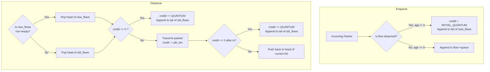

# Step 1: Flow Classification and 2-List Deficit Round Robin (DRR)

[Japanese](README.md)

## 1. Learning Goals

In this step, you will implement `struct Qdisc_ops` via BPF `struct_ops` to build the core foundation of **Fair Queueing (FQ): per-flow classification and 2-list Deficit Round Robin (DRR)** from scratch.

- For an overview of the track, see the [FQ Track README](../README.en.md).

---

## 2. Algorithm and Concepts

### 2.1 Why Separate Queues per Flow? (Flow Classification)

In a conventional FIFO queue, all packets from all connections share a single linear queue. When a greedy bulk transfer (Flow A) streams data continuously, FIFO queues stay filled with Flow A's packets. An interactive connection (Flow B: SSH or HTTP requests) that only emits sporadic packets is forced behind hundreds of bulk packets, suffering high latency (Bufferbloat).

FQ inspects the socket hash (`sk->__sk_common.skc_hash`) or 4-tuple hash (`bpf_skb_get_hash(skb)`) and directs packets into **dedicated, per-flow queues (`struct fq_flow_node`)**.

### 2.2 Deficit Round Robin (DRR)

After separating packets into per-flow queues, how should the scheduler dequeue them?

Simple packet-by-packet round-robin is unfair to flows sending small packets: a flow sending 1500-byte packets gets 3x more bandwidth than a flow sending 500-byte packets.

To solve this, M. Shreedhar and G. Varghese invented **Deficit Round Robin (DRR)**:

- **`QUANTUM`**: The baseline byte credit allotted to each flow per scheduling round (`1500` bytes in this lab).
- **`credit`**: The current transmission allowance (in bytes) held by the flow.
- **Rules**:
  - If the head packet's size is $\le \text{credit}$, the packet is transmitted and `credit -= packet_len`.
  - When `credit <= 0`, the flow has used its round allowance: add `QUANTUM` (`credit += QUANTUM`) and move the flow to the back of the queue.

### 2.3 The 2-List Architecture: `fq_new_flows` vs `fq_old_flows`

A vital design innovation in Linux's `sch_fq` and `sch_fq_codel` is dividing active flows into **two separate lists**:



1. **Absolute Priority of `fq_new_flows`**: The dequeue scheduler **never touches `fq_old_flows` as long as `fq_new_flows` has pending flows**.
2. **Reviving Idle Flows**:
   - When a flow has no packets left, it is detached (`age != 0`).
   - When a new packet arrives for an idle flow, it receives a generous `INITIAL_QUANTUM` (`2000` bytes) and is added to the **tail of `fq_new_flows`**.
3. **Demoting Bulk Flows**:
   - A greedy bulk flow exhausts its credit after 1-2 packets (`credit <= 0`) and is demoted to **`fq_old_flows`**.

Because intermittent sparse flows (Flow B) arrive as detached flows, they enter `fq_new_flows`, **immediately jumping ahead of bulk packets queued in `fq_old_flows`** to achieve near-zero queuing delay.

### 2.4 Concrete Trace (`test.pkt` Scenario)

Parameters: `INITIAL_QUANTUM = 2000`, `QUANTUM = 1500`, Packet size $\approx 1028$ bytes (UDP 1000B payload + headers), `BOTTLENECK_NS = 2 ms`.

| Time | Event | Flow A State | Flow B State | Packet Sent | Explanation |
| :--- | :--- | :--- | :--- | :--- | :--- |
| **+0.000** | Flow A writes 4000B<br>(4 packets arrive) | `credit = 2000`<br>in `fq_new_flows` | Idle / Unconnected | **Flow A: Pkt 1** (1000B) | After sending Pkt 1: `credit = 2000 - 1028 = 972 > 0`.<br>Remains at head of `fq_new_flows`.<br>Next eligible transmission: `+2 ms`. |
| **+0.002** | Timer fires (2 ms elapsed) | `credit = 972`<br>in `fq_new_flows` | Idle / Unconnected | **Flow A: Pkt 2** (1000B) | After sending Pkt 2: `credit = 972 - 1028 = -56 <= 0`!<br>Credit exhausted: `credit += 1500 = 1444`, **demoted to `fq_old_flows`**! |
| **+0.002** | **Flow B writes 500B** | `credit = 1444`<br>in `fq_old_flows`<br>(Pkt 3, 4 queued) | **Wakes from idle!**<br>`credit = 2000`<br>**enters `fq_new_flows`!** | — | Flow B was detached, so it enters priority list `fq_new_flows`! |
| **+0.004** | Timer fires (4 ms elapsed) | Waiting in `fq_old_flows` | **Head of `fq_new_flows`** | **Flow B: 500B packet!** | `fq_new_flows` takes strict priority: **Flow B departs before Flow A's Pkt 3 & 4!** |
| **+0.006** | Timer fires (6 ms elapsed) | Head of `fq_old_flows` | Done (idle) | **Flow A: Pkt 3** (1000B) | `fq_new_flows` is empty, so `fq_old_flows` resumes. |
| **+0.008** | Timer fires (8 ms elapsed) | Head of `fq_old_flows` | Idle | **Flow A: Pkt 4** (1000B) | Flow A's final packet departs. |

---

## 3. Design Checkpoints

### Q1. What is the role of `bpf_refcount`?

<details>
<summary>Hint & Answer</summary>

- **Hint**: `struct fq_flow_node` must exist concurrently in both the hash map (`fq_flows`) and one of the scheduling lists (`fq_new_flows` / `fq_old_flows`).
- **Answer**: The map value holds the primary reference (refcount 1). When the flow becomes active and enters a scheduling list, `flow_copy = bpf_refcount_acquire(flow)` increments the refcount to 2. When the flow empties and becomes detached, `bpf_obj_drop(flow)` drops the list reference (refcount returns to 1). This ensures safe memory management without prematurely freeing stashed flows.

</details>

### Q2. How should a flow be handled during dequeue if `flow->credit <= 0`?

<details>
<summary>Hint & Answer</summary>

- **Hint**: In DRR, a flow with non-positive credit cannot transmit in the current round.
- **Answer**: Replenish credit with `flow->credit += QUANTUM` (1500 bytes), push the flow to the **tail** of `fq_old_flows`, and `continue` the loop to inspect the next eligible flow.

</details>

### Q3. How does the bottleneck link rate limit coordinate with the watchdog timer?

<details>
<summary>Hint & Answer</summary>

- **Hint**: If less than 2 ms has elapsed since the last transmission, the packet cannot be sent yet.
- **Answer**: Read current time `now = bpf_ktime_get_ns();`. If `now < next_tx_ns`, arm the kernel high-resolution timer via `bpf_qdisc_watchdog_schedule(sch, next_tx_ns, 0)` and return `NULL` immediately.

</details>

---

## 4. Verification Commands

```sh
cd /usr/local/google/home/kuniyu/tcp-eli5/labs

# 1. Verify starter fails
./run_test.sh 05-qdisc-fq/step01-flow-drr starter

# 2. Verify solution passes
./run_test.sh 05-qdisc-fq/step01-flow-drr solution
```
