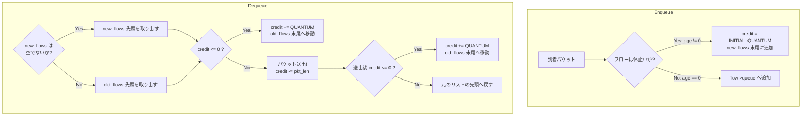

# Step 1: フロー分類と 2 リスト Deficit Round Robin (DRR)

[English](README.en.md)

## 1. 学習ゴール

このステップでは、Linux カーネルの Qdisc インターフェースである `struct Qdisc_ops` を BPF の `struct_ops` 機能で実装し、**Fair Queueing (FQ) の根幹であるフロー分類と 2 リスト Deficit Round Robin (DRR)** をゼロから組み立てます。

- トラック全体の概要は [FQ トラック README](../README.md) を参照してください。

---

## 2. アルゴリズムと背景の解説（まずここを読む）

### 2.1 なぜフローごとにキューを分けるのか？（Flow Classification）

従来の FIFO（First-In First-Out）キューでは、すべての接続のパケットが 1 本のキューに直列に並びます。そのため、巨大なファイルを連続送信しているフロー（Flow A）があると、キューのほとんどが Flow A のパケットで埋まり、たまにしかパケットを送らない対話型通信（Flow B: SSH や Web リクエスト）も Flow A の後ろに並ばされて深刻な遅延（Bufferbloat）を被ります。

FQ では、到着したパケットのソケット情報（`sk->__sk_common.skc_hash`）または 4-tuple ハッシュ（`bpf_skb_get_hash(skb)`）をキーとして、**パケットをフローごとの独立したキュー（`struct fq_flow_node`）に振り分けます**。

### 2.2 Deficit Round Robin (DRR) の仕組み

フローごとにキューを分けた後、それぞれのキューからどのような順序でパケットを取り出す（Dequeue する）べきでしょうか？

単純なラウンドロビン（1 パケットずつ順番に取り出す）だと、パケットサイズが 1500 バイトのフローと 500 バイトのフローの間で、帯域が $1500 : 500 = 3 : 1$ と不公平になってしまいます。

そこで M. Shreedhar と G. Varghese によって考案されたのが **Deficit Round Robin (DRR)** です。

- **`QUANTUM`（クアンタム）**: 各フローにラウンドごとに付与される送信権の基本単位（バイト数、本ラボでは `1500` バイト）。
- **`credit`（クレジット）**: 各フローが現在保持している送信可能残高（バイト数）。
- **送信ルール**:
  - フローの先頭パケットの長さが `credit` 以下なら送信を許可し、`credit -= packet_len` と減算します。
  - `credit` が `0` 以下になったら、そのラウンドでの送信権を使い切ったと判断し、次回の送信枠として `QUANTUM` を足し（`credit += QUANTUM`）、キューの末尾へ回します。

### 2.3 2 リスト方式：なぜ `fq_new_flows` と `fq_old_flows` に分けるのか？

Linux の `sch_fq` および `sch_fq_codel` の極めて重要な工夫が、**アクティブなフローを 2 つのリストに分類すること** です。



1. **`fq_new_flows` の絶対優先**: Dequeue 時、スケジューラは **`fq_new_flows` が空になるまで、決して `fq_old_flows` からパケットを取り出しません**。
2. **休止中（Detached）フローの復活**:
   - アイドル状態（キューにパケットがない状態）のフローはリストから外され、`age != 0`（休止中）とマークされます。
   - 新しいパケットが届くと、初期クレジットとして多めの `INITIAL_QUANTUM`（2000 バイト）が与えられ、**`fq_new_flows` の末尾** に追加されます。
3. **継続的大容量フローの降格**:
   - 連続してパケットを送り続けるフローは、1〜2 パケット送ったところで `credit <= 0` となり、自動的に **`fq_old_flows` に降格** されます。

この 2 リスト構造により、時々しかパケットを送らないスパースフロー（Flow B）は、到着するたびに `fq_new_flows` に入るため、**大容量ダウンロードで `fq_old_flows` に溜まっている大量のパケットを一瞬でごぼう抜きして最優先で送信される** のです。

### 2.4 具体数値トレース（本ステップの `test.pkt` シナリオ）

本ステップの `test.pkt` で実際に起きる動作をトレースしてみましょう。
設定値：`INITIAL_QUANTUM = 2000`, `QUANTUM = 1500`, パケット長 $\approx 1028$ バイト（UDP 1000B ペイロード + ヘッダ）, ボトルネック送信間隔 `BOTTLENECK_NS = 2 ms`。

| 時刻 | イベント | Flow A の状態 | Flow B の状態 | 送出パケット | 解説 |
| :--- | :--- | :--- | :--- | :--- | :--- |
| **+0.000** | Flow A が 4000B 送信<br>(4 パケット到着) | `credit = 2000`<br>`fq_new_flows` 所属 | 未接続 / アイドル | **Flow A: Pkt 1** (1000B) | Pkt 1 送出で `credit = 2000 - 1028 = 972 > 0`。<br>まだ残高があるので `fq_new_flows` 先頭に留まる。<br>次回送出可能時刻は `+2 ms`。 |
| **+0.002** | タイマー発火 (2 ms 経過) | `credit = 972`<br>`fq_new_flows` 所属 | 未接続 / アイドル | **Flow A: Pkt 2** (1000B) | Pkt 2 送出で `credit = 972 - 1028 = -56 <= 0`！<br>残高が尽きたため `credit += 1500 = 1444` となり、**`fq_old_flows` へ降格**！ |
| **+0.002** | **Flow B が 500B 送信** | `credit = 1444`<br>`fq_old_flows` 所属<br>(Pkt 3, 4 が待機中) | **休止から復帰！**<br>`credit = 2000`<br>**`fq_new_flows` に追加！** | — | Flow B は休止中だったため優先リスト `fq_new_flows` に入る！ |
| **+0.004** | タイマー発火 (4 ms 経過) | `fq_old_flows` で待機中 | **`fq_new_flows` 先頭** | **Flow B: 500B パケット！** | `fq_new_flows` が絶対優先されるため、**Flow A の Pkt 3・4 より先に Flow B が送出される！** |
| **+0.006** | タイマー発火 (6 ms 経過) | `fq_old_flows` 先頭 | 送信完了（休止へ） | **Flow A: Pkt 3** (1000B) | `fq_new_flows` が空になったため、`fq_old_flows` の Flow A が再開。 |
| **+0.008** | タイマー発火 (8 ms 経過) | `fq_old_flows` 先頭 | 休止中 | **Flow A: Pkt 4** (1000B) | Flow A の最後のパケットが送出される。 |

---

## 3. 設計チェックポイント

`starter.bpf.c` の TODO を実装するための設計の問いです。

### Q1. フローの参照カウント（`bpf_refcount`）の役割は何ですか？

<details>
<summary>ヒントと答え</summary>

- **ヒント**: フロー構造体 `struct fq_flow_node` は、パケットを分類するためのハッシュマップ `fq_flows` に常駐しつつ、スケジューリングリスト（`fq_new_flows` や `fq_old_flows`）にも所属します。
- **答え**: ハッシュマップ内のポインタ `sflow->flow` が 1 つ目の参照（参照カウント 1）を持ちます。フローがアクティブ化されてリストに繋がれる際、`flow_copy = bpf_refcount_acquire(flow)` で 2 つ目の参照を獲得してリストに渡します（参照カウント 2）。パケットがすべて捌けて休止する際、リストから取り出した参照を `bpf_obj_drop(flow)` で破棄します（参照カウント 1 に戻る）。これにより、リストから外れてもハッシュマップ側で安全に保持され続けます。

</details>

### Q2. Dequeue 時、フローの `credit` が `0` 以下の場合はどう処理しますか？

<details>
<summary>ヒントと答え</summary>

- **ヒント**: DRR では、残高がマイナスまたはゼロのフローはそのラウンドでパケットを送る権利がありません。
- **答え**: `flow->credit += QUANTUM`（1500 バイト）を加算して次回の送信枠を与えたうえで、そのフローを `fq_old_flows` の **末尾（Tail）** に追加し、ループを `continue` して次のフローの検査に移ります。

</details>

### Q3. ボトルネックレート（`BOTTLENECK_NS`）の制限とタイマーはどう連携しますか？

<details>
<summary>ヒントと答え</summary>

- **ヒント**: 前回のパケット送出から 2 ms 経過していない場合、勝手にパケットを送り出してはいけません。
- **答え**: `now = bpf_ktime_get_ns();` を取得し、`now < next_tx_ns` ならば `bpf_qdisc_watchdog_schedule(sch, next_tx_ns, 0)` を呼び出してカーネルの高精度タイマーを予約し、その場ですぐに `NULL` を返します。

</details>

---

## 4. テストと動作確認

```sh
cd /usr/local/google/home/kuniyu/tcp-eli5/labs

# 1. 未実装の starter が失敗することを確認する
./run_test.sh 05-qdisc-fq/step01-flow-drr starter

# 2. 模範解答 (solution) が PASS することを確認する
./run_test.sh 05-qdisc-fq/step01-flow-drr solution
```
