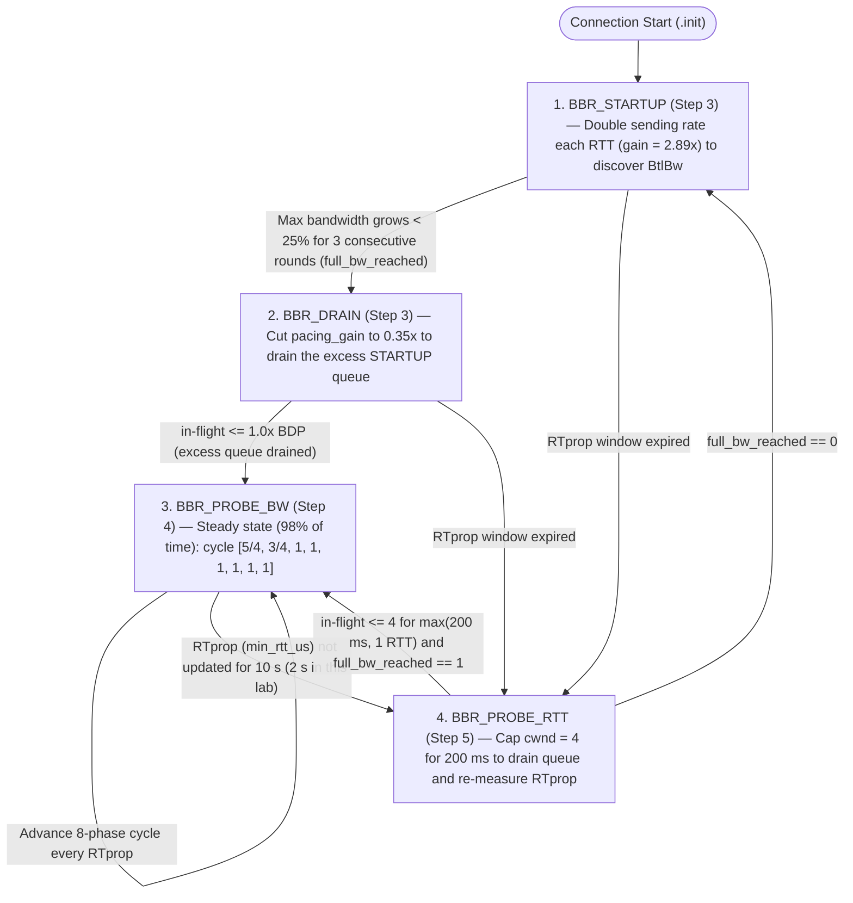

# Track 3: TCP BBR Hands-on — Model-Based Control with Bandwidth and Min-RTT

In Track 1 (Reno) and Track 2 (CUBIC), we implemented **loss-based congestion control**: algorithms that continuously inflate `cwnd` until a router buffer overflows and drops a packet, treating packet loss as the signal to cut `cwnd`. Since Van Jacobson's pioneering design in the late 1980s, this paradigm has powered the Internet for nearly three decades.

In 2016, however, Neal Cardwell, Yuchung Cheng, Van Jacobson, and their colleagues at Google introduced **BBR (Bottleneck Bandwidth and Round-trip propagation time)** — a congestion control algorithm that overturns the loss-based paradigm from first principles.

This introductory guide assumes zero prior knowledge of BBR. Starting from the fundamental question of why Reno and CUBIC struggle on modern networks, we will build and verify **the core engine of BBRv1 from scratch in six progressive steps** using BPF `struct_ops` and `packetdrill`.

---

## 1. Why Reno and CUBIC (Loss-Based Congestion Control) Fall Short

Although Reno and CUBIC differ in the shape of their window growth function (linear vs cubic), they share the exact same fundamental rule:

- **"Keep increasing `cwnd` until a router buffer overflows and drops a packet (Loss); when a packet is lost, assume the pipe is full and cut `cwnd`."**

While this assumption — that **packet loss equals congestion (a full pipe)** — worked well in the 1980s and 1990s, it causes **two opposite and severe problems** on modern networks.

### Problem 1: Bufferbloat (Severe Latency Inflation in Deep Buffers)

Modern edge routers, cable/fibre modems, and cellular base stations frequently contain megabytes of cheap DRAM memory (**deep buffers**).

Consider a link with a bottleneck bandwidth of 10 Mbps and a two-way propagation delay of 20 ms. The exact amount of data needed to fill this pipe end-to-end — its Bandwidth-Delay Product (**BDP**) — is just **25 KB (about 18 packets)**. Once 18 packets are in flight, the 10 Mbps link is already **100% utilised**.

What happens when the bottleneck router has a 1 MB buffer (~700 packets) and we run Reno or CUBIC?

- Because the router buffer does not overflow at 18 packets (no packets are dropped), Reno and CUBIC assume there is still spare capacity and keep growing `cwnd` to 100, 300, and eventually 700 packets.
- Every packet sent beyond the 18-packet BDP simply piles up inside the router's memory queue. **Throughput does not increase by a single bit per second above 10 Mbps.**
- Instead, newly arriving packets must wait at the back of a massive 700-packet queue, inflating the round-trip time from its true 20 ms to **hundreds of milliseconds or over a full second** on a permanent basis.

This phenomenon is known as **Bufferbloat**. Whenever a background file download causes video calls, online games, or interactive SSH sessions on the same network to freeze, the culprit is loss-based congestion control deliberately stuffing the bottleneck buffer until it overflows.

### Problem 2: Throughput Collapse on Shallow Buffers and Random Loss

At the opposite extreme — on high-speed links behind **shallow-buffered** data-centre switches, or across wireless, cellular, and long-haul optical links subject to occasional **random non-congestive packet drops** — loss-based algorithms suffer the inverse failure:

- Even when the pipe is mostly empty and ample bandwidth is available, **a single packet drop** caused by a transient microburst or wireless noise causes Reno to slash `cwnd` by **50% (`0.5x`)** and CUBIC to cut `cwnd` by **30% (`0.7x`)**.
- For example, sustaining 10 Gbps across a 100 ms path (a BDP of ~86,000 packets) with CUBIC requires a packet loss rate below roughly $10^{-8}$. Even a tiny fraction of random loss repeatedly chops `cwnd` down, causing throughput to collapse even though the link is nowhere near congested.

### The Root Cause

Both failures stem from a single flawed premise:

> [!IMPORTANT]
> **The assumption that "Packet Loss = Congestion (Full Pipe)" is fundamentally wrong!**
> - On paths with **deep buffers**, congestion (a full pipe and severe queueing delay) occurs **long before** any packet is lost.
> - On paths with **shallow buffers or wireless links**, packet loss occurs **long before** the pipe is full.

To achieve both minimal latency and maximum throughput simultaneously, we must stop watching for packet drops and instead directly measure **the physical width and length of the pipe**.

---

## 2. The Core Idea of BBR (Bottleneck Bandwidth and Round-trip propagation time)

BBR models the end-to-end network path between sender and receiver as a single physical **water pipe (conduit)**.

A physical pipe is characterised by just two parameters:

1. **The "Width" of the Pipe = Bottleneck Bandwidth (`BtlBw`)**
   - The maximum rate at which data can flow through the narrowest link (the bottleneck) along the path.
   - No matter how fast the sender injects packets, the rate at which data arrives at the receiver — the **Delivery Rate** ($\Delta \text{delivered} / \Delta t$) — can never exceed the physical capacity of the bottleneck. Conversely, when the application has little data to send (`is_app_limited`), the observed delivery rate will be much lower than capacity.
   - Therefore, BBR estimates the pipe's width `BtlBw` by tracking the **windowed maximum (max-filter)** of the delivery rate measured across ACKs.
2. **The "Length" of the Pipe = Round-trip propagation time (`RTprop`)**
   - The pure physical two-way travel time of the path when router queues along the path are **completely empty (zero packets queued)**.
   - Whenever a queue builds up at a router, the measured RTT increases to $\text{RTT} = \text{RTprop} + \text{queueing\_delay}$ (queueing delay is never negative, so RTT can never be shorter than `RTprop`).
   - Therefore, BBR estimates the pipe's length `RTprop` by tracking the **windowed minimum (min-filter)** of RTT samples measured across ACKs.

### Kleinrock's Optimal Operating Point

Once we know both the width (`BtlBw`) and the length (`RTprop`) of the pipe, the exact volume of in-flight data that **completely fills the pipe from end to end whilst creating zero standing queue at the router** is given by the Bandwidth-Delay Product (**BDP**):

$$\text{BDP} = \text{BtlBw} \times \text{RTprop}$$

```text
[ Underfilled Pipe (in-flight < BDP) ]
  Sender ──> [  pkt  ][    empty space    ] ──> Bottleneck ──> Receiver
  - Queueing delay = 0 (RTT == RTprop, minimum latency)
  - Pipe is underutilised (Throughput < BtlBw)

[ Ideal Operating Point: Kleinrock's Optimum (in-flight == BDP) ]
  Sender ──> [ pkt ][ pkt ][ pkt ][ pkt ] ──> Bottleneck ──> Receiver
  - Pipe is 100% full from end to end (Throughput == BtlBw, maximum bandwidth)
  - Router queue is completely empty (RTT == RTprop, minimum latency)!

[ Overfilled Pipe: Bufferbloat (in-flight > BDP) ]
  Sender ──> [pkt][pkt][pkt][pkt] + [long standing queue in router...] ──> Bottleneck
  - Throughput is capped at BtlBw and cannot increase any further
  - Every excess packet sits in the router buffer, inflating RTT
```

### Pacing: Sending Smoothly at `BtlBw` Instead of Bursting

There is a second pillar to BBR's design: **Pacing**.

Even if `cwnd` (the total number of packets allowed in flight) is set to exactly 1 BDP, dumping an entire window of packets onto the wire in a single back-to-back burst whenever an ACK arrives will instantaneously overwhelm the bottleneck router, creating transient queues and packet drops on shallow buffers.

Instead of relying solely on `cwnd`, BBR configures the socket's pacing rate (`sk->sk_pacing_rate`) to **space outgoing packets evenly over time at the exact bottleneck rate `BtlBw`**:

- **Primary control knob: `sk_pacing_rate`** — controls the *rate* at which packets are injected into the pipe ($\text{pacing\_gain} \times \text{BtlBw}$).
- **Safety cap: `snd_cwnd`** — bounds the total *volume* of in-flight data allowed in the pipe ($\text{cwnd\_gain} \times \text{BDP}$).

Working together, pacing and BDP-based `cwnd` keep the pipe 100% full without building queues at the bottleneck.

---

## 3. Why BBR Needs a 4-Mode State Machine

At first glance, one might wonder: *"Why not simply set `pacing_rate = BtlBw` and `cwnd = BDP` forever?"*

Here we encounter a fundamental **physical measurement dilemma (an uncertainty principle)**:

- **To measure the true maximum bandwidth `BtlBw`**:
  - You must verify whether the pipe has more capacity available by **temporarily overfilling the pipe** (sending faster than current capacity, which creates a small queue) and checking where the measured delivery rate hits a ceiling.
- **To measure the true minimum propagation delay `RTprop`**:
  - Conversely, you must **underfill the pipe** long enough to drain the bottleneck queue completely to zero packets so that a packet can traverse the path with zero queueing delay.

> [!WARNING]
> **The Physical Dilemma: `BtlBw` (which requires a full/slightly overfilled pipe) and `RTprop` (which requires an empty queue) can never be measured at the exact same instant!**

Moreover, network conditions change over time: competing flows join or leave, available bandwidth grows or shrinks, and routing changes alter the physical propagation delay. Consequently, BBR sequences its measurements across time using a **4-mode state machine**:



Let us walk through each of the four modes in order:

### 1. `BBR_STARTUP` (Implemented in Step 3)

- **Purpose**: Rapidly discover the unknown bottleneck bandwidth `BtlBw` when a connection starts.
- **Behaviour**: Sets both `pacing_gain` and `cwnd_gain` to $\frac{2}{\ln 2} \approx 2.89\times$, doubling the sending rate every round trip.
- **Exit condition**: Instead of waiting for packet loss, BBR watches the delivery rate (`max_bw`). Once **3 consecutive non-application-limited round trips pass without `max_bw` growing by at least 25% ($\times 1.25$)**, BBR concludes that the pipe has reached full capacity (`full_bw_reached = 1`) and transitions to `BBR_DRAIN`.

### 2. `BBR_DRAIN` (Implemented in Step 3)

- **Purpose**: Drain the excess queue (~$1.89 \times \text{BDP}$) that accumulated at the bottleneck router during the 3 plateau rounds of `BBR_STARTUP`.
- **Behaviour**: Cuts `pacing_gain` to the multiplicative inverse of the startup gain, $\frac{\ln 2}{2} \approx 0.35\times$. Because packets are now injected at only 35% of `BtlBw`, the bottleneck queue drains at 65% of line rate.
- **Exit condition**: As soon as the number of packets in flight (`tcp_packets_in_flight()`) drops to or below **$1.0 \times \text{BDP}$**, the excess queue has been cleared and BBR enters steady state (`BBR_PROBE_BW`).

### 3. `BBR_PROBE_BW` (Implemented in Step 4)

- **Purpose**: The steady-state mode where a long-lived BBR flow spends roughly **98% of its time**, cruising at full bandwidth with minimal queue whilst periodically checking whether additional bandwidth has become available.
- **Behaviour**: Rotates through an 8-phase `pacing_gain` cycle **`[5/4, 3/4, 1, 1, 1, 1, 1, 1]`**, advancing one phase roughly every `RTprop` (`min_rtt_us`):
  - **Phase 0 (`5/4 = 1.25x` — Probe for Bandwidth)**: Sends 25% faster than the current `BtlBw` for one `RTprop`. If spare capacity has opened up on the link, the returning ACKs will show a higher delivery rate and raise `max_bw`.
  - **Phase 1 (`3/4 = 0.75x` — Drain Excess Queue)**: If no extra bandwidth was available, Phase 0 built a small queue of $0.25 \times \text{BDP}$ at the router. Phase 1 paces at 25% below `BtlBw` for one `RTprop` (or exits early as soon as in-flight falls back to $\le 1.0 \times \text{BDP}$) to drain that self-inflicted queue.
  - **Phases 2–7 (`1.0x` $\times$ 6 — Cruise)**: Sends at exactly `1.0x BtlBw` for 6 `RTprop` intervals, achieving high throughput and low queueing delay. Throughout `BBR_PROBE_BW`, `cwnd_gain` is held at $2.0\times$ to provide enough headroom for delayed ACKs and receiver offload bursts.

### 4. `BBR_PROBE_RTT` (Implemented in Step 5)

- **Purpose**: Re-measure the true unloaded propagation delay `RTprop` (`min_rtt_us`) if a route change occurred or if competing flows created a persistent standing queue that hid the true minimum RTT.
- **Behaviour**: If `min_rtt_us` has not been updated by a strictly smaller RTT sample for **10 seconds** (shortened to **2 seconds** in this lab so `packetdrill` tests run quickly), BBR enters `BBR_PROBE_RTT`:
  - Saves the current congestion window in `ca->prior_cwnd` and **clamps `snd_cwnd` down to `4` packets (`BBR_MIN_PIPE_CWND`)**.
  - Holds `snd_cwnd = 4` for **at least 200 ms and at least 1 packet-timed round trip** after packets in flight drop to $\le 4$, ensuring the bottleneck queue drains completely so the true minimum RTT can be observed.
  - Restores `snd_cwnd` back to `prior_cwnd` and returns to `BBR_PROBE_BW` (spending 200 ms every 10 seconds costs at most $200\text{ ms} / 10\text{ s} = 2\%$ of bandwidth).

| Mode | `pacing_gain` | `cwnd_gain` | Primary Purpose | Transition Condition | Lab Step |
| --- | --- | --- | --- | --- | --- |
| `BBR_STARTUP` | $2/\ln 2 \approx 2.89\times$ | $2/\ln 2 \approx 2.89\times$ | Exponentially double sending rate to discover `BtlBw` | `< 25%` bandwidth growth for 3 consecutive non-app-limited rounds | Step 3 |
| `BBR_DRAIN` | $\ln 2 / 2 \approx 0.35\times$ | $2/\ln 2 \approx 2.89\times$ | Drain the excess queue created during `STARTUP` | `tcp_packets_in_flight(tp) <= 1.0x BDP` | Step 3 |
| `BBR_PROBE_BW` | `[5/4, 3/4, 1, 1, 1, 1, 1, 1]` | $2.0\times$ | Steady state (probe at 1.25x, drain at 0.75x, cruise at 1.0x for 6 phases) | Advance phase every `RTprop` (or enter `PROBE_RTT` if `min_rtt_us` expires) | Step 4 |
| `BBR_PROBE_RTT` | $1.0\times$ | Clamped to `cwnd = 4` | Drain bottleneck queue to re-measure true `RTprop` | Hold `in-flight <= 4` for $\max(200\text{ ms}, 1\text{ RTT})$, then restore `prior_cwnd` | Step 5 |

---

## 4. How BBR Differs in BPF Implementation (`.cong_control` vs `.cong_avoid`)

When implementing BBR with BPF `struct_ops` (`struct tcp_congestion_ops`), we use a fundamentally different hook from Reno (Track 1) and CUBIC (Track 2).

### Why `.cong_avoid` Is Insufficient for BBR

Reno and CUBIC implement `.cong_avoid(sk, ack, acked)` and `.ssthresh(sk)`. Inside the kernel's ACK processing path (`tcp_ack()` $\rightarrow$ `tcp_cong_control()`), `.cong_avoid` has two fatal limitations for a model-based algorithm like BBR:

1. **It is not called during Recovery or CWR**:
   - The kernel only invokes `.cong_avoid` when the congestion state (`icsk_ca_state`) is `TCP_CA_Open` or `TCP_CA_Disorder`. Whenever packet loss triggers `TCP_CA_Recovery` or `TCP_CA_CWR`, the kernel runs its own built-in `tcp_cwnd_reduction()` (Proportional Rate Reduction) and skips `.cong_avoid` entirely.
2. **It receives no delivery rate information**:
   - `.cong_avoid(sk, ack, acked)` is only told how many packets were acknowledged (`acked`), with no information about the time interval over which they were delivered or whether the socket was application-limited.

### BBR's Main Engine: `.cong_control(sk, ack, flag, rs)`

To support rate- and model-based congestion control, the Linux kernel provides the **`.cong_control(struct sock *sk, u32 ack, int flag, const struct rate_sample *rs)`** hook.

Look at how the kernel's `tcp_cong_control()` dispatches callbacks:

```c
static void tcp_cong_control(struct sock *sk, u32 ack, u32 acked_sacked,
			     int flag, const struct rate_sample *rs)
{
	const struct inet_connection_sock *icsk = inet_csk(sk);

	if (icsk->icsk_ca_ops->cong_control) {
		icsk->icsk_ca_ops->cong_control(sk, ack, flag, rs);
		return;
	}

	if (tcp_in_cwnd_reduction(sk)) {
		/* Reduce cwnd if state mandates */
		tcp_cwnd_reduction(sk, acked_sacked, flag);
	} else if (tcp_may_raise_cwnd(sk, flag)) {
		/* Advance cwnd if state allows */
		tcp_cong_avoid(sk, ack, acked_sacked);
	}
	tcp_update_pacing_rate(sk);
}
```

When `icsk_ca_ops->cong_control` is defined, the kernel calls it and **returns immediately**:

- Standard kernel helpers (`tcp_cwnd_reduction()`, `tcp_cong_avoid()`, and `tcp_update_pacing_rate()`) are **completely bypassed**.
- `.cong_control` is invoked on **every single ACK** regardless of whether the socket is in `TCP_CA_Open`, `TCP_CA_Recovery`, or `TCP_CA_CWR`.
- Its fourth argument provides a pointer to **`const struct rate_sample *rs`** computed by the kernel's `tcp_rate_gen()` function on every ACK.

| Key `struct rate_sample` Field | Type | Meaning and Role in BBR |
| --- | --- | --- |
| `rs->delivered` | `__s32` | Number of packets delivered over this sampling interval (`< 0` indicates an invalid sample) |
| `rs->interval_us` | `long` | Elapsed time of the sampling interval in microseconds (`<= 0` indicates an invalid sample) |
| `rs->rtt_us` | `long` | RTT measured by this ACK in microseconds (`-1` if unavailable); used to update `RTprop` (`min_rtt_us`) |
| `rs->is_app_limited` | `bool` | Whether the sender ran out of application data during this sample; prevents app-limited samples from lowering `max_bw` |
| `rs->is_ack_delayed` | `bool` | Whether the ACK was delayed by the receiver's delayed-ACK timer |
| `rs->acked_sacked` | `__u32` | Number of packets newly ACKed or SACKed by this ACK |
| `rs->losses` | `__u32` | Number of packets newly marked lost on this ACK |
| `rs->prior_delivered` | `__u32` | Snapshot of `tp->delivered` when the newly ACKed packet was sent; used to advance packet-timed round trips |
| `rs->prior_in_flight` | `__u32` | Number of packets in flight just before this ACK arrived; used in `PROBE_BW` phase transition checks |

On every ACK, our BPF `.cong_control` program reads `rs`, updates the per-socket BBR model (`min_rtt_us`, `max_bw`, `mode`, `cycle_idx`, etc.), and directly writes **both `sk->sk_pacing_rate` and `tp->snd_cwnd`**.

---

## 5. Roadmap of All 6 Steps (`step01`–`step06`) and How to Run

This track is organised into six incremental steps (`step01` through `step06`). Each step adds one self-contained component until you have built the complete core state machine of Linux's `net/ipv4/tcp_bbr.c`.

| Step | Directory | Topic | Key Concepts Covered |
| --- | --- | --- | --- |
| **Step 1** | [step01-pacing-rate](step01-pacing-rate/) | The `.cong_control` Hook & Pacing Rate Calculation | Enabling internal pacing (`SK_PACING_NEEDED`) in `.init`, computing instantaneous delivery rate from `rs->delivered` / `rs->interval_us`, and driving `sk->sk_pacing_rate` |
| **Step 2** | [step02-btlbw-rtprop](step02-btlbw-rtprop/) | BDP Calculation from `BtlBw` (Max-Filter) & `RTprop` (Min-Filter) | Tracking `min_rtt_us` with a min-filter, tracking `max_bw` with an app-limited-aware max-filter, and computing $\text{BDP} = \lceil \text{BtlBw} \times \text{RTprop} \rceil$ in `bbr_bdp()` |
| **Step 3** | [step03-startup-drain](step03-startup-drain/) | Transitioning from `STARTUP` to `DRAIN` (Full Pipe Detection) | Packet-timed round counting, detecting the 3-round bandwidth plateau (`< 25%` growth) in `bbr_check_full_bw_reached()`, and draining excess queue in `bbr_check_drain()` |
| **Step 4** | [step04-probe-bw](step04-probe-bw/) | The 8-Phase Gain Cycle in `PROBE_BW` | Cycling `bbr_pacing_gain[] = {5/4, 3/4, 1, 1, 1, 1, 1, 1}` and implementing phase exit conditions for probing (`1.25x`), draining (`0.75x`), and cruising (`1.0x`) in `bbr_is_next_cycle_phase()` |
| **Step 5** | [step05-probe-rtt](step05-probe-rtt/) | Entering `PROBE_RTT` and Draining the Queue (`cwnd = 4`) | Expiring `min_rtt_us` via `min_rtt_stamp`, saving `prior_cwnd`, clamping `snd_cwnd = 4` for $\max(200\text{ ms}, 1\text{ RTT})$, and restoring `prior_cwnd` |
| **Step 6** | [step06-loss-ack-aggregation](step06-loss-ack-aggregation/) | Saving/Restoring `cwnd` Across Loss & ACK Aggregation (`extra_acked`) | First-round packet conservation in `TCP_CA_Recovery`, restoring `prior_cwnd` upon recovery exit, and compensating for Wi-Fi / GRO burst ACKs via `extra_acked` |

### Files in Each Step Directory

Every step directory (`step01-pacing-rate/` through `step06-loss-ack-aggregation/`) contains five files:

- `README.md` / `README.en.md`: Learning goals, **Design Checkpoints (four guided questions to think through before reading the solution)**, code and formula walkthroughs, and an explanation of the `test.pkt` scenario.
- `starter.bpf.c`: Skeleton BPF source file with `TODO` markers for you to implement (compiles and loads cleanly, but fails the `packetdrill` assertions until completed).
- `solution.bpf.c`: Complete reference BPF implementation that passes `test.pkt`.
- `test.pkt`: Deterministic `packetdrill` test script executed inside a lightweight `vng` (virtme-ng) VM.

### How to Run the Labs

From the `labs/` directory (or from `labs/bbr/` using `../run_test.sh`), you can compile and test any step in seconds without rebuilding or rebooting your host kernel:

```sh
# Change to the labs/ directory
cd /usr/local/google/home/kuniyu/tcp-eli5/labs

# 1. Run the unimplemented starter skeleton for Step 1 and observe the assertion failure
./run_test.sh bbr/step01-pacing-rate starter

# 2. Fill in the TODO in bbr/step01-pacing-rate/starter.bpf.c and re-run
./run_test.sh bbr/step01-pacing-rate starter

# 3. Run the reference solution (solution.bpf.c) to verify it passes
./run_test.sh bbr/step01-pacing-rate solution
```

To run the reference solutions for all six BBR steps in sequence:

```sh
for step in bbr/step0*; do ./run_test.sh "$step" solution; done
```

When you are ready, dive into [Step 1: The `.cong_control` Hook and Pacing Rate Calculation from Delivery Rate](step01-pacing-rate/README.en.md)!
