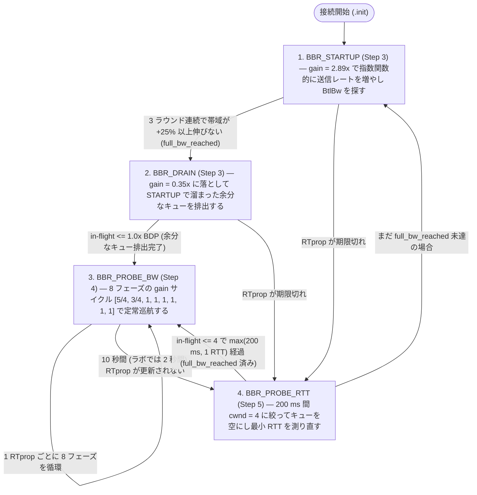

# トラック 3: TCP BBR ハンズオン — ロスではなく「帯域と最小 RTT」で制御する

トラック 1（Reno）とトラック 2（CUBIC）では、「パケットロスが起きるまで `cwnd` を増やし続け、ロスが起きたら `cwnd` を減らす」という **ロスベース（Loss-Based）輻輳制御** を実装しました。1980 年代の Van Jacobson による設計以来、約 30 年間にわたりインターネットを支えてきたアプローチです。

しかし 2016 年、Google の Neal Cardwell、Yuchung Cheng、Van Jacobson らは、ロスベースの前提そのものを覆す新しい輻輳制御アルゴリズム **BBR（Bottleneck Bandwidth and Round-trip propagation time）** を発表しました。

このトラックでは、BBR の予備知識を一切仮定せず、「なぜ Reno や CUBIC では現代のネットワークで問題が起きるのか」という根本的な問いから出発し、BPF `struct_ops` と `packetdrill` を使って **BBRv1 のコアエンジンを 6 つのステップでゼロから実装・検証** します。

---

## 1. なぜ Reno / CUBIC（ロスベース輻輳制御）ではダメだったのか

Reno も CUBIC も、増加曲線の形（直線か 3 次関数か）が違うだけで、基本ルールはまったく同じです。

- **「ルータのバッファが溢れてパケットが落ちる（Loss）まで `cwnd` を増やし続け、パケットが落ちたらパイプが満杯になったとみなして `cwnd` を削る」**

この「パケットロス ＝ 輻輳（パイプが満杯）」という仮定は、1980〜1990 年代のネットワークではうまく機能していましたが、現代のインターネットでは **2 つの正反対の深刻な問題** を引き起こします。

### 問題① Bufferbloat（深いバッファでの深刻な遅延悪化）

家庭用ルータ、ケーブルモデム、携帯基地局などの現代のネットワーク機器には、安価になったメモリが数 MB 単位で搭載されていることが珍しくありません（**深いバッファ / Deep Buffer**）。

たとえば、ボトルネック帯域が 10 Mbps、往復伝搬遅延が 20 ms の回線を考えてみましょう。この回線（パイプ）を隙間なく満たすのに必要なデータ量（BDP: 帯域遅延積）は、わずか **25 KB（約 18 パケット）** です。つまり、ネットワーク上に 18 パケット出ていれば、回線の 10 Mbps はすでに **100% 使い切られています**。

ところが、ルータに 1 MB（約 700 パケット分）の巨大なバッファがあると、Reno や CUBIC はどう振る舞うでしょうか？

- 18 パケットを超えてもルータのバッファが溢れない（パケットロスが起きない）ため、Reno や CUBIC は「まだ回線に余裕がある！」と勘違いして `cwnd` を 100、300、700 パケットへと増やし続けます。
- 18 パケットを超えた分はすべてルータの待ち行列（キュー）に積み上がるだけなので、**スループットは 10 Mbps のまま 1 ビットも速くなりません**。
- その代わり、後から来たパケットはルータの長い行列の最後尾に並ぶことになり、本来 20 ms だった RTT が **常時数百ミリ秒〜1 秒以上** に膨れ上がります。

これが **Bufferbloat（バッファ肥大化による遅延悪化）** です。大容量ダウンロードを裏で走らせた途端にビデオ会議やオンラインゲーム、SSH のレスポンスが固まってしまう現象の正体は、ロスベース輻輳制御がルータのバッファを満杯になるまで詰め込み続けることにあります。

### 問題② 浅いバッファやランダムロスでのスループット崩壊

逆に、データセンター内の高速スイッチ（**浅いバッファ / Shallow Buffer**）や、Wi-Fi・モバイル回線・長距離光回線のように **輻輳とは無関係なランダムロス** がわずかに発生する環境では、正反対の悲劇が起きます。

- まだパイプがガラガラで帯域にたっぷりと空きがあるにもかかわらず、マイクロバーストや無線ノイズで **たった 1 パケットでもロスが起きると**、Reno は `cwnd` を **0.5 倍** に、CUBIC は **0.7 倍** に機械的に減らしてしまいます。
- たとえば、帯域 10 Gbps・RTT 100 ms の長距離高速回線（BDP $\approx$ 86,000 パケット）を CUBIC で 100% 使い切るには、パケットロス率が 1 億分の 1 以下でなければなりません。ほんの少しでもランダムロスがあると、`cwnd` が何度も切り詰められてスループットが壊滅的に落ち込みます。

### 根本原因

これら 2 つの問題の根本原因はただ 1 つです。

> [!IMPORTANT]
> **「パケットロス ＝ 輻輳（パイプが満杯）」という仮定そのものが間違っている！**
> - **深いバッファの経路** では、パケットロスが起きる **はるか手前** でパイプはすでに満杯になり、深刻な遅延（Bufferbloat）が発生しています。
> - **浅いバッファや無線の経路** では、パイプが満杯になる **ずっと手前** でもパケットロスが発生します。

したがって、本当に低遅延かつ高スループットな通信を実現するには、「パケットが落ちたかどうか」を見るのをやめ、**「パイプが実際にどれだけの太さと長さを持っているか」** を直接測る必要があります。

---

## 2. BBR (Bottleneck Bandwidth and Round-trip propagation time) の発想

BBR は、送信元から受信先までのネットワーク経路を **1 本の「水道管（パイプ）」** として物理的にモデル化します。

パイプの性質を決める物理量は、たったの 2 つだけです。

1. **パイプの「太さ」 ＝ ボトルネック帯域 `BtlBw` (Bottleneck Bandwidth)**
   - 経路上で最も細いリンク（ボトルネック）を、単位時間あたりに通過できる最大データ量です。
   - 送信側がいくら速くパケットを流し込んでも、受信側に届く速度（**Delivery Rate: 配送レート** ＝ $\Delta \text{delivered} / \Delta t$）は決してボトルネックの太さを超えられません。逆に、アプリケーションがデータを少ししか送っていないとき（App-limited）には配送レートは小さくなります。
   - そのため、BBR は ACK ごとに観測される配送レートの **最大値（max-filter）** を追跡することで、パイプの太さ `BtlBw` を推定します。
2. **パイプの「長さ」 ＝ 往復伝搬遅延 `RTprop` (Round-trip propagation time)**
   - ルータの待ち行列（キュー）が **完全に空（0 パケット）** のときに、パケットが送信元から受信先へ届き、ACK が戻ってくるまでにかかる純粋な物理的往復時間です。
   - ルータに少しでもキューが溜まると、観測される RTT は「物理的な往復時間 `RTprop` ＋ キューでの待ち時間」へと必ず長くなります（短くなることは絶対にありません）。
   - そのため、BBR は ACK ごとに観測される RTT の **最小値（min-filter）** を追跡することで、パイプの長さ `RTprop` を推定します。

### 理想の動作点（Kleinrock の最適動作点）

パイプの「太さ（`BtlBw`）」と「長さ（`RTprop`）」が分かれば、**パイプの端から端までを隙間なくデータで満たし、かつルータに余計な待ち行列を一切作らない理想の in-flight 量（未確認データ量）** が一意に求まります。これが **BDP（Bandwidth-Delay Product: 帯域遅延積）** です。

$$\text{BDP} = \text{BtlBw} \times \text{RTprop}$$

```text
[ パイプがスカスカ (in-flight < BDP) ]
  送信側 ──> [  pkt  ][       空き       ] ──> ボトルネック ──> 受信側
  ・キュー遅延 = 0 (RTT = RTprop で最小)
  ・しかし帯域を使い切れていない (スループット < BtlBw)

[ 理想の状態: Kleinrock の最適動作点 (in-flight == BDP) ]
  送信側 ──> [ pkt ][ pkt ][ pkt ][ pkt ] ──> ボトルネック ──> 受信側
  ・パイプが隙間なく満杯で、帯域を 100% 使い切る (スループット == BtlBw)
  ・しかもルータの待ち行列は 0 (RTT == RTprop で最小)！

[ 詰め込みすぎ: Bufferbloat (in-flight > BDP) ]
  送信側 ──> [pkt][pkt][pkt][pkt] ＋ [ルータの長い待ち行列...] ──> ボトルネック
  ・帯域は BtlBw で頭打ちのまま、これ以上スループットは上がらない
  ・余分なパケットがすべてルータのキューに溜まり、RTT だけが悪化する
```

### Pacing（等間隔送信）：ドカンと送らず、`BtlBw` と同じ速度で送り出す

もう 1 つ、BBR には極めて重要な仕組みがあります。それが **Pacing（ペーシング）** です。

たとえ `cwnd`（一度にパイプへ出せる総量）をちょうど 1 BDP に制限していたとしても、ACK が返ってきた瞬間に 1 BDP 分のパケットをまとめて「ドカン！」とバースト送信してしまうと、ボトルネックのルータに一時的な行列ができて遅延が跳ね上がったり、浅いバッファから溢れてロスしたりします。

そこで BBR は、`cwnd` でパイプ内の総量に上限をかけるだけでなく、ソケットのペーシングレート（`sk->sk_pacing_rate`）を使って **ボトルネック帯域 `BtlBw` とまったく同じ速度で、パケットを等間隔に滑らかに送り出します**。

- **主役は `sk_pacing_rate`**（パケットを送り出すスピード ＝ $\text{pacing}_{\text{gain}} \times \text{BtlBw}$）
- **安全弁としての `snd_cwnd`**（パイプ内に出せる最大量 ＝ $\text{cwnd}_{\text{gain}} \times \text{BDP}$）

この 2 つを両輪として回すことで、BBR はルータに無駄な行列を作ることなく、回線を 100% 使い切ります。

---

## 3. なぜ BBR には 4 つのモード（状態機械）が必要なのか

ここまでの話を読むと、「なんだ、最初からずっと `pacing_rate = BtlBw`、`cwnd = BDP` に固定して送ればいいじゃないか！」と思うかもしれません。

しかし、ここに **物理的なジレンマ（不確定性原理）** があります。

- **本当の最大帯域 `BtlBw` を知るには**：
  - パイプがまだ空いているのか、それとももう満杯なのかを確かめるため、**一度パイプを満杯以上にして（少しだけ余分なキューを作って）、「これ以上送信レートを上げても、相手に届く速度（Delivery Rate）が上がらない上限」を確かめる** 必要があります。
- **本当の最小遅延 `RTprop` を知るには**：
  - 逆に、ルータに溜まっているパケットをすべて吐き出させ、**パイプの待ち行列を完全に空にして「キューイング遅延が 0 の状態」を作る** 必要があります。

> [!WARNING]
> **物理的なジレンマ：`BtlBw`（満杯以上で測定）と `RTprop`（空にして測定）は、同じ瞬間には絶対に同時測定できません！**

さらに、通信の途中で他のフローが割り込んできたり、他のフローが終了して空き帯域が増えたり、ルーティングが変わって物理的な RTT が変化したりします。そのため、BBR は **「帯域を探る時期」「作ったキューを抜く時期」「最適点で巡航する時期」「キューを空にして最小 RTT を測り直す時期」** を時間的に切り替える **4 つのモード（状態機械）** を持っています。



それぞれのモードの役割を順番に見ていきましょう。

### 1. `BBR_STARTUP` (Step 3 で実装)

- **目的**: 接続開始時、まだ未知であるボトルネック帯域 `BtlBw` を最短時間で見つけ出します。
- **動作**: `pacing_gain` と `cwnd_gain` をともに $\frac{2}{\ln 2} \approx 2.89$ 倍に設定し、1 RTT ごとに送信レートを約 2 倍へ指数関数的に引き上げます。
- **終了条件**: パケットロスを待つのではなく、**「アプリ制限でないラウンドにおいて、測定された最大帯域 `max_bw` が 25% 以上伸びないラウンドが 3 回連続した」** 時点で「パイプが満杯に達した（`full_bw_reached`）」と判断し、`BBR_DRAIN` へ移ります。

### 2. `BBR_DRAIN` (Step 3 で実装)

- **目的**: `BBR_STARTUP` でパイプが満杯になったことを確認するまでの 3 ラウンドの間に、ルータに溜まってしまった余分なキュー（約 $1.89 \times \text{BDP}$）を素早く抜きます。
- **動作**: `pacing_gain` を `STARTUP` の逆数である $\frac{\ln 2}{2} \approx 0.35$ 倍に一気に落とします（送信レートが `BtlBw` の 35% になるため、残りの 65% 分の速度でルータのキューが急速に減っていきます）。
- **終了条件**: パイプ内の未確認パケット数（`tcp_packets_in_flight()`）がちょうど **1 BDP 以下** まで減った瞬間に、キューが空になったと判断して定常状態の `BBR_PROBE_BW` へ移ります。

### 3. `BBR_PROBE_BW` (Step 4 で実装)

- **目的**: 通信時間の約 98% を過ごす定常状態です。キューを作らずに `BtlBw` ぴったりの速度で巡航しつつ、定期的に「空き帯域が増えていないか」を探ります。
- **動作**: 8 つのフェーズからなる `pacing_gain` サイクル **`[5/4, 3/4, 1, 1, 1, 1, 1, 1]`** を、原則として 1 `RTprop`（`min_rtt_us`）ごとに順番に回します。
  - **Phase 0（`5/4 = 1.25` 倍：帯域探査）**: 1 `RTprop` の間だけ、推定 `BtlBw` より 25% 速く送ってみます。もし他のフローが終了して空き帯域が増えていれば、帰ってくる ACK の配送レートが上がり、`max_bw`（`BtlBw`）が上方に更新されます。
  - **Phase 1（`3/4 = 0.75` 倍：キュー排出）**: もし空き帯域が増えていなかった場合、Phase 0 で 25% 多く送った分（$0.25 \times \text{BDP}$）がルータに小さなキューとして溜まっています。そこで次の 1 `RTprop`（または in-flight が 1 BDP 以下に戻るまで）は `0.75` 倍に落として、今自分が作った小さなキューをきれいに消し去ります。
  - **Phase 2〜7（`1.0` 倍 $\times$ 6：巡航）**: 残りの 6 フェーズはぴったり `1.0` 倍（＝ `BtlBw`）で送信し、キューイング遅延ゼロ・帯域利用率 100% の最適点で巡航します。なお、`cwnd_gain` は遅延 ACK や一時的なジッタで送信が詰まらないよう `2.0` 倍に設定されます。

### 4. `BBR_PROBE_RTT` (Step 5 で実装)

- **目的**: 定常状態で走り続けている間に、経路変更で本当の `RTprop` が変わった場合や、複数フローが同時に走っていて常時少しずつキューが残っている（Standing Queue）場合に、古くなった `RTprop`（`min_rtt_us`）を測り直します。
- **動作**: **10 秒間**（本ラボでは `packetdrill` のテストを約 2.5 秒で高速に完了させるため **2 秒間** に設定）、一度も `min_rtt_us` を下回る RTT サンプルが観測されなかったら `BBR_PROBE_RTT` に入ります。
  - 直前の健全な `cwnd` を `ca->prior_cwnd` に保存したうえで、**`snd_cwnd` を強制的に `4` パケット（`BBR_MIN_PIPE_CWND`）に絞り込みます**。
  - in-flight が 4 パケット以下に落ちてから **最低 200 ms かつ最低 1 ラウンド（1 RTT）** 維持することで、パイプのキューを完全に空にして真の最小 RTT を測定します。
  - 測定が終わったら `snd_cwnd` を元の `prior_cwnd` に即座に復元し、`BBR_PROBE_BW` に戻ります（10 秒のうち 200 ms だけなので、帯域のロスはわずか $200\text{ ms} / 10\text{ s} = 2\%$ に抑えられます）。

| モード | `pacing_gain` | `cwnd_gain` | 主な役割 | 次のモードへの遷移条件 | 実装ステップ |
| --- | --- | --- | --- | --- | --- |
| `BBR_STARTUP` | $2/\ln 2 \approx 2.89\times$ | $2/\ln 2 \approx 2.89\times$ | 指数関数的にレートを上げて `BtlBw` を素早く探す | 非 App-limited な 3 ラウンド連続で `max_bw` の伸びが $+25\%$ 未満 | Step 3 |
| `BBR_DRAIN` | $\ln 2 / 2 \approx 0.35\times$ | $2/\ln 2 \approx 2.89\times$ | `STARTUP` で溜まった過剰キューを排出する | `tcp_packets_in_flight(tp) <= 1.0x BDP` | Step 3 |
| `BBR_PROBE_BW` | `[5/4, 3/4, 1, 1, 1, 1, 1, 1]` | $2.0\times$ | 定常状態（1.25x で探り、0.75x で抜き、1.0x で 6 相巡航） | 各フェーズ約 1 `RTprop` ごとに循環（10 秒間 `min_rtt_us` 未更新で `PROBE_RTT` へ） | Step 4 |
| `BBR_PROBE_RTT` | $1.0\times$ | `cwnd = 4` にクランプ | パイプを空にして真の `RTprop`（最小 RTT）を再測定する | `in-flight <= 4` の状態で $\max(200\text{ ms}, 1\text{ RTT})$ 経過後、`prior_cwnd` を復元して復帰 | Step 5 |

---

## 4. BPF での実装の違い（なぜ `.cong_avoid` ではなく `.cong_control` なのか）

BPF `struct_ops`（`struct tcp_congestion_ops`）で BBR を実装する際、Reno（トラック 1）や CUBIC（トラック 2）とは **使うコールバックフック自体が異なります**。

### Reno / CUBIC が使う `.cong_avoid` の限界

Reno や CUBIC は `.cong_avoid(sk, ack, acked)` と `.ssthresh(sk)` を実装していました。しかし、カーネルの ACK 処理（`tcp_ack()` $\rightarrow$ `tcp_cong_control()`）において、`.cong_avoid` には BBR にとって致命的な 2 つの制約があります。

1. **Recovery や CWR の最中には呼ばれない**:
   - `.cong_avoid` は、ソケットの輻輳状態（`icsk_ca_state`）が正常（`TCP_CA_Open` / `TCP_CA_Disorder`）のときにしか呼ばれません。パケットロスが起きて `TCP_CA_Recovery` や `TCP_CA_CWR` に入ると、カーネル標準の `tcp_cwnd_reduction()`（PRR: Proportional Rate Reduction）が勝手に動いて `cwnd` を減らしてしまい、`.cong_avoid` は完全にスキップされます。
2. **配送レート（Delivery Rate）の情報を受け取れない**:
   - `.cong_avoid(sk, ack, acked)` の引数は「何パケット ACK されたか（`acked`）」だけであり、「それが何マイクロ秒の間に届いたのか」「App-limited だったのか」というレート計算に必要な情報が渡されません。

### BBR のメインエンジン：`.cong_control(sk, ack, flag, rs)`

そこで Linux カーネルは、BBR のようなモデルベース輻輳制御のために **`.cong_control(struct sock *sk, u32 ack, int flag, const struct rate_sample *rs)`** フックを用意しています。

カーネルの `tcp_cong_control()` の実装を見てみましょう。

```c
static void tcp_cong_control(struct sock *sk, u32 ack, u32 acked_sacked,
			     int flag, const struct rate_sample *rs)
{
	const struct inet_connection_sock *icsk = inet_csk(sk);

	if (icsk->icsk_ca_ops->cong_control) {
		icsk->icsk_ca_ops->cong_control(sk, ack, flag, rs);
		return;
	}

	if (tcp_in_cwnd_reduction(sk)) {
		/* Reduce cwnd if state mandates */
		tcp_cwnd_reduction(sk, acked_sacked, flag);
	} else if (tcp_may_raise_cwnd(sk, flag)) {
		/* Advance cwnd if state allows */
		tcp_cong_avoid(sk, ack, acked_sacked);
	}
	tcp_update_pacing_rate(sk);
}
```

`icsk_ca_ops->cong_control` が定義されていると、カーネルはそれを呼び出して **即座に `return`** します。つまり：

- カーネル標準の `tcp_cwnd_reduction()`、`tcp_cong_avoid()`、`tcp_update_pacing_rate()` は **すべてバイパス** されます。
- 通常時（`TCP_CA_Open`）であろうとロス回復中（`TCP_CA_Recovery`）であろうと、**すべての ACK ごとに毎回必ず `.cong_control` が呼ばれます**。
- 第 4 引数として、カーネルの `tcp_rate_gen()` が計測した配送レート情報 **`const struct rate_sample *rs`** が直接渡されます。

| `struct rate_sample` の主要フィールド | 型 | 意味と BBR での使い道 |
| --- | --- | --- |
| `rs->delivered` | `__s32` | この測定区間で新たに相手に届いたパケット数（`< 0` の場合は無効サンプル） |
| `rs->interval_us` | `long` | この測定区間の経過時間（マイクロ秒、`<= 0` の場合は無効サンプル） |
| `rs->rtt_us` | `long` | この ACK で計測された RTT（マイクロ秒、未計測時は `-1`）。`RTprop`（`min_rtt_us`）の更新に使用 |
| `rs->is_app_limited` | `bool` | アプリの送信データ不足（パイプに泡がある状態）で計測されたサンプルか。`true` のとき `max_bw` を引き下げないために使用 |
| `rs->is_ack_delayed` | `bool` | 受信側の遅延 ACK タイマーによって遅れた ACK か |
| `rs->acked_sacked` | `__u32` | 今回の ACK で新たに確認（ACK または SACK）されたパケット数 |
| `rs->losses` | `__u32` | 今回の ACK で新たにロスと判定されたパケット数 |
| `rs->prior_delivered` | `__u32` | 今回 ACK されたパケットを送信した時点での累積配送パケット数 `tp->delivered`。パケット単位のラウンド（1 RTT）境界判定に使用 |
| `rs->prior_in_flight` | `__u32` | 今回の ACK が届く直前の in-flight パケット数。`PROBE_BW` のフェーズ遷移判定に使用 |

BBR の `.cong_control` プログラムは、この `rs` を入力として受け取り、内部のモデル（`min_rtt_us`, `max_bw`, `mode`, `cycle_idx` など）を更新したうえで、**`sk->sk_pacing_rate` と `tp->snd_cwnd` の両方を直接書き換えます**。

---

## 5. 全 6 ステップのロードマップと実行方法

本トラックは `step01` から `step06` までの 6 つのステップで構成されています。各ステップで 1 つずつ部品を組み立て、最終的に Linux カーネルの `net/ipv4/tcp_bbr.c` と同等のコア状態機械を完成させます。

| ステップ | ディレクトリ | 実装するテーマ | 主な学習ポイント |
| --- | --- | --- | --- |
| **Step 1** | [step01-pacing-rate](step01-pacing-rate/) | `.cong_control` フックと Pacing Rate 計算 | `.init` での `SK_PACING_NEEDED` 有効化と初期レート計算、`rs->delivered` / `rs->interval_us` からの瞬間配送レート計算と `sk->sk_pacing_rate` の更新 |
| **Step 2** | [step02-btlbw-rtprop](step02-btlbw-rtprop/) | `BtlBw`（最大帯域）と `RTprop`（最小 RTT）による BDP 計算 | `min_rtt_us` の最小値フィルタ、`is_app_limited` を考慮した `max_bw` の最大値フィルタ、`bbr_bdp()` による $\text{BDP} = \lceil \text{BtlBw} \times \text{RTprop} \rceil$ 計算 |
| **Step 3** | [step03-startup-drain](step03-startup-drain/) | `STARTUP` から `DRAIN` への遷移（満杯パイプ検出） | パケット単位のラウンド計数、`bbr_check_full_bw_reached()`（3 ラウンド連続で $+25\%$ 未満の成長で満杯判定）、`bbr_check_drain()` による過剰キュー排出と `PROBE_BW` 突入 |
| **Step 4** | [step04-probe-bw](step04-probe-bw/) | `PROBE_BW` の 8 相ゲインサイクル | `bbr_pacing_gain[] = {5/4, 3/4, 1, 1, 1, 1, 1, 1}`、`bbr_is_next_cycle_phase()` による探査（1.25x）・排出（0.75x）・巡航（1.0x）の各終了条件の実装 |
| **Step 5** | [step05-probe-rtt](step05-probe-rtt/) | `PROBE_RTT` への遷移とキューの排出（`cwnd = 4`） | `min_rtt_stamp` による `RTprop` の有効期限管理、`prior_cwnd` の退避、`snd_cwnd = 4` クランプと「200 ms かつ 1 ラウンド完了」後のウィンドウ復元 |
| **Step 6** | [step06-loss-ack-aggregation](step06-loss-ack-aggregation/) | Loss 時の `cwnd` 保存・復元と ACK 集約（`extra_acked`）補償 | Recovery 第 1 ラウンドのパケット保存則（Packet Conservation）、Recovery 脱出時の `prior_cwnd` 復元、Wi-Fi / GRO 環境のバースト ACK を補償する `extra_acked` の算出 |

### 各ステップのファイル構成

各ステップのディレクトリ（`step01-pacing-rate/` 〜 `step06-loss-ack-aggregation/`）には、以下のファイルが用意されています。

- `README.md` / `README.en.md`: そのステップの学習ゴール、**設計チェックポイント（コードを見る前に考える 4 つの問い）**、実装ロジックと数式の解説、`test.pkt` の検証シナリオ解説
- `starter.bpf.c`: 自分で実装するための `TODO` 付きスケルトンコード（そのまま実行すると `packetdrill` のアサートで FAIL します）
- `solution.bpf.c`: 模範解答の BPF プログラム（`test.pkt` のすべての検証を PASS します）
- `test.pkt`: `vng`（virtme-ng）内で実行される `packetdrill` 自動検証スクリプト

### 実行コマンド

`labs/` ディレクトリ（または `labs/bbr/` から `../run_test.sh`）を使って、カーネルの再ビルドなしで即座にコンパイルとテストを実行できます。

```sh
# labs/ ディレクトリへ移動
cd /usr/local/google/home/kuniyu/tcp-eli5/labs

# 1. まず Step 1 の starter（未実装スケルトン）を実行し、アサートが失敗することを確認する
./run_test.sh bbr/step01-pacing-rate starter

# 2. bbr/step01-pacing-rate/starter.bpf.c の TODO を実装して再実行する
./run_test.sh bbr/step01-pacing-rate starter

# 3. 模範解答（solution.bpf.c）で PASS することを確認する
./run_test.sh bbr/step01-pacing-rate solution
```

全ステップの模範解答をまとめてテストする場合は、任意のステップ名を指定するか `make check` を実行してください。

```sh
# Step 1 〜 Step 6 を順番に実行する場合
for step in bbr/step0*; do ./run_test.sh "$step" solution; done
```

それでは、[Step 1: .cong_control フックと Delivery Rate からの Pacing Rate 計算](step01-pacing-rate/README.md) から始めましょう！
