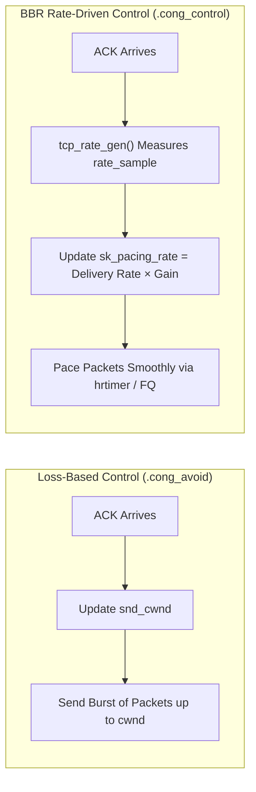

# Step 1: The `.cong_control` Hook and Pacing Rate Calculation from Delivery Rate

## 1. Goal

In this step, you will implement the foundational mechanism of BBR (Bottleneck Bandwidth and Round-trip propagation time) using BPF `struct_ops` (`struct tcp_congestion_ops`): **pacing rate control driven directly by the measured delivery rate**. You will learn how BBR's `.cong_control` hook replaces the traditional `.cong_avoid` hook used by loss-based algorithms (Reno and CUBIC), and how to dynamically update `sk->sk_pacing_rate` from the kernel's `struct rate_sample` measurements (see [../README.md](../README.md) for the full BBR track overview).

---

## 2. How the Algorithm Works (Read This First)

Before examining the design checkpoints or writing code, let's build a complete picture from first principles: why BBR paces packets, how it computes the pacing rate from a delivery rate sample, and which kernel structures and fields are already provided to your BPF program.

### Why Controlling Only `cwnd` Is Not Enough (Intuition Behind Pacing)

Traditional loss-based congestion control algorithms such as Reno and CUBIC only regulate the **congestion window (`snd_cwnd`)** — the maximum number of unacknowledged segments allowed in flight. Relying solely on `snd_cwnd` causes two classic problems:

1. **Line-rate bursts overflow shallow buffers**: Whenever an ACK arrives and opens space in the congestion window, the sender immediately transmits a burst of back-to-back packets at the NIC's line rate. Even if the average sending rate matches the bottleneck link capacity, these instantaneous bursts can overflow shallow router queues and trigger premature packet loss.
2. **Bufferbloat in deep buffers**: When router buffers are deep, loss-based algorithms keep inflating `snd_cwnd` until the buffer completely fills up and drops packets, introducing tens or hundreds of milliseconds of unnecessary queueing delay.

BBR solves this by shifting from a **loss-driven window model** to a **rate-driven pacing model**: whenever an ACK arrives, the kernel measures the actual **Delivery Rate** across the bottleneck link (how many bytes per second reached the receiver) and sets the socket's **Pacing Rate (`sk->sk_pacing_rate`)** so outgoing packets are spaced evenly over time rather than sent in bursts.



### Delivery Rate Formula and Fixed-Point STARTUP Gain

On every incoming ACK, the Linux kernel's rate sampling engine (`tcp_rate_gen()`) measures how many segments (`delivered`) were delivered to the peer over the elapsed measurement interval (`interval_us`, in microseconds). Given the segment payload size `mss_cache` (in bytes) and `USEC_PER_SEC = 1,000,000` microseconds per second, the instantaneous delivery rate $\text{bw}$ in bytes per second is:

$$\text{bw (bytes/sec)} = \frac{\text{delivered} \times \text{mss}_{\text{cache}} \times 1,000,000}{\text{interval}_{\text{us}}}$$

#### Why Multiply Before Dividing in Integer Arithmetic?

In C and BPF integer arithmetic, division truncates any fractional remainder towards zero. If you divided `delivered / interval_us` first (for example, `10 / 10000`), the result would truncate to `0`. Therefore, you must always cast to a 64-bit unsigned integer (`__u64`), **multiply the entire numerator (`delivered * mss_cache * USEC_PER_SEC`) first**, and then divide by `interval_us` using the 64-bit helper `div64_u64()`.

#### Applying the STARTUP Gain in Fixed-Point (`BBR_HIGH_GAIN`)

When a connection starts in the **STARTUP** phase (BBR's equivalent of Slow Start), it probes for available bandwidth by pacing packets faster than the currently measured delivery rate. Specifically, BBR uses a theoretical STARTUP gain of $2 / \ln(2) \approx 2.885\text{x}$, which doubles the sending rate every RTT.

Because floating-point instructions (`float` / `double`) are forbidden in the Linux kernel and BPF programs, BBR represents gains as fixed-point integers scaled by $2^{10} = 1024$ (`BBR_SCALE = 10`, where `BBR_UNIT = 1 << 10 = 1024` represents a `1.0x` multiplier). In this lab, the STARTUP gain is defined as `BBR_HIGH_GAIN = 2885` ($2885 / 1024 \approx 2.817\text{x}$). Applying the gain is a 64-bit multiplication followed by a right shift by `BBR_SCALE`:

$$\text{pacing}_{\text{rate}} = \frac{\text{bw} \times \text{BBR}_{\text{HIGH,GAIN}}}{2^{\text{BBR}_{\text{SCALE}}}} = (\text{bw} \times 2885) \gg 10$$

#### Initialising the Pacing Rate at Connection Start (`.init`)

When the 3-way handshake finishes and `.init(sk)` runs, no data segments have been acknowledged yet, so no `rate_sample` exists. To prevent the initial congestion window (`snd_cwnd = 10` segments) from being transmitted as an unpaced line-rate burst, BBR estimates an initial bandwidth from `snd_cwnd` and the handshake RTT (`rtt_us`), scales it by `BBR_HIGH_GAIN`, and enables TCP internal pacing:

$$\text{init}_{\text{bw}} = \frac{\text{snd}_{\text{cwnd}} \times \text{mss}_{\text{cache}} \times 1,000,000}{\text{rtt}_{\text{us}}}$$

$$\text{init}_{\text{pacing,rate}} = (\text{init}_{\text{bw}} \times \text{BBR}_{\text{HIGH,GAIN}}) \gg \text{BBR}_{\text{SCALE}}$$

### Concrete Numerical Walkthrough (`test.pkt` Numbers)

Let's trace the exact numbers from our test scenario where the payload MSS is `mss_cache = 1000` bytes:

1. **Right after the 3-way handshake (`.init`)**:
   - Initial `snd_cwnd = 10` segments, and the SYN/SYN-ACK RTT is `100 ms` (`rtt_us = 100,000` us):
   - $\text{init}_{\text{bw}} = (10 \times 1000 \times 1,000,000) / 100,000 = 100,000\text{ B/s}$ (100 KB/s)
   - $\text{init}_{\text{pacing,rate}} = (100,000 \times 2885) \gg 10 = 281,738\text{ B/s}$ (~281.7 KB/s)
2. **When the first flight of 10 segments is ACKed after 10 ms (`.cong_control`)**:
   - The ACK reports `rs->delivered = 10` segments delivered over `rs->interval_us = 10,000` us (10 ms):
   - $\text{bw} = (10 \times 1000 \times 1,000,000) / 10,000 = 1,000,000\text{ B/s}$ (1.0 MB/s)
   - $\text{pacing}_{\text{rate}} = (1,000,000 \times 2885) \gg 10 = 2,817,382\text{ B/s}$ (~2.82 MB/s)

### What the Kernel Already Provides (Structures, Fields, and Hooks)

Here are the exact kernel callbacks and structure fields provided to your BPF program:

1. **Callbacks in `struct tcp_congestion_ops`**:
   - `.init(struct sock *sk)`: Invoked once when the TCP connection is initialised.
   - `.cong_control(struct sock *sk, __u32 ack, int flag, const struct rate_sample *rs)`: Invoked by the kernel's `tcp_cong_control()` on every ACK. **Crucially, when `.cong_control` is defined on `struct tcp_congestion_ops`, `tcp_cong_control()` calls it and returns immediately, completely bypassing the kernel's default `.cong_avoid`, `tcp_cwnd_reduction()`, and `tcp_update_pacing_rate()` logic.** Your `.cong_control` callback has sole authority over `sk->sk_pacing_rate` (and `tp->snd_cwnd` in subsequent steps).
   - `.ssthresh(struct sock *sk)` and `.undo_cwnd(struct sock *sk)`: The kernel's registration validator `tcp_validate_congestion_control()` requires every congestion control module to provide non-NULL `.ssthresh` and `.undo_cwnd` callbacks (otherwise registration fails with `-EINVAL`).
2. **Pacing fields on `struct sock *sk`**:
   - `sk->sk_pacing_rate` (`unsigned long`): Target transmission rate in **bytes per second**. The BPF `tcp_congestion_ops` verifier allows direct writes to this field.
   - `sk->sk_pacing_status` (`__u32`): Setting `sk->sk_pacing_status = SK_PACING_NEEDED` activates TCP's internal high-resolution timer (`hrtimer`) pacing engine, ensuring packets are paced even when the `sch_fq` qdisc is not attached to the network interface. Also directly writable from BPF.
3. **Fields on `struct tcp_sock *tp` (obtained via `tcp_sk(sk)`)**:
   - `tp->snd_cwnd` (`__u32`): Current congestion window in segments (initialised to `10`).
   - `tp->snd_ssthresh` (`__u32`): Current slow-start threshold in segments.
   - `tp->mss_cache` (`__u32`): Effective payload MSS in bytes (excluding TCP/IP headers and TCP options).
   - `tp->srtt_us` (`__u32`): Smoothed RTT stored in fixed-point units of **1/8th of a microsecond** (shifted left by 3 bits). To obtain the RTT in microseconds, shift right by 3: **`tp->srtt_us >> 3`**. If no RTT sample has been recorded yet, `tp->srtt_us` is `0`.
4. **Fields on `const struct rate_sample *rs` (4th argument to `.cong_control`)**:
   - Generated automatically by `tcp_rate_gen()` on each ACK before calling `.cong_control`:
   - `rs->delivered` (`__s32`): Number of segments delivered during this sample interval. **If `rs->delivered < 0`, the sample is invalid** (no valid delivery measurement could be taken on this ACK).
   - `rs->interval_us` (`long`): Elapsed time in microseconds for the delivery of those segments. **If `rs->interval_us <= 0`, the sample is invalid** (and dividing by it would cause division by zero or a bogus rate).
5. **Per-socket private storage (`inet_csk(sk)->icsk_ca_priv` / `inet_csk_ca(sk)`)**:
   - Every TCP socket reserves `icsk_ca_priv` as private scratch space for the active congestion control algorithm.
   - **In Step 1, we do not need `icsk_ca_priv` at all**: our pacing rate is computed statelessly on each ACK directly from `rs->delivered`, `rs->interval_us`, and `tp->mss_cache`, and written straight into `sk->sk_pacing_rate`. We will introduce a custom state structure in `icsk_ca_priv` in Step 2 when we begin tracking the windowed maximum bandwidth.

---

## 3. Design Checkpoints (Translate the Algorithm into Code)

Using what you just learned in Section 2, think through these four design questions to plan your implementation of `starter.bpf.c`.

### Q1. Which hook in `struct tcp_congestion_ops` should we implement, and do we need a private struct in `icsk_ca_priv` for Step 1?

Unlike Reno and CUBIC, which implement `.cong_avoid(sk, ack, acked)`, how should `bpf_bbr1` hook into the ACK processing path to receive `struct rate_sample`? And do we need to store any custom per-socket state in `icsk_ca_priv` for this first step?

<details>
<summary>Hint and Answer</summary>

- **Hook to implement**: `.cong_control(struct sock *sk, __u32 ack, int flag, const struct rate_sample *rs)`. Defining `.cong_control` causes the kernel's `tcp_cong_control()` to pass `rs` directly to our BPF program and skip the default `tcp_update_pacing_rate()` and `.cong_avoid` paths. (We also provide `.init`, `.ssthresh`, and `.undo_cwnd` to satisfy `tcp_validate_congestion_control()`.)
- **No private struct needed yet**: All inputs (`rs->delivered`, `rs->interval_us`, `tp->mss_cache`) and the output (`sk->sk_pacing_rate`) live in kernel structures already passed to `.cong_control`. Since Step 1 only computes the instantaneous pacing rate without remembering historical maxima across ACKs, `icsk_ca_priv` is unused here.

</details>

### Q2. How does `.init(sk)` enable TCP internal pacing and safely compute the initial pacing rate without risking division by zero?

In `bpf_bbr1_init()`, which field on `struct sock` turns on internal packet pacing, and how should we extract the initial RTT in microseconds from `tp->srtt_us` when `tp->srtt_us` might be `0` or less than `8`?

<details>
<summary>Hint and Answer</summary>

- Write `sk->sk_pacing_status = SK_PACING_NEEDED;` to enable TCP's internal `hrtimer` pacing.
- Because `tp->srtt_us` is scaled by 8, compute `__u32 rtt_us = tp->srtt_us ? (tp->srtt_us >> 3) : USEC_PER_MSEC;` (falling back to `1000` us = 1 ms when `tp->srtt_us == 0`).
- If `tp->srtt_us` happens to be between `1` and `7`, `tp->srtt_us >> 3` evaluates to `0`, so guard with `if (!rtt_us) rtt_us = 1;` before calling `div64_u64(rate, rtt_us)`.

</details>

### Q3. How should `bpf_bbr1_cong_control()` filter out invalid rate samples?

Not every ACK carries a usable delivery rate measurement. Which fields of `const struct rate_sample *rs` must we inspect at the start of `bpf_bbr1_cong_control()` before performing any arithmetic?

<details>
<summary>Hint and Answer</summary>

- Check both `rs->delivered` and `rs->interval_us` and return early if either is invalid:
  ```c
  if (rs->delivered < 0 || rs->interval_us <= 0)
      return;
  ```
- This discards unusable samples and guarantees that `rs->interval_us` is strictly positive (`>= 1`) when used as the divisor in `div64_u64()`.

</details>

### Q4. How do we write the 64-bit integer arithmetic in `bpf_bbr1_cong_control()` to compute the instantaneous delivery rate and apply `BBR_HIGH_GAIN`?

Given a valid `rs`, write the C statements that compute the delivery rate in bytes/sec from `rs->delivered`, `tp->mss_cache`, `USEC_PER_SEC`, and `rs->interval_us`, scale it by `BBR_HIGH_GAIN` (`2885` in `BBR_SCALE = 10` fixed-point), and update `sk->sk_pacing_rate`.

<details>
<summary>Hint and Answer</summary>

- Cast `rs->delivered` to `__u64` and multiply the numerator before dividing with `div64_u64()` to prevent 32-bit overflow and integer truncation:
  ```c
  rate = (__u64)rs->delivered * tp->mss_cache * USEC_PER_SEC;
  rate = div64_u64(rate, (__u64)rs->interval_us);
  ```
- Multiply by `BBR_HIGH_GAIN` and shift right by `BBR_SCALE`, then assign to `sk->sk_pacing_rate`:
  ```c
  rate = (rate * BBR_HIGH_GAIN) >> BBR_SCALE;
  sk->sk_pacing_rate = rate;
  ```

</details>

---

## 4. Step-by-step Code Walkthrough (`solution.bpf.c`)

Let's walk through each part of [solution.bpf.c](file:///usr/local/google/home/kuniyu/tcp-eli5/labs/bbr/step01-pacing-rate/solution.bpf.c).

### 1. Fixed-Point Constants

```c
#define BBR_SCALE	10
#define BBR_UNIT	(1 << BBR_SCALE)	/* 1024 */
#define BBR_HIGH_GAIN	2885			/* ~2.885x (2/ln(2)) STARTUP gain */
```

- `BBR_SCALE = 10` (`BBR_UNIT = 1024`) defines our fixed-point unit (`1.0x`).
- `BBR_HIGH_GAIN = 2885` represents the STARTUP gain ($2885 / 1024 \approx 2.817\text{x}$). Scaling any byte-per-second `rate` via `(rate * BBR_HIGH_GAIN) >> BBR_SCALE` multiplies it by ~2.82x using pure integer operations.

### 2. `bpf_bbr1_init()` — Enabling Internal Pacing and Setting the Initial Rate

```c
SEC("struct_ops")
void BPF_PROG(bpf_bbr1_init, struct sock *sk)
{
	struct tcp_sock *tp = tcp_sk(sk);
	__u32 rtt_us = tp->srtt_us ? (tp->srtt_us >> 3) : USEC_PER_MSEC;
	__u64 rate;

	if (!rtt_us)
		rtt_us = 1;

	/* Initialize pacing rate: high_gain * init_cwnd * mss / initial_rtt */
	rate = (__u64)tp->snd_cwnd * tp->mss_cache * USEC_PER_SEC;
	rate = div64_u64(rate, rtt_us);
	rate = (rate * BBR_HIGH_GAIN) >> BBR_SCALE;

	sk->sk_pacing_rate = rate;
	sk->sk_pacing_status = SK_PACING_NEEDED;
}
```

- Extracts the initial smoothed RTT in microseconds (`tp->srtt_us >> 3`), defaulting to `USEC_PER_MSEC` (1 ms) if `tp->srtt_us` is zero, and clamps `rtt_us` to at least `1`.
- Computes the initial bandwidth `snd_cwnd * mss_cache * USEC_PER_SEC / rtt_us`, applies `BBR_HIGH_GAIN`, writes the result to `sk->sk_pacing_rate`, and sets `sk->sk_pacing_status = SK_PACING_NEEDED`.

### 3. `bpf_bbr1_cong_control()` — Updating Pacing Rate from `struct rate_sample`

```c
SEC("struct_ops")
void BPF_PROG(bpf_bbr1_cong_control, struct sock *sk, __u32 ack, int flag,
	      const struct rate_sample *rs)
{
	struct tcp_sock *tp = tcp_sk(sk);
	__u64 rate;

	/* Ignore invalid delivery rate samples */
	if (rs->delivered < 0 || rs->interval_us <= 0)
		return;

	/* Instantaneous delivery rate (bytes/sec):
	 *   bw = delivered * mss * USEC_PER_SEC / interval_us
	 */
	rate = (__u64)rs->delivered * tp->mss_cache * USEC_PER_SEC;
	rate = div64_u64(rate, (__u64)rs->interval_us);

	/* Apply STARTUP pacing gain (~2.885x) */
	rate = (rate * BBR_HIGH_GAIN) >> BBR_SCALE;

	sk->sk_pacing_rate = rate;
}
```

- Rejects invalid rate samples where `rs->delivered < 0 || rs->interval_us <= 0`.
- Calculates the instantaneous delivery rate in bytes/sec using 64-bit multiplication (`(__u64)rs->delivered * tp->mss_cache * USEC_PER_SEC`) followed by `div64_u64(rate, (__u64)rs->interval_us)`.
- Multiplies by `BBR_HIGH_GAIN`, shifts right by `BBR_SCALE`, and updates `sk->sk_pacing_rate`.

### 4. `bpf_bbr1_ssthresh()` and `bpf_bbr1_undo_cwnd()`

```c
SEC("struct_ops")
__u32 BPF_PROG(bpf_bbr1_ssthresh, struct sock *sk)
{
	return tcp_sk(sk)->snd_ssthresh;
}

SEC("struct_ops")
__u32 BPF_PROG(bpf_bbr1_undo_cwnd, struct sock *sk)
{
	return tcp_sk(sk)->snd_cwnd;
}
```

- Required by `tcp_validate_congestion_control()` at registration time; in Step 1 they simply return the socket's existing `snd_ssthresh` and `snd_cwnd`.

---

## 5. Understanding `test.pkt` and How to Run

[test.pkt](file:///usr/local/google/home/kuniyu/tcp-eli5/labs/bbr/step01-pacing-rate/test.pkt) verifies `bpf_bbr1` in two stages:

1. **3-way Handshake and Initial Pacing Rate (Lines 13–22)**:
   ```
   +0.00 < S 0:0(0) win 32792 <mss 1012,sackOK,TS val 100 ecr 0,nop,wscale 7>
   +0.00 > S. 0:0(0) ack 1 <mss 1460,sackOK,TS val 100 ecr 100,nop,wscale 7>
   +0.10 < . 1:1(0) ack 1 win 257 <nop,nop,TS val 200 ecr 100>
   ```
   - The client advertises `mss 1012` with 12-byte TCP timestamps, resulting in a payload MSS of `tp->mss_cache = 1000` bytes.
   - The final handshake ACK arrives after `+0.10` (100 ms), so `tp->srtt_us >> 3` is `100,000` us.
   - `bpf_bbr1_init()` computes an initial pacing rate of `10 * 1000 * 1,000,000 / 100,000 * 2885 >> 10 = 281,738 B/s`, which satisfies `assert 200000 < tcpi_pacing_rate < 400000`.
2. **Data Flight of 10 Segments and Pacing Rate Update on ACK (Lines 27–34)**:
   ```
   +0.00 write(4, ..., 10000) = 10000
   +0.00 > P. 1:10001(10000) ack 1 <nop,nop,TS val 200 ecr 200>
   +0.01 < . 1:1(0) ack 10001 win 257 <nop,nop,TS val 210 ecr 200>
   ```
   - The server writes `10,000` bytes (10 segments), and the client acknowledges all `10,000` bytes after `+0.01` (10 ms).
   - This produces a `rate_sample` with `rs->delivered = 10` and `rs->interval_us = 10,000` us, representing a delivery rate of `1,000,000 B/s` (1.0 MB/s).
   - Why [starter.bpf.c](file:///usr/local/google/home/kuniyu/tcp-eli5/labs/bbr/step01-pacing-rate/starter.bpf.c) fails: `bpf_bbr1_cong_control()` is an empty stub, so `sk->sk_pacing_rate` stays at the initial `281,738 B/s` and fails `assert tcpi_pacing_rate > 500000` on line 32.
   - Why [solution.bpf.c](file:///usr/local/google/home/kuniyu/tcp-eli5/labs/bbr/step01-pacing-rate/solution.bpf.c) passes: `bpf_bbr1_cong_control()` updates `sk->sk_pacing_rate` to `1,000,000 * 2885 >> 10 = 2,817,382 B/s` (~2.82 MB/s), passing both `assert tcpi_pacing_rate > 500000` and `assert 2000000 < tcpi_pacing_rate < 3500000`.

### How to Run the Test

Run the commands below to see `starter` fail the assertion and `solution` pass:

```sh
../../run_test.sh bbr/step01-pacing-rate starter
../../run_test.sh bbr/step01-pacing-rate solution
```
