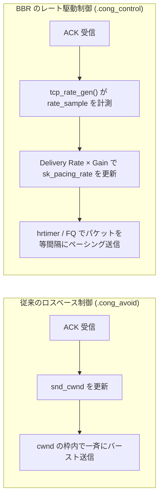

# Step 1: `.cong_control` フックと Delivery Rate からの Pacing Rate 計算

## 1. 学習ゴール

このステップでは、BPF `struct_ops`（`struct tcp_congestion_ops`）を用いて、BBR（Bottleneck Bandwidth and Round-trip propagation time）の最も基本的な仕組みである **配送レート（Delivery Rate）に基づくペーシングレート（Pacing Rate）制御** を実装します。従来のロスベース輻輳制御（Reno / CUBIC）が用いる `.cong_avoid` フックと BBR が用いる `.cong_control` フックの違いを理解し、カーネルが計測した `struct rate_sample` から送信レート `sk->sk_pacing_rate` を動的に更新できるようになることがゴールです（BBR トラック全体の構成は [../README.md](../README.md) を参照してください）。

---

## 2. アルゴリズムと背景の解説（まずここを読む）

コードを書いたり設計の問いを考えたりする前に、まず「なぜ BBR はペーシングレートを制御するのか」「どのように配送レートから送信レートを計算するのか」「カーネルはどの構造体フィールドを提供してくれるのか」を基礎から整理しましょう。

### なぜ `cwnd` だけでは不十分なのか？（ペーシングの直感）

Reno や CUBIC のような従来のロスベース輻輳制御は、「ネットワーク内に同時に存在できる未確認パケット数の上限」である **輻輳ウィンドウ（`snd_cwnd`）** だけを制御します。しかし、`snd_cwnd` による制御には 2 つの構造的な弱点があります。

1. **バースト送信によるキューの溢れ**: ACK が返ってウィンドウが空いた瞬間、送信側は許可された `snd_cwnd` 分のパケットを一気に（ワイヤ速度のバーストとして）ネットワークへ送出します。ボトルネックルータのバッファが浅い場合、平均レートは回線容量以下であっても、この瞬間的なバーストによってバッファが溢れ、パケットロスが発生します。
2. **ロスが起きるまで減速できない（Bufferbloat）**: ルータのバッファが深い場合、ロスベース制御はバッファが満杯になってパケットがドロップするまで `snd_cwnd` を増やし続けるため、大量のキューイング遅延（Bufferbloat）を引き起こします。

BBR はこの問題を根本から解決するため、**「ACK が返ってきた結果から、ボトルネック回線が実際に 1 秒あたり何バイトのペースでパケットを配送できているか（Delivery Rate）を計測し、そのレートに合わせてパケットを一定間隔で滑らかに送出（Pacing）する」** というアプローチを採ります。



### 配送レート（Delivery Rate）と STARTUP ゲインの計算式

ACK が到着するたびに、Linux カーネルは「直近の観測区間 `interval_us`（マイクロ秒）の間に、何個のセグメント `delivered` が相手に届いたか」を計測します。1 セグメントあたりのペイロードサイズを `mss_cache`（バイト）、1 秒を `USEC_PER_SEC = 1,000,000` マイクロ秒とすると、瞬間配送レート $\text{bw}$（bytes/sec）は次の式で求まります。

$$\text{bw (bytes/sec)} = \frac{\text{delivered} \times \text{mss}_{\text{cache}} \times 1,000,000}{\text{interval}_{\text{us}}}$$

#### なぜ整数演算では「先に掛けてから割る」のか？

C 言語（および BPF）の整数除算では小数点以下が切り捨てられます。もし先に `delivered / interval_us` を計算すると、たとえば `delivered = 10`、`interval_us = 10000` のとき `10 / 10000 = 0` に潰れてしまいます。そのため、必ず **分子（`delivered * mss_cache * USEC_PER_SEC`）を 64 ビット符号なし整数（`__u64`）で先に掛け算してから、`div64_u64()` で `interval_us` で割る** 必要があります。

#### 固定小数点によるゲイン（`BBR_HIGH_GAIN`）の適用

コネクション開始直後の **STARTUP フェーズ**（Reno のスロースタートに相当）では、回線の最大帯域を素早く探索するため、計測された配送レートよりも高いレートで送信します。BBR の理論値は、1 RTT ごとに送信レートを 2 倍にするゲイン $2 / \ln(2) \approx 2.885$ です。

カーネルおよび BPF プログラム内では浮動小数点数（`float` / `double`）を使用できないため、BBR は `BBR_SCALE = 10`（すなわち基準単位 `BBR_UNIT = 1 << 10 = 1024` が `1.0x`）の **固定小数点表現** を用います。このラボでは STARTUP ゲインを `BBR_HIGH_GAIN = 2885`（ $2885 / 1024 \approx 2.817\text{x}$）と定義し、次のように掛け算と右シフトでペーシングレートを求めます。

$$\text{pacing}_{\text{rate}} = \frac{\text{bw} \times \text{BBR}_{\text{HIGH,GAIN}}}{2^{\text{BBR}_{\text{SCALE}}}} = (\text{bw} \times 2885) \gg 10$$

#### コネクション確立時（`.init`）の初期ペーシングレート

3-way ハンドシェイクが完了した直後（`.init` フックが呼ばれた時点）では、まだデータパケットに対する ACK が一度も返ってきていないため、`rate_sample` が存在しません。最初のウィンドウ分（`snd_cwnd = 10` セグメント）がバースト送信されるのを防ぐため、`.init` では初期 `snd_cwnd` とハンドシェイクの RTT（`rtt_us`）から初期帯域を推定し、`BBR_HIGH_GAIN` を掛けて初期 `sk_pacing_rate` を設定します。

$$\text{init}_{\text{bw}} = \frac{\text{snd}_{\text{cwnd}} \times \text{mss}_{\text{cache}} \times 1,000,000}{\text{rtt}_{\text{us}}}$$

$$\text{init}_{\text{pacing,rate}} = (\text{init}_{\text{bw}} \times \text{BBR}_{\text{HIGH,GAIN}}) \gg \text{BBR}_{\text{SCALE}}$$

### 具体的な数値例（`test.pkt` のシナリオ）

具体的な数値で計算の流れを確認しましょう（`mss_cache = 1000` バイトとします）。

1. **ハンドシェイク直後（`.init`）**:
   - 初期 `snd_cwnd = 10` セグメント、SYN/SYN-ACK で計測された初期 RTT が `100 ms`（`rtt_us = 100,000` us）のとき：
   - $\text{init}_{\text{bw}} = (10 \times 1000 \times 1,000,000) / 100,000 = 100,000\text{ B/s}$（100 KB/s）
   - $\text{init}_{\text{pacing,rate}} = (100,000 \times 2885) \gg 10 = 281,738\text{ B/s}$（約 281.7 KB/s）
2. **データ 10 セグメント送信後の ACK 到着時（`.cong_control`）**:
   - `10` セグメント（10,000 バイト）が `10 ms`（`interval_us = 10,000` us）で配送されたことを示す ACK が到着したとき（`rs->delivered = 10`, `rs->interval_us = 10000`）：
   - $\text{bw} = (10 \times 1000 \times 1,000,000) / 10,000 = 1,000,000\text{ B/s}$（1.0 MB/s）
   - $\text{pacing}_{\text{rate}} = (1,000,000 \times 2885) \gg 10 = 2,817,382\text{ B/s}$（約 2.82 MB/s）

### カーネルが提供する構造体とフィールド（BPF から使える部品）

このステップを実装するにあたり、Linux カーネルおよび `bpf_cc_helpers.h` が最初から用意しているフックと構造体フィールドは以下の通りです。

1. **`struct tcp_congestion_ops` のフックとカーネルの呼び出し規約**:
   - `.init(struct sock *sk)`: コネクション確立時に初期化のため 1 回呼ばれます。
   - `.cong_control(struct sock *sk, __u32 ack, int flag, const struct rate_sample *rs)`: ACK 処理のたびにカーネルの `tcp_cong_control()` から呼ばれます。**`.cong_control` が定義されている場合、カーネルの `tcp_cong_control()` はそれを呼び出した直後に `return` し、標準の `.cong_avoid` や `tcp_cwnd_reduction()`、`tcp_update_pacing_rate()` をすべてバイパスします。** つまり、`.cong_control` を実装するアルゴリズムは自分で `sk->sk_pacing_rate`（および後のステップでは `tp->snd_cwnd`）を更新する全責任を持ちます。
   - `.ssthresh(struct sock *sk)` と `.undo_cwnd(struct sock *sk)`: カーネルの登録検証関数 `tcp_validate_congestion_control()` は、この 2 つのコールバックが必須（非 NULL）であることを要求します。
2. **`struct sock *sk` のペーシング関連フィールド**:
   - `sk->sk_pacing_rate`（`unsigned long`）: 1 秒あたりの送信バイト数（bytes/sec）を格納します。BPF の `tcp_congestion_ops` から直接書き込み可能です。
   - `sk->sk_pacing_status`（`__u32`）: `SK_PACING_NEEDED` を書き込むことで、NIC や `sch_fq` qdisc に頼らず TCP スタック自身の高分解能タイマー（`hrtimer`）による内部ペーシングを有効化します。これも BPF から直接書き込み可能です。
3. **`struct tcp_sock *tp`（`tcp_sk(sk)` で取得）のフィールド**:
   - `tp->snd_cwnd`（`__u32`）: 現在の輻輳ウィンドウ（セグメント単位、初期値は 10）。
   - `tp->snd_ssthresh`（`__u32`）: スロースタート閾値（セグメント単位）。
   - `tp->mss_cache`（`__u32`）: 現在の有効ペイロード MSS（バイト単位、TCP/IP ヘッダや TCP タイムスタンプ等のオプションを除いた純粋なデータサイズ）。
   - `tp->srtt_us`（`__u32`）: 平滑化 RTT（Smoothed RTT）。カーネル内部では小数部の精度を保つため **実際のマイクロ秒値の 8 倍（3 ビット左シフトされた固定小数点）** で格納されています。したがって、マイクロ秒単位の RTT を取り出すには **`tp->srtt_us >> 3`** とします。まだ RTT が一度も計測されていない場合は `0` になります。
4. **`const struct rate_sample *rs`（`.cong_control` の第 4 引数）**:
   - カーネルの `tcp_rate_gen()` が ACK ごとに自動計算して渡してくれる配送レート計測結果です。
   - `rs->delivered`（`__s32`）: この計測区間で配送が確認されたセグメント数。**`rs->delivered < 0` の場合は有効な計測ができなかった（無効サンプル）** ことを意味します。
   - `rs->interval_us`（`long`）: 上記セグメントが配送されるのに要した時間（マイクロ秒）。**`rs->interval_us <= 0` の場合も無効サンプル** であり、そのまま割るとゼロ除算や不正な値になります。
5. **`inet_csk(sk)->icsk_ca_priv`（`inet_csk_ca(sk)`）について**:
   - 各ソケットには輻輳制御アルゴリズム専用のプライベートメモリ領域 `icsk_ca_priv` が用意されています。
   - ただし **この Step 1 では、ACK ごとに届いた `rs` から即座に `sk->sk_pacing_rate` を計算して書き込むだけであり、過去の履歴をソケットごとに保持する必要がないため、`icsk_ca_priv`（プライベート構造体）は使用しません**（Step 2 で最大帯域を記憶する際に導入します）。

---

## 3. 設計チェックポイント（理解した仕組みをコードに落とし込む）

セクション 2 の解説を踏まえて、`starter.bpf.c` の TODO を埋めるための 4 つの設計クエスチョンを考えてみましょう。

### Q1. BBR ではどのフックを使い、ソケットごとのプライベート構造体（`icsk_ca_priv`）は必要でしょうか？

Reno や CUBIC では `.cong_avoid` を使いましたが、今回の `bpf_bbr1` ではどのフックを実装すべきでしょうか？また、Step 1 の仕様（直近の `rate_sample` から瞬間レートを計算して `sk->sk_pacing_rate` に書き込む）において、`icsk_ca_priv` に独自の構造体を定義する必要はあるでしょうか？

<details>
<summary>ヒントと答え</summary>

- **使うべきフック**: `.cong_control(struct sock *sk, __u32 ack, int flag, const struct rate_sample *rs)` です。これにより、カーネルが計測した `rs` を直接受け取り、カーネル標準の `tcp_update_pacing_rate()` 等をバイパスして自分で `sk->sk_pacing_rate` を制御できます（あわせて登録チェックを通すための `.init`、`.ssthresh`、`.undo_cwnd` も定義します）。
- **プライベート構造体の要否**: Step 1 では不要です。入力となる `rs->delivered`、`rs->interval_us`、`tp->mss_cache`、および出力先の `sk->sk_pacing_rate` はすべてカーネル既存の構造体フィールドにあり、ACK 間で持ち越す独自状態がまだないためです。

</details>

### Q2. `.init(sk)` で内部ペーシングを有効化し、ゼロ除算を避けて初期レートを設定するにはどう書きますか？

コネクション確立時に呼ばれる `bpf_bbr1_init()` では、(1) TCP スタックの内部ペーシングを有効化し、(2) `tp->srtt_us` からマイクロ秒単位の初期 RTT を取り出して初期 `sk->sk_pacing_rate` を設定します。`tp->srtt_us` が `0` の場合や非常に小さい場合、どう扱うべきでしょうか？

<details>
<summary>ヒントと答え</summary>

- `sk->sk_pacing_status = SK_PACING_NEEDED;` を設定することで、TCP の内部ペーシングタイマーを有効化します。
- `tp->srtt_us` は 8 倍された値なので、非ゼロなら `tp->srtt_us >> 3` でマイクロ秒に変換し、`0`（未計測）ならフォールバックとして 1 ミリ秒（`USEC_PER_MSEC = 1000` us）を使います。さらに `tp->srtt_us` が 1〜7 の極端な値で `tp->srtt_us >> 3` が `0` になった場合にもゼロ除算を防ぐため、`if (!rtt_us) rtt_us = 1;` でガードします。

</details>

### Q3. `bpf_bbr1_cong_control()` で無効な `rate_sample` を弾く条件式はどうなりますか？

すべての ACK で有効な配送レートが計測できるわけではありません（たとえば新しいデータを ACK していないパケットなど）。`const struct rate_sample *rs` のどのフィールドをチェックして早期 `return` すべきでしょうか？

<details>
<summary>ヒントと答え</summary>

- セクション 2 で確認した通り、`rs->delivered < 0` または `rs->interval_us <= 0` のサンプルは無効です。
- したがって、関数の先頭で以下のガードを入れます。
  ```c
  if (rs->delivered < 0 || rs->interval_us <= 0)
      return;
  ```
- これにより、直後の除算で `rs->interval_us` が正の値（`>= 1`）であることが保証され、ゼロ除算も確実に防止できます。

</details>

### Q4. `rs` から瞬間配送レート（bytes/sec）を求め、`BBR_HIGH_GAIN` を掛けて `sk->sk_pacing_rate` を更新する C コードはどう書きますか？

有効な `rs` が得られた後、`rs->delivered`、`tp->mss_cache`、`USEC_PER_SEC`、`rs->interval_us`、`BBR_HIGH_GAIN`、`BBR_SCALE` を使って `sk->sk_pacing_rate` を計算する手順を組み立ててみましょう。

<details>
<summary>ヒントと答え</summary>

- 桁落ち（truncation）と 32 ビットオーバーフローを防ぐため、`__u64` にキャストして分子を先に掛け算し、`div64_u64()` で `rs->interval_us` で割ります。
  ```c
  rate = (__u64)rs->delivered * tp->mss_cache * USEC_PER_SEC;
  rate = div64_u64(rate, (__u64)rs->interval_us);
  ```
- 次に、固定小数点の STARTUP ゲイン `BBR_HIGH_GAIN`（`2885`）を掛けて `BBR_SCALE`（`10`）ビット右シフトし、`sk->sk_pacing_rate` に書き込みます。
  ```c
  rate = (rate * BBR_HIGH_GAIN) >> BBR_SCALE;
  sk->sk_pacing_rate = rate;
  ```

</details>

---

## 4. 実装ステップと解説 (`solution.bpf.c`)

[solution.bpf.c](file:///usr/local/google/home/kuniyu/tcp-eli5/labs/bbr/step01-pacing-rate/solution.bpf.c) の各パートを順番に解説します。

### 1. 固定小数点マクロの定義

```c
#define BBR_SCALE	10
#define BBR_UNIT	(1 << BBR_SCALE)	/* 1024 */
#define BBR_HIGH_GAIN	2885			/* ~2.885x (2/ln(2)) STARTUP gain */
```

- `BBR_SCALE = 10`（`BBR_UNIT = 1024`）を固定小数点の基準（`1.0x`）とします。
- `BBR_HIGH_GAIN = 2885` は STARTUP フェーズのペーシングゲインを表します。任意のレート `rate` に対して `(rate * BBR_HIGH_GAIN) >> BBR_SCALE` を計算することで、浮動小数点を使わずに約 `2.817` 倍（`2885 / 1024`）のレート乗算を行います。

### 2. `bpf_bbr1_init()` — ペーシングの有効化と初期レート設定

```c
SEC("struct_ops")
void BPF_PROG(bpf_bbr1_init, struct sock *sk)
{
	struct tcp_sock *tp = tcp_sk(sk);
	__u32 rtt_us = tp->srtt_us ? (tp->srtt_us >> 3) : USEC_PER_MSEC;
	__u64 rate;

	if (!rtt_us)
		rtt_us = 1;

	/* Initialize pacing rate: high_gain * init_cwnd * mss / initial_rtt */
	rate = (__u64)tp->snd_cwnd * tp->mss_cache * USEC_PER_SEC;
	rate = div64_u64(rate, rtt_us);
	rate = (rate * BBR_HIGH_GAIN) >> BBR_SCALE;

	sk->sk_pacing_rate = rate;
	sk->sk_pacing_status = SK_PACING_NEEDED;
}
```

- `tp->srtt_us` が非ゼロであれば `tp->srtt_us >> 3` でマイクロ秒単位の初期 RTT を取得し、`0` の場合は `USEC_PER_MSEC`（`1000` us = 1 ms）を使用します。
- `tp->snd_cwnd * tp->mss_cache * USEC_PER_SEC` を `rtt_us` で割って初期帯域幅（bytes/sec）を求め、`BBR_HIGH_GAIN` を掛けて `sk->sk_pacing_rate` に設定します。
- `sk->sk_pacing_status = SK_PACING_NEEDED` により、ソケットの内部ペーシングを有効化します。

### 3. `bpf_bbr1_cong_control()` — `rate_sample` からのペーシングレート更新

```c
SEC("struct_ops")
void BPF_PROG(bpf_bbr1_cong_control, struct sock *sk, __u32 ack, int flag,
	      const struct rate_sample *rs)
{
	struct tcp_sock *tp = tcp_sk(sk);
	__u64 rate;

	/* Ignore invalid delivery rate samples */
	if (rs->delivered < 0 || rs->interval_us <= 0)
		return;

	/* Instantaneous delivery rate (bytes/sec):
	 *   bw = delivered * mss * USEC_PER_SEC / interval_us
	 */
	rate = (__u64)rs->delivered * tp->mss_cache * USEC_PER_SEC;
	rate = div64_u64(rate, (__u64)rs->interval_us);

	/* Apply STARTUP pacing gain (~2.885x) */
	rate = (rate * BBR_HIGH_GAIN) >> BBR_SCALE;

	sk->sk_pacing_rate = rate;
}
```

- `rs->delivered < 0 || rs->interval_us <= 0` の無効サンプルをフィルタリングします。
- 配送されたバイト数 `(__u64)rs->delivered * tp->mss_cache` に `USEC_PER_SEC` を掛け、`div64_u64()` で `rs->interval_us` で割ることで瞬間配送レート（bytes/sec）を算出します。
- `(rate * BBR_HIGH_GAIN) >> BBR_SCALE` で STARTUP ゲインを適用し、`sk->sk_pacing_rate` を更新します。

### 4. `bpf_bbr1_ssthresh()` と `bpf_bbr1_undo_cwnd()`

```c
SEC("struct_ops")
__u32 BPF_PROG(bpf_bbr1_ssthresh, struct sock *sk)
{
	return tcp_sk(sk)->snd_ssthresh;
}

SEC("struct_ops")
__u32 BPF_PROG(bpf_bbr1_undo_cwnd, struct sock *sk)
{
	return tcp_sk(sk)->snd_cwnd;
}
```

- `tcp_validate_congestion_control()` の必須コールバック要件を満たすため、現在の `snd_ssthresh` と `snd_cwnd` をそのまま返します。

---

## 5. `packetdrill` テストの解説 (`test.pkt`) と実行方法

[test.pkt](file:///usr/local/google/home/kuniyu/tcp-eli5/labs/bbr/step01-pacing-rate/test.pkt) は以下のパケットシーケンスで `bpf_bbr1` の動作を検証します。

1. **3-way ハンドシェイクと初期レートの検証（13〜22 行目）**:
   ```
   +0.00 < S 0:0(0) win 32792 <mss 1012,sackOK,TS val 100 ecr 0,nop,wscale 7>
   +0.00 > S. 0:0(0) ack 1 <mss 1460,sackOK,TS val 100 ecr 100,nop,wscale 7>
   +0.10 < . 1:1(0) ack 1 win 257 <nop,nop,TS val 200 ecr 100>
   ```
   - クライアントが `mss 1012` と 12 バイトの TCP タイムスタンプオプション付きで SYN を送るため、ペイロード MSS は `tp->mss_cache = 1000` バイトになります。
   - SYN-ACK から `+0.10`（100 ms）後に ACK が到着するため、初期 RTT は `100,000` us（100 ms）と計測されます。
   - `bpf_bbr1_init()` により、初期ペーシングレートは `10 * 1000 * 1,000,000 / 100,000 * 2885 >> 10 = 281,738 B/s` に設定され、`assert 200000 < tcpi_pacing_rate < 400000` をパスします。
2. **データ 10 セグメントの送信と ACK によるレート更新の検証（27〜34 行目）**:
   ```
   +0.00 write(4, ..., 10000) = 10000
   +0.00 > P. 1:10001(10000) ack 1 <nop,nop,TS val 200 ecr 200>
   +0.01 < . 1:1(0) ack 10001 win 257 <nop,nop,TS val 210 ecr 200>
   ```
   - サーバーが `10,000` バイト（10 セグメント）を送信し、`+0.01`（10 ms）後にクライアントが `ack 10001` を返します。
   - この ACK によって `rs->delivered = 10`、`rs->interval_us = 10,000` us の `rate_sample` が生成され、瞬間配送レートは `1,000,000 B/s`（1 MB/s）となります。
   - [starter.bpf.c](file:///usr/local/google/home/kuniyu/tcp-eli5/labs/bbr/step01-pacing-rate/starter.bpf.c) では `bpf_bbr1_cong_control()` が未実装（空）であるため、`tcpi_pacing_rate` が初期値 `281,738 B/s` のまま変化せず、32 行目の `assert tcpi_pacing_rate > 500000` で失敗します。
   - [solution.bpf.c](file:///usr/local/google/home/kuniyu/tcp-eli5/labs/bbr/step01-pacing-rate/solution.bpf.c) では `1,000,000 * 2885 >> 10 = 2,817,382 B/s`（約 2.82 MB/s）に更新されるため、32〜33 行目のアサート（`2000000 < tcpi_pacing_rate < 3500000`）をすべてパスします。

### テストの実行コマンド

以下のコマンドで `starter`（失敗を確認）と `solution`（テスト通過を確認）を実行できます。

```sh
../../run_test.sh bbr/step01-pacing-rate starter
../../run_test.sh bbr/step01-pacing-rate solution
```
