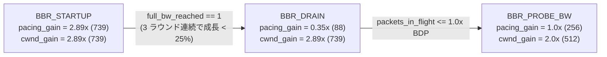

# Step 3: STARTUP から DRAIN・PROBE_BW への状態遷移（満杯パイプ検出）

## 1. 学習ゴール

このステップでは、BBR のステートマシンにおける初期状態 **`BBR_STARTUP`（指数的な帯域探索）** から **`BBR_DRAIN`（STARTUP で溜まった過剰キューの排出）**、そして定常状態である **`BBR_PROBE_BW`（推定ボトルネック帯域での巡航）** への状態遷移を実装します。パケットロスに頼らずに「ボトルネックのパイプが満杯になった（Full Pipe）」ことを検出する `bbr_check_full_bw_reached()`、キューを排出して巡航モードへ移る `bbr_check_drain()`、および各モードのゲインを切り替える `bbr_update_gains()` を完成させましょう（BBR トラック全体の構成は [../README.md](../README.md) を参照してください）。

---

## 2. アルゴリズムと背景の解説（まずここを読む）

### なぜロスを待たずに「パイプ満杯」を検出できるのか？

TCP コネクションが開始された直後、送信側はボトルネックリンクの帯域（`BtlBw`）が 1 Mbps なのか 10 Gbps なのか全く分かりません。そのため、最初は送信レートを毎ラウンド（1 RTT ごと）倍増させて、利用可能な帯域を素早く探索する必要があります。

Reno や CUBIC のような**ロスベース（Loss-based）**の輻輳制御では、スロースタート中に `cwnd` を毎 RTT 2 倍に増やし続け、**ボトルネックルータのバッファが溢れてパケットロスが発生するまで**加速を止めません。しかし、これではコネクション開始のたびにルータのキューを満杯にして大量のパケットロスと遅延（Bufferbloat）を引き起こしてしまいます。

一方、BBR の初期状態である **`BBR_STARTUP`** は、送信レートと `cwnd` のゲインを $2 / \ln(2) \approx 2.885\text{x}$（`bbr_high_gain`）に設定して毎ラウンド送信レートを約 2 倍に引き上げつつ、**配送レート（`max_bw`）の成長が頭打ち（Plateau）になったかどうか**を監視します。

- **パイプが空いている間（送信レート $< \text{BtlBw}$）**: 送信側が毎ラウンド 2 倍のペースでパケットを送り出すと、受信側に届くペース（ACK から計測される配送レート `max_bw`）も毎ラウンド約 2 倍（+100%）のペースで成長します。
- **パイプが満杯になった後（送信レート $\ge \text{BtlBw}$）**: ボトルネックリンクはすでに 100% 稼働しているため、送信側がさらに速く送っても、受信側に届く配送レート `max_bw` は **`BtlBw` で頭打ちになり、それ以上伸びなくなります**（余分に送ったパケットはボトルネックルータのキューに溜まり、RTT が伸びるだけです）。

この性質を利用し、BBR は以下のルールで「パイプが満杯になった（`full_bw_reached = 1`）」と判定します。

> **満杯パイプ検出（Full Pipe Detection）のルール**:
> アプリケーション制限でない（`rs->is_app_limited == 0`）ラウンドの区切り（`round_start == 1`）ごとに、その時点の最大帯域 `max_bw` を基準値 `full_bw` と比較する。
> - もし `max_bw` が `full_bw` から **25% 以上（`1.25x`）成長していれば**（$\text{max}_{\text{bw}} \ge 1.25 \times \text{full}_{\text{bw}}$）、パイプはまだ空いていると判断し、`full_bw = max_bw` に更新してカウンタ `full_bw_cnt = 0` にリセットする。
> - もし成長率が **25% 未満**であれば、`full_bw_cnt` を 1 増やす。これが **3 ラウンド連続（`full_bw_cnt >= 3`）** に達したら、ボトルネック帯域に達したと判断して `full_bw_reached = 1` をセットする。

固定小数点（`BBR_SCALE = 8`、`BBR_UNIT = 256` が `1.0x`）では、しきい値 `1.25x` は `bbr_full_bw_thresh = BBR_UNIT * 5 / 4 = 320` と表され、判定式は以下のようになります。

$$\text{bw}_{\text{thresh}} = \frac{\text{full}_{\text{bw}} \times \text{full}_{\text{bw,thresh}}}{2^{\text{BBR}_{\text{SCALE}}}} = \left(\text{full}_{\text{bw}} \times 320\right) \gg 8$$

### 時計を使わずに「パケット数」で 1 ラウンド（1 RTT）を数える仕組み

「3 ラウンド連続で帯域が 25% 伸びなかった」と判定するには、1 ラウンド（1 往復）の区切りを正確に知る必要があります。BBR はタイマーや時刻ではなく、**累積配送パケット数（`tp->delivered`）** を使った「パケット時間（Packet-timed round trip）」でラウンドを数えます。

1. 新しいラウンドが始まる時点で、現在の `tp->delivered` の値を「次のラウンド境界」として `ca->next_rtt_delivered = tp->delivered` に記録します。
2. カーネルはパケットを送信する際、その時点の `tp->delivered` をパケット（`skb`）のメタデータにスナップショットとして保存します。
3. 1 RTT 後、そのパケットに対する ACK が届くと、カーネルは保存されていたスナップショット値を `rs->prior_delivered` に入れて `.cong_control()` に渡します。
4. したがって、`rs->prior_delivered >= ca->next_rtt_delivered`（32 ビット整数のラップアラウンドを考慮して `!before(rs->prior_delivered, ca->next_rtt_delivered)`）が成り立った瞬間、「このラウンド開始以降に送信されたパケットが 1 往復して ACK された＝**1 ラウンドが完了した**」と分かります。その時点で `ca->next_rtt_delivered = tp->delivered` に進め、`ca->round_cnt++`、`ca->round_start = 1` をセットします。

### なぜ `BBR_STARTUP` の直後に `BBR_DRAIN` を挟むのか？

`BBR_STARTUP` では `pacing_gain` と `cwnd_gain` を `bbr_high_gain`（約 `2.89x`）に設定し、さらに帯域の頭打ちを確認するまで 3 ラウンド様子を見ます。そのため、`full_bw_reached = 1` と判定された時点では、ネットワーク内のインフライトデータ量は最大で約 `2.89x BDP` まで膨らんでいます。パイプ自体の容量は `1.0x BDP` なので、残りの**約 `1.89x BDP` はボトルネックルータのキューに滞留している過剰パケット**です。

もし `BBR_STARTUP` から直接、定常状態の `BBR_PROBE_BW`（`pacing_gain = 1.0x`＝ボトルネック帯域と同じ速度）に移ってしまうと、ルータの入力レートと出力レートが釣り合うため、**溜まった `1.89x BDP` のキューがいつまでも抜けず、RTT が高止まり**してしまいます。

そこで BBR は、`BBR_STARTUP` でパイプ満杯を検出したら、まず **`BBR_DRAIN`** モードへ遷移します。



3 つのモードのゲイン設定と遷移条件をまとめると以下の通りです（`BBR_SCALE = 8`、`BBR_UNIT = 256`）。

| モード | `pacing_gain` | `cwnd_gain` | 役割と遷移条件 |
| :--- | :--- | :--- | :--- |
| **`BBR_STARTUP`** | `bbr_high_gain = 739` ($\approx 2.89\text{x}$) | `bbr_high_gain = 739` ($\approx 2.89\text{x}$) | 毎ラウンド送信レートを倍増させて `BtlBw` を探索する。`full_bw_reached == 1` になったら `BBR_DRAIN` へ遷移し、`tp->snd_ssthresh = BDP` を記録する。 |
| **`BBR_DRAIN`** | `bbr_drain_gain = 88` ($\approx 0.35\text{x}$) | `bbr_high_gain = 739` ($\approx 2.89\text{x}$) | `bbr_high_gain` の逆数（$1 / 2.885 \approx 0.35\text{x}$）にペーシングレートを落とし、STARTUP で作った過剰キューを排出する。`cwnd_gain` は `2.89x` のまま維持し、`cwnd` による急ブレーキではなくペーシングで滑らかに減速する。`tcp_packets_in_flight(tp) <= 1.0x BDP` になったら `BBR_PROBE_BW` へ遷移する（※遷移直後の同じ ACK で条件を満たせば即座に `BBR_PROBE_BW` まで進む）。 |
| **`BBR_PROBE_BW`** | `BBR_UNIT = 256` ($1.0\text{x}$) | `bbr_cwnd_gain = 512` ($2.0\text{x}$) | 推定ボトルネック帯域の `1.0x` でペーシング巡航しつつ、遅延 ACK 等による詰まりを防ぐため `cwnd` には `2.0x BDP` の余裕を持たせる。 |

また、`full_bw_reached` が `0` から `1` に変わると、ペーシングレートと `cwnd` の更新ルールも切り替わります。
- **`bbr_set_pacing_rate()`**: パイプが満杯になる前（`!ca->full_bw_reached`）は、一時的に小さなレートサンプルが出ても加速が止まらないよう `rate > sk->sk_pacing_rate` のときだけ `sk->sk_pacing_rate` を更新（単調増加）します。`ca->full_bw_reached == 1` になった後は、`BBR_DRAIN`（`0.35x`）や `BBR_PROBE_BW`（`1.0x`）の低いレートへ引き下げられるよう、無条件で `sk->sk_pacing_rate = rate` を設定します。
- **`bbr_set_cwnd()`**: `ca->full_bw_reached == 1` になった後は、`cwnd = min(cwnd + acked, target_cwnd)` によって `target_cwnd`（`BBR_PROBE_BW` では `2.0x BDP`、最小値 `BBR_CWND_MIN_TARGET = 4`）へ収束させます。

### 具体例で追う数値トレース（`BtlBw = 100 KB/s` 固定の経路）

ボトルネック帯域が常に `100 KB/s`（`MSS = 1000` バイト、`RTT = 10 ms`、1 ラウンドあたり 1 パケット＝`bw = 1677`）である経路を考えます。

1. **Round 1（最初の非アプリ制限ラウンド）**:
   - `ca->full_bw` は初期値 `0` なので、`bw_thresh = (0 * 320) >> 8 = 0`。
   - 計測された `ca->max_bw = 1677` は `bw_thresh (0)` 以上なので、`ca->full_bw = 1677` に更新され、`ca->full_bw_cnt = 0` となります。
   - モードは `BBR_STARTUP` のまま、ペーシングレートは約 `2.89x * 0.99 * 100 KB/s ≈ 286 KB/s` です。
2. **Round 2**:
   - `bw_thresh = (1677 * 320) >> 8 = 2096`（`1677` の 1.25 倍）。
   - しかしボトルネック帯域は `100 KB/s` で頭打ちのため、`ca->max_bw` は `1677` のまま（`< 2096`）です。
   - 25% 成長に達しなかったため、`ca->full_bw_cnt` が `1` になります（まだ `< 3` なので `BBR_STARTUP` 継続）。
3. **Round 3**:
   - 再び `ca->max_bw (1677) < bw_thresh (2096)` となり、`ca->full_bw_cnt` が `2` になります（`BBR_STARTUP` 継続）。
4. **Round 4**:
   - 3 回連続で `ca->max_bw (1677) < bw_thresh (2096)` となったため、`++ca->full_bw_cnt` が `3` に達し、**`ca->full_bw_reached = 1`** がセットされます！
   - `bbr_check_drain()` が `BBR_STARTUP` から `BBR_DRAIN` へ遷移させ、`tp->snd_ssthresh` に `1.0x BDP` を設定します。さらにその時点で `tcp_packets_in_flight(tp) <= BDP` であれば、同じ ACK 処理の中で即座に `BBR_PROBE_BW`（`pacing_gain = 1.0x`、`cwnd_gain = 2.0x`）へ遷移し、ペーシングレートは約 `99 KB/s`（`100 KB/s` から 1% マージンを引いた値）へ引き下げられます。

### カーネルが提供する構造体フィールドと `icsk_ca_priv`

BPF 輻輳制御プログラムを書くにあたり、カーネルが管理しているフィールドと、BPF 側で独自に保持するプライベート構造体（`icsk_ca_priv`）の役割を整理しておきましょう。

1. **`struct sock *sk`（ソケット共通構造体）**:
   - `sk->sk_pacing_status`: `SK_PACING_NEEDED` を設定するとカーネルのパケットペーシング機構を有効化します。
   - `sk->sk_pacing_rate`: パケットの送信間隔を決めるペーシングレート（単位: bytes/sec）。
   - `sk->sk_max_pacing_rate`: アプリケーションが `SO_MAX_PACING_RATE` で指定した上限レート（未指定なら `0`）。
2. **`struct tcp_sock *tp`（`tcp_sk(sk)` で取得する TCP ソケット構造体）**:
   - `tp->snd_cwnd`: 現在の輻輳ウィンドウ（単位: パケット／セグメント数）。
   - `tp->snd_ssthresh`: スロースタートしきい値（`BBR_STARTUP` 終了時に `1.0x BDP` を記録するために使用）。
   - `tp->snd_cwnd_clamp`: `snd_cwnd` の上限値。
   - `tp->mss_cache`: 現在の最大セグメントサイズ（MSS、単位: bytes）。
   - `tp->srtt_us`: 平滑化 RTT（単位: $\mu\text{s} \times 8$。`tp->srtt_us >> 3` で $\mu\text{s}$ 単位になります）。
   - `tp->delivered`: コネクション開始以降に受信側へ届けられた累積パケット数。
   - `tcp_packets_in_flight(tp)`: 現在ネットワーク上に飛んでいる未確認（in-flight）パケット数を返すヘルパー関数です。
3. **`struct rate_sample *rs`（ACK ごとにカーネルが計算して `.cong_control()` に渡す計測サンプル）**:
   - `rs->rtt_us`: 今回の ACK から計測された RTT（単位: $\mu\text{s}$。計測不能な場合は `<= 0`）。
   - `rs->delivered`: 測定区間内に配送されたパケット数。
   - `rs->interval_us`: 上記パケット数が配送されるのに要した時間（単位: $\mu\text{s}$）。
   - `rs->prior_delivered`: 今回 ACK されたパケットが**送信された時点**での `tp->delivered` のスナップショット値。
   - `rs->acked_sacked`: 今回の ACK で新たに確認応答（ACK / SACK）されたパケット数。
   - `rs->is_app_limited`: 測定区間中に送信データ枯渇や受信ウィンドウ制限があった場合は `1`、ネットワーク帯域を使い切っていた場合は `0`。
4. **`icsk_ca_priv` と `struct bpf_bbr3_ca`（`inet_csk_ca(sk)` で取得する輻輳制御プライベート領域）**:
   - カーネルの `struct inet_connection_sock` には、各輻輳制御アルゴリズムが自由使える固定サイズのプライベートメモリ領域 `icsk_ca_priv` が用意されています。
   - `inet_csk_ca(sk)` ヘルパーを使うと、この `icsk_ca_priv` の先頭ポインタを自前の `struct bpf_bbr3_ca *` として取得できます。
   - このステップの `struct bpf_bbr3_ca` には以下のフィールドが定義されています。
     - `min_rtt_us`: 観測された最小 RTT（$\mu\text{s}$）
     - `max_bw`: 観測された最大配送レート（固定小数点: `packets / us << 24`）
     - `round_cnt`: パケット時間で数えたラウンド数
     - `next_rtt_delivered`: 現在のラウンドが終了する `tp->delivered` の境界値
     - `full_bw`: 満杯パイプ判定の基準となる帯域ベースライン
     - `full_bw_cnt`: 25% 以上の帯域成長が見られなかった連続ラウンド数（`0`〜`3`）
     - `mode`: 現在のモード（`BBR_STARTUP` / `BBR_DRAIN` / `BBR_PROBE_BW`）
     - `pacing_gain`, `cwnd_gain`: 現在のモードに対応するゲイン（固定小数点: `1.0x = 256`）
     - `round_start`: 今回の ACK で新しいラウンドが始まったかを表すフラグ（`0` または `1`）
     - `full_bw_reached`: パイプが満杯に達したかを表すフラグ（`0` または `1`）

---

## 3. 設計チェックポイント（理解した仕組みをコードに落とし込む）

セクション 2 の仕組みを踏まえて、[starter.bpf.c](file:///usr/local/google/home/kuniyu/tcp-eli5/labs/bbr/step03-startup-drain/starter.bpf.c) の 3 つの TODO を実装する前に、以下の設計上の問いを考えてみましょう。

### Q1. `bbr_check_full_bw_reached()` はどのような条件のときに早期リターン（スキップ）すべきでしょうか？

`bbr_check_full_bw_reached()` は ACK ごとに `.cong_control()` から毎回呼び出されます。しかし、すべての ACK で `ca->full_bw_cnt` を進めてしまうと、1 RTT の間に何十回もカウンタが増えて一瞬で `BBR_STARTUP` が終わってしまいます。`ca->full_bw_reached`、`ca->round_start`、`rs->is_app_limited` の 3 つのフラグを使って、どのようなときに何もせず `return` すべきでしょうか？また、判定を行う場合はどのように `bw_thresh` を計算して `ca->full_bw` と `ca->full_bw_cnt` を更新すべきでしょうか？

<details>
<summary>ヒントと答え</summary>

- **早期リターン条件**:
  1. すでに満杯パイプに達している場合（`ca->full_bw_reached`）は再判定不要です。
  2. ラウンドの区切りではない途中の ACK の場合（`!ca->round_start`）は、1 ラウンドに 1 回だけ判定するためにスキップします。
  3. 今回のサンプルがアプリケーション制限だった場合（`rs->is_app_limited`）は、送信側がデータを出し切っておらずパイプが満杯か判断できないためスキップします。
  - すなわち `if (ca->full_bw_reached || !ca->round_start || rs->is_app_limited) return;` とします。
- **しきい値判定と更新**:
  - 64 ビット乗算でオーバーフローを防ぎつつ `bw_thresh = ((__u64)ca->full_bw * bbr_full_bw_thresh) >> BBR_SCALE;` を計算します。
  - `ca->max_bw >= bw_thresh` なら 25% 以上成長しているので、`ca->full_bw = ca->max_bw;` と `ca->full_bw_cnt = 0;` に更新して `return` します。
  - そうでなければ `if (++ca->full_bw_cnt >= bbr_full_bw_cnt)` をチェックし、`3` に達したら `ca->full_bw_reached = 1;` をセットします。

</details>

### Q2. `bbr_check_drain()` で `BBR_STARTUP -> BBR_DRAIN` と `BBR_DRAIN -> BBR_PROBE_BW` の 2 つの判定を `else if` ではなく独立した 2 つの `if` 文で書くのはなぜでしょうか？

`bbr_check_drain()` では、(1) `BBR_STARTUP` から `BBR_DRAIN` への遷移と、(2) `BBR_DRAIN` から `BBR_PROBE_BW` への遷移の 2 つを実装します。もしこれを `if (...) { ... } else if (...) { ... }` で書いてしまうと、受信ウィンドウ制限などでインフライトパケット数が最初から `1.0x BDP` 以下だった場合に何が起きるでしょうか？

<details>
<summary>ヒントと答え</summary>

- もし `else if` にしてしまうと、`ca->full_bw_reached == 1` になった ACK の時点でネットワーク上の過剰キューがすでにゼロ（`tcp_packets_in_flight(tp) <= bbr_bdp(sk, ca->max_bw, BBR_UNIT)`）であっても、その ACK では `BBR_DRAIN` に止まり、`pacing_gain` が `0.35x` に落ちてしまいます。
- 2 つの独立した `if` 文として並べて書けば：
  1. 最初の `if (ca->mode == BBR_STARTUP && ca->full_bw_reached)` で `ca->mode = BBR_DRAIN` に変更し、`tp->snd_ssthresh = bbr_bdp(sk, ca->max_bw, BBR_UNIT)` を記録します。
  2. 直後の `if (ca->mode == BBR_DRAIN && tcp_packets_in_flight(tp) <= bbr_bdp(sk, ca->max_bw, BBR_UNIT))` にそのままフォールスルー（Fall-through）して評価されるため、インフライト数がすでに `1.0x BDP` 以下なら**同じ ACK の中で即座に `ca->mode = BBR_PROBE_BW` まで遷移**できます（[test.pkt](file:///usr/local/google/home/kuniyu/tcp-eli5/labs/bbr/step03-startup-drain/test.pkt) の Round 4 がまさにこのケースです）。

</details>

### Q3. `bbr_update_gains()` では、3 つのモードそれぞれに対して `pacing_gain` と `cwnd_gain` にどの定数を設定すべきでしょうか？

`BBR_STARTUP`、`BBR_DRAIN`、`BBR_PROBE_BW` の 3 モードにおいて、[starter.bpf.c](file:///usr/local/google/home/kuniyu/tcp-eli5/labs/bbr/step03-startup-drain/starter.bpf.c) の先頭で定義されている定数（`bbr_high_gain`、`bbr_drain_gain`、`BBR_UNIT`、`bbr_cwnd_gain`）をどのように割り当てればよいでしょうか？特に `BBR_DRAIN` の `cwnd_gain` と `BBR_PROBE_BW` の `cwnd_gain` に注意して整理してみましょう。

<details>
<summary>ヒントと答え</summary>

- **`BBR_STARTUP`**:
  - `ca->pacing_gain = bbr_high_gain;`（`739` $\approx 2.89\text{x}$）
  - `ca->cwnd_gain = bbr_high_gain;`（`739` $\approx 2.89\text{x}$）
- **`BBR_DRAIN`**:
  - `ca->pacing_gain = bbr_drain_gain;`（`88` $\approx 0.35\text{x}$、キュー排出のため逆数ゲインへ減速）
  - `ca->cwnd_gain = bbr_high_gain;`（`739` $\approx 2.89\text{x}$、`cwnd` 制限で送信を止めずペーシング主導で滑らかに排出するため維持）
- **`BBR_PROBE_BW`（および `default`）**:
  - `ca->pacing_gain = BBR_UNIT;`（`256` $= 1.0\text{x}$、推定ボトルネック帯域で巡航）
  - `ca->cwnd_gain = bbr_cwnd_gain;`（`512` $= 2.0\text{x}$、遅延 ACK 等を吸収するため `2.0x BDP` を確保）

</details>

---

## 4. 実装ステップと解説 (`solution.bpf.c`)

[solution.bpf.c](file:///usr/local/google/home/kuniyu/tcp-eli5/labs/bbr/step03-startup-drain/solution.bpf.c) の各関数と固定小数点演算の流れを解説します。

### 1. スケール定数と各モードのゲイン定義

- `BW_SCALE = 24`（`BW_UNIT = 1 << 24`）: 配送レート `bw`（packets / $\mu\text{s}$）を整数で保持するためのスケールです。
- `BBR_SCALE = 8`（`BBR_UNIT = 1 << 8 = 256`）: ゲインやしきい値の `1.0x` を表す固定小数点スケールです。
  - `bbr_high_gain = BBR_UNIT * 2885 / 1000 + 1 = 739`（$\approx 2.89\text{x}$）
  - `bbr_drain_gain = BBR_UNIT * 1000 / 2885 = 88`（$\approx 0.35\text{x}$）
  - `bbr_cwnd_gain = BBR_UNIT * 2 = 512`（$2.0\text{x}$）
  - `bbr_full_bw_thresh = BBR_UNIT * 5 / 4 = 320`（$1.25\text{x}$）
  - `bbr_full_bw_cnt = 3U`

### 2. ラウンド計数と最大帯域の更新: `bbr_update_bw()`

`bbr_update_bw()` は ACK ごとに呼ばれ、まず `ca->round_start = 0` にクリアした上で、有効なレートサンプル（`rs->delivered > 0 && rs->interval_us > 0`）に対して以下の処理を行います。

1. **パケット時間によるラウンド境界の検出**:
   `!before(rs->prior_delivered, ca->next_rtt_delivered)` が真であれば、現在のラウンド開始時点以降に送信されたパケットの ACK が戻ってきたことを意味するため、`ca->next_rtt_delivered = tp->delivered` に更新し、`ca->round_cnt++` と `ca->round_start = 1` をセットします。
2. **配送レートの計算と `ca->max_bw` の更新**:
   `bw = div64_u64((__u64)rs->delivered * BW_UNIT, (__u64)rs->interval_us)` を計算し、アプリケーション制限でない（`!rs->is_app_limited`）か、あるいは既存の `ca->max_bw` 以上であれば `ca->max_bw` を更新します。

### 3. 満杯パイプ検出: `bbr_check_full_bw_reached()`

```c
static __always_inline void bbr_check_full_bw_reached(struct sock *sk,
						      const struct rate_sample *rs)
{
	struct bpf_bbr3_ca *ca = inet_csk_ca(sk);
	__u32 bw_thresh;

	if (ca->full_bw_reached || !ca->round_start || rs->is_app_limited)
		return;

	bw_thresh = ((__u64)ca->full_bw * bbr_full_bw_thresh) >> BBR_SCALE;
	if (ca->max_bw >= bw_thresh) {
		ca->full_bw = ca->max_bw;
		ca->full_bw_cnt = 0;
		return;
	}

	if (++ca->full_bw_cnt >= bbr_full_bw_cnt)
		ca->full_bw_reached = 1;
}
```

- ラウンドが完了した瞬間（`ca->round_start == 1`）かつ非アプリ制限（`!rs->is_app_limited`）のときだけ評価します。
- `ca->full_bw` の 1.25 倍である `bw_thresh` と `ca->max_bw` を比較し、25% 以上の成長が見られなくなったラウンドが 3 回連続したら `ca->full_bw_reached = 1` を立てます。

### 4. `BBR_DRAIN` と `BBR_PROBE_BW` への状態遷移: `bbr_check_drain()` と `bbr_update_gains()`

```c
static __always_inline void bbr_check_drain(struct sock *sk)
{
	struct tcp_sock *tp = tcp_sk(sk);
	struct bpf_bbr3_ca *ca = inet_csk_ca(sk);

	if (ca->mode == BBR_STARTUP && ca->full_bw_reached) {
		ca->mode = BBR_DRAIN;
		tp->snd_ssthresh = bbr_bdp(sk, ca->max_bw, BBR_UNIT);
	}

	if (ca->mode == BBR_DRAIN &&
	    tcp_packets_in_flight(tp) <= bbr_bdp(sk, ca->max_bw, BBR_UNIT))
		ca->mode = BBR_PROBE_BW;
}
```

- `BBR_STARTUP` 中に `ca->full_bw_reached` が立ったら `BBR_DRAIN` へ移行し、`tp->snd_ssthresh` に `1.0x BDP` を保存します。
- `BBR_DRAIN` 中に `tcp_packets_in_flight(tp)` が `1.0x BDP` 以下になれば `BBR_PROBE_BW` へ移行します。
- 直後に呼ばれる `bbr_update_gains()` が新しい `ca->mode` に応じて `ca->pacing_gain` と `ca->cwnd_gain` を設定し、`bbr_set_pacing_rate()` と `bbr_set_cwnd()` が `sk->sk_pacing_rate` と `tp->snd_cwnd` に反映します。

---

## 5. `packetdrill` テストの解説 (`test.pkt`) と実行方法

[test.pkt](file:///usr/local/google/home/kuniyu/tcp-eli5/labs/bbr/step03-startup-drain/test.pkt) は、一定帯域（1 セグメント / 10 ms = `100 KB/s`）の経路でパケットを送り、3 ラウンド連続で帯域成長が頭打ちになった後に `BBR_STARTUP` を抜ける様子を検証します。

1. **3-way ハンドシェイクと 5,000 バイトの一括 `write()`**:
   - `MSS = 1000` バイト、受信ウィンドウ `win 1000`（1 セグメント）、`RTT = 10 ms`（ハンドシェイク時のみ 100 ms）で接続を確立します。
   - `write(4, ..., 5000)` で 5 セグメント分をまとめて送信キューに積むことで、途中のラウンドで送信キューが空になるのを防ぎ、ウォームアップ後の全ラウンドを非アプリ制限（`rs->is_app_limited == 0`）にします。
2. **Warmup ラウンド（`1:1001`）と Round 1（`1001:2001`）**:
   - 最初の `1:1001` の ACK で初期のアプリ制限状態が解消されます。
   - 続く Round 1（`1001:2001`、10 ms 後に ACK）で非アプリ制限の最大帯域 `ca->max_bw`（`100 KB/s` 相当）が `ca->full_bw` に記録され、`ca->full_bw_cnt = 0` となります。
   - この時点では `BBR_STARTUP`（`pacing_gain = 739 / 256 ≈ 2.89x`）のため、`tcpi_pacing_rate` は約 `286 KB/s`（`250000 < tcpi_pacing_rate < 320000`）、`tcpi_snd_ssthresh` は初期値 `0x7fffffff`（`TCP_INFINITE_SSTHRESH`）です。
3. **Round 2（`2001:3001`）と Round 3（`3001:4001`）**:
   - 10 ms ごとに 1 セグメントずつ ACK されるため、計測帯域は `100 KB/s` のまま横ばい（成長率 0% $< 25\%$）です。
   - `ca->full_bw_cnt` が Round 2 で `1`、Round 3 で `2` に増えますが、まだ `3` 未満なので `BBR_STARTUP`（約 `286 KB/s`）に留まります。
4. **Round 4（`4001:5001`）での状態遷移とアサーション**:
   - 3 ラウンド連続で +25% 未満の成長となったため、`ca->full_bw_cnt` が `3` に達し `ca->full_bw_reached = 1` になります。
   - `bbr_check_drain()` により `BBR_STARTUP -> BBR_DRAIN`（`tp->snd_ssthresh = BDP = 1`）へ遷移し、さらにこの ACK 時点で全 5,000 バイトの配送が完了して `tcp_packets_in_flight(tp) == 0 <= BDP` となっているため、そのまま `BBR_PROBE_BW`（`pacing_gain = 1.0x`、`cwnd_gain = 2.0x`）へ遷移します。
   - **なぜ `starter.bpf.c` は失敗し、`solution.bpf.c` は成功するのか**:
     - `starter.bpf.c` では TODO 部分が空欄のため、Round 4 でも `ca->full_bw_reached` が `0` のまま `BBR_STARTUP` に留まり、`tcpi_pacing_rate` が約 `286 KB/s` のまま下がらず 56 行目の `assert 90000 < tcpi_pacing_rate < 110000` で失敗します。
     - `solution.bpf.c`（または TODO 実装後の `starter.bpf.c`）では、Round 4 で `BBR_PROBE_BW` に遷移するため、`tcpi_pacing_rate` が約 `99 KB/s`（`90000 < tcpi_pacing_rate < 110000`）に下がり、`1 <= tcpi_snd_ssthresh <= 4`、そして `tcpi_snd_cwnd == 4`（`BBR_CWND_MIN_TARGET = 4`）となってすべてのアサーションにパスします。

### テストの実行コマンド

以下のコマンドで、`starter` が失敗することと `solution` がパスすることを確認できます。

```sh
../../run_test.sh bbr/step03-startup-drain starter
../../run_test.sh bbr/step03-startup-drain solution
```
