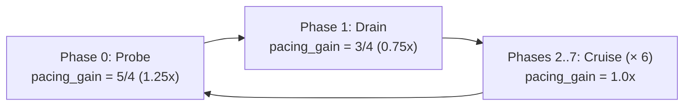

# Step 4: PROBE_BW 8-Phase Gain Cycle (Bandwidth Probing and Queue Draining)

## 1. Goal

In [Step 3](../step03-startup-drain/README.en.md), you implemented `BBR_STARTUP` (which uses a `2.89x` gain to quickly discover the bottleneck bandwidth) and `BBR_DRAIN` (which drains the queue built during startup). In this step, you will implement the steady-state **`BBR_PROBE_BW`** mode's **8-phase pacing gain cycle (`bbr_pacing_gain[]`)** and its phase transition logic (`bbr_is_next_cycle_phase()`, `bbr_advance_cycle_phase()`, `bbr_update_cycle_phase()`, and `bbr_update_gains()`). For the full curriculum progression, see the [BBR Track Overview (`../README.md`)](../README.md).

---

## 2. How the Algorithm Works (Read This First)

### Why Can't BBR Simply Pace at `1.0x` Forever in Steady State?

When a flow finishes `BBR_STARTUP` and `BBR_DRAIN` and enters `BBR_PROBE_BW`, it has measured the bottleneck bandwidth `ca->max_bw` (BtlBw) and minimum round-trip propagation time `ca->min_rtt_us` (RTprop), and its data in flight sits at `1.0x BDP`.

At first glance, it might seem ideal to simply pace at `pacing_gain = 1.0x` (matching `ca->max_bw`) forever so that no bottleneck queue ever forms. However, in real networks, pacing at a static `1.0x` rate creates **two fundamental problems**:

1. **Blindness to newly available bandwidth**:
   Suppose a competing flow sharing the bottleneck finishes, or a routing change doubles the available link capacity from 100 KB/s to 200 KB/s. If the sender continues pacing strictly at `1.0x` of its old `ca->max_bw` estimate (100 KB/s), it never injects more than 100 KB/s into the network. Consequently, the delivery rate measured from returning ACKs (`rs->delivered / rs->interval_us`) can never exceed 100 KB/s. **To discover whether the pipe can carry more traffic, the sender must periodically send faster than `1.0x`.**
2. **Excess queue buildup when capacity has not increased**:
   Conversely, suppose the sender probes for extra capacity by pacing at `1.25x` (+25%) for one RTT, and the bottleneck capacity has *not* actually grown. That extra 25% of traffic cannot cross the bottleneck link immediately, so it accumulates in the bottleneck router's buffer as an excess queue of `0.25x BDP`. If the sender immediately returned to `1.0x` without draining that queue, the `0.25x BDP` queue would persist indefinitely—inflating RTT and stacking up on subsequent probes until the buffer overflows (bufferbloat).

### BBRv1's Solution: The 8-Phase Pacing Gain Cycle (`CYCLE_LEN = 8`)

To solve both problems simultaneously, BBRv1's `BBR_PROBE_BW` mode cycles through **8 phases (Phase 0 to Phase 7)**, where each phase lasts roughly one minimum RTT (`ca->min_rtt_us`):



Using fixed-point arithmetic with `BBR_SCALE = 8` (`1.0x` = `BBR_UNIT = 256`), the 8-element gain array `bbr_pacing_gain[]` is defined as follows:

| Phase (`cycle_idx`) | Role | Fixed-Point Formula (`BBR_UNIT = 256`) | Multiplier | Behaviour and Purpose |
| :--- | :--- | :--- | :--- | :--- |
| **Phase 0** (`0`) | **Probe** | `BBR_UNIT * 5 / 4` (`320`) | `1.25x` | Paces 25% faster than `ca->max_bw` to test whether higher bottleneck bandwidth is available. |
| **Phase 1** (`1`) | **Drain** | `BBR_UNIT * 3 / 4` (`192`) | `0.75x` | Paces 25% slower than `ca->max_bw` to drain the `0.25x BDP` excess queue created in Phase 0 if capacity did not grow (`+0.25 - 0.25 = 0`). |
| **Phases 2..7** (`2..7`) | **Cruise** | `BBR_UNIT` (`256`) | `1.0x` | Cruises at the exact estimated bottleneck rate `ca->max_bw` for 6 rounds, maintaining 100% link utilisation with minimal queuing delay. |

Throughout all 8 phases of `BBR_PROBE_BW`, the congestion window gain `ca->cwnd_gain` remains fixed at **`bbr_cwnd_gain = BBR_UNIT * 2` (`2.0x`)**. While `sk->sk_pacing_rate` controls the actual transmission rate, keeping `target_cwnd` at `2.0x BDP` ensures that the congestion window does not artificially block the `1.25x` probe or stall transmission when ACKs are delayed or aggregated.

> [!NOTE]
> **Flow Desynchronisation (Random Initial Phase) vs. Deterministic Testing**
> In the production Linux kernel, when BBR transitions from `BBR_DRAIN` to `BBR_PROBE_BW`, it picks a random starting `cycle_idx` among the cruise phases (2..7). This prevents multiple BBR flows sharing a bottleneck from synchronising their Phase 0 (`1.25x`) probes at the same instant and causing queue spikes. In this lab (`starter.bpf.c` / `solution.bpf.c`), `bbr_check_drain()` initialises `ca->cycle_idx = 0` so that `test.pkt` can deterministically verify the Phase 0 → Phase 1 → Phase 2 transitions immediately after `BBR_DRAIN`.

### Phase Completion Rules (`bbr_is_next_cycle_phase()`)

How does BBR decide when the current phase has finished so it can advance `ca->cycle_idx`? First, BBR checks whether the time elapsed since the current phase started (`ca->cycle_mstamp`) exceeds one minimum RTT (`ca->min_rtt_us`):

```c
bool is_full_length = (tp->tcp_mstamp - ca->cycle_mstamp) > ca->min_rtt_us;
```

Next, `bbr_is_next_cycle_phase()` applies one of three rules depending on the current `ca->pacing_gain`:

1. **Cruise Phases (`ca->pacing_gain == BBR_UNIT`, Phases 2..7)**:
   - **Transition rule**: `is_full_length`
   - Each cruise phase simply runs until strictly more than `ca->min_rtt_us` has elapsed.

2. **Probe Phase (`ca->pacing_gain > BBR_UNIT`, Phase 0: `1.25x`)**:
   - **Transition rule**:
     ```c
     is_full_length &&
     (rs->losses ||
      rs->prior_in_flight >= bbr_inflight(sk, ca->max_bw, ca->pacing_gain))
     ```
   - **Why is this an `&&` (AND) condition?**
     Even after `ca->min_rtt_us` has elapsed (`is_full_length`), the sender might not yet have managed to put `1.25x BDP` of packets in flight (for instance, if the application briefly wrote slowly or pacing intervals spaced out transmissions). Ending Phase 0 before `1.25x BDP` is actually in flight would abort the bandwidth probe before testing the link.
   - Therefore, Phase 0 continues until **both** `is_full_length` is true **and** either `rs->prior_in_flight` has reached the target `bbr_inflight(sk, ca->max_bw, ca->pacing_gain)` (`1.25x BDP`), or packet loss (`rs->losses > 0`) has occurred (indicating the bottleneck buffer is already full).

3. **Drain Phase (`ca->pacing_gain < BBR_UNIT`, Phase 1: `0.75x`)**:
   - **Transition rule**:
     ```c
     is_full_length ||
     rs->prior_in_flight <= bbr_inflight(sk, ca->max_bw, BBR_UNIT)
     ```
   - **Why is this an `||` (OR) condition that allows early exit?**
     The sole purpose of Phase 1 is to drain the excess queue created during Phase 0 back down to `1.0x BDP`. If Phase 0 actually discovered higher bandwidth (so no excess queue built up), or if the queue finishes draining in less than a full RTT such that `rs->prior_in_flight <= bbr_inflight(sk, ca->max_bw, BBR_UNIT)` (`1.0x BDP`), continuing to pace at `0.75x` would underutilise the bottleneck link!
   - Thus, Phase 1 exits early as soon as `rs->prior_in_flight` drops to or below `1.0x BDP`, or after `is_full_length` (`> ca->min_rtt_us`) at the latest.

### Advancing the Phase (`bbr_advance_cycle_phase()`)

When `bbr_is_next_cycle_phase()` returns `true` in `BBR_PROBE_BW`, `bbr_advance_cycle_phase()` increments `ca->cycle_idx` modulo `CYCLE_LEN` (`8`) and records the new phase's start timestamp (`tp->tcp_mstamp`). Because `CYCLE_LEN = 8` is a power of two, modulo 8 is computed via bitwise AND `& (CYCLE_LEN - 1)` (`& 7`):

```c
ca->cycle_idx = (ca->cycle_idx + 1) & (CYCLE_LEN - 1);
ca->cycle_mstamp = tp->tcp_mstamp;
```

### Concrete Numerical Example (Matching `test.pkt`)

Let's trace the exact numbers from `test.pkt`:
- `MSS = 1000` bytes
- Minimum RTT: `ca->min_rtt_us = 10,000` us (10 ms)
- Bottleneck bandwidth: 1 segment (1,000 bytes) per 10 ms = **100,000 B/s (100 KB/s)**
  - Packet delivery rate: `1 pkt / 10,000 us = 0.0001 pkts/us`
  - Fixed-point `ca->max_bw`: `1 * (1 << 24) / 10000 = 1677` (`BW_SCALE = 24`)
- **Target in-flight packets `bbr_inflight(sk, ca->max_bw, gain)`**:
  - At `1.0x` (`gain = 256`): `BDP = 0.0001 pkts/us * 10,000 us = 1.0` packet → **`1` packet**
  - At `1.25x` (`gain = 320`): `1.0 * 1.25 = 1.25` packets → ceiling division in `bbr_bdp()` (`(((w * gain) >> 8) + BW_UNIT - 1) / BW_UNIT`) rounds this up to **`2` packets**
- **Pacing rate `sk->sk_pacing_rate` in each phase** (after applying the 1% pacing margin `bbr_pacing_margin_percent = 1`):
  - **Phase 0 (`5/4 = 1.25x`)**: `100,000 * 1.25 * 0.99` ≈ **`123,750 B/s` (~123 KB/s)**
  - **Phase 1 (`3/4 = 0.75x`)**: `100,000 * 0.75 * 0.99` ≈ **`74,250 B/s` (~74 KB/s)**
  - **Phases 2..7 (`1.0x`)**: `100,000 * 1.00 * 0.99` ≈ **`99,000 B/s` (~99 KB/s)**

### Kernel and `starter.bpf.c` Fields & Helpers Provided

Before moving to Section 3, here is every struct field and helper function already provided by the kernel and `starter.bpf.c`:

#### 1. `struct tcp_sock *tp = tcp_sk(sk)` (Kernel TCP Socket State)
- `tp->tcp_mstamp` (`__u64`): Microsecond timestamp updated by the kernel on every packet transmission and ACK reception. Used to compute phase elapsed time `(tp->tcp_mstamp - ca->cycle_mstamp)` and to stamp `ca->cycle_mstamp` when advancing phases.
- `tp->snd_cwnd` (`__u32`): Current congestion window in packets.

#### 2. `const struct rate_sample *rs` (Per-ACK Rate Sample Passed by the Kernel to `.cong_control`)
- `rs->prior_in_flight` (`__u32`): Number of packets in flight right before this ACK was processed. Used in `bbr_is_next_cycle_phase()` to check whether Phase 0 reached `>= 1.25x BDP` or Phase 1 drained down to `<= 1.0x BDP`.
- `rs->losses` (`__u32`): Number of packets newly marked lost on this ACK. Used in Phase 0 to end probing if loss occurs after 1 RTT.

#### 3. `struct bbr_ca *ca = inet_csk_ca(sk)` (Per-Socket Private Storage in `icsk_ca_priv`)
Every `struct inet_connection_sock` includes an inline private buffer `icsk_ca_priv` reserved for the active congestion control algorithm, accessed via `inet_csk_ca(sk)` as `struct bbr_ca *ca`:
- `ca->mode` (`__u32`): Current BBR mode (`BBR_STARTUP`, `BBR_DRAIN`, `BBR_PROBE_BW`). When `bbr_check_drain()` finishes draining the startup queue, it sets `ca->mode = BBR_PROBE_BW`, `ca->cycle_idx = 0`, and `ca->cycle_mstamp = tp->tcp_mstamp`.
- `ca->cycle_idx` (`__u32`): Current index (`0..7`) in `bbr_pacing_gain[]`.
- `ca->cycle_mstamp` (`__u64`): Value of `tp->tcp_mstamp` (in microseconds) when the current `BBR_PROBE_BW` phase began.
- `ca->min_rtt_us` (`__u32`): Minimum RTT observed so far in microseconds.
- `ca->max_bw` (`__u32`): Estimated bottleneck bandwidth in `BW_SCALE = 24` fixed-point (`pkts/us << 24`).
- `ca->pacing_gain` / `ca->cwnd_gain` (`__u32`): Current pacing and cwnd gains in `BBR_SCALE = 8` fixed-point (`BBR_UNIT = 256` represents `1.0x`).

#### 4. Existing Constants and Helpers in `starter.bpf.c`
- `CYCLE_LEN` (`8`), `BBR_UNIT` (`256`), `bbr_cwnd_gain` (`BBR_UNIT * 2`)
- `bbr_pacing_gain[8]`: `{ BBR_UNIT * 5 / 4, BBR_UNIT * 3 / 4, BBR_UNIT, ... }`.
- `bbr_inflight(sk, bw, gain)`: Returns the target in-flight packet count (`ceil(BDP * gain)`) for a given `bw` and `gain`.

---

## 3. Design Checkpoints (Translate the Algorithm into Code)

Use the concepts and struct fields from Section 2 to work through the four TODOs in `starter.bpf.c`.

### Q1. How should we express the base timer check and the Cruise phase (Phases 2..7) completion rule in `bbr_is_next_cycle_phase()`? (TODO 1, Part 1)

In `bbr_is_next_cycle_phase(struct sock *sk, const struct rate_sample *rs)`, which fields of `tp` and `ca` determine whether the current phase has lasted longer than one minimum RTT (`is_full_length`), and what should the function return when `ca->pacing_gain == BBR_UNIT`?

<details>
<summary>Hint and Answer</summary>

- Subtract the phase start timestamp `ca->cycle_mstamp` from the current TCP timestamp `tp->tcp_mstamp`, and check if the difference is strictly greater than `ca->min_rtt_us`:
  ```c
  bool is_full_length = (tp->tcp_mstamp - ca->cycle_mstamp) > ca->min_rtt_us;
  ```
- During the cruise phases (`ca->pacing_gain == BBR_UNIT`), transition depends solely on elapsed time, so we immediately return `is_full_length`:
  ```c
  if (ca->pacing_gain == BBR_UNIT)
          return is_full_length;
  ```

</details>

### Q2. How do the Probe phase (`ca->pacing_gain > BBR_UNIT`) and Drain phase (`ca->pacing_gain < BBR_UNIT`) conditions differ in logical operators (`&&` vs `||`) and `bbr_inflight()` arguments? (TODO 1, Part 2)

When writing the remaining two branches of `bbr_is_next_cycle_phase()`, how should `is_full_length` be combined with `rs->prior_in_flight`, and what `gain` argument must be passed to `bbr_inflight(sk, ca->max_bw, ...)` in each branch?

<details>
<summary>Hint and Answer</summary>

- **Probe phase (`ca->pacing_gain > BBR_UNIT`, Phase 0)**:
  - Must wait until **both (`&&`)** a full minimum RTT has elapsed (`is_full_length`) **and** the sender has either experienced packet loss (`rs->losses`) or filled the pipe to the probe target (`1.25x BDP`).
  - The target in-flight volume uses `ca->pacing_gain` (`5/4`): `bbr_inflight(sk, ca->max_bw, ca->pacing_gain)`.
  ```c
  if (ca->pacing_gain > BBR_UNIT)
          return is_full_length &&
                  (rs->losses ||
                   rs->prior_in_flight >= bbr_inflight(sk, ca->max_bw, ca->pacing_gain));
  ```
- **Drain phase (`ca->pacing_gain < BBR_UNIT`, Phase 1)**:
  - Exits when **either (`||`)** a full minimum RTT has elapsed (`is_full_length`) **or** the excess queue has finished draining early (`rs->prior_in_flight` drops to or below `1.0x BDP`).
  - Note that the third argument to `bbr_inflight()` here is **`BBR_UNIT` (`1.0x`)**, *not* `ca->pacing_gain` (`0.75x`), because the goal of Phase 1 is to bring in-flight packets back down to `1.0x BDP`:
  ```c
  return is_full_length ||
          rs->prior_in_flight <= bbr_inflight(sk, ca->max_bw, BBR_UNIT);
  ```

</details>

### Q3. What two state variables must `bbr_advance_cycle_phase()` update when `bbr_update_cycle_phase()` triggers a transition? (TODO 2 & TODO 3)

In `bbr_update_cycle_phase()`, we check `ca->mode == BBR_PROBE_BW && bbr_is_next_cycle_phase(sk, rs)` before calling `bbr_advance_cycle_phase(sk)`. Inside `bbr_advance_cycle_phase(sk)`, what happens if you increment `ca->cycle_idx` (wrapping modulo `CYCLE_LEN`) but forget to update `ca->cycle_mstamp`?

<details>
<summary>Hint and Answer</summary>

- `bbr_advance_cycle_phase(sk)` must update **both** `ca->cycle_idx` and `ca->cycle_mstamp`:
  ```c
  ca->cycle_idx = (ca->cycle_idx + 1) & (CYCLE_LEN - 1);
  ca->cycle_mstamp = tp->tcp_mstamp;
  ```
- If you forget to set `ca->cycle_mstamp = tp->tcp_mstamp`, then `tp->tcp_mstamp - ca->cycle_mstamp` remains greater than `ca->min_rtt_us` on every subsequent ACK, causing `is_full_length` to evaluate to `true` immediately and skipping through subsequent phases on every single ACK!

</details>

### Q4. How should `bbr_update_gains()` index into `bbr_pacing_gain[]` to satisfy the BPF verifier, and why does call order in `bpf_bbr4_main()` matter? (TODO 4)

In `bbr_update_gains()`, how should `ca->cycle_idx` be masked when indexing `bbr_pacing_gain[]`? Also, look at `bpf_bbr4_main()`: why is `bbr_update_cycle_phase()` called *before* `bbr_check_drain()`, and `bbr_update_gains()` called *after* both?

<details>
<summary>Hint and Answer</summary>

- **BPF verifier bounds check**:
  Masking the index with `& 7` (`bbr_pacing_gain[ca->cycle_idx & 7]`) proves statically to the kernel BPF verifier that the array index is always within `0..7`, preventing out-of-bounds verifier rejections.
- **Call order in `bpf_bbr4_main()`**:
  1. If the connection is already in `BBR_PROBE_BW`, `bbr_update_cycle_phase()` evaluates `bbr_is_next_cycle_phase()` using the current phase's `ca->pacing_gain` and advances `ca->cycle_idx` if the phase is complete.
  2. If the connection was still in `BBR_STARTUP` or `BBR_DRAIN`, `bbr_update_cycle_phase()` does nothing, and `bbr_check_drain()` then transitions `ca->mode` into `BBR_PROBE_BW` with `ca->cycle_idx = 0` and `ca->cycle_mstamp = tp->tcp_mstamp`.
  3. Finally, `bbr_update_gains()` looks up `bbr_pacing_gain[ca->cycle_idx & 7]` for the newly entered or updated phase, and `bbr_set_pacing_rate()` immediately applies that gain to `sk->sk_pacing_rate`.

</details>

---

## 4. Step-by-step Code Walkthrough (`solution.bpf.c`)

Let's walk through each component implemented in `solution.bpf.c`.

### 1. The `bbr_pacing_gain[]` Table

In steady state (`BBR_PROBE_BW`), BBR cycles through the 8-phase pacing gain array:

```c
#define CYCLE_LEN			8

static const int bbr_pacing_gain[] = {
	BBR_UNIT * 5 / 4,
	BBR_UNIT * 3 / 4,
	BBR_UNIT,
	BBR_UNIT,
	BBR_UNIT,
	BBR_UNIT,
	BBR_UNIT,
	BBR_UNIT,
};
```

- Index `0`: `BBR_UNIT * 5 / 4` (`320` = `1.25x`, Probe phase)
- Index `1`: `BBR_UNIT * 3 / 4` (`192` = `0.75x`, Drain phase)
- Indices `2..7`: `BBR_UNIT` (`256` = `1.0x`, 6 Cruise phases)

### 2. `bbr_is_next_cycle_phase()` — Evaluating Phase Completion (TODO 1)

```c
static __always_inline bool bbr_is_next_cycle_phase(struct sock *sk,
						    const struct rate_sample *rs)
{
	struct tcp_sock *tp = tcp_sk(sk);
	struct bbr_ca *ca = inet_csk_ca(sk);
	bool is_full_length = (tp->tcp_mstamp - ca->cycle_mstamp) > ca->min_rtt_us;

	if (ca->pacing_gain == BBR_UNIT)
		return is_full_length;

	if (ca->pacing_gain > BBR_UNIT)
		return is_full_length &&
			(rs->losses ||
			 rs->prior_in_flight >= bbr_inflight(sk, ca->max_bw, ca->pacing_gain));

	return is_full_length ||
		rs->prior_in_flight <= bbr_inflight(sk, ca->max_bw, BBR_UNIT);
}
```

- `is_full_length`: Checks whether elapsed time `(tp->tcp_mstamp - ca->cycle_mstamp)` exceeds `ca->min_rtt_us`.
- `ca->pacing_gain == BBR_UNIT`: Cruise phases finish as soon as `is_full_length` is true.
- `ca->pacing_gain > BBR_UNIT`: Phase 0 (Probe) requires `is_full_length` AND either packet losses (`rs->losses`) or `rs->prior_in_flight >= bbr_inflight(sk, ca->max_bw, ca->pacing_gain)` (`1.25x BDP`).
- `ca->pacing_gain < BBR_UNIT`: Phase 1 (Drain) finishes when `is_full_length` is true OR `rs->prior_in_flight <= bbr_inflight(sk, ca->max_bw, BBR_UNIT)` (`1.0x BDP`).

### 3. `bbr_advance_cycle_phase()` and `bbr_update_cycle_phase()` — Advancing Phases (TODO 2 & TODO 3)

```c
static __always_inline void bbr_advance_cycle_phase(struct sock *sk)
{
	struct tcp_sock *tp = tcp_sk(sk);
	struct bbr_ca *ca = inet_csk_ca(sk);

	ca->cycle_idx = (ca->cycle_idx + 1) & (CYCLE_LEN - 1);
	ca->cycle_mstamp = tp->tcp_mstamp;
}

static __always_inline void bbr_update_cycle_phase(struct sock *sk,
						   const struct rate_sample *rs)
{
	struct bbr_ca *ca = inet_csk_ca(sk);

	if (ca->mode == BBR_PROBE_BW && bbr_is_next_cycle_phase(sk, rs))
		bbr_advance_cycle_phase(sk);
}
```

- `bbr_advance_cycle_phase()` increments `ca->cycle_idx` modulo 8 (`& (CYCLE_LEN - 1)`) and stamps `ca->cycle_mstamp = tp->tcp_mstamp`.
- `bbr_update_cycle_phase()` checks `ca->mode == BBR_PROBE_BW` and advances the phase whenever `bbr_is_next_cycle_phase(sk, rs)` returns `true`.

### 4. `bbr_update_gains()` — Applying the Phase Gain (TODO 4)

```c
static __always_inline void bbr_update_gains(struct sock *sk)
{
	struct bbr_ca *ca = inet_csk_ca(sk);

	switch (ca->mode) {
	case BBR_STARTUP:
		ca->pacing_gain = bbr_high_gain;
		ca->cwnd_gain = bbr_high_gain;
		break;
	case BBR_DRAIN:
		ca->pacing_gain = bbr_drain_gain;
		ca->cwnd_gain = bbr_high_gain;
		break;
	case BBR_PROBE_BW:
	default:
		ca->pacing_gain = bbr_pacing_gain[ca->cycle_idx & 7];
		ca->cwnd_gain = bbr_cwnd_gain;
		break;
	}
}
```

- In `BBR_PROBE_BW`, `ca->pacing_gain` is selected from `bbr_pacing_gain[ca->cycle_idx & 7]`, while `ca->cwnd_gain` is set to `bbr_cwnd_gain` (`2.0x`).
- Immediately afterwards in `bpf_bbr4_main()`, `bbr_set_pacing_rate(sk, ca->max_bw, ca->pacing_gain)` updates `sk->sk_pacing_rate`.

---

## 5. Understanding `test.pkt` and How to Run

### Walkthrough of `test.pkt`

`test.pkt` emulates a 100 KB/s bottleneck link (`MSS = 1000` bytes, `min_rtt_us = 10 ms`, `1.0x BDP = 1` packet) and verifies the transitions through **Phase 0 (`1.25x`) → Phase 1 (`0.75x`) → Phase 2 (`1.0x`)** after exiting `BBR_STARTUP`:

1. **Handshake and STARTUP Plateau (Lines 14–53)**:
   - The first data segment (`1:1001`) is ACKed after 10 ms with `win 1000`, establishing `ca->min_rtt_us = 10,000` us and `ca->max_bw` ≈ 100 KB/s (`1.0x BDP = 1` segment). Because the receive window caps in-flight data at 1 segment, bandwidth plateaus across Rounds 1 to 4.
2. **Exiting STARTUP into `BBR_PROBE_BW` Phase 0 (Lines 48–57)**:
   - On the Round 4 ACK (`ack 6001 win 2000` at line 53), `full_bw_cnt` reaches `3`, setting `ca->full_bw_reached = 1`.
   - `bbr_check_drain()` transitions `BBR_STARTUP` → `BBR_DRAIN`, and because `tcp_packets_in_flight(tp)` is `0` (`<= 1.0x BDP = 1`), it immediately transitions into `BBR_PROBE_BW` with `ca->cycle_idx = 0` and `ca->cycle_mstamp = tp->tcp_mstamp`.
   - Phase 0 applies `pacing_gain = 5/4` (`1.25x`), setting `tcpi_pacing_rate` to `100,000 * 1.25 * 0.99` ≈ **`123,750 B/s`** and `tcpi_snd_cwnd` to `4` (`bbr_cwnd_min_target`), verified at lines 55–56:
   ```python
   assert 115000 < tcpi_pacing_rate < 135000, f"PROBE_BW Phase 0 (5/4 gain): expected ~123KB/s, got {tcpi_pacing_rate}"
   assert tcpi_snd_cwnd == 4, f"PROBE_BW Phase 0: expected cwnd == 4, got {tcpi_snd_cwnd}"
   ```
   - The ACK at line 53 also opens the receive window to `win 2000` (2 segments) so the sender can inject 2 segments during Phase 0.
3. **Transition from Phase 0 to Phase 1 (`0.75x`) (Lines 59–70)**:
   - Two segments (`6001:7001` and `7001:8001`) are sent 10 ms apart, and `ack 8001` arrives 10 ms after the second segment.
   - At this ACK, 30 ms has elapsed since Phase 0 started (`> min_rtt_us = 10 ms`, so `is_full_length == true`), and `rs->prior_in_flight == 2` meets `bbr_inflight(sk, ca->max_bw, 5/4) == 2`. Because 2 segments were delivered over 20 ms, `ca->max_bw` remains 100 KB/s.
   - `bbr_is_next_cycle_phase()` returns `true`, advancing `ca->cycle_idx` to `1` (Phase 1: `3/4 = 0.75x`). Line 69 asserts that `tcpi_pacing_rate` drops to **`~74,250 B/s`**:
   ```python
   assert 65000 < tcpi_pacing_rate < 85000, f"PROBE_BW Phase 1 (3/4 gain): expected ~74KB/s, got {tcpi_pacing_rate}"
   ```
4. **Transition from Phase 1 to Phase 2 (`1.0x`) (Lines 72–80)**:
   - One segment (`8001:9001`) is sent and ACKed 15 ms later (`ack 9001`).
   - Both `is_full_length` (`25 ms > 10 ms`) and `rs->prior_in_flight == 1 <= bbr_inflight(1.0x) == 1` are satisfied, advancing `ca->cycle_idx` to `2` (Phase 2: `1.0x` cruise). Line 79 asserts that `tcpi_pacing_rate` returns to **`~99,000 B/s`**:
   ```python
   assert 90000 < tcpi_pacing_rate < 110000, f"PROBE_BW Phase 2 (1.0 gain): expected ~99KB/s, got {tcpi_pacing_rate}"
   ```

### Why `starter.bpf.c` Fails and `solution.bpf.c` Passes

- **Why `starter.bpf.c` fails**:
  In `starter.bpf.c`, `bbr_update_gains()` hardcodes `ca->pacing_gain = BBR_UNIT` (`1.0x`) in `BBR_PROBE_BW`, and `bbr_is_next_cycle_phase()` always returns `false`. As a result, when the flow enters `BBR_PROBE_BW` Phase 0 at line 53, `tcpi_pacing_rate` is set to `~99,000 B/s` (`1.0x`) instead of `~123,750 B/s` (`1.25x`), failing the assertion at line 55 (`assert 115000 < tcpi_pacing_rate < 135000`).
- **Why `solution.bpf.c` passes**:
  `bbr_update_gains()` looks up `bbr_pacing_gain[ca->cycle_idx & 7]`, and `bbr_is_next_cycle_phase()`, `bbr_advance_cycle_phase()`, and `bbr_update_cycle_phase()` advance `ca->cycle_idx` from `0` (`1.25x`) → `1` (`0.75x`) → `2` (`1.0x`) as each phase's completion criteria are met.

### How to Run

Run the following commands to verify that `starter` fails on the unimplemented TODOs and `solution` passes all packetdrill assertions:

```sh
../../run_test.sh bbr/step04-probe-bw starter
../../run_test.sh bbr/step04-probe-bw solution
```
