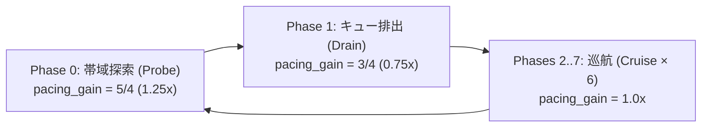

# Step 4: PROBE_BW の 8 相ゲインサイクル（帯域探索とキュー排出）

## 1. 学習ゴール

[Step 3](../step03-startup-drain/README.md) では、接続開始時に `2.89x` の高ゲインでボトルネック帯域を素早く見つける `BBR_STARTUP` と、その過程で膨らんだ過剰キューを排出する `BBR_DRAIN` を実装しました。このステップでは、キュー排出後に移行する定常状態モード **`BBR_PROBE_BW`** の核心である **8 相ペーシングゲインサイクル（`bbr_pacing_gain[]`）** と、各フェーズの遷移判定ロジック（`bbr_is_next_cycle_phase()`、`bbr_advance_cycle_phase()`、`bbr_update_cycle_phase()`、`bbr_update_gains()`）を実装します。BBR トラック全体の構成については [BBR トラック概要 (`../README.md`)](../README.md) を参照してください。

---

## 2. アルゴリズムと背景の解説（まずここを読む）

### なぜ定常状態でずっと `1.0x` のレートで送り続けてはいけないのか？

`BBR_STARTUP` と `BBR_DRAIN` を経て `BBR_PROBE_BW` に入った時点では、その時点の最大ボトルネック帯域 `ca->max_bw`（BtlBw）と最小 RTT `ca->min_rtt_us`（RTprop）が求まっており、インフライトパケット数もちょうどのパイプ容量（`1.0x BDP`）に落ち着いています。

ここで、「以降は永遠に `pacing_gain = 1.0x`（推定帯域ぴったり）で送り続ければ、キューも溜まらず理想的なのではないか？」と思うかもしれません。しかし、実際のネットワークでは以下の **2 つの問題** が生じます。

1. **帯域の増加に気づけない（ブラインド問題）**:
   同じボトルネックリンクを共有していた他の通信が終了したり、経路が切り替わったりして、利用可能な帯域が 100 KB/s から 200 KB/s に増えたとします。もし送信側が過去の推定値 `ca->max_bw`（100 KB/s）の `1.0x` でペーシングし続けると、1 秒間に 100 KB しかネットワークに送り出さないため、ACK から計測される配送レート（`rs->delivered / rs->interval_us`）も絶対に 100 KB/s を超えません。つまり、**一度でも `1.0x` を超えるレートでパケットを送り込んでみない限り、帯域が増えたかどうかを原理的に観測できない** のです。
2. **帯域が増えていなかった場合に発生する過剰キュー**:
   逆に、空いている帯域があるか確かめるために `1.25x`（+25%）のレートで 1 RTT の間送信したとします。もしボトルネック帯域が実際には増えていなかった場合、余分に送り込んだ `0.25x BDP` 分のパケットはボトルネックルータのバッファにキューとして溜まります。これをそのまま放置して `1.0x` の送信に戻ると、溜まった `0.25x BDP` のキューはいつまでも消えず、RTT が膨らんだままになり、次の探索のたびにキューが積み重なって最終的にパケットロス（バッファブロート）を引き起こします。

### BBRv1 の解決策：8 相ペーシングゲインサイクル（`CYCLE_LEN = 8`）

このジレンマを解決するため、BBRv1 の `BBR_PROBE_BW` は **8 つのフェーズ（Phase 0 〜 Phase 7）** を 1 サイクルとして循環します。各フェーズの基本期間は約 1 最小 RTT（`ca->min_rtt_us`）です。



固定小数点スケール `BBR_SCALE = 8`（`1.0x` = `BBR_UNIT = 256`）で表されたゲイン配列 `bbr_pacing_gain[]` は以下のとおりです。

| フェーズ (`cycle_idx`) | 役割 | 固定小数点式 (`BBR_UNIT = 256`) | 倍率 | 動作と目的 |
| :--- | :--- | :--- | :--- | :--- |
| **Phase 0** (`0`) | **探索 (Probe)** | `BBR_UNIT * 5 / 4` (`320`) | `1.25x` | 推定帯域より 25% 速く送信し、より高いボトルネック帯域が利用可能かテストする。 |
| **Phase 1** (`1`) | **排出 (Drain)** | `BBR_UNIT * 3 / 4` (`192`) | `0.75x` | 推定帯域より 25% 遅く送信し、Phase 0 で帯域が増えていなかった場合に作られた `0.25x BDP` の過剰キューを排出する（`+0.25 - 0.25 = 0`）。 |
| **Phases 2..7** (`2..7`) | **巡航 (Cruise)** | `BBR_UNIT` (`256`) | `1.0x` | 6 ラウンドの間、推定帯域 `ca->max_bw` ちょうどで巡航し、低遅延かつ 100% のリンク利用率を維持する。 |

なお、`BBR_PROBE_BW` 中の輻輳ウィンドウゲイン `ca->cwnd_gain` は全フェーズを通して **`bbr_cwnd_gain = BBR_UNIT * 2`（`2.0x`）** に固定されます。これは、ペーシングレートが送信間隔を直接制御する一方で、`snd_cwnd` に `2.0x BDP` の余裕を持たせることで、Phase 0 の `1.25x` 探索や遅延 ACK（Delayed ACK）・ACK 圧縮によって送信が頭打ちになるのを防ぐためです。

> [!NOTE]
> **複数フロー間の脱同期化（ランダム開始インデックス）と本演習の初期値**
> 実際の Linux カーネルの BBRv1 では、`BBR_DRAIN` から `BBR_PROBE_BW` へ入る際に `cycle_idx` を Phase 2〜7（巡航フェーズ）の中からランダムに選択します。これは、同じボトルネックを共有する複数の BBR フローが同時に Phase 0（`1.25x`）に入って一斉にバッファを溢れさせる現象（同期問題）を防ぐためです。一方、本演習の `starter.bpf.c` / `solution.bpf.c` では、`test.pkt` で `BBR_DRAIN` 直後から Phase 0 → Phase 1 → Phase 2 の遷移を決定論的に検証できるよう、`bbr_check_drain()` にて `ca->cycle_idx = 0` から開始しています。

### 各フェーズの終了条件（`bbr_is_next_cycle_phase()` の 3 分岐）

「いつ現在のフェーズを終了して次の `cycle_idx` へ進むか」は、フェーズの役割によって異なります。まず、フェーズ開始時刻 `ca->cycle_mstamp` からの経過時間が最小 RTT（`ca->min_rtt_us`）を超えたかどうかを表す基本フラグ `is_full_length` を定義します。

```c
bool is_full_length = (tp->tcp_mstamp - ca->cycle_mstamp) > ca->min_rtt_us;
```

その上で、現在の `ca->pacing_gain` の値に応じて以下の 3 通りで判定します。

1. **巡航フェーズ（`ca->pacing_gain == BBR_UNIT`、Phases 2..7）**:
   - **終了条件**: `is_full_length`
   - 最小 RTT（`ca->min_rtt_us`）を超える時間が経過したら、無条件で次のフェーズへ進みます。

2. **探索フェーズ（`ca->pacing_gain > BBR_UNIT`、Phase 0: `1.25x`）**:
   - **終了条件**:
     ```c
     is_full_length &&
     (rs->losses ||
      rs->prior_in_flight >= bbr_inflight(sk, ca->max_bw, ca->pacing_gain))
     ```
   - **なぜ `&&`（AND 条件）なのか？**:
     単に時間が 1 RTT 経過した（`is_full_length`）だけでは、アプリケーションの送信データが一時的に少なかった場合やペーシングのタイミングによって、ネットワーク内にまだ `1.25x BDP` 分のパケットが送り込まれていない可能性があります。パイプに `1.25x BDP` を実際に満たしてみないことには、帯域の余力をテストしたとは言えません。
   - そのため、「`is_full_length`（1 RTT 超経過）**かつ**、この ACK 処理直前のインフライト量 `rs->prior_in_flight` が目標値 `bbr_inflight(sk, ca->max_bw, ca->pacing_gain)`（`1.25x BDP`）以上に達したか、またはパケットロス `rs->losses` が発生した（＝すでにバッファが溢れた）」ときに限り Phase 0 を終了します。

3. **排出フェーズ（`ca->pacing_gain < BBR_UNIT`、Phase 1: `0.75x`）**:
   - **終了条件**:
     ```c
     is_full_length ||
     rs->prior_in_flight <= bbr_inflight(sk, ca->max_bw, BBR_UNIT)
     ```
   - **なぜ `||`（OR 条件）で早期終了を許すのか？**:
     Phase 1 の目的は「Phase 0 で溜まった過剰キューを抜き、インフライト量を `1.0x BDP` に戻すこと」だけです。もし Phase 0 で実際に帯域が増えていてキューが全く溜まっていなかった場合や、1 RTT 経つ前に素早くキューが抜けて `rs->prior_in_flight <= bbr_inflight(sk, ca->max_bw, BBR_UNIT)`（`1.0x BDP` 以下）になった場合、それ以上 `0.75x` の低速ペーシングを続けるとパイプが空になり、帯域を無駄にしてしまいます。
   - したがって、1 RTT が経過する前であっても、インフライト量が `1.0x BDP` 以下まで下がった瞬間に即座に Phase 1 を切り上げて Phase 2（`1.0x` 巡航）へ移行します。

### フェーズの進行処理（`bbr_advance_cycle_phase()`）

フェーズ終了条件が満たされたら、インデックス `ca->cycle_idx` を 1 つ進め、長さ `CYCLE_LEN`（`8`）でラップアラウンドさせるとともに、新しいフェーズの開始時刻として現在の `tp->tcp_mstamp` を記録します。`CYCLE_LEN` は 2 のべき乗（`8`）なので、剰余 `% 8` はビット論理積 `& (CYCLE_LEN - 1)`（`& 7`）で高速に計算できます。

```c
ca->cycle_idx = (ca->cycle_idx + 1) & (CYCLE_LEN - 1);
ca->cycle_mstamp = tp->tcp_mstamp;
```

### 具体的な数値例（`test.pkt` のシナリオ）

`test.pkt` の設定値を用いて、具体的な数値で計算してみましょう。
- `MSS = 1000` バイト
- 最小 RTT: `ca->min_rtt_us = 10,000` us（10 ms）
- ボトルネック帯域: 10 ms あたり 1 セグメント（1,000 バイト）＝ **100,000 B/s（100 KB/s）**
  - パケット単位レート: `1 pkt / 10,000 us = 0.0001 pkts/us`
  - 固定小数点 `ca->max_bw`: `1 * (1 << 24) / 10000 = 1677`（`BW_SCALE = 24`）
- **目標インフライトパケット数 `bbr_inflight(sk, ca->max_bw, gain)`**:
  - `1.0x`（`gain = 256`）のとき: `BDP = 0.0001 pkts/us * 10,000 us = 1.0` パケット → 切り上げで **`1` パケット**
  - `1.25x`（`gain = 320`）のとき: `1.0 * 1.25 = 1.25` パケット → `bbr_bdp()` の切り上げ除算 `(((w * gain) >> 8) + BW_UNIT - 1) / BW_UNIT` により **`2` パケット**
- **各フェーズのペーシングレート `sk->sk_pacing_rate`**（1% のマージン `bbr_pacing_margin_percent = 1` を差し引いた値）:
  - **Phase 0（`5/4 = 1.25x`）**: `100,000 * 1.25 * 0.99` ≒ **`123,750 B/s`（約 123 KB/s）**
  - **Phase 1（`3/4 = 0.75x`）**: `100,000 * 0.75 * 0.99` ≒ **`74,250 B/s`（約 74 KB/s）**
  - **Phase 2..7（`1.0x`）**: `100,000 * 1.00 * 0.99` ≒ **`99,000 B/s`（約 99 KB/s）**

### カーネルと `starter.bpf.c` が提供する構造体フィールドとヘルパ関数

セクション 3 の設計チェックポイントに進む前に、このステップで使用する構造体フィールドと既存のヘルパ関数を整理しておきます。

#### 1. `struct tcp_sock *tp = tcp_sk(sk)`（カーネルが管理する TCP ソケット状態）
- `tp->tcp_mstamp` (`__u64`): カーネルがパケット送受信のたびに更新する現在時刻（マイクロ秒単位）。現在のフェーズの経過時間 `tp->tcp_mstamp - ca->cycle_mstamp` の計算と、次フェーズ開始時刻 `ca->cycle_mstamp` の記録に使用します。
- `tp->snd_cwnd` (`__u32`): 現在の輻輳ウィンドウ（パケット数）。

#### 2. `const struct rate_sample *rs`（ACK ごとにカーネルから `.cong_control` に渡される計測サンプル）
- `rs->prior_in_flight` (`__u32`): この ACK が処理される直前にネットワーク上にあったインフライトパケット数。Phase 0 で `1.25x BDP` に到達したか、および Phase 1 で `1.0x BDP` 以下まで抜けたかを判定するために使用します。
- `rs->losses` (`__u32`): この ACK によって新たにロスと判定されたパケット数。Phase 0 でロス発生時に探索を終了するために参照します。

#### 3. `struct bbr_ca *ca = inet_csk_ca(sk)`（`icsk_ca_priv` 内の BBR 固有状態）
各 TCP ソケット（`struct inet_connection_sock`）には、輻輳制御アルゴリズムが自由に使えるプライベートメモリ領域 `icsk_ca_priv` が用意されており、`inet_csk_ca(sk)` で `struct bbr_ca *` としてアクセスします。`starter.bpf.c` では以下のフィールドが定義・初期化済みです。
- `ca->mode` (`__u32`): 現在のモード（`BBR_STARTUP`、`BBR_DRAIN`、`BBR_PROBE_BW`）。`bbr_check_drain()` でキュー排出が完了すると `ca->mode = BBR_PROBE_BW` に遷移し、同時に `ca->cycle_idx = 0`、`ca->cycle_mstamp = tp->tcp_mstamp` に初期化されます。
- `ca->cycle_idx` (`__u32`): 現在の `BBR_PROBE_BW` フェーズ番号（`0` 〜 `7`）。
- `ca->cycle_mstamp` (`__u64`): 現在のフェーズが開始した時点の `tp->tcp_mstamp`（マイクロ秒）。
- `ca->min_rtt_us` (`__u32`): これまでに観測された最小 RTT（マイクロ秒）。
- `ca->max_bw` (`__u32`): 推定ボトルネック帯域（`BW_SCALE = 24` の固定小数点、`pkts/us << 24`）。
- `ca->pacing_gain` / `ca->cwnd_gain` (`__u32`): 現在のペーシングゲインと cwnd ゲイン（`BBR_SCALE = 8`、`BBR_UNIT = 256` が `1.0x`）。

#### 4. `starter.bpf.c` に実装済みのヘルパ関数・定数
- `CYCLE_LEN` (`8`)、`BBR_UNIT` (`256`)、`bbr_cwnd_gain` (`BBR_UNIT * 2`)
- `bbr_pacing_gain[8]`: `{ BBR_UNIT * 5 / 4, BBR_UNIT * 3 / 4, BBR_UNIT, ... }` の 8 要素配列。
- `bbr_inflight(sk, bw, gain)`: 指定された帯域 `bw` とゲイン `gain` に対する目標インフライトパケット数（`gain * BDP` の切り上げ値）を返します。

---

## 3. 設計チェックポイント（理解した仕組みをコードに落とし込む）

セクション 2 の仕組みを踏まえて、`starter.bpf.c` の 4 つの TODO をどのように実装すべきか考えてみましょう。

### Q1. 巡航フェーズ（Phases 2..7）の終了条件はどう書くべきでしょうか？（TODO 1 前半）

`bbr_is_next_cycle_phase(struct sock *sk, const struct rate_sample *rs)` において、まずフェーズ開始からの経過時間が最小 RTT を超えたかを表すブール値 `is_full_length` を定義し、巡航フェーズ（`ca->pacing_gain == BBR_UNIT`）の終了判定を行うには、どのフィールドをどう比較すればよいでしょうか？

<details>
<summary>ヒントと答え</summary>

- 現在時刻は `tp->tcp_mstamp`、現在のフェーズの開始時刻は `ca->cycle_mstamp`、最小 RTT は `ca->min_rtt_us` に格納されています。
- したがって、`is_full_length` は次のように計算できます。
  ```c
  bool is_full_length = (tp->tcp_mstamp - ca->cycle_mstamp) > ca->min_rtt_us;
  ```
- 巡航フェーズ（`ca->pacing_gain == BBR_UNIT`）ではインフライト量の増減を待つ必要はなく、1 最小 RTT を超える時間が経過したかどうかだけで判定するため、`if (ca->pacing_gain == BBR_UNIT) return is_full_length;` と記述します。

</details>

### Q2. 探索フェーズ（Phase 0: `1.25x`）と排出フェーズ（Phase 1: `0.75x`）では、なぜ論理演算子（`&&` と `||`）や `bbr_inflight()` に渡すゲイン引数が異なるのでしょうか？（TODO 1 後半）

`ca->pacing_gain > BBR_UNIT`（Phase 0）と `ca->pacing_gain < BBR_UNIT`（Phase 1）それぞれの `return` 文を組み立てる際、`is_full_length` と `rs->prior_in_flight` の比較をどのように組み合わせ、また `bbr_inflight(sk, ca->max_bw, ...)` の第 3 引数には何を渡すべきでしょうか？

<details>
<summary>ヒントと答え</summary>

- **探索フェーズ（`ca->pacing_gain > BBR_UNIT`）**:
  - 1 RTT 超の時間が経過し（`is_full_length`）、**かつ（`&&`）** 実際に `1.25x BDP` のパケットをネットワークに送り込めたか（またはロス `rs->losses` が発生したか）を確認する必要があります。
  - 目標インフライト量は現在の探索ゲイン `ca->pacing_gain`（`5/4`）に対する BDP なので、`bbr_inflight(sk, ca->max_bw, ca->pacing_gain)` を使います。
  ```c
  if (ca->pacing_gain > BBR_UNIT)
          return is_full_length &&
                  (rs->losses ||
                   rs->prior_in_flight >= bbr_inflight(sk, ca->max_bw, ca->pacing_gain));
  ```
- **排出フェーズ（`ca->pacing_gain < BBR_UNIT`）**:
  - Phase 0 で溜まった過剰キューが抜けて `1.0x BDP` 以下に戻れば、1 RTT の経過を待たずに即座に巡航フェーズへ戻ってよいため、**または（`||`）** で結びます。
  - 排出完了の基準は「ちょうどのパイプ容量（`1.0x BDP`）」なので、`bbr_inflight()` の第 3 引数には `ca->pacing_gain`（`3/4`）ではなく **`BBR_UNIT`（`1.0x`）** を渡す点に注意してください。
  ```c
  return is_full_length ||
          rs->prior_in_flight <= bbr_inflight(sk, ca->max_bw, BBR_UNIT);
  ```

</details>

### Q3. フェーズを進める `bbr_advance_cycle_phase()` と `bbr_update_cycle_phase()` では何を更新する必要がありますか？（TODO 2・TODO 3）

`bbr_is_next_cycle_phase(sk, rs)` が `true` を返したとき、`struct bbr_ca` のどのフィールドを更新しなければ、次の ACK でも同じフェーズにとどまったり、次のフェーズが即座に終了してしまったりするでしょうか？

<details>
<summary>ヒントと答え</summary>

- `bbr_update_cycle_phase()` では、まず現在が `ca->mode == BBR_PROBE_BW` であることを確認した上で `bbr_is_next_cycle_phase(sk, rs)` を呼びます（`BBR_STARTUP` や `BBR_DRAIN` 中にフェーズを進めてはいけません）。
- `bbr_advance_cycle_phase()` では以下の **2 つ** を必ずセットで更新します。
  1. `ca->cycle_idx = (ca->cycle_idx + 1) & (CYCLE_LEN - 1);` でフェーズ番号を `0..7` の範囲で 1 つ進めます。
  2. `ca->cycle_mstamp = tp->tcp_mstamp;` で新フェーズの開始時刻を現在時刻にリセットします。もし `ca->cycle_mstamp` の更新を忘れると、次の ACK でも `(tp->tcp_mstamp - ca->cycle_mstamp) > ca->min_rtt_us` が `true` のままになり、ACK のたびにフェーズが 1 つずつ一気にスキップされてしまいます。

</details>

### Q4. `bbr_update_gains()` と `bpf_bbr4_main()` の呼び出し順序はどう連携していますか？（TODO 4）

`bbr_update_gains()` の `case BBR_PROBE_BW:` で `bbr_pacing_gain[]` を参照する際、BPF ベリファイアが配列の境界外アクセスと判定しないようにするにはインデックスをどうマスクすべきでしょうか？また、`bpf_bbr4_main()` の中で `bbr_update_cycle_phase()`、`bbr_check_drain()`、`bbr_update_gains()` がこの順序で並んでいることにはどんな意味があるでしょうか？

<details>
<summary>ヒントと答え</summary>

- **BPF ベリファイア対策のマスク**:
  `ca->cycle_idx` は `__u32` 型であるため、`bbr_pacing_gain[ca->cycle_idx & 7]`（または `& (CYCLE_LEN - 1)`）のようにビットマスクを添字に直接付けることで、BPF ベリファイアに対して添字が常に `0..7` の範囲内であることを静的に証明できます。
- **`bpf_bbr4_main()` での呼び出し順序**:
  1. すでに `BBR_PROBE_BW` にいる場合は、`bbr_update_cycle_phase()` が現在の `ca->pacing_gain` を使ってフェーズ終了を判定し、`ca->cycle_idx` を進めます。
  2. まだ `BBR_STARTUP` / `BBR_DRAIN` にいた場合は、`bbr_check_drain()` が排出完了を検知して `ca->mode = BBR_PROBE_BW`、`ca->cycle_idx = 0` に遷移させます（もし `bbr_check_drain()` の後に `bbr_update_cycle_phase()` を呼ぶと、遷移したその同じ ACK で Phase 0 の終了判定まで走ってしまいます）。
  3. 最後に `bbr_update_gains()` が最新の `ca->mode` と `ca->cycle_idx` に基づいて `ca->pacing_gain` を更新し、直後の `bbr_set_pacing_rate()` が新しいレートを `sk->sk_pacing_rate` に反映します。

</details>

---

## 4. 実装ステップと解説 (`solution.bpf.c`)

`solution.bpf.c` における各関数の実装を順番に確認します。

### 1. `bbr_pacing_gain[]` 配列の定義

定常状態（`BBR_PROBE_BW`）で循環する 8 相のゲインテーブルです。

```c
#define CYCLE_LEN			8

static const int bbr_pacing_gain[] = {
	BBR_UNIT * 5 / 4,
	BBR_UNIT * 3 / 4,
	BBR_UNIT,
	BBR_UNIT,
	BBR_UNIT,
	BBR_UNIT,
	BBR_UNIT,
	BBR_UNIT,
};
```

- インデックス `0` が `BBR_UNIT * 5 / 4`（`320` = `1.25x`、探索フェーズ）
- インデックス `1` が `BBR_UNIT * 3 / 4`（`192` = `0.75x`、排出フェーズ）
- インデックス `2..7` が `BBR_UNIT`（`256` = `1.0x`、巡航フェーズ × 6）

### 2. `bbr_is_next_cycle_phase()` — フェーズ終了条件の判定（TODO 1）

```c
static __always_inline bool bbr_is_next_cycle_phase(struct sock *sk,
						    const struct rate_sample *rs)
{
	struct tcp_sock *tp = tcp_sk(sk);
	struct bbr_ca *ca = inet_csk_ca(sk);
	bool is_full_length = (tp->tcp_mstamp - ca->cycle_mstamp) > ca->min_rtt_us;

	if (ca->pacing_gain == BBR_UNIT)
		return is_full_length;

	if (ca->pacing_gain > BBR_UNIT)
		return is_full_length &&
			(rs->losses ||
			 rs->prior_in_flight >= bbr_inflight(sk, ca->max_bw, ca->pacing_gain));

	return is_full_length ||
		rs->prior_in_flight <= bbr_inflight(sk, ca->max_bw, BBR_UNIT);
}
```

- `is_full_length`: `tp->tcp_mstamp - ca->cycle_mstamp` が `ca->min_rtt_us` を超えているかを判定します。
- `ca->pacing_gain == BBR_UNIT`: 巡航フェーズでは `is_full_length` のみで次フェーズへ進みます。
- `ca->pacing_gain > BBR_UNIT`: 探索フェーズ（Phase 0）では、`is_full_length` に加えて、`rs->losses` が非ゼロであるか、または `rs->prior_in_flight` が `bbr_inflight(sk, ca->max_bw, ca->pacing_gain)`（`1.25x BDP`）以上に達していることを要求します。
- `ca->pacing_gain < BBR_UNIT`: 排出フェーズ（Phase 1）では、`is_full_length` に達したか、あるいは `rs->prior_in_flight` が `bbr_inflight(sk, ca->max_bw, BBR_UNIT)`（`1.0x BDP`）以下に下がった時点で次フェーズへ進みます。

### 3. `bbr_advance_cycle_phase()` と `bbr_update_cycle_phase()` — フェーズの進行（TODO 2・TODO 3）

```c
static __always_inline void bbr_advance_cycle_phase(struct sock *sk)
{
	struct tcp_sock *tp = tcp_sk(sk);
	struct bbr_ca *ca = inet_csk_ca(sk);

	ca->cycle_idx = (ca->cycle_idx + 1) & (CYCLE_LEN - 1);
	ca->cycle_mstamp = tp->tcp_mstamp;
}

static __always_inline void bbr_update_cycle_phase(struct sock *sk,
						   const struct rate_sample *rs)
{
	struct bbr_ca *ca = inet_csk_ca(sk);

	if (ca->mode == BBR_PROBE_BW && bbr_is_next_cycle_phase(sk, rs))
		bbr_advance_cycle_phase(sk);
}
```

- `bbr_advance_cycle_phase()` は `ca->cycle_idx` をインクリメントして `& (CYCLE_LEN - 1)` で `0..7` に丸め、`ca->cycle_mstamp` を現在の `tp->tcp_mstamp` に更新します。
- `bbr_update_cycle_phase()` は `ca->mode == BBR_PROBE_BW` のときにのみ `bbr_is_next_cycle_phase(sk, rs)` を評価し、`true` ならフェーズを進めます。

### 4. `bbr_update_gains()` — 現在のフェーズに応じたゲイン設定（TODO 4）

```c
static __always_inline void bbr_update_gains(struct sock *sk)
{
	struct bbr_ca *ca = inet_csk_ca(sk);

	switch (ca->mode) {
	case BBR_STARTUP:
		ca->pacing_gain = bbr_high_gain;
		ca->cwnd_gain = bbr_high_gain;
		break;
	case BBR_DRAIN:
		ca->pacing_gain = bbr_drain_gain;
		ca->cwnd_gain = bbr_high_gain;
		break;
	case BBR_PROBE_BW:
	default:
		ca->pacing_gain = bbr_pacing_gain[ca->cycle_idx & 7];
		ca->cwnd_gain = bbr_cwnd_gain;
		break;
	}
}
```

- `BBR_PROBE_BW` では `bbr_pacing_gain[ca->cycle_idx & 7]` から現在のフェーズのペーシングゲインを取得し、`ca->cwnd_gain` には `bbr_cwnd_gain`（`2.0x`）を設定します。
- `bpf_bbr4_main()` で `bbr_update_gains(sk)` の直後に呼ばれる `bbr_set_pacing_rate(sk, ca->max_bw, ca->pacing_gain)` によって、更新された `ca->pacing_gain` が即座に `sk->sk_pacing_rate` に反映されます。

---

## 5. `packetdrill` テストの解説 (`test.pkt`) と実行方法

### `test.pkt` のパケットトレースとアサーションの解説

`test.pkt` は、ボトルネック帯域 100 KB/s（`MSS = 1000` バイト、`min_rtt_us = 10 ms`、`1.0x BDP = 1` パケット）の経路において、`BBR_STARTUP` を抜けて `BBR_PROBE_BW` に入った後の **Phase 0（`1.25x`）→ Phase 1（`0.75x`）→ Phase 2（`1.0x`）** の遷移を順番に検証します。

1. **ハンドシェイクと STARTUP ラウンド（14〜53 行目）**:
   - 最初のデータセグメント（`1:1001`）が 10 ms で ACK され、`ca->min_rtt_us = 10,000` us、`ca->max_bw` ≒ 100 KB/s（`1.0x BDP = 1` セグメント）が計測されます。受信ウィンドウ `win 1000` によってインフライトが 1 セグメントに制限されるため、Round 1 で `full_bw` が記録された後、Round 2・Round 3・Round 4 と 3 ラウンド連続で帯域成長が 25% 未満（0%）になります。
2. **Round 4 での `BBR_PROBE_BW` Phase 0 突入（48〜57 行目）**:
   - 53 行目の ACK（`ack 6001 win 2000`）で `full_bw_cnt == 3` に達し、`ca->full_bw_reached = 1` となります。
   - `bbr_check_drain()` において `BBR_STARTUP` → `BBR_DRAIN` へ遷移し、さらにその時点の `tcp_packets_in_flight(tp)` が `0`（`<= 1.0x BDP = 1`）であるため、同じ ACK 内でただちに `BBR_PROBE_BW`（`ca->cycle_idx = 0`、`ca->cycle_mstamp = tp->tcp_mstamp`）へ突入します。
   - Phase 0 のゲインは `5/4`（`1.25x`）なので、`tcpi_pacing_rate` は `100,000 * 1.25 * 0.99` ≒ **`123,750 B/s`** となり、55〜56 行目のアサーションを通過します（`snd_cwnd` は `target_cwnd = 2` と最小ターゲット `bbr_cwnd_min_target = 4` の比較により `4` になります）。
   ```python
   assert 115000 < tcpi_pacing_rate < 135000, f"PROBE_BW Phase 0 (5/4 gain): expected ~123KB/s, got {tcpi_pacing_rate}"
   assert tcpi_snd_cwnd == 4, f"PROBE_BW Phase 0: expected cwnd == 4, got {tcpi_snd_cwnd}"
   ```
   - また、この ACK で受信ウィンドウが `win 2000`（2 セグメント分）に広げられ、次の Phase 0 で 2 パケットをインフライトに送り込めるようになります。
3. **Phase 0 → Phase 1（`0.75x`）への遷移（59〜70 行目）**:
   - 10 ms 間隔で 2 セグメント（`6001:7001` と `7001:8001`）を送信し、さらに 10 ms 後にまとめて `ack 8001` を受け取ります。
   - この ACK 時点では、Phase 0 開始からの経過時間が `30 ms > min_rtt_us (10 ms)` なので `is_full_length == true` であり、かつ直前のインフライト量 `rs->prior_in_flight == 2` が `bbr_inflight(sk, ca->max_bw, 5/4) == 2` 以上に達しています。また、2 セグメントが 20 ms かかって配送されたため計測帯域は `2000 B / 20 ms = 100 KB/s` のままで変化しません。
   - よって `bbr_is_next_cycle_phase()` が `true` を返し、`ca->cycle_idx` が `1`（Phase 1: `3/4 = 0.75x`）に進みます。69 行目でペーシングレートが約 **`74,250 B/s`** に低下したことを検証します。
   ```python
   assert 65000 < tcpi_pacing_rate < 85000, f"PROBE_BW Phase 1 (3/4 gain): expected ~74KB/s, got {tcpi_pacing_rate}"
   ```
4. **Phase 1 → Phase 2（`1.0x`）への遷移（72〜80 行目）**:
   - 1 セグメント（`8001:9001`）を送信し、15 ms 後に `ack 9001` を受け取ります。
   - 経過時間が `25 ms > 10 ms`（`is_full_length == true`）かつ `rs->prior_in_flight == 1 <= bbr_inflight(1.0x) == 1` を満たすため、`ca->cycle_idx` が `2`（Phase 2: `1.0x` 巡航）に進みます。79 行目でペーシングレートが約 **`99,000 B/s`** に戻ったことを検証します。
   ```python
   assert 90000 < tcpi_pacing_rate < 110000, f"PROBE_BW Phase 2 (1.0 gain): expected ~99KB/s, got {tcpi_pacing_rate}"
   ```

### なぜ `starter.bpf.c` は失敗し、`solution.bpf.c` はパスするのか？

- **`starter.bpf.c` が失敗する理由**:
  `starter.bpf.c` では `bbr_update_gains()` の `BBR_PROBE_BW` ケースで `ca->pacing_gain = BBR_UNIT`（`1.0x`）がハードコードされており、さらに `bbr_is_next_cycle_phase()` が常に `false` を返します。そのため、53 行目で `BBR_PROBE_BW` に入った直後の `tcpi_pacing_rate` が Phase 0 の `~123,750 B/s`（`1.25x`）にならず `~99,000 B/s`（`1.0x`）のままとなり、55 行目の `assert 115000 < tcpi_pacing_rate < 135000` で即座に失敗します。
- **`solution.bpf.c` がパスする理由**:
  `bbr_update_gains()` が `bbr_pacing_gain[ca->cycle_idx & 7]` を参照し、`bbr_is_next_cycle_phase()`・`bbr_advance_cycle_phase()`・`bbr_update_cycle_phase()` が各フェーズの終了条件を正しく判定して `cycle_idx` を `0` → `1` → `2` と進めるため、すべてのアサーションをパスします。

### テストの実行コマンド

リポジトリの `labs/bbr/step04-probe-bw` ディレクトリから、以下のコマンドで `starter`（失敗の確認）と `solution`（成功の確認）を実行できます。

```sh
../../run_test.sh bbr/step04-probe-bw starter
../../run_test.sh bbr/step04-probe-bw solution
```
