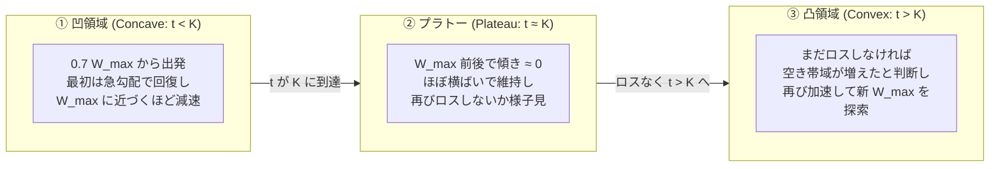
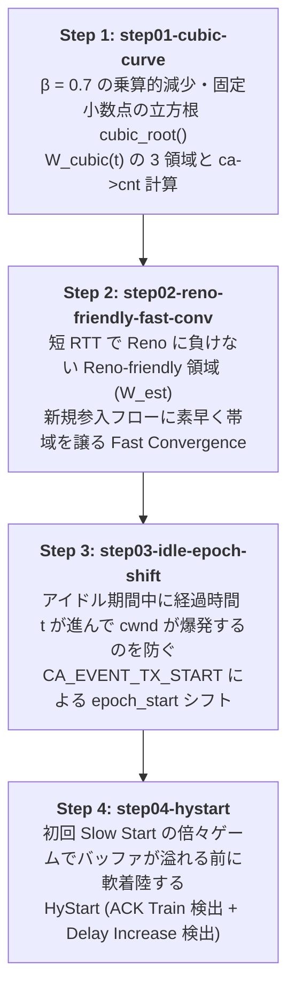

# トラック 2: TCP CUBIC ハンズオン — 3次関数で高帯域ネットワークを乗りこなす

トラック 1（TCP Reno）では、輻輳制御の原点である **Slow Start（指数関数的増加）** と **AIMD（Additive Increase / Multiplicative Decrease：1 RTT ごとに $$+1$$ 増やし、ロスで半分に減らす）**、そして誤検知から窓を復元する **Loss Undo** を BPF でゼロから実装しました。

しかし、現代のインターネットやデータセンターで実際に使われている Linux カーネルのデフォルト輻輳制御は Reno ではなく **CUBIC**（[RFC 9438](https://www.rfc-editor.org/rfc/rfc9438)、`net/ipv4/tcp_cubic.c`）です。
このトラックでは、なぜ Reno が高速・長距離ネットワークで限界を迎えたのかを数値で体感したあと、CUBIC の心臓部である **3 次関数ウィンドウ曲線** と、それを実ネットワークで安全に動かす **4 つの仕組み（Step 1〜Step 4）** を BPF `struct_ops` と `packetdrill` で 1 つずつ組み立てていきます。

---

## 1. なぜ Reno ではダメだったのか（Long Fat Network での崩壊）

1980〜1990 年代の低速な回線では見事に機能していた TCP Reno の AIMD（1 RTT あたり $$+1$$ パケット増加、ロス時に $$0.5$$ 倍へ半減）は、回線帯域がギガビット級に広がった途端、2 つの致命的な壁にぶつかりました。

### 壁①：1 回のロスから回復するのに「69 分」かかる

長距離・広帯域のネットワーク（**LFN: Long Fat Network**）を具体的な数字で計算してみましょう。

- **回線帯域（Bandwidth）**: $$10\text{ Gbps}$$（$$= 10 \times 10^9\text{ bit/s}$$）
- **往復遅延（RTT）**: $$100\text{ ms}$$（$$= 0.1\text{ 秒}$$、たとえば太平洋横断や大陸間の光ファイバー回線）
- **1 パケットのサイズ**: $$1,500\text{ Bytes} = 12,000\text{ bits}$$

この土管（パイプ）を隙間なく満たすために必要な飛行中パケット数、すなわち **帯域遅延積（BDP: Bandwidth-Delay Product）** は次のようになります。

$$\text{BDP} = \frac{10 \times 10^9\text{ bit/s} \times 0.1\text{ s}}{12,000\text{ bits/packet}} \approx 83,333\text{ パケット（約 }83,000\text{ パケット）}$$

つまり、送信側が `cwnd = 83,000` を維持できて初めて $$10\text{ Gbps}$$ の回線を 100% 使い切ることができます。

ここで、Reno が `cwnd = 83,000` で走っている最中に **たった 1 パケットだけロスした** とします。何が起きるでしょうか？

1. **半減（Multiplicative Decrease）**: Reno は 1 回のロスで `cwnd` を半分に落とすため、`cwnd` は一気に $$83,000 \div 2 = 41,500$$ パケットまで急落します。
2. **1 RTT ごとに +1 の回復（Additive Increase）**: Fast Recovery を抜けて Congestion Avoidance に入ると、Reno は「1 RTT（$$0.1\text{ 秒}$$）ごとに $$+1$$ パケット」しか `cwnd` を増やせません。
3. **回復にかかる時間**: 失った $$41,500$$ パケットを取り戻して元の $$83,000$$ パケットに戻るまでにかかる時間は、

$$41,500\text{ RTT} \times 0.1\text{ 秒/RTT} = 4,150\text{ 秒} \approx \mathbf{69\text{ 分 10 秒}}$$

なんと、**たった 1 パケット落としただけで、元の速度に戻るまでに 1 時間以上（約 69 分）もかかってしまう** のです。しかも、その 69 分の間に光ファイバーのビットエラーや瞬間的なマイクロバーストでもう 1 回でもロスが起きれば、そこからまた半分に叩き落とされます。その結果、$$10\text{ Gbps}$$ の回線を引いているのに実効スループットが数 Mbps〜数十 Mbps しか出ないという現象が発生しました。

### 壁②：RTT 不公平（近距離フローが遠距離フローを駆逐する）

Reno のもう 1 つの問題は、Congestion Avoidance の増加ペースが **「ACK が返ってくる周期（＝RTT）」に比例してしまう** ことです。

同じボトルネックルータを、次の 2 本のフローが共有している場面を想像してください。

- **フロー A（近距離）**: $$\text{RTT} = 10\text{ ms}$$（1 秒間に 100 回 RTT が回る） → 1 秒あたり **`+100` パケット** のペースで `cwnd` が増加
- **フロー B（遠距離）**: $$\text{RTT} = 100\text{ ms}$$（1 秒間に 10 回しか RTT が回らない） → 1 秒あたり **`+10` パケット** のペースでしか `cwnd` が増加しない

両者が同時にパケットロスを経験して窓を減らしたあと、近距離のフロー A は遠距離のフロー B より **10 倍速く** 窓を広げてボトルネック帯域を独占してしまいます。これを **RTT 不公平（RTT Unfairness）** と呼びます。

---

## 2. CUBIC の 2 大アイデア

Reno の「回復が遅すぎる」「RTT によって不公平になる」という 2 つの壁を同時に打ち破るために設計されたのが **CUBIC** です。CUBIC の核心は、驚くほどシンプルな 2 つのアイデアに集約されます。

### アイデア①：ロス時の削減を 0.5 倍ではなく $$\beta = 0.7$$ 倍にとどめる

Reno はロスが起きると `cwnd` を $$0.5$$ 倍（50% 削減）にしていましたが、高 BDP 回線でパイプの半分を空にしてしまうのはブレーキのかけすぎです。
CUBIC は乗算的減少係数 $$\beta$$ を **$$0.7$$（30% 削減、7 割を残す）** に引き上げます。

- 浮動小数点演算が使えない Linux カーネル（`net/ipv4/tcp_cubic.c`）および BPF では、分母を $$2^{10} = 1024$$（`BICTCP_BETA_SCALE = 1024`）、分子を `beta = 717` とする固定小数点で表します：
  $$\beta = \frac{717}{1024} \approx 0.7002$$
- これにより、まずロス直後の落ち込み自体を浅くし、パイプの稼働率（リンク利用率）を高く保ちます。

### アイデア②：窓サイズを「最後のロスからの経過時間 $$t$$」の 3 次関数で決める

CUBIC 最大の発明は、Congestion Avoidance 中の目標ウィンドウサイズを「返ってきた ACK の数」ではなく、**「直前のロス回復が終わってからの実経過時間 $$t$$」の 3 次関数（Cubic function）** として定義したことです。

$$W_{\text{cubic}}(t) = C(t - K)^3 + W_{\max}$$

この式に登場する各記号の意味を 1 つずつ押さえましょう。

- **$$W_{\max}$$（コード上の `ca->last_max_cwnd`）**: **「直前のパケットロスが起きたときの `cwnd`」** です。
  - パケットロスが起きたということは、「`cwnd` が $$W_{\max}$$ に達した瞬間にネットワークのパイプが溢れた」という重要な手がかりです。Reno はロスが起きると半減するだけで元の窓サイズを忘れてしまいますが、CUBIC は **「前回どこまで増やしたら溢れたか（$$W_{\max}$$）」を記憶** し、その $$W_{\max}$$ を次の曲線の中心（変曲点）に据えます。
- **$$t$$**: 直前のロス回復（Fast Recovery）を抜けて Congestion Avoidance に入ってからの **経過時間**（秒、カーネル内では $$1\text{ 秒} = 2^{10} = 1024$$ の `BICTCP_HZ` 単位）です。
- **$$C$$**: 曲線の立ち上がりの鋭さを決める定数で、標準値は **$$C = 0.4\text{ packet/s}^3$$**（固定小数点では `410 / 1024 ≈ 0.4004`）です。
- **$$K$$（コード上の `ca->bic_K`）**: ロス直後の窓サイズ $$\beta W_{\max}$$（$$= 0.7 W_{\max}$$）からスタートして、**曲線 $$W_{\text{cubic}}(t)$$ がちょうど $$W_{\max}$$ に戻るまでにかかる時間** です。
  - $$t = 0$$ のとき $$W_{\text{cubic}}(0) = \beta W_{\max}$$ となる条件を解くと、次の立方根（三乗根）の式が得られます：
    $$C(0 - K)^3 + W_{\max} = \beta W_{\max} \implies K = \sqrt[3]{\frac{W_{\max}(1 - \beta)}{C}}$$
  - （より一般には、エポック開始時の窓を $$\text{cwnd}_{\text{epoch}}$$ として $$K = \sqrt[3]{\frac{W_{\max} - \text{cwnd}_{\text{epoch}}}{C}}$$ と計算します。）

先ほどの「帯域 $$10\text{ Gbps}$$・RTT $$100\text{ ms}$$・$$W_{\max} = 83,000$$」の例にこの式を当てはめてみましょう。

$$K = \sqrt[3]{\frac{83,000 \times (1 - 0.7)}{0.4}} = \sqrt[3]{62,250} \approx \mathbf{39.6\text{ 秒}}$$

Reno では元の $$83,000$$ パケットに戻るのに **約 69 分（4,150 秒）** かかっていたのが、CUBIC なら **約 40 秒（100 倍以上高速！）** で回復します。さらに、式の中の $$t$$ は「実世界の時計の経過時間」なので、RTT $$10\text{ ms}$$ のフローも RTT $$100\text{ ms}$$ のフローも同じ時間 $$t$$ で同じように窓を広げることができ、**RTT 不公平も大幅に緩和** されます。

---

## 3. 3次関数曲線の 3 つの領域と `ca->cnt` への変換

なぜ 2 次関数や指数関数ではなく **3 次関数 $$(t - K)^3$$** なのでしょうか？
その理由は、時刻 $$t = K$$（窓サイズが $$W_{\max}$$ に戻る点）を境にして、1 つの数式だけで **「急回復 → 慎重な様子見 → 新規開拓の加速」という 3 つの理想的なフェーズ** を自然に表現できるからです。

```text
  cwnd (W_cubic(t))
   ^
   |                                                  /  (3) 凸領域 (Convex / Probing)
   |                                                 /       t > K:
   |                                                /        ロスしなかったので空き帯域が
   |                                               /         増えたと判断し、再び加速！
   |                            (2) プラトー      /
   |                           (Plateau, t ≈ K)  /
W_max - - - - - - - - - - - - - - -.- - - - - - -    <-- 前回パイプが溢れた上限 (last_max_cwnd)
   |                    . '
   |                . '   前回溢れた危険地帯 W_max の前後では
   |             . '      傾きがほぼ 0 になり、窓を増やさず様子を見る
   |           .'
   |         .'   (1) 凹領域 (Concave region, t < K)
   |        /         0.7 * W_max から出発。最初は大きく増やし、
   |       /          W_max に近づくほどブレーキをかけて慎重になる
0.7*W_max +
   |
   +-------------------------------------------------------------> 経過時間 t
   0                               K
```



### ① 凹領域（Concave Region, $$t < K$$）
- ロス直後の $$0.7 W_{\max}$$ から、前回の最大値 $$W_{\max}$$ に向かって回復していく区間です。
- $$t$$ が $$0$$ に近い（$$K$$ から遠い）うちは $$|t - K|^3$$ の傾きが大きいため、大股で一気に `cwnd` を引き上げて空きパイプを埋めます。
- そして「前回ロスが起きた危険地帯」である $$W_{\max}$$ に近づくにつれて $$(t - K)^3$$ の傾きがどんどん緩やかになり、自動的にブレーキをかけながら慎重に $$W_{\max}$$ へと軟着陸します。

### ② プラトー（Plateau, $$t \approx K$$）
- $$t = K$$ の前後では $$(t - K)^3 \approx 0$$ となり、3 次関数の接線の傾きがほぼゼロ（平坦な高原＝プラトー）になります。
- 前回パイプが溢れた $$W_{\max}$$ ちょうどのサイズでしばらくウィンドウを据え置き、「この窓サイズで走り続けてももうロスしないか？」を静かに見極めます。もしネットワークの空き容量が変わっていなければ、無駄なオーバーシュート（膨らませすぎ）を起こさずに最大の帯域を維持できます。

### ③ 凸領域（Convex / Max Probing Region, $$t > K$$）
- $$W_{\max}$$ のプラトーをしばらく走ってもパケットロスが起きなかった場合、「他のフローが通信を終えるなどして、以前よりネットワークの空き帯域が増えた！」と判断できます。
- $$t > K$$ に入ると $$(t - K)^3 > 0$$ となり、最初は恐る恐る少しずつ窓を増やし始め（ゆっくり探索）、それでもロスしなければ $$(t - K)^3$$ の増大とともにぐんぐん加速して、新しい上限（次の $$W_{\max}$$）を素早く探しに行きます（**Max Probing**）。

### 固定小数点の世界で $$W_{\text{cubic}}(t)$$ を `ca->cnt` に変換する仕組み

数学の式では「時刻 $$t$$ における窓サイズ $$W_{\text{cubic}}(t)$$」を計算しますが、Linux カーネルの輻輳制御フレームワーク（`tcp_cong_avoid_ai(tp, w, acked)`）は `tp->snd_cwnd` を直接 $$W_{\text{cubic}}(t)$$ で上書きするのではなく、**「何個の ACK（セグメント）を確認したら `snd_cwnd` を $$+1$$ 増やすか」を表すインターバル値 `ca->cnt`** を使って滑らかに窓を進めます。

具体的には、ACK が届くたびに `bictcp_update()` が次の手順で `ca->cnt` を計算します。

1. **1 RTT 先の目標窓 `bic_target` を求める**:
   現在時刻 `now` からの経過時間に最小 RTT（`ca->delay_min`）を足した「1 RTT 後の時刻 $$t = \text{now} - \text{epoch}_{\text{start}} + \text{delay}_{\min}$$」における $$W_{\text{cubic}}(t)$$ を計算し、これを **`bic_target`** とします。
2. **この 1 RTT で増やしたい個数から逆算して `ca->cnt` を決める**:
   1 RTT の間に到着する ACK の総数は、おおよそ現在の窓サイズ `cwnd` 個です。1 RTT 後に `cwnd` を `bic_target` まで到達させるには、`cwnd` 個の ACK が返ってくる間に `bic_target - cwnd` 回だけ `snd_cwnd++` を実行すればよいことになります。
   - **`bic_target > cwnd` のとき**:
     $$\text{ca}\to\text{cnt} = \frac{\text{cwnd}}{\text{bic}_{\text{target}} - \text{cwnd}}$$
     たとえば現在 `cwnd = 100` で、1 RTT 先の目標が `bic_target = 110`（あと $$+10$$ 増やしたい）なら、`ca->cnt = 100 / (110 - 100) = 10` となります。つまり「10 パケット ACK されるごとに `snd_cwnd` を $$+1$$ する」ペースにすれば、100 パケット分の ACK（1 RTT）でちょうど $$+10$$ 増えて `110` に到達します。
   - **`bic_target <= cwnd` のとき（プラトー付近）**:
     今すぐ窓を増やす必要はないため、`ca->cnt = 100 * cwnd`（100 RTT かけてやっと $$+1$$ する程度）という非常に大きな値を設定し、事実上ウィンドウの増加をストップさせます。
   - **安全上限のクランプ**:
     最後に `ca->cnt = max(ca->cnt, 2U)` で下限を `2` に制限し、Congestion Avoidance 中に 2 ACK で $$+1$$（1 RTT で $$+0.5 \times \text{cwnd}$$）を超える急激な膨張が起きないように保護します。
3. **`tcp_cong_avoid_ai(tp, ca->cnt, acked)` に渡す**:
   あとは Reno のときと同じく `tp->snd_cwnd_cnt += acked` でクレジットを貯め、`tp->snd_cwnd_cnt >= ca->cnt` に達するたびに `tp->snd_cwnd_cnt -= ca->cnt; tp->snd_cwnd++;` で窓を $$+1$$ ずつ進めます。

---

## 4. CUBIC を実用にする 4 つの補助輪（Step 1〜4 の全体像）

3 次関数 $$W_{\text{cubic}}(t) = C(t - K)^3 + W_{\max}$$ だけでも美しいアルゴリズムですが、世界中のあらゆる回線（超短距離の LAN、競合フローが激しく出入りする回線、間欠的に通信する Web アプリ、初回接続時の Slow Start）で破綻なく動かすには、さらに **3 つの補助輪と HyStart** が不可欠です。

本トラックでは、全 4 ステップでこれらを順番に実装し、最終的に Linux カーネルの `net/ipv4/tcp_cubic.c` と同等のフル機能 CUBIC を完成させます。



| ステップ | ディレクトリ | 解決する課題 | 実装するコア機能 |
| --- | --- | --- | --- |
| **Step 1** | `step01-cubic-curve` | 高 BDP 回線での遅すぎる回復と RTT 不公平 | $$\beta = 0.7$$（`717/1024`）、整数立方根 `cubic_root()`、$$W_{\text{cubic}}(t)$$ による `ca->cnt` 計算 |
| **Step 2** | `step02-reno-friendly-fast-conv` | 短 RTT・小窓での Reno に対する劣後、および競合フロー参入時の収束遅れ | 線形推定窓 $$W_{\text{est}}$$（`ca->tcp_cwnd`）による下支えと、`cwnd < last_max_cwnd` 時の Fast Convergence（$$\approx 0.85$$ 倍） |
| **Step 3** | `step03-idle-epoch-shift` | アプリの送信休止（アイドル）後に $$t \gg K$$ へワープして `cwnd` が急膨張する問題 | `.cwnd_event_tx_start`（`CA_EVENT_TX_START`）での `ca->epoch_start += delta` シフト |
| **Step 4** | `step04-hystart` | 接続開始時の Slow Start で BDP の最大 2 倍まで膨らみ大量ロスする問題 | `.pkts_acked` での **HyStart**（ACK Train 検出＋Delay Increase 検出による早期 `ssthresh` 設定） |

### Step 1 (`step01-cubic-curve`): 3次関数曲線と固定小数点の立方根
- **学ぶこと**:
  - ロス検知時（`.ssthresh`）に直前の `cwnd` を `ca->last_max_cwnd`（$$W_{\max}$$）として記憶し、新しい閾値を $$\beta = 717 / 1024 \approx 0.7$$ 倍に設定します。
  - 浮動小数点命令が存在しないカーネル / BPF 環境で、`fls64()`（最上位ビット位置の取得）と 64 要素のルックアップテーブル `v[]`、そして 1 回のニュートン＝ラフソン法反復を組み合わせて 64 ビット整数の立方根を高速・高精度に求める `cubic_root()` を実装します。
  - $$W_{\text{cubic}}(t)$$ の凹領域（$$t < K$$）・プラトー（$$t \approx K$$）・凸領域（$$t > K$$）から `bic_target` と `ca->cnt` を算出し、`packetdrill` で 3 つの領域すべての成長ペースを検証します。

### Step 2 (`step02-reno-friendly-fast-conv`): Reno-friendly 領域と Fast Convergence
- **学ぶこと① — Reno-friendly 領域（$$W_{\text{est}}$$ / `ca->tcp_cwnd`）**:
  - RTT が短い（例：数 ms〜10 ms）環境や $$W_{\max}$$ が小さい環境では、1 RTT あたりの実時間 $$t$$ の進みが小さいため、3 次関数 $$W_{\text{cubic}}(t)$$ の増加ペースが「1 RTT ごとに確実に $$+1$$ する TCP Reno」より遅くなってしまう区間があります。
  - そこで CUBIC は、「もし同じ $$\beta = 0.7$$ の減少率で、TCP Reno（$$\beta_{\text{reno}} = 0.5$$、傾き $$1$$）とまったく同じ平均ウィンドウサイズになる線形関数 $$W_{\text{est}}$$ で増やしていたら、いま窓サイズはいくつか？」を裏で並行して計算します（傾き $$\alpha = \frac{3(1 - \beta)}{1 + \beta} \approx 0.529$$、すなわち約 $$1.875\text{ RTT}$$ ごとに $$+1$$ パケット）。
  - そして $$W_{\text{est}} > W_{\text{cubic}}(t)$$ の間は $$W_{\text{est}}$$（`ca->tcp_cwnd`）の方を採用することで、**「どんな環境でも絶対に Reno より遅くならない」** ことを保証します。
- **学ぶこと② — Fast Convergence（高速収束）**:
  - 自分が大きな $$W_{\max}$$ で走っているところに新しいフローが参入してくると、自分が使える公平な帯域は減ります。しかし前回の大きな $$W_{\max}$$ をそのまま目指し続けると、何度も溢れてロスを繰り返してしまいます。
  - そこで「前回の $$W_{\max}$$ に回復しきれないうちに再びロスが起きたら（`cwnd < ca->last_max_cwnd`）、競争相手が増えた！」と判断し、$$W_{\max}$$ を今回の `cwnd` ではなくさらに **$$\frac{1 + \beta}{2} \approx 0.85$$ 倍**（`(cwnd * 1741) / 2048`）に引き下げて、素早く帯域を譲ります。

### Step 3 (`step03-idle-epoch-shift`): アイドル期間後の `epoch_start` シフト
- **学ぶこと**:
  - Reno は ACK が届いたときだけ時計が進むので、アプリが送信を休止（アイドル）している間は自然に成長が止まります。しかし CUBIC は実時間 $$t = \text{now} - \text{ca}\to\text{epoch}_{\text{start}}$$ を見るため、Congestion Avoidance 中にアプリが数秒間データを送らずに休むと、その休んでいた時間まで $$t$$ に加算されてしまいます。
  - すると送信を再開した直後の最初の ACK で、$$t$$ が一気に数秒先の $$t \gg K$$（急激な凸領域）へワープしてしまい、たった 1 RTT で `cwnd` が 1.5 倍に大爆発します（[RFC 9438 §5.8](https://www.rfc-editor.org/rfc/rfc9438#section-5.8) で明確に禁止されている挙動です）。
  - これを防ぐため、飛行中パケット 0（`in_flight == 0`）から送信を再開した瞬間に発火する `CA_EVENT_TX_START`（`.cwnd_event_tx_start` フック）を捕捉し、休んでいた時間 `delta = now - tp->lsndtime` の分だけ `ca->epoch_start += delta` と未来へシフトさせて、3 次関数の時計を一時停止させる仕組みを実装します。

### Step 4 (`step04-hystart`): HyStart（Hybrid Slow Start）による安全な初期加速の終了
- **学ぶこと**:
  - 接続が始まった直後の最初の Slow Start では、まだ一度もロスを経験していないため $$W_{\max} = 0$$ であり、`ssthresh` も事実上無限大（`0x7fffffff`）です。このまま 1 RTT ごとに `cwnd` を倍々に増やし続けると、パイプが満杯（BDP）になった次の 1 RTT で最大 $$2 \times \text{BDP}$$ ものパケットを流し込み、ルータのバッファが溢れて数千〜数万パケットの壊滅的なバーストロスを引き起こします。
  - **HyStart（Hybrid Slow Start）** は、`.pkts_acked` フックで毎回の ACK の到着タイミングと RTT を観察し、以下の **2 つのセンサー** のどちらかが反応した瞬間に「もうすぐパイプが満杯になる！」と察知して `tp->snd_ssthresh = tp->snd_cwnd` に引き下げ、**パケットロスを 1 個も起こす前に Slow Start から Congestion Avoidance へ軟着陸** させます：
    1. **ACK Train 検出（流量センサー）**: 2 ms 以内の密な間隔で連続して返ってくる ACK の列（Train）の長さが、最小 RTT（`delay_min`）の半分に達したら「送信したパケット列がボトルネックのパイプを隙間なく埋め尽くした（BDP 到達）」と判定します。
    2. **Delay Increase 検出（遅延センサー）**: 現在のラウンドで最初の 8 サンプル以上の最小 RTT（`curr_rtt`）が、接続全体の最小 RTT（`delay_min`）より `clamp(delay_min >> 3, 4ms, 16ms)` 以上大きくなったら「ボトルネックルータのキューにパケットが溜まり始めた」と判定します。

---

## ハンズオンの進め方

各ステップのディレクトリ（`step01-cubic-curve` 〜 `step04-hystart`）には、以下のファイルが用意されています。

- `README.md` / `README.en.md`: そのステップの理論、**設計チェックポイント（コードを書く前に考える 4 つの問い）**、実装解説
- `starter.bpf.c`: 自分で `TODO` を埋めるためのスケルトン実装
- `solution.bpf.c`: 模範解答の BPF 実装
- `test.pkt`: `vng`（virtme-ng）内でそのステップの挙動を厳密に検証する `packetdrill` テストスクリプト

`labs/` ディレクトリから `run_test.sh` を使って、まずは Step 1（`step01-cubic-curve`）から順番に挑戦しましょう！

```sh
# 1. まず未完成の starter が packetdrill のアサートで失敗することを確認する
./run_test.sh cubic/step01-cubic-curve starter

# 2. step01-cubic-curve/starter.bpf.c の TODO を実装して再テストする
./run_test.sh cubic/step01-cubic-curve starter

# 3. 模範解答 (solution.bpf.c) の動作を確認する
./run_test.sh cubic/step01-cubic-curve solution
```
