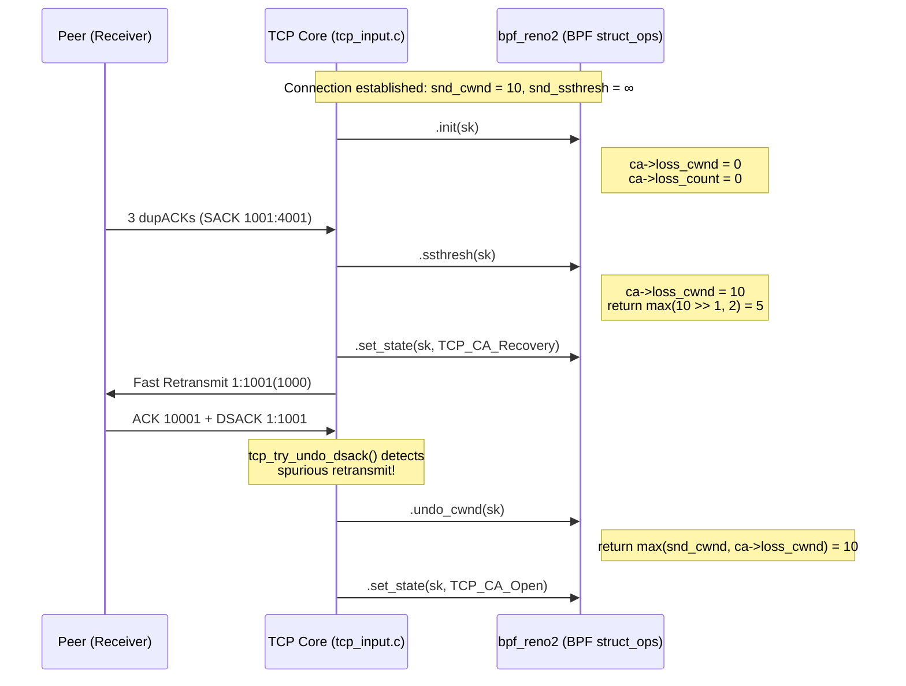

# Step 2: Loss / Fast Recovery and DSACK Undo

## Goal

In Step 1, we implemented Slow Start and Congestion Avoidance in an ideal environment without packet loss. In real networks, however, **packet loss** due to router buffer overflows and **packet reordering** due to path changes happen all the time.

In this step, you will learn how a TCP congestion control (CC) algorithm interacts with the Linux TCP core when packet loss is detected, and when that loss detection later turns out to be a false alarm (**spurious retransmission**) caused by packet reordering.

Specifically, you will implement and verify four mechanisms in `bpf_reno2`:

- Managing a custom per-socket state structure (`struct bpf_reno2_ca`) inside the CC private area `inet_csk_ca(sk)` (`icsk_ca_priv`)
- Saving the pre-loss `snd_cwnd` and halving the slow start threshold ($\max(\text{cwnd} / 2, 2)$) in the `.ssthresh` hook
- Resetting the fractional credit counter and recording loss statistics upon entering `TCP_CA_Loss` (RTO timeout) in the `.set_state` hook
- Restoring the congestion window upon receiving a DSACK (Duplicate SACK) in the `.undo_cwnd` hook

---

## Design Checkpoints (Think before coding)

Before opening `starter.bpf.c`, think through the following four questions on your own.

### Q1. Where should per-socket custom state be stored?

To restore `snd_cwnd` when a loss event turns out to be spurious, we need to remember the `snd_cwnd` right before entering recovery (as well as how many RTO losses occurred) on each socket. Storing this in a BPF global variable would cause all sockets to overwrite one another's state. Where inside `struct sock` can we store a custom per-socket structure, and what is its size limit?

<details>
<summary>Hint and Answer</summary>

Use the `icsk_ca_priv` array (104 bytes) inside `struct inet_connection_sock`. The `inet_csk_ca(sk)` helper in `bpf_cc_helpers.h` returns a `void *` pointer to `icsk->icsk_ca_priv`.

In this step, we define an 8-byte structure and cast `inet_csk_ca(sk)` to it:

```c
struct bpf_reno2_ca {
	u32 loss_cwnd;
	u32 loss_count;
};
```

The BPF verifier (`bpf_tcp_ca_btf_struct_access()`) explicitly allows write access within the `icsk_ca_priv` range.

</details>

### Q2. When entering Fast Recovery, does the CC modify `snd_cwnd` or `snd_ssthresh`?

When three duplicate ACKs (with SACK blocks) trigger Fast Recovery (`TCP_CA_Recovery`), the TCP core calls `tcp_init_cwnd_reduction()`. Which CC hook is invoked at this point, what should it return, and who is responsible for actually reducing `snd_cwnd`?

<details>
<summary>Hint and Answer</summary>

The core invokes `.ssthresh(sk)`. Rather than modifying `tp->snd_cwnd` directly, the CC module **only computes and returns the new `snd_ssthresh` value** (`max(tp->snd_cwnd >> 1U, 2U)` for Reno).

The actual reduction of `tp->snd_cwnd` is handled by the TCP core during Recovery using **PRR (Proportional Rate Reduction, RFC 6937)** (`tcp_cwnd_reduction()`), which smoothly paces the window down towards `snd_ssthresh`, and `tcp_end_cwnd_reduction()`, which clamps `tp->snd_cwnd = tp->snd_ssthresh` when exiting Recovery.

Consequently, when `.ssthresh(sk)` is called, `tp->snd_cwnd` still holds its **pre-loss value**. That makes `.ssthresh(sk)` the exact right place to save `ca->loss_cwnd = tp->snd_cwnd`.

</details>

### Q3. Why reset `tp->snd_cwnd_cnt` to 0 when transitioning to `TCP_CA_Loss`?

When packet loss cannot be recovered via Fast Recovery and an RTO (Retransmission Timeout) fires, the TCP core calls `tcp_set_ca_state(sk, TCP_CA_Loss)`. Why should `.set_state(sk, new_state)` reset `tp->snd_cwnd_cnt = 0` when it sees `new_state == TCP_CA_Loss`?

<details>
<summary>Hint and Answer</summary>

`tp->snd_cwnd_cnt` accumulates fractional ACK credits during Congestion Avoidance (to increment `snd_cwnd` by 1 once a full window of packets has been acknowledged). If credits accumulated under a large pre-loss window were left intact after an RTO reset the window, `snd_cwnd` would be incremented prematurely as soon as the socket re-entered Congestion Avoidance.

Resetting `tp->snd_cwnd_cnt = 0` on `new_state == TCP_CA_Loss` (alongside incrementing `ca->loss_count++`) discards stale credits cleanly. (In later steps, CUBIC will also use `.set_state` on `TCP_CA_Loss` to reset its internal state.)

</details>

### Q4. When undoing via DSACK, why return `max(tp->snd_cwnd, ca->loss_cwnd)` instead of just `ca->loss_cwnd`?

When a DSACK (Duplicate SACK) proves that a retransmission was unnecessary because the original packet had already arrived, the TCP core calls `.undo_cwnd(sk)` from `tcp_try_undo_dsack()` → `tcp_undo_cwnd_reduction()`. What edge case does `return max(tp->snd_cwnd, ca->loss_cwnd);` prevent compared to `return ca->loss_cwnd;`?

<details>
<summary>Hint and Answer</summary>

During a spurious Recovery or Loss episode, incoming ACKs may have already grown `tp->snd_cwnd` past the initial `ca->loss_cwnd` by the time the undo is triggered.

Returning `ca->loss_cwnd` unconditionally would paradoxically shrink `snd_cwnd` upon undo. Taking `max(tp->snd_cwnd, ca->loss_cwnd)` ensures the congestion window is restored to at least its pre-loss level without ever reducing a window that has already grown larger.

</details>

---

## Step-by-step Walkthrough



### 1. Per-socket State `struct bpf_reno2_ca` and `.init`

```c
struct bpf_reno2_ca {
	u32 loss_cwnd;
	u32 loss_count;
};

SEC("struct_ops")
void BPF_PROG(bpf_reno2_init, struct sock *sk)
{
	struct bpf_reno2_ca *ca = inet_csk_ca(sk);

	ca->loss_cwnd = 0;
	ca->loss_count = 0;
}
```

- `inet_csk_ca(sk)` returns `(void *)inet_csk(sk)->icsk_ca_priv`.
- `bpf_reno2_init()` is called when the connection reaches `ESTABLISHED` (or when switching CC via `setsockopt(TCP_CONGESTION)`) and initialises both `loss_cwnd` and `loss_count` to `0`.

### 2. Saving `snd_cwnd` and Halving `ssthresh`: `.ssthresh`

```c
SEC("struct_ops")
u32 BPF_PROG(bpf_reno2_ssthresh, struct sock *sk)
{
	const struct tcp_sock *tp = tcp_sk(sk);
	struct bpf_reno2_ca *ca = inet_csk_ca(sk);

	ca->loss_cwnd = tp->snd_cwnd;
	return max(tp->snd_cwnd >> 1U, 2U);
}
```

- Following [RFC 5681 §3.1](https://www.rfc-editor.org/rfc/rfc5681#section-3.1), `.ssthresh` returns half of the current `snd_cwnd` (using right shift `>> 1U`) bounded below by `2U`.
- At the same time, it saves the pre-reduction `tp->snd_cwnd` into `ca->loss_cwnd` so that `.undo_cwnd` can restore it if the loss turns out to be spurious.

### 3. Handling Transition to `TCP_CA_Loss`: `.set_state`

```c
SEC("struct_ops")
void BPF_PROG(bpf_reno2_set_state, struct sock *sk, u8 new_state)
{
	struct tcp_sock *tp = tcp_sk(sk);
	struct bpf_reno2_ca *ca = inet_csk_ca(sk);

	if (new_state == TCP_CA_Loss) {
		tp->snd_cwnd_cnt = 0;
		ca->loss_count++;
	}
}
```

- Invoked by `tcp_set_ca_state()` right before updating `icsk_ca_state`.
- When `new_state == TCP_CA_Loss`, we clear `tp->snd_cwnd_cnt = 0` and increment `ca->loss_count++`.
- Note on BPF verifier constraints: not all fields of `struct tcp_sock` are writable from a `struct_ops` program, but `snd_cwnd`, `snd_cwnd_cnt`, `snd_ssthresh`, and `icsk_ca_priv` are explicitly whitelisted in `bpf_tcp_ca_btf_struct_access()`.

### 4. Undoing Window Reduction: `.undo_cwnd`

```c
SEC("struct_ops")
u32 BPF_PROG(bpf_reno2_undo_cwnd, struct sock *sk)
{
	const struct tcp_sock *tp = tcp_sk(sk);
	const struct bpf_reno2_ca *ca = inet_csk_ca(sk);

	return max(tp->snd_cwnd, ca->loss_cwnd);
}
```

- When DSACK ([RFC 2883](https://www.rfc-editor.org/rfc/rfc2883) / [RFC 3708](https://www.rfc-editor.org/rfc/rfc3708)) or TCP timestamps (Eifel Detection, [RFC 3522](https://www.rfc-editor.org/rfc/rfc3522)) prove that all retransmissions in the recovery episode were spurious, `tcp_undo_cwnd_reduction()` calls `.undo_cwnd(sk)`.
- Returning `max(tp->snd_cwnd, ca->loss_cwnd)` restores the halved window back to the pre-loss `loss_cwnd` (while the TCP core restores `snd_ssthresh` from `tp->prior_ssthresh`).

---

## Understanding `test.pkt`

`test.pkt` reproduces a complete **packet reordering → Fast Recovery → DSACK Undo** sequence:

1. **Handshake and IW10 transmission**:
   - The connection is established with `<mss 1012,sackOK,TS val 100 ecr 0,nop,wscale 7>`. Because the TCP Timestamp option takes 12 bytes, each segment carries exactly `1000` bytes of payload.
   - `write(4, ..., 10000)` sends 10 segments (`1:10001(10000)`). At this point `tcpi_snd_cwnd == 10` and `tcpi_ca_state == TCP_CA_Open`.
2. **Three duplicate ACKs with SACK trigger Fast Recovery**:
   - Segment `1:1001` is delayed in the network while `1001:2001`, `2001:3001`, and `3001:4001` arrive at the peer first.
   - The peer sends three duplicate ACKs (`ack 1`) carrying `<nop,nop,TS ...,nop,nop,sack 1001:2001>`, `<...,sack 1001:3001>`, and `<...,sack 1001:4001>`. On the third duplicate ACK, `sacked_out == 3` (`>= tp->reordering`), triggering Fast Recovery.
   - The kernel fast-retransmits `1:1001(1000)`, calls `.ssthresh`, and transitions to `tcpi_ca_state == TCP_CA_Recovery` with `tcpi_snd_ssthresh == 5`.
3. **Cumulative ACK with DSACK triggers Undo**:
   - Both the delayed original `1:1001` and the remaining segments arrive at the peer, followed by the duplicate retransmission `1:1001`. The peer replies with a cumulative `ack 10001` containing a **DSACK block `<nop,nop,TS ...,nop,nop,sack 1:1001>`** (reporting duplicate receipt of `1:1001`, which is below `ack 10001`).
   - Seeing `undo_retrans == 0`, the kernel calls `tcp_try_undo_dsack()`, which invokes `.undo_cwnd` and restores `tcpi_snd_cwnd` from `5` back to `>= 10` (`tcpi_snd_cwnd >= 10`).

---

## How to run

```sh
# 1. starter.bpf.c がアサートで失敗することを確認
../../run_test.sh cubic/step02-loss-undo starter
# 2. starter.bpf.c の TODO を実装して再実行（または模範解答 solution を実行）
../../run_test.sh cubic/step02-loss-undo solution
```
