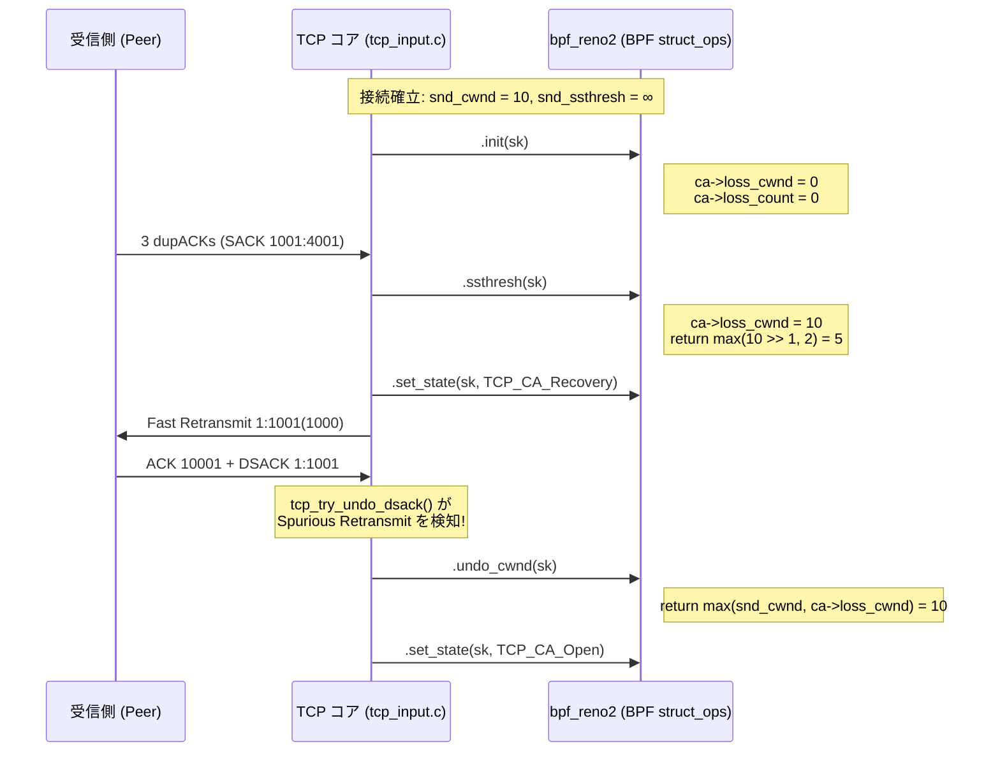

# Step 2: Loss / Fast Recovery と DSACK Undo

## 学習ゴール

Step 1 では、パケットロスが起きない理想的な環境で Slow Start と Congestion Avoidance を実装しました。しかし現実のネットワークでは、ルータのバッファ溢れによる**パケットロス**や、経路の揺らぎによる**パケットの並べ替え（Reordering）**が日常的に発生します。

このステップでは、TCP の輻輳制御アルゴリズム（CC）がパケットロスに直面したとき、およびそのロス判定が「実は並べ替えによる誤検出（Spurious Retransmission）だった」と判明したときに、TCP コアとどのように連携するかを学びます。

具体的には、以下の 4 つの仕組みを `bpf_reno2` として実装・検証します。

- ソケットごとの CC 私有領域 `inet_csk_ca(sk)`（`icsk_ca_priv`）を使ったカスタム状態構造体 `struct bpf_reno2_ca` の管理
- `.ssthresh` フックによるロス前の `snd_cwnd` の退避と、しきい値の半減（$\max(\text{cwnd} / 2, 2)$）
- `.set_state` フックによる `TCP_CA_Loss`（RTO タイムアウト）遷移時の端数カウンタリセットと統計記録
- `.undo_cwnd` フックによる DSACK（Duplicate SACK）受信時のウィンドウ復元（Undo）

---

## 設計チェックポイント（VibeWise 方式 — コードを見る前に考えよう）

`starter.bpf.c` を開く前に、以下の 4 つの問いを自分の頭で考えてみましょう。

### Q1. ソケットごとの独自状態はどこに保存するか？

ロス判定が誤り（Spurious）だったときに元の `snd_cwnd` へ戻すには、「ロスに入る直前の `snd_cwnd`」や「RTO が何回起きたか」をソケットごとに記憶しておく必要があります。BPF グローバル変数に置くと全ソケットで上書きし合ってしまいます。カーネルの `struct sock` のどこに、何バイトまで独自の構造体を置けるでしょうか？

<details>
<summary>ヒントと答え</summary>

`struct inet_connection_sock` の末尾付近にある `icsk_ca_priv` 配列（104 バイト）を使います。`bpf_cc_helpers.h` の `inet_csk_ca(sk)` ヘルパーを使うと、`icsk->icsk_ca_priv` の先頭ポインタを `void *` として取得できます。

今回は以下の 8 バイトの構造体を定義してキャストして使います。

```c
struct bpf_reno2_ca {
	u32 loss_cwnd;
	u32 loss_count;
};
```

なお、BPF ベリファイア（`bpf_tcp_ca_btf_struct_access()`）は `icsk_ca_priv` の範囲内への書き込みを許可しています。

</details>

### Q2. Fast Recovery に入るとき、CC が実際に書き換えるのは `snd_cwnd` か `snd_ssthresh` か？

3 回の重複 ACK（SACK）で Fast Recovery（`TCP_CA_Recovery`）に入るとき、TCP コアの `tcp_init_cwnd_reduction()` が呼ばれます。このとき CC モジュールのどのフックが呼ばれ、CC は何を返すべきでしょうか？また、`snd_cwnd` 自体を半分に減らす処理は誰が担当するでしょうか？

<details>
<summary>ヒントと答え</summary>

呼ばれるフックは `.ssthresh(sk)` です。CC モジュールはここで `tp->snd_cwnd` を直接書き換えるのではなく、**新しい `snd_ssthresh` の値（Reno なら `max(tp->snd_cwnd >> 1U, 2U)`）を計算して返すだけ**です。

実際の `tp->snd_cwnd` の削減は、TCP コア側が Recovery 中に **PRR（Proportional Rate Reduction, RFC 6937）**（`tcp_cwnd_reduction()`）を使って `snd_ssthresh` に向けて滑らかに減らし、Recovery を抜ける際の `tcp_end_cwnd_reduction()` で `tp->snd_cwnd = tp->snd_ssthresh` に揃えます。

したがって、`.ssthresh(sk)` が呼ばれた時点では `tp->snd_cwnd` はまだ**削減前の値**を保っています。このタイミングで `ca->loss_cwnd = tp->snd_cwnd` を保存しておくのが正解です。

</details>

### Q3. RTO（`TCP_CA_Loss`）に遷移したとき、なぜ `tp->snd_cwnd_cnt` を 0 にリセットするのか？

パケットロスが Fast Recovery で回復できず RTO（Retransmission Timeout）が発火すると、TCP コアは `tcp_set_ca_state(sk, TCP_CA_Loss)` を呼びます。このとき `.set_state(sk, new_state)` フックで `new_state == TCP_CA_Loss` を検知したら、なぜ `tp->snd_cwnd_cnt = 0` にリセットすべきなのでしょうか？

<details>
<summary>ヒントと答え</summary>

`tp->snd_cwnd_cnt` は Congestion Avoidance 中に「1 RTT で `snd_cwnd` を +1 するための ACK パケット数クレジット（端数）」を貯めているカウンタです。ロスが発生してウィンドウサイズがリセットされた後に、ロス前の大きなウィンドウ時代に貯めた端数クレジットが残っていると、再び Congestion Avoidance に入った直後に意図せず早く `snd_cwnd` が +1 されてしまいます。

そのため、`new_state == TCP_CA_Loss` への遷移時には `tp->snd_cwnd_cnt = 0` にクリアし、あわせてロスカウンタ `ca->loss_count++` を記録します（後続のステップで作る CUBIC でも、`.set_state` で `TCP_CA_Loss` を見て内部状態をリセットします）。

</details>

### Q4. DSACK で Undo するとき、なぜ単純に `return ca->loss_cwnd;` ではなく `max(tp->snd_cwnd, ca->loss_cwnd)` を返すのか？

再送したパケットが DSACK（Duplicate SACK）によって「元のパケットも届いていた（＝再送は不要だった）」と判明すると、TCP コアの `tcp_try_undo_dsack()` → `tcp_undo_cwnd_reduction()` から `.undo_cwnd(sk)` が呼ばれます。このとき `return ca->loss_cwnd;` ではなく `return max(tp->snd_cwnd, ca->loss_cwnd);` とするのはどのようなエッジケースを防ぐためでしょうか？

<details>
<summary>ヒントと答え</summary>

誤検出された Recovery や Loss の最中に多くの ACK が到着してウィンドウが成長し、Undo が発動した時点での現在の `tp->snd_cwnd` が、すでにロス開始時の `ca->loss_cwnd` を上回っているケースがあり得ます。

もし無条件に `ca->loss_cwnd` で上書きしてしまうと、「Undo した結果かえって `snd_cwnd` が減ってしまう」という逆転現象が起きます。`max(tp->snd_cwnd, ca->loss_cwnd)` を取ることで、現在のウィンドウを決して縮小させずにロス前の水準以上へ復元できます。

</details>

---

## 実装ステップと解説



### 1. 私有データ構造体 `struct bpf_reno2_ca` と `.init`

```c
struct bpf_reno2_ca {
	u32 loss_cwnd;
	u32 loss_count;
};

SEC("struct_ops")
void BPF_PROG(bpf_reno2_init, struct sock *sk)
{
	struct bpf_reno2_ca *ca = inet_csk_ca(sk);

	ca->loss_cwnd = 0;
	ca->loss_count = 0;
}
```

- `inet_csk_ca(sk)` は `(void *)inet_csk(sk)->icsk_ca_priv` を返します。
- ソケット確立時（または `setsockopt(TCP_CONGESTION)` による切り替え時）に呼ばれる `bpf_reno2_init()` で `loss_cwnd` と `loss_count` を `0` に初期化します。

### 2. しきい値の計算と cwnd の退避: `.ssthresh`

```c
SEC("struct_ops")
u32 BPF_PROG(bpf_reno2_ssthresh, struct sock *sk)
{
	const struct tcp_sock *tp = tcp_sk(sk);
	struct bpf_reno2_ca *ca = inet_csk_ca(sk);

	ca->loss_cwnd = tp->snd_cwnd;
	return max(tp->snd_cwnd >> 1U, 2U);
}
```

- [RFC 5681 §3.1](https://www.rfc-editor.org/rfc/rfc5681#section-3.1) に従い、輻輳発生時の新しい `snd_ssthresh` として現在の `snd_cwnd` の半分（右シフト `>> 1U`）と下限 `2U` の大きい方を返します。
- 同時に、後で DSACK Undo が起きたときに戻せるよう、削減前の `tp->snd_cwnd` を `ca->loss_cwnd` に退避します。

### 3. Loss 状態への遷移処理: `.set_state`

```c
SEC("struct_ops")
void BPF_PROG(bpf_reno2_set_state, struct sock *sk, u8 new_state)
{
	struct tcp_sock *tp = tcp_sk(sk);
	struct bpf_reno2_ca *ca = inet_csk_ca(sk);

	if (new_state == TCP_CA_Loss) {
		tp->snd_cwnd_cnt = 0;
		ca->loss_count++;
	}
}
```

- TCP コアの `tcp_set_ca_state()` が `icsk_ca_state` を書き換える直前に呼ばれます。
- `new_state == TCP_CA_Loss`（RTO による Loss 状態突入）のとき、`tp->snd_cwnd_cnt = 0` にリセットして `ca->loss_count` をインクリメントします。
- BPF ベリファイアの制約として、`struct tcp_sock` の全フィールドが書き込み可能なわけではありませんが、`snd_cwnd`、`snd_cwnd_cnt`、`snd_ssthresh`、および `icsk_ca_priv` は `bpf_tcp_ca_btf_struct_access()` で明示的に書き込みが許可されています。

### 4. Spurious Retransmission からの復元: `.undo_cwnd`

```c
SEC("struct_ops")
u32 BPF_PROG(bpf_reno2_undo_cwnd, struct sock *sk)
{
	const struct tcp_sock *tp = tcp_sk(sk);
	const struct bpf_reno2_ca *ca = inet_csk_ca(sk);

	return max(tp->snd_cwnd, ca->loss_cwnd);
}
```

- DSACK（[RFC 2883](https://www.rfc-editor.org/rfc/rfc2883) / [RFC 3708](https://www.rfc-editor.org/rfc/rfc3708)）や TCP タイムスタンプ（Eifel Detection, [RFC 3522](https://www.rfc-editor.org/rfc/rfc3522)）によって「さきほどの再送は並べ替えによる誤検出だった」と判明した際、`tcp_undo_cwnd_reduction()` から呼ばれます。
- `max(tp->snd_cwnd, ca->loss_cwnd)` を返すことで、半減されたウィンドウをロス前の `loss_cwnd` へ即座に戻します（なお、`snd_ssthresh` 自体は TCP コア側が `tp->prior_ssthresh` を使って復元します）。

---

## packetdrill テストの解説 (`test.pkt`)

`test.pkt` は、**パケットの到着順序逆転（Reordering）によって誤って Fast Recovery に入った後、DSACK によってウィンドウが元の 10 に復元される一連の流れ**を再現しています。

1. **接続確立と IW10 の送信**:
   - `<mss 1012,sackOK,TS val 100 ecr 0,nop,wscale 7>` で接続を確立します。TCP Timestamp オプションが 12 バイトを占めるため、1 セグメントあたりのデータペイロードはちょうど `1000` バイトになります。
   - `write(4, ..., 10000)` で 10 セグメント（`1:10001(10000)`）を一気に送信します。この時点で `tcpi_snd_cwnd == 10`、`tcpi_ca_state == TCP_CA_Open` です。
2. **3 回の重複 ACK（SACK）による Fast Recovery 突入**:
   - 先頭セグメント `1:1001` がネットワーク内で遅延し、後続の `1001:2001`、`2001:3001`、`3001:4001` が先に受信側へ届いた状況を模擬します。
   - 受信側が `ack 1` に SACK ブロック `<nop,nop,TS ...,nop,nop,sack 1001:2001>`、`<...,sack 1001:3001>`、`<...,sack 1001:4001>` を付けて 3 回返すと、3 つ目の dupACK で `sacked_out == 3`（`>= tp->reordering`）となり、Fast Recovery が発動します。
   - カーネルは `1:1001(1000)` を Fast Retransmit し、`.ssthresh` フックが呼ばれて `tcpi_snd_ssthresh == 5`、`tcpi_ca_state == TCP_CA_Recovery` になります。
3. **DSACK 付きの累積 ACK による Undo**:
   - 直後に、遅延していた本来の `1:1001` も残りのセグメントもすべて受信側に届き、さらに再送した `1:1001` が重複して届いたため、受信側は累積 ACK `ack 10001` に **DSACK ブロック `<nop,nop,TS ...,nop,nop,sack 1:1001>`**（すでに `ack 10001` 以下の範囲を SACK しているので重複受信の報告）を添えて返します。
   - カーネルは `undo_retrans == 0` となったことで `tcp_try_undo_dsack()` を呼び、`.undo_cwnd` フックによって `tcpi_snd_cwnd` が半減した `5` から元の `10` 以上（`tcpi_snd_cwnd >= 10`）に復元されたことをアサートします。

---

## 実行方法

```sh
# 1. starter.bpf.c がアサートで失敗することを確認
../../run_test.sh cubic/step02-loss-undo starter
# 2. starter.bpf.c の TODO を実装して再実行（または模範解答 solution を実行）
../../run_test.sh cubic/step02-loss-undo solution
```
