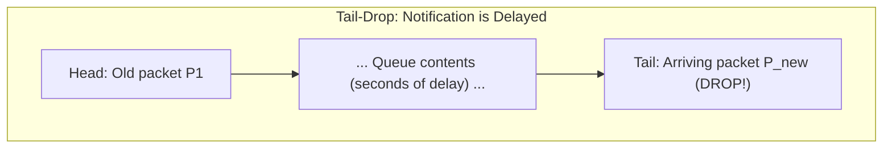
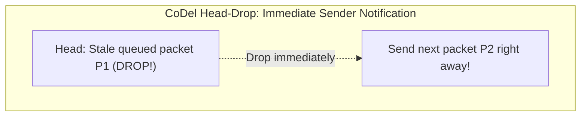
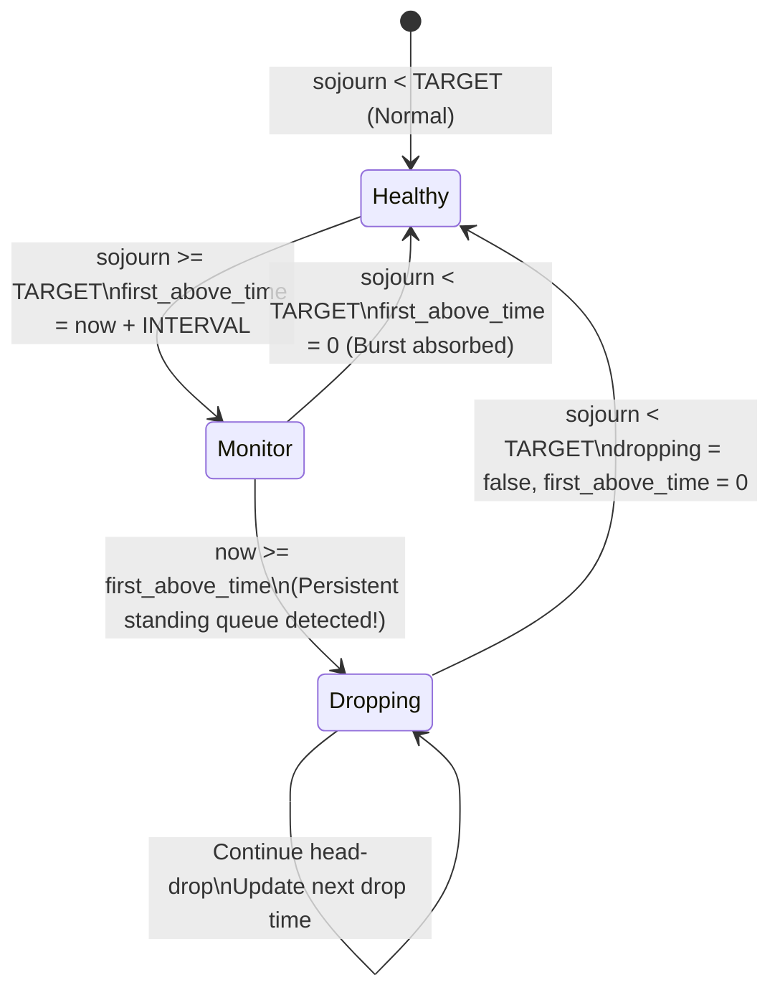

# Track 6: Linux Queuing Disciplines (Qdisc) — CoDel AQM and FQ-CoDel

[日本語](README.md)

In this track, you will implement **CoDel (Controlled Delay AQM: RFC 8289)** and **FQ-CoDel (FlowQueue-CoDel: RFC 8290)** from scratch using Linux kernel BPF `struct_ops` (`struct Qdisc_ops`). These algorithms were designed to solve one of the greatest challenges in the modern Internet: **Bufferbloat**.

No prior knowledge of Linux traffic control or queuing theory is assumed. We will start from first principles: why oversized buffers cause latency explosions, why traditional tail-drop fails, and how CoDel surgically identifies and drops packets from standing queues while preserving throughput.

---

## 1. What is Bufferbloat?

For years, network equipment designers (home routers, Wi-Fi access points, cellular base stations, switches) operated under the assumption that "packet loss is bad." As memory costs dropped, packet buffers grew dramatically (from megabytes to gigabytes).

However, loss-based TCP congestion control algorithms (such as Reno and CUBIC) **keep increasing the sending window until a packet loss occurs**. As a result, the following pathological behavior emerges:

```text
Sender (TCP Reno/CUBIC)
   |
   | Continuously increases congestion window (cwnd)
   v
[ Huge FIFO buffer at bottleneck router (thousands of packets) ]
   |  P1 | P2 | P3 | P4 | P5 | ... | P1000 | ...
   |  <- Packets sit stuck in the queue for seconds! (Massive latency) ->
   v
Receiver (Eventually receives packets seconds later and ACKs)
```

1. **Formation of a Standing Queue**:
   - Because router buffers are enormous, packets do not overflow easily (no loss occurs).
   - The sender's TCP assumes the network has spare capacity and continues expanding `cwnd`, filling the buffer to capacity.
2. **Latency Explosion**:
   - Once the buffer is full, every new packet must wait at the tail of a massive queue, waiting for the bottleneck link to drain.
   - A link that should have a 10 ms round-trip time now experiences 1–2 seconds of queueing delay.
3. **Starvation of Interactive Traffic**:
   - When a bulk download or background backup runs, interactive traffic (DNS lookups, SSH typing, web browsing, online gaming, VoIP calls) is stuck behind thousands of bulk packets, causing extreme lag and frozen calls.

This phenomenon—where oversized buffers are persistently full of packets, leading to severe latency degradation—is called **Bufferbloat**.

---

## 2. Tail-Drop vs. Head-Drop: Why Drop from the Front?

In traditional simple FIFO queues, when the buffer is completely full (`sch->limit` reached), newly arriving packets are discarded at the tail. This is called **Tail-Drop**.

Tail-drop suffers from two critical flaws:



- **Delayed Feedback Signal**:
  - The drop of the newly arrived packet at the tail cannot be detected by the sender until all old packets currently sitting ahead of it in the queue have been transmitted.
  - By the time the sender detects loss via duplicate ACKs or SACK, seconds have elapsed and the network is already severely congested.
- **Global Synchronization**:
  - When the buffer overflows, packets from multiple concurrent TCP flows are dropped simultaneously, causing all flows to halve their windows at the same time and resulting in link underutilization.

### CoDel's Head-Drop

CoDel solves this by dropping the **oldest packet at the head of the queue** at the moment of dequeue.



- When the head packet is dropped and the next packet ($$P_2$$) is sent immediately, the receiver immediately generates a SACK / duplicate ACK and sends it back to the sender.
- The sender discovers packet loss in the **shortest possible time (within 1 RTT)** and reduces its transmission rate promptly.
- Stale packets are discarded, allowing fresher packets to reach the wire faster.

---

## 3. CoDel (RFC 8289) Algorithm: Control via Sojourn Time

The fundamental insight of CoDel (Controlled Delay) is to **measure packet sojourn time (queue delay) rather than queue length (packet or byte count)**.

### Good Queues vs. Bad Queues

- **Good Queue (Transient Burst)**:
  - When a web page loads, a burst of 100 packets may arrive. If the link is fast, this burst is drained within a few milliseconds, and the queue quickly empties. This burst must be absorbed by the buffer without dropping packets.
- **Bad Queue (Persistent Standing Queue)**:
  - The queue never empties over tens or hundreds of milliseconds; every packet experiences high delay. This is Bufferbloat—a bad queue that must be drained.

### Sojourn Time and State Transitions

When a packet is enqueued, its arrival timestamp is recorded (`enqueue_time`). At dequeue time, the sojourn time is calculated:

$$\text{sojourn} = \text{now} - \text{enqueue-time}$$



1. **`TARGET` (Acceptable Sojourn Time, standard 5 ms)**:
   - If packet sojourn time is below `TARGET`, the queue is healthy and no drops occur.
2. **`INTERVAL` (Observation Window, standard 100 ms, shortened to 20 ms in this lab)**:
   - When `sojourn >= TARGET`, this might be a transient burst. Rather than dropping immediately, CoDel sets `first_above_time = now + INTERVAL` to observe.
   - If the sojourn time drops below `TARGET` at any point during `INTERVAL`, the burst is deemed resolved and the timer is reset.
3. **Head-Drop Execution**:
   - If `sojourn >= TARGET` persists for the entire `INTERVAL`, CoDel concludes a persistent standing queue exists.
   - It transitions to `dropping = true`, drops the dequeued head packet, and transmits the subsequent packet immediately.

---

## 4. FQ-CoDel (RFC 8290): Flow Isolation and Sparse Flow Prioritization

Applying CoDel to a single FIFO queue mitigates Bufferbloat, but when multiple heavy download flows run concurrently, interactive traffic (DNS, TCP ACKs, SSH keystrokes, VoIP) still gets mixed in with bulk packets.

**FQ-CoDel** combines **Fair Queueing** with **CoDel AQM** to provide complete isolation and zero-delay treatment for interactive traffic.

```text
Arriving packet (skb)
   |
   +---> Hash (IP 5-tuple) maps to flow bucket
           |
           +---> [ Flow A (Bulk download: many packets) ] ---> old_flows (Subject to CoDel head-drops)
           |
           +---> [ Flow B (SSH / DNS / Gaming: sparse)   ] ---> new_flows (Highest dequeue priority!)
```

### Deficit Round Robin (DRR) with Two Lists

FQ-CoDel manages active flows using two circular linked lists: **`new_flows`** and **`old_flows`**.

1. **Automatic Preference for Sparse Flows**:
   - Interactive communications (web clicks, DNS queries, SSH keystrokes) send packets intermittently.
   - When a packet arrives for an idle flow, the flow is added to the tail of **`new_flows`**.
   - Dequeue **always services `new_flows` before `old_flows`**.
   - As a result, interactive packets jump ahead of standing bulk queues, experiencing **zero added queuing delay (`sojourn < TARGET`) and zero packet loss**!
2. **Bulk Flow Isolation and CoDel**:
   - Flows continuously streaming large volumes of data exhaust their round credit (`quantum = 1000` bytes) and are moved to **`old_flows`**.
   - Flows in `old_flows` share bandwidth fairly via Deficit Round Robin.
   - Each flow maintains independent CoDel state (`first_above_time`, `dropping`). **Only the bulk flow causing buffer buildup suffers head-drops, while other flows remain completely unaffected**.

---

## 5. Lab Steps and Commands

This track consists of two steps:

| Step | Directory | Description |
| :--- | :--- | :--- |
| **Step 1** | [`step01-codel-aqm/`](step01-codel-aqm/README.en.md) | Single-queue CoDel AQM. Implement enqueue timestamp stamping, bottleneck transmission rate control (Watchdog timer), sojourn time evaluation, and head-drop state transitions. |
| **Step 2** | [`step02-fq-codel/`](step02-fq-codel/README.en.md) | Complete FQ-CoDel. Implement 5-tuple flow classification, DRR scheduling with `new_flows` and `old_flows`, per-flow CoDel state tracking, and sparse flow prioritization. |

### Running Tests

From the `labs/` directory (`/usr/local/google/home/kuniyu/tcp-eli5/labs`), test each step using `run_test.sh`:

```sh
# Step 1: Verify starter fails, then implement TODOs to pass
./run_test.sh qdisc-fq-codel/step01-codel-aqm starter
./run_test.sh qdisc-fq-codel/step01-codel-aqm solution

# Step 2: Verify starter fails, then test solution
./run_test.sh qdisc-fq-codel/step02-fq-codel starter
./run_test.sh qdisc-fq-codel/step02-fq-codel solution
```

Proceed to [`step01-codel-aqm/README.en.md`](step01-codel-aqm/README.en.md) to implement your first CoDel AQM!
