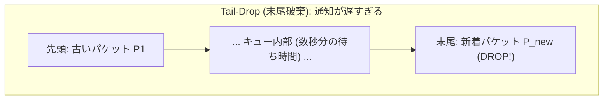
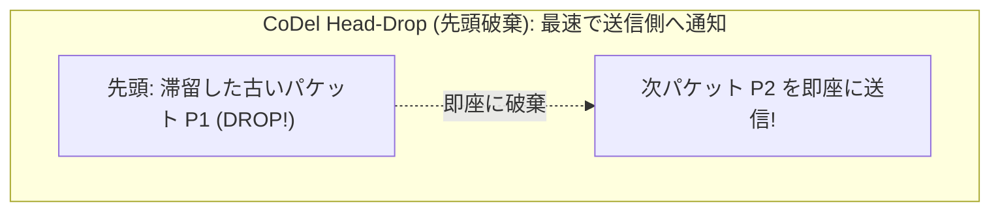
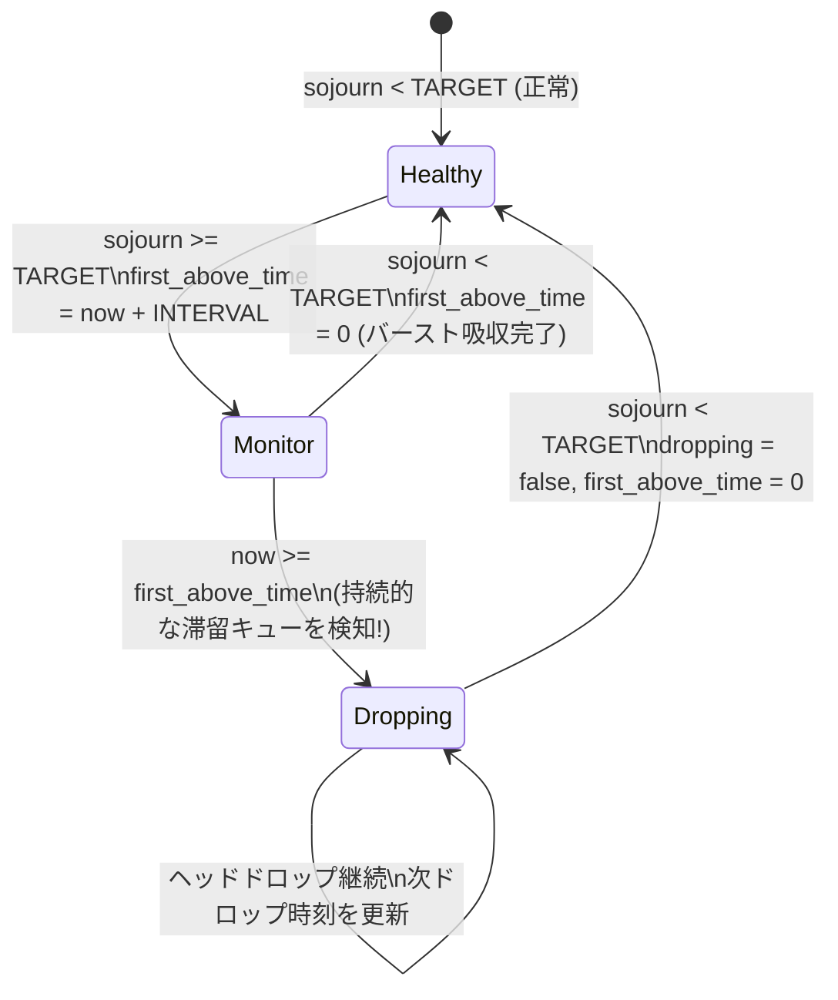

# トラック 6: Linux キューイング規律 (Qdisc) — CoDel AQM と FQ-CoDel

[English](README.en.md)

このトラックでは、現代のインターネットにおける最大の課題の一つである **Bufferbloat（バッファブロート）** を解決するために開発された **CoDel（Controlled Delay AQM: RFC 8289）** および **FQ-CoDel（FlowQueue-CoDel: RFC 8290）** を、Linux カーネルの BPF `struct_ops`（`struct Qdisc_ops`）を使ってゼロから実装します。

トラフィック制御やキューイングの事前知識は前提としません。「なぜ巨大なバッファが通信遅延を爆発させるのか」「従来の Tail-Drop は何が問題だったのか」「CoDel はどのようにして不要な滞留キューだけを見つけ出して外科手術のようにパケットを間引くのか」を第一原理から整理しましょう。

---

## 1. そもそも Bufferbloat（バッファブロート）とは何か？

長年、ネットワーク機器（家庭用ルータ、Wi-Fi アクセスポイント、基地局、スイッチ）の設計者は「パケットロスは悪である」と考え、メモリの低価格化に伴って機器内部のパケットバッファをどんどん巨大化（数メガバイト〜数ギガバイト）させてきました。

しかし、TCP 輻輳制御（Reno や CUBIC など）は **「パケットロスが起きるまで送信ウィンドウを増やし続ける」** という性質を持っています。その結果、以下の破滅的な現象が発生します。

```text
送信側 (TCP Reno/CUBIC)
   |
   | 送信ウィンドウ (cwnd) を限界まで拡大し続ける
   v
[ ボトルネックルータの巨大な FIFO キュー (数万パケット) ]
   |  P1 | P2 | P3 | P4 | P5 | ... | P1000 | ...
   |  <- パケットがキューの中で数秒間も足止めされる！ (巨大な遅延) ->
   v
受信側 (数秒後にようやくパケットを受け取り、ACK を返す)
```

1. **滞留キュー（Standing Queue）の形成**:
   - ルータのバッファが大きすぎるため、パケットがなかなか溢れません（パケットロスが起きない）。
   - 送信側 TCP は「まだ道路が空いている」と勘違いし、`cwnd` を増やし続けてバッファを満杯まで詰め込みます。
2. **レイテンシの破滅的爆発**:
   - 一度バッファが満杯になると、すべてのパケットが巨大な行列の最後尾に並ばされ、回線速度で順番に捌かれるのを待たされます。
   - 本来なら $$10\text{ ms}$$ で届くはずの通信に、キュー待ち遅延だけで $$1\text{ 秒} \sim 2\text{ 秒}$$ もの遅延が上乗せされます。
3. **対話型通信の窒息**:
   - バックグラウンドで大容量ファイルのダウンロードやバックアップ（バルクフロー）が走ると、同じ回線を共有している Web ブラウジング、SSH、オンラインゲーム、音声通話（VoIP）のパケットも同じ大行列の後ろに並ばされ、画面がフリーズしたり通話が途切れたりします。

この「無駄に大きすぎるバッファが常時パケットで満たされ、レイテンシが極端に悪化する現象」を **Bufferbloat** と呼びます。

---

## 2. Tail-Drop vs Head-Drop：なぜ後ろではなく「先頭」を落とすのか？

従来の単純な FIFO キューでは、バッファが完全に満杯（`sch->limit` に到達）になったときに、新しく届いたパケットを捨てる **Tail-Drop（末尾破棄）** が行われていました。

しかし、Tail-Drop には致命的な欠点があります。



- **シグナルの遅延**:
  - 末尾で破棄された新着パケットの情報は、キューの先頭に並んでいる数万個の古いパケットがすべて送信され切るまで、送信側に伝わりません。
  - 送信側 TCP がロス（重複 ACK や SACK）を検知して減速する頃には、すでに数秒が経過しており、ネットワークは渋滞しきっています。
- **グローバル同期（Global Synchronization）**:
  - バッファ満杯時に到着した複数の異なる TCP コネクションのパケットが一斉に Tail-Drop され、すべてのフローが同時にウィンドウを半減させ、回線利用率が急落します。

### CoDel の Head-Drop（先頭破棄）

これに対し、CoDel はパケットがキューから出ていく瞬間（`dequeue`）に、最も古く滞留していた **先頭パケット（Head）を破棄** します。



- 先頭パケットを落として直後のパケット（$$P_2$$）をただちに送信すると、受信側は即座に SACK / 重複 ACK を生成して送信側に返します。
- 送信側 TCP は **最短の時間（1 RTT 以内）** でパケットロスを検知し、即座に送信レートを落とすことができます。
- キューの中に溜まった古いゴミパケットを捨てて、より新鮮なパケットを優先的に回線へ送り出せます。

---

## 3. CoDel (RFC 8289) のアルゴリズム：滞在時間（Sojourn Time）による制御

CoDel（Controlled Delay）の画期的な点は、**「キューの長さ（パケット数やバイト数）ではなく、パケットの滞在時間（Sojourn Time）を測定する」** という点です。

### 良いキュー（Good Queue）と悪いキュー（Bad Queue）

- **良いキュー（一過性のバースト）**:
  - Web ページの読み込みなどで一時的に 100 パケットのバーストが到着しても、回線が空いていれば数ミリ秒で捌け、キューはすぐに空になります。このようなバーストはバッファで吸収すべきであり、パケットを落とすべきではありません。
- **悪いキュー（持続的な滞留キュー / Standing Queue）**:
  - 何十ミリ秒、何百ミリ秒にもわたってキューが一度も空にならず、どのパケットも長い時間並ばされている状態。これこそが Bufferbloat であり、排除すべき「悪いキュー」です。

### Sojourn Time と CoDel の状態遷移

パケットがエンキューされた時刻を `enqueue_time` として記録しておき、デキュー時に現在の時刻との差を計算します：

$$\text{sojourn} = \text{now} - \text{enqueue}_{\text{time}}$$



1. **`TARGET`（許容滞在時間，標準 5 ms）**:
   - パケットの滞在時間が `TARGET` 未満であれば、キューは健全と判断し、何も落としません。
2. **`INTERVAL`（観測ウィンドウ，標準 100 ms、本ラボでは短縮値 20 ms）**:
   - `sojourn >= TARGET` になっても、一過性のバーストかもしれないので即座には落とさず、`first_above_time = now + INTERVAL` を設定して監視します。
   - `INTERVAL` の期間中、滞在時間が一度でも `TARGET` を下回れば、バーストが解消したと判断してタイマーをリセットします。
3. **Head-Drop の発動**:
   - `INTERVAL` の間ずっと `sojourn >= TARGET` が継続した場合、持続的な滞留キュー（Bad Queue）が存在すると断定します。
   - `dropping = true` に遷移し、デキューした先頭パケットを破棄（Head-Drop）して直後のパケットを送信します。

---

## 4. FQ-CoDel (RFC 8290)：フロー分離と疎なフローの優先

CoDel を単一の FIFO キューに適用するだけでも Bufferbloat は大幅に抑えられますが、ヘビーなダウンロードフローが複数走っている場合、それらのパケットが混ざり合い、軽量な通信（DNS、ACK、SSH、ゲーム）も巻き添えを食らいます。

そこで **Fair Queueing（公平キューイング）** と **CoDel AQM** を融合させた究極の qdisc が **FQ-CoDel** です。

```text
受信パケット (skb)
   |
   +---> L4 ハッシュ (IP 5-tuple) でバケット (flow) に分類
           |
           +---> [ Flow A (動画ダウンロード: 大量パケット) ] ---> old_flows (CoDel でヘッドドロップ)
           |
           +---> [ Flow B (SSH / DNS / ゲーム: 1 パケット) ] ---> new_flows (最優先デキュー!)
```

### 2 つのリストによる DRR（Deficit Round Robin）

FQ-CoDel は、フローを **`new_flows`** と **`old_flows`** の 2 つの循環リストで管理します。

1. **Sparse Flow（疎なフロー）の自動優遇**:
   - Web のクリック、DNS 問い合わせ、SSH のキー入力などの通信は、たまに 1 パケットだけ届きます。
   - キューが空だったフローにパケットが届くと、そのフローは **`new_flows`** の末尾に追加されます。
   - デキュー処理は **常に `old_flows` よりも `new_flows` を優先して処理** します。
   - その結果、バルクフローが数メガバイトのデータを流し込んでいても、対話型通信のパケットはバルクフローを追い越して **遅延ゼロ（`sojourn < TARGET`）かつロスゼロ** で即座に送出されます！
2. **Bulk Flow（大量転送フロー）の隔離と CoDel**:
   - 連続して大量のパケットを送り続けるフローは、クレジット（`quantum = 1000` バイト）を使い切ると **`old_flows`** へ降格されます。
   - `old_flows` 同士はラウンドロビンで公平に帯域を分け合います。
   - さらに、フローごとに独立して CoDel 状態変数（`first_above_time` や `dropping`）を保持しているため、**バッファを埋めているバルクフローだけが選択的にパケットを落とされ、他のフローには一切影響を与えません**。

---

## 5. ステップ一覧と実行コマンド

このトラックは以下の 2 ステップで構成されています。

| ステップ | ディレクトリ | 実装する内容 |
| :--- | :--- | :--- |
| **Step 1** | [`step01-codel-aqm/`](step01-codel-aqm/README.md) | 単一キューにおける CoDel AQM。エンキュー時刻の打刻、ボトルネック送信レートの制御（Watchdog タイマー）、滞在時間（Sojourn Time）判定、持続的滞留キューに対する Head-Drop 状態マシンを実装します。 |
| **Step 2** | [`step02-fq-codel/`](step02-fq-codel/README.md) | FQ-CoDel の完全実装。フローハッシュ分類、`new_flows` / `old_flows` による DRR スケジューリング、フローごとの CoDel 状態管理と、疎な対話型フローの優先送出を実装します。 |

### 実行コマンド

`labs/` ディレクトリ（`/usr/local/google/home/kuniyu/tcp-eli5/labs`）から `run_test.sh` を使って各ステップをビルド・検証できます。

```sh
# Step 1: starter が失敗することを確認し、TODO を実装してパスさせる
./run_test.sh qdisc-fq-codel/step01-codel-aqm starter
./run_test.sh qdisc-fq-codel/step01-codel-aqm solution

# Step 2: starter の失敗確認と模範解答のテスト
./run_test.sh qdisc-fq-codel/step02-fq-codel starter
./run_test.sh qdisc-fq-codel/step02-fq-codel solution
```

それでは、[`step01-codel-aqm/README.md`](step01-codel-aqm/README.md) に進んで最初の CoDel AQM を実装してみましょう！
