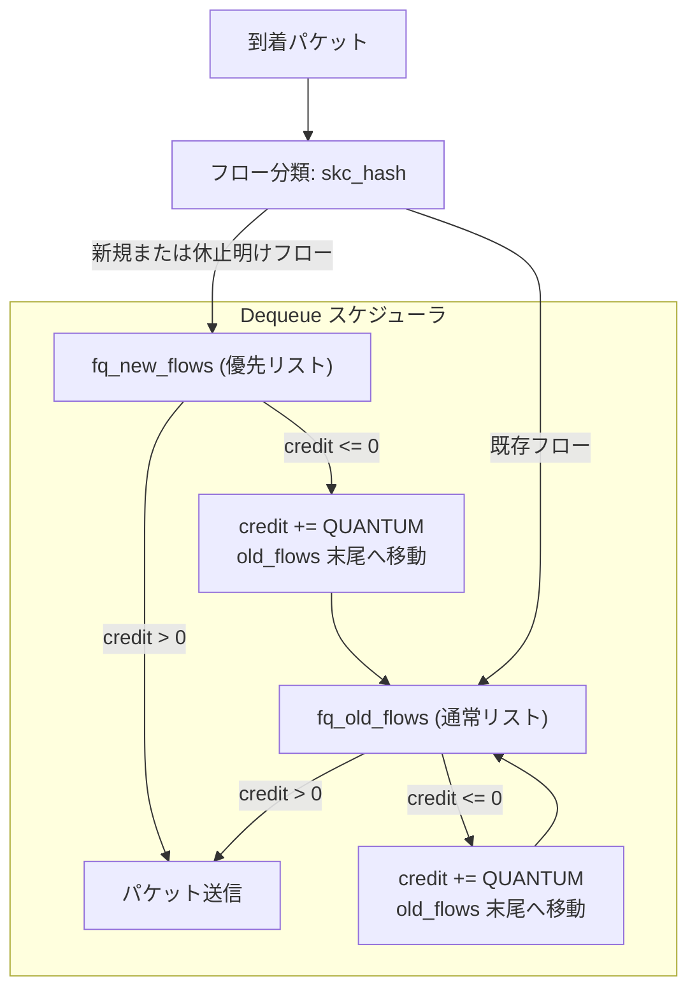

# トラック 5: Fair Queueing (FQ) と EDT ペーシング ハンズオン

[English](README.en.md)

このトラックでは、現代の高速 TCP（特に BBR や CUBIC）の真の性能を引き出すために不可欠なカーネル内スケジューラ **Fair Queueing (FQ) と Earliest Departure Time (EDT) ペーシング** を、Linux カーネルの BPF `struct_ops`（`struct Qdisc_ops`）を使ってゼロから実装します。

Qdisc やパケットスケジューリングの事前知識は前提としません。「なぜ単純な FIFO ではインターネットが渋滞するのか」「Deficit Round Robin (DRR) はどのような仕組みで帯域を公平に分け合うのか」「TCP のバースト送信を抑える EDT ペーシングはどのように動いているのか」を第一原理から整理しましょう。

---

## 1. そもそも Qdisc（Queueing Discipline）とは何か？

TCP ソケットが `write()` や `sendmsg()` で送信したパケットは、すぐに物理 NIC から電波や光として飛び出すわけではありません。ソケット層とデバイスドライバの間には、**Qdisc（Queueing Discipline：パケット送出キュー制御機構）** と呼ばれるトラフィック制御レイヤが存在します。

```text
+-----------------------+     +-----------------------+
|  TCP Socket (Flow A)  |     |  TCP Socket (Flow B)  |
+-----------------------+     +-----------------------+
            |                             |
            +--------------+--------------+
                           |
                           v
           +-------------------------------+
           |    Qdisc (Traffic Control)    |
           |   - フロー分類 (Classification)|
           |   - 帯域配分 (Fair Queuing)   |
           |   - 送信調歩 (EDT Pacing)     |
           +-------------------------------+
                           |
                           v
           +-------------------------------+
           |    Device Driver (Ring Buff)  |
           +-------------------------------+
                           |
                           v
           +-------------------------------+
           |         Physical NIC          |
           +-------------------------------+
```

Qdisc の最も単純な実装は **pfifo（単純な先入れ先出しキュー）** です。しかし、FIFO には重大な欠陥があります：

- **Fat Flow による回線占有**: 巨大なファイルを全力でダウンロードしているフロー（Fat Flow）があると、FIFO キューは常にそのフローのパケットで満杯になります。
- **Sparse Flow の遅延悪化**: その裏で SSH のキーストロークや DNS 問い合わせ、HTTP GET リクエストなどの小さなパケット（Sparse Flow / Thin Flow）を送信しようとすると、先行する巨大フローのパケットがすべて捌けるまで長い時間待たされ、遅延（RTT）が跳ね上がります。
- **バースト送信と自己パケットロス**: TCP は ACK を受信した瞬間に複数パケットを一気に送信する傾向があります（ACK クランキング / パケットバースト）。FIFO に一瞬で大量のパケットが押し寄せると、スイッチの浅いバッファが溢れて自分自身のパケットをドロップさせてしまいます。

これらの問題を解決するために Linux カーネルに導入されたのが **`sch_fq`（Fair Queueing Qdisc）** です。

---

## 2. FQ の第 1 の柱：Deficit Round Robin (DRR) と新規フロー優先

FQ は、到着したパケットをフロー（IP アドレスやポート番号、またはソケットハッシュ）ごとに個別のキューに振り分けます。そのうえで、2 つのリストを使ってパケットを送り出します。

- **`fq_new_flows`（新規・スパースフロー用リスト）**
- **`fq_old_flows`（継続的な大容量フロー用リスト）**



### なぜ 2 つのリストがあるとスパースフローが速くなるのか？

- **クレジット制度（Deficit Round Robin）**: 各フローはパケットを送信する権利として `credit`（バイト単位）を持ちます。パケットを 1 つ送るとそのパケット長（`qdisc_pkt_len(skb)`）だけクレジットが減ります。
- **クレジットの初期値**: フローが新しくできたとき、または通信が途切れてアイドル状態から再開したとき、初期クレジットとして多めの値（`INITIAL_QUANTUM = 2000` バイト）が与えられ、**`fq_new_flows` の末尾** に追加されます。
- **`fq_new_flows` の絶対優先**: Dequeue スケジューラは、**`fq_new_flows` にフローが存在する限り、決して `fq_old_flows` を処理しません**。
- **大容量フローの降格**: 巨大フローが連続してパケットを送り、クレジットがゼロ以下（`credit <= 0`）になると、次回の送信枠として `QUANTUM`（1500 バイト）が加算されたうえで、優先リストから降格されて **`fq_old_flows` の末尾** へ送られます。

この仕組みにより、時々しかパケットを送らない SSH や Web リクエスト（Sparse Flow）は、常に `fq_new_flows` に入って大容量ダウンロードのパケットを瞬時に追い抜き、待ち時間ほぼゼロで送信されます。

---

## 3. FQ の第 2 の柱：Earliest Departure Time (EDT) ペーシング

FQ のもう 1 つの革新的な機能が **EDT（Earliest Departure Time：最早出発時刻）ペーシング** です。

従来の TCP では、送信側が一気にパケットを放出してネットワークを渋滞させていました。Linux 4.20 以降の EDT モデルでは、TCP レイヤまたは FQ が **パケットごとに「ネットワークへ送り出すべき未来の時刻（`skb->tstamp`）」** を計算してスタンプします。

```text
パケット 1 (0 ms) ----> 即座に送信!
パケット 2 (5 ms) ----> まだ早い! fq_delayed (赤黒木) へ退避
パケット 3 (10 ms) ---> fq_delayed へ退避

   5 ms 経過後: Watchdog タイマー発火!
   パケット 2 ----> 送信!
```

### EDT の 3 つの要素

1. **目標送出時刻の計算**:
   ソケットに設定された目標レート（`sk_max_pacing_rate`）に基づき、各パケットの送出間隔を計算します：
   $$\Delta t = \frac{\text{packet len} \times 10^9}{\text{rate}}$$
   フローの次回送出予定時刻 `flow->time_next_packet` を順次進めていきます。
2. **遅延キュー（`fq_delayed`）と Watchdog タイマー**:
   Dequeue 時にパケットのスタンプ時刻が現在時刻より未来（`now < tstamp`）である場合、そのフローを赤黒木（`bpf_rb_root fq_delayed`）に退避し、`bpf_qdisc_watchdog_schedule()` でカーネルの高精度タイマーをセットします。タイマーが発火すると、再び Dequeue が呼ばれてパケットが送り出されます。
3. **ホライゾンチェック（Horizon Check）**:
   もしバグや設定ミスで 10 秒後や 1 分後といった遥か未来のタイムスタンプが付けられた場合、キューが永久に詰まるのを防ぐため、一定の猶予時間（`HORIZON_NS = 2` 秒）を超えた異常パケットは即座にドロップします。

---

## 4. このトラックで学ぶ技術スタック（BPF Graph Data Structures）

Linux 6.x で導入された最新の BPF 機能である **BPF Graph Data Structures（グラフデータ構造）** を本格的に活用します。

| BPF 機能 | 用途 |
| :--- | :--- |
| `struct_ops` (`struct Qdisc_ops`) | C 言語でカーネルモジュールを書く代わりに、BPF でセキュアかつ動的に Qdisc を実装・登録する |
| `bpf_list_head` / `bpf_list_node` | DRR の `fq_new_flows` / `fq_old_flows` キューおよびパケット FIFO キューを表現する |
| `bpf_rb_root` / `bpf_rb_node` | タイムスタンプ順のパケットソート、および時刻順の遅延フロー管理（`fq_delayed`）を $$O(\log N)$$ で実現する |
| `bpf_refcount` | フロー構造体がハッシュマップ（フローテーブル）とリスト（スケジューラ）の両方に同時に所属するための安全な参照カウント管理 |
| `bpf_kptr_xchg()` | カーネルポインタの所有権（Ownership）をアトミックに移動・交換する |
| `bpf_qdisc_watchdog_schedule()` | EDT の目標時刻に正確に Dequeue を再開させるためのカーネル kfunc |

---

## 5. ステップ一覧と実行コマンド

このトラックは以下の 2 ステップで構成されています。

| ステップ | ディレクトリ | 実装する内容 |
| :--- | :--- | :--- |
| **Step 1** | [`step01-flow-drr/`](step01-flow-drr/README.md) | ハッシュによるフロー分類、および `fq_new_flows` と `fq_old_flows` を使った Deficit Round Robin (DRR) スケジューラを実装し、大容量フローの裏でスパースフローが優先されることを確認します。 |
| **Step 2** | [`step02-edt-pacing/`](step02-edt-pacing/README.md) | 赤黒木（`bpf_rb_root`）を用いた Earliest Departure Time (EDT) ペーシング、遅延フロー管理（`fq_delayed`）、Watchdog スケジューリング、および未来パケットのホライゾンチェックを実装します。 |

### 実行コマンド

`labs/` ディレクトリ（`/usr/local/google/home/kuniyu/tcp-eli5/labs`）から `run_test.sh` を使って各ステップをビルド・検証できます。

```sh
# Step 1: まず starter が失敗することを確認し、TODO を実装してテストする
./run_test.sh qdisc-fq/step01-flow-drr starter
# Step 1 の模範解答 (solution.bpf.c) を実行する
./run_test.sh qdisc-fq/step01-flow-drr solution

# Step 2: starter の確認と模範解答の実行
./run_test.sh qdisc-fq/step02-edt-pacing starter
./run_test.sh qdisc-fq/step02-edt-pacing solution
```

それでは、[`step01-flow-drr/README.md`](step01-flow-drr/README.md) に進んで最初の BPF FQ スケジューラを実装してみましょう！
