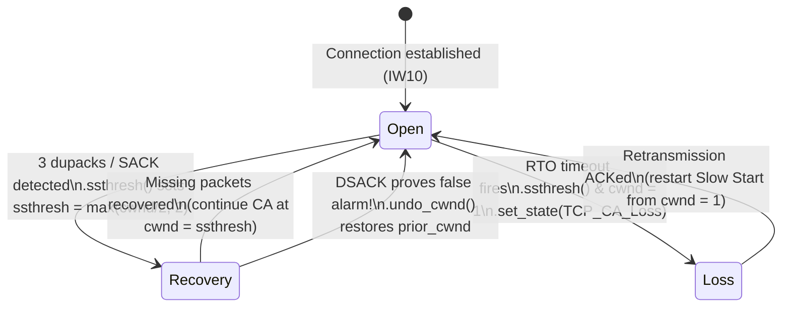

# Track 1: TCP Reno Hands-on — The Origin of Congestion Control

[日本語](README.md)

In this track, you will build **TCP Reno (RFC 5681)** — the foundational algorithm from which modern TCP congestion control evolved — from scratch using Linux kernel BPF `struct_ops` (`struct tcp_congestion_ops`).

No prior knowledge of Reno or CUBIC is assumed. Let's start from first principles: why congestion control exists at all, and how Reno probes and shares network capacity.

---

## 1. What Is Congestion Control?

When a TCP sender transmits data, **two distinct brakes** govern the maximum amount of unacknowledged data allowed in flight at any moment:

| Mechanism | Kernel Variable (`struct tcp_sock`) | What Does It Protect? | Who Determines It? |
| :--- | :--- | :--- | :--- |
| **Flow Control** | `snd_wnd` | **The receiver's room (socket receive buffer)** so the receiving host is never overwhelmed | Computed by the receiver and advertised in every TCP header's Window field |
| **Congestion Control** | `snd_cwnd` | **The roads and routers along the path** so bottleneck queues do not overflow and collapse | **Estimated by the sender itself** using returning ACKs and packet loss signals |

Even if the receiver has gigabytes of free memory (a huge `snd_wnd`), blasting packets into the network faster than an intermediate router's link capacity will overflow the router's queue, causing massive packet loss (**congestion collapse**). Conversely, even if the network path is completely empty (a huge `snd_cwnd`), a slow application on the receiving end requires the sender to stop at `snd_wnd`.

Therefore, a TCP sender always caps its in-flight data at the **smaller of the two windows**:

$$\text{Max In-Flight Data} = \min(\text{snd}_{\text{cwnd}}, \text{snd}_{\text{wnd}})$$

The fundamental challenge is that **routers along the path do not explicitly tell the sender how much bandwidth is available**. Congestion control is the algorithm the sender uses to probe the path's capacity — gently increasing its sending window while packets arrive safely, and backing off as soon as congestion is detected.

---

## 2. Reno's Core Principle: AIMD (Additive Increase / Multiplicative Decrease)

Designed by Van Jacobson in the late 1980s, TCP Reno rests on a simple, powerful control law called **AIMD (Additive Increase / Multiplicative Decrease)**:

- **Additive Increase (`+1`)**: As long as ACKs return without packet loss, increase `snd_cwnd` linearly by **`+1` packet per round-trip time (RTT)**.
- **Multiplicative Decrease (`× 1/2`)**: As soon as packet loss is detected, assume the sending rate exceeded the bottleneck capacity and immediately cut `snd_cwnd` in **half (`× 1/2`)**.

### Why "Add to Grow, Multiply to Shrink" Achieves Fairness

Why not increase by addition and also decrease by subtraction (AIAD)?
Imagine two flows sharing a bottleneck link with a capacity of 30 packets: Flow A started earlier and holds `cwnd = 24`, whilst Flow B just joined with `cwnd = 6`.

- If both flows increased by `+1` per RTT and subtracted `-5` on loss, the gap between them ($$24 - 6 = 18$$) would never shrink.
- With **Multiplicative Decrease (`× 1/2`)**, a packet loss cuts Flow A from `24 → 12` (giving up 12 packets), whilst Flow B only drops from `6 → 3` (giving up 3 packets). Their gap immediately halves from `18` to `9`!
- Because both flows then grow at the exact same additive rate (`+1 / RTT`), repeating this cycle automatically drives them to converge to a **fair `15 : 15` split** of the bottleneck.

```text
snd_cwnd (packets)
  ^
  |        /\              /\              /\          <-- Bottleneck capacity + buffer limit
  |       /  \            /  \            /  \             (Packet loss occurs here!)
  |      /    \          /    \          /    \
  |     /      \        /      \        /      \       Additive Increase (+1 / RTT)
  |    /        \      /        \      /        \      & Multiplicative Decrease (× 1/2)
  |   /          \    /          \    /          \
  |  /            \  /            \  /            \    <-- ssthresh = cwnd / 2
  | /              \/              \/              \
  +----------------------------------------------------> Time (RTT)
  [Slow] [------- Congestion Avoidance (AIMD) -------]
  [Start]
```

This signature pattern is known as the **TCP Sawtooth**.

---

## 3. Two Growth Phases and the Role of `snd_ssthresh`

If a connection only ever grew by `+1` packet per RTT from the very beginning, filling a high-speed path (say, `cwnd = 10,000` packets) would take thousands of round trips.

To solve this, Reno defines a boundary called the **Slow Start Threshold (`snd_ssthresh`)** and divides window growth into two distinct phases:

### Phase 1: Slow Start (`snd_cwnd < snd_ssthresh`)

- When a connection starts, `snd_cwnd` is initialised to **IW10 (10 packets)** and `snd_ssthresh` is set to infinity (`TCP_INFINITE_SSTHRESH`).
- Whilst `snd_cwnd < snd_ssthresh`, Reno increases `snd_cwnd` by **`+1` for every single packet acknowledged**.
- Sending 10 packets and receiving 10 ACKs grows `snd_cwnd` by `+10` to `20`. The next RTT doubles it from `20 → 40`, then `40 → 80`. This **exponential doubling every RTT** quickly discovers the rough capacity of the path.
  - *Note*: The name "Slow Start" is historical — it contrasted with jumping straight to the full receiver window `snd_wnd` on packet 1. In reality, Slow Start is the *fast*, exponential probing phase.

### Phase 2: Congestion Avoidance (`snd_cwnd >= snd_ssthresh`)

- Once packet loss has set `snd_ssthresh` to half of the previous peak and `snd_cwnd` grows back to `snd_cwnd >= snd_ssthresh`, the sender is approaching the known danger zone.
- Reno switches from exponential doubling to linear growth: **`+1` packet per full RTT (`snd_cwnd` ACKed packets)**.
- **How Linux Counts Fractional Windows in Integer Arithmetic (`tp->snd_cwnd_cnt`)**:
  - Neither the Linux kernel nor BPF allows floating-point arithmetic (`float`), so we cannot literally add `1 / snd_cwnd` on each ACK.
  - Instead, Linux maintains a credit bucket **`tp->snd_cwnd_cnt`** inside `struct tcp_sock`. Each incoming ACK adds `acked` segments to `tp->snd_cwnd_cnt`. Once the bucket fills up (`tp->snd_cwnd_cnt >= tp->snd_cwnd`), the sender increments `tp->snd_cwnd` by `1` and subtracts `tp->snd_cwnd` from `tp->snd_cwnd_cnt`.

---

## 4. Reacting to Packet Loss and Undoing False Alarms

When packet loss is detected (or suspected), the Linux TCP core invokes hooks on the congestion control algorithm:



1. **Fast Recovery (`TCP_CA_Recovery`) — Moderate Congestion**:
   - When 3 duplicate ACKs (or SACK blocks) indicate that a packet was lost whilst later packets are still arriving, the TCP core enters `TCP_CA_Recovery`.
   - It calls the **`.ssthresh(sk)`** hook, where Reno returns `max(tp->snd_cwnd / 2, 2)` to halve `snd_ssthresh` (and the congestion window is paced down to `snd_ssthresh` across recovery).
2. **RTO Timeout (`TCP_CA_Loss`) — Severe Congestion**:
   - If ACKs stop arriving altogether and the Retransmission Timeout (RTO) expires, the TCP core transitions to `TCP_CA_Loss`.
   - After halving `snd_ssthresh` via `.ssthresh(sk)`, the kernel resets **`snd_cwnd = 1`** so the connection restarts Slow Start from 1 packet. The **`.set_state(sk, TCP_CA_Loss)`** hook is called on this transition, allowing the CC to reset `tp->snd_cwnd_cnt = 0` so stale Congestion Avoidance credits are discarded.
3. **Spurious Retransmission and `.undo_cwnd(sk)` — Reversing a False Alarm**:
   - In real networks, packets often arrive out of order (**packet reordering**) without actually being dropped. Reordering of 3 or more packets can trick the sender into entering Fast Recovery, retransmitting early, and halving `snd_cwnd` unnecessarily.
   - When the receiver subsequently sends a **DSACK (Duplicate SACK)** reporting that both the original packet and the retransmission arrived, the TCP core realises the loss recovery was a false alarm (**spurious retransmission**).
   - The core immediately invokes **`.undo_cwnd(sk)`**, which restores `snd_cwnd` back to the pre-loss window (`prior_cwnd` / `loss_cwnd`).

---

## 5. Why Build Reno First Before Moving to CUBIC?

You might wonder: *"If Linux uses CUBIC by default today, why start by implementing Reno?"* There are **two fundamental reasons**:

### Reason 1: `struct tcp_sock` Was Designed Around Reno

Because Linux's TCP stack grew up with Reno, the core variables Reno manipulates — `snd_cwnd`, `snd_ssthresh`, `snd_cwnd_cnt`, and `prior_cwnd` — are **built directly into `struct tcp_sock` itself**. Implementing Reno first lets you see how the kernel TCP state machine reads and writes these core fields without any algorithmic clutter.

### Reason 2: CUBIC Is Reno with Just Two Plug-in Upgrades

In Track 2, you will build **CUBIC**. Far from being a completely unrelated design, CUBIC inherits its entire hook structure and Slow Start behaviour directly from Reno, replacing only two pieces:

| Component | Track 1: TCP Reno | Track 2: TCP CUBIC |
| :--- | :--- | :--- |
| **BPF Hooks Used** | `.init`, `.ssthresh`, `.cong_avoid`, `.set_state`, `.undo_cwnd` | **Identical** (plus `.cwnd_event` and `.pkts_acked` for HyStart) |
| **Slow Start** | `+1` per ACKed packet (exponential) | **Identical to Reno** (plus HyStart early exit) |
| **Loss Backoff (`.ssthresh`)** | Multiply by **`0.5`** (`cwnd / 2`) | Multiply by **`0.7`** (`cwnd * 717 / 1024`) |
| **Congestion Avoidance (`.cong_avoid`)** | **Linear** (`+1` per RTT) | **Cubic polynomial curve** concave/convex around $$W_{\max}$$ |
| **Undo (`.undo_cwnd`)** | `max(snd_cwnd, loss_cwnd)` | **Identical** (`max(snd_cwnd, loss_cwnd)`) |

By completing the two steps in this Reno track first, you master both the BPF `tcp_congestion_ops` hook lifecycle and 80% of the foundation needed for CUBIC.

---

## 6. Track Steps and Commands

This track consists of two hands-on steps:

| Step | Directory | What You Will Build |
| :--- | :--- | :--- |
| **Step 1** | [`step01-slow-start-ai/`](step01-slow-start-ai/README.en.md) | Minimal BPF CC skeleton (`.init`, `.ssthresh`, `.cong_avoid`, `.undo_cwnd`) and the exact boundary transition from Slow Start to Reno Additive Increase. |
| **Step 2** | [`step02-loss-undo/`](step02-loss-undo/README.en.md) | Per-socket private state via `inet_csk_ca(sk)` (`icsk_ca_priv`), state resets on RTO loss (`.set_state`), and restoring `snd_cwnd` on DSACK undo (`.undo_cwnd`). |

### How to Run the Labs

From the `labs/` directory (`/usr/local/google/home/kuniyu/tcp-eli5/labs`), run `run_test.sh` to compile and test each step inside a lightweight `vng` VM with `packetdrill`:

```sh
# Step 1: Verify that starter fails first, then implement the TODOs and re-run
./run_test.sh reno/step01-slow-start-ai starter
# Run the Step 1 model solution (solution.bpf.c)
./run_test.sh reno/step01-slow-start-ai solution

# Step 2: Verify starter and run the model solution
./run_test.sh reno/step02-loss-undo starter
./run_test.sh reno/step02-loss-undo solution
```

Ready? Head over to [`step01-slow-start-ai/README.en.md`](step01-slow-start-ai/README.en.md) and write your first BPF congestion control algorithm!
