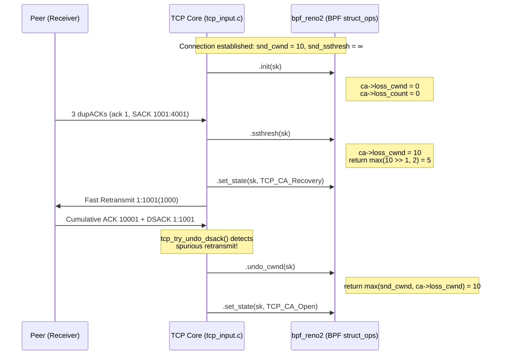

# Step 2: Loss / Fast Recovery and DSACK Undo

## 1. Goal

In Step 1 of the [Reno Track Overview (`../README.md`)](../README.md), we implemented Slow Start and Congestion Avoidance in an ideal network without packet loss. In real networks, however, **packet loss** due to router buffer overflows and **packet reordering** due to multi-path routing happen constantly. In this step, you will learn how TCP NewReno halves its window upon detecting packet loss (**Multiplicative Decrease**) and how it restores the window (**CWND Undo**) when a Duplicate SACK (**DSACK**) later proves that the loss detection was a false alarm (**spurious retransmission**) caused by packet reordering. You will implement and verify these mechanisms in `bpf_reno2`.

---

## 2. How the Algorithm Works (Read This First)

Before looking at any code, let us build a complete mental model of what happens during packet loss and spurious retransmission, how TCP NewReno reacts, and how the Linux TCP core divides work with a BPF congestion control (CC) module.

### Why Does This Problem Happen, and What Is the Idea Behind the Algorithm?

In real networks, two distinct events cause segments to arrive out of order at the receiver:

1. **Congestion-induced Packet Loss**: A bottleneck router queue overflows and drops a packet. If the sender keeps transmitting at the same rate, congestion will worsen, so TCP must immediately cut its congestion window (`snd_cwnd`).
2. **Packet Reordering**: Multi-path routing (ECMP) or internal router parallelism causes an earlier packet (say, segment 1) to take a slightly slower path while later packets (segments 2, 3, and 4) arrive at the receiver first. Segment 1 was not dropped—it is merely delayed.

When segments 2, 3, and 4 arrive before segment 1, the receiver sends three duplicate ACKs (carrying SACK blocks for the out-of-order segments). Following standard TCP rules, the sender assumes segment 1 was lost, immediately retransmits it (**Fast Retransmit**), and enters **Fast Recovery (`TCP_CA_Recovery`)**.

What if segment 1 was only delayed by packet reordering? Shortly after the sender retransmits segment 1, both the delayed original segment 1 and the retransmitted copy arrive at the receiver. Because the network was not actually congested, halving the congestion window was an overreaction! Once the receiver informs the sender that the same segment arrived twice, the sender performs a **CWND Undo** to restore `snd_cwnd` back to its pre-loss size.

### Algorithm Rules and Mathematical Formulae

#### 1. Multiplicative Decrease on Loss Detection (RFC 5681)

When entering **Fast Recovery (`TCP_CA_Recovery`)** on three duplicate ACKs or **Loss (`TCP_CA_Loss`)** on a Retransmission Timeout (RTO), NewReno sets the new slow start threshold (`snd_ssthresh`) to half of the current `snd_cwnd`, bounded below by 2 segments ([RFC 5681 §3.1](https://www.rfc-editor.org/rfc/rfc5681#section-3.1)):

$$\text{ssthresh} = \max\left(\left\lfloor \frac{\text{snd}_{\text{cwnd}}}{2} \right\rfloor, 2\right)$$

At the exact same moment, NewReno saves the pre-loss window size into a per-socket variable `loss_cwnd` so it can recover the original window if the loss later turns out to be spurious:

$$\text{loss}_{\text{cwnd}} = \text{snd}_{\text{cwnd}}$$

#### 2. Division of Labour Between the TCP Core (PRR) and `.ssthresh`

When three duplicate ACKs trigger `TCP_CA_Recovery`, the Linux TCP core calls `tcp_init_cwnd_reduction()`. It is essential to understand who modifies which field:

- **What `.ssthresh(sk)` does**: The CC module does **not** directly overwrite `tp->snd_cwnd` inside `.ssthresh(sk)`. It only computes and returns the new `snd_ssthresh` value.
- **Who actually reduces `snd_cwnd`?**: During Recovery, the TCP core uses **PRR (Proportional Rate Reduction, RFC 6937)** (`tcp_cwnd_reduction()`) to smoothly pace `tp->snd_cwnd` down towards `snd_ssthresh`, and `tcp_end_cwnd_reduction()` sets `tp->snd_cwnd = tp->snd_ssthresh` when exiting Recovery.
- **Why this matters for saving `loss_cwnd`**: Because the TCP core has not yet reduced `tp->snd_cwnd` when it invokes `.ssthresh(sk)`, `tp->snd_cwnd` still holds the exact **pre-loss window size**. Therefore, `.ssthresh(sk)` is the exact place to record `ca->loss_cwnd = tp->snd_cwnd`.

#### 3. Resetting Fractional Credit on RTO Timeout (`TCP_CA_Loss`)

When packet loss is so severe that Fast Recovery cannot recover it and the Retransmission Timer (RTO) expires, the TCP core transitions the socket to `TCP_CA_Loss`, resets `tp->snd_cwnd = 1`, and restarts transmission from Slow Start.

During the previous Congestion Avoidance phase (when the window was large), `tp->snd_cwnd_cnt` accumulated fractional ACK credits towards the next `+1` window increment. If those stale credits were left intact across an RTO, the socket would prematurely increment `snd_cwnd` as soon as it re-entered Congestion Avoidance. Therefore, upon transitioning to `TCP_CA_Loss`, the CC module must reset `tp->snd_cwnd_cnt = 0`.

#### 4. Detecting Spurious Retransmissions via DSACK and Restoring with `.undo_cwnd`

When both the original delayed packet and the retransmitted packet arrive at the receiver, the receiver reports the duplicate arrival using a **DSACK (Duplicate SACK, [RFC 2883](https://www.rfc-editor.org/rfc/rfc2883) / [RFC 3708](https://www.rfc-editor.org/rfc/rfc3708))** block—a SACK block whose sequence numbers lie *below* the cumulative ACK number (proving that a segment already covered by the cumulative ACK arrived a second time).

When DSACK (or TCP Timestamp Eifel Detection, [RFC 3522](https://www.rfc-editor.org/rfc/rfc3522)) confirms that all retransmissions in the recovery episode were spurious, the TCP core (`tcp_try_undo_dsack()` → `tcp_undo_cwnd_reduction()`) calls the CC module's `.undo_cwnd(sk)` hook.

NewReno's `.undo_cwnd(sk)` returns the maximum of the current window and the saved pre-loss window:

$$\text{cwnd}_{\text{undo}} = \max(\text{snd}_{\text{cwnd}}, \text{loss}_{\text{cwnd}})$$

Why return $$\max(\text{snd}_{\text{cwnd}}, \text{loss}_{\text{cwnd}})$$ instead of simply returning $$\text{loss}_{\text{cwnd}}$$? Because during a spurious Recovery or Loss episode, incoming ACKs might have already grown `tp->snd_cwnd` past the initial `loss_cwnd` by the time the undo is triggered. Taking the maximum guarantees that undoing a window reduction never accidentally shrinks a window that has already grown larger. (Meanwhile, the TCP core automatically restores `snd_ssthresh` from `tp->prior_ssthresh`.)

### Concrete Numerical Example and Sequence Diagram (`snd_cwnd = 10`)

Let us trace a concrete example matching `test.pkt`, starting with `snd_cwnd = 10` (1 segment = 1000 bytes). We send 10 segments (`1:10001`), where the first segment (`1:1001`) is delayed in the network while segments 2, 3, and 4 (`1001:4001`) arrive first:



1. **Initial transmission (`TCP_CA_Open`)**: `snd_cwnd = 10`. The sender transmits 10 segments (`1:10001`).
2. **Three duplicate ACKs → Fast Recovery**:
   - The receiver sends three duplicate ACKs (`ack 1`) with SACK blocks covering `1001:4001`.
   - The TCP core invokes `.ssthresh(sk)`. `bpf_reno2` saves `ca->loss_cwnd = 10` and returns `max(10 >> 1, 2) = 5`.
   - `snd_ssthresh` becomes `5`, segment `1:1001` is fast-retransmitted, and PRR reduces `snd_cwnd` to `5`.
3. **Cumulative ACK with DSACK → Undo**:
   - Both the delayed original `1:1001`, the remaining segments up to `10001`, and the duplicate retransmission `1:1001` arrive at the receiver.
   - The receiver sends cumulative `ack 10001` together with DSACK block `sack 1:1001`.
   - The TCP core detects the spurious retransmission and invokes `.undo_cwnd(sk)`.
   - `bpf_reno2` returns `max(5, 10) = 10`, restoring `snd_cwnd` to `10` as the socket returns to `TCP_CA_Open`.

### What the Kernel Already Provides (`struct tcp_sock`, `struct inet_connection_sock`, and `icsk_ca_priv`)

Here is the complete inventory of kernel fields and helpers you will use in Step 2:

#### 1. Fields in `struct tcp_sock` (accessed via `tcp_sk(sk)`)

| Field | Type | Access in BPF | Meaning |
| :--- | :--- | :--- | :--- |
| `tp->snd_cwnd` | `u32` | Read / Write | Current congestion window (in segments). Still holds the **pre-loss** value when `.ssthresh(sk)` is invoked. |
| `tp->snd_ssthresh` | `u32` | Read / Write | Slow start threshold. Set by the TCP core from `.ssthresh(sk)`'s return value; restored automatically by the core from `tp->prior_ssthresh` on Undo. |
| `tp->snd_cwnd_cnt` | `u32` | Read / Write | Fractional ACK credit counter for Congestion Avoidance. Must be reset to `0` on `TCP_CA_Loss`. |
| `tp->snd_cwnd_clamp` | `u32` | Read-only | Maximum allowed `snd_cwnd`. |

#### 2. Per-socket Private Storage: `icsk_ca_priv` and `inet_csk_ca(sk)`

Notice what `struct tcp_sock` does **not** have: a dedicated field for the CC module to save `loss_cwnd` or custom counters like `loss_count`.

Furthermore, we cannot store `loss_cwnd` in a BPF global variable because a single BPF CC program is shared across **every TCP socket on the machine**—concurrent connections would constantly overwrite one another's values.

To solve this, the Linux kernel embeds a per-socket private byte array called **`icsk_ca_priv` (104 bytes in mainline kernels)** inside `struct inet_connection_sock`:

- The helper `inet_csk_ca(sk)` in `bpf_cc_helpers.h` returns a `void *` pointer to `(void *)inet_csk(sk)->icsk_ca_priv`.
- A BPF CC module defines its own custom structure (here, the 8-byte `struct bpf_reno2_ca`) and casts `inet_csk_ca(sk)` to that struct pointer.
- The BPF verifier (`bpf_tcp_ca_btf_struct_access()`) explicitly whitelists read/write access to `icsk_ca_priv`, alongside writes to `snd_cwnd`, `snd_ssthresh`, and `snd_cwnd_cnt`.

```c
struct bpf_reno2_ca {
	u32 loss_cwnd;   /* Pre-loss snd_cwnd saved for Undo */
	u32 loss_count;  /* Number of transitions into TCP_CA_Loss (RTO) */
};
```

#### 3. Congestion States `enum tcp_ca_state` (passed as `u8 new_state` to `.set_state`)

Just before the TCP core updates a socket's congestion state (`icsk_ca_state`), it calls `.set_state(sk, new_state)` with one of the following constants:

- `TCP_CA_Open` (`0`): Normal state (no loss detected)
- `TCP_CA_Disorder` (`1`): Duplicate ACKs / SACKs detected, but below the recovery threshold
- `TCP_CA_CWR` (`2`): Congestion Window Reduced (e.g., ECN)
- `TCP_CA_Recovery` (`3`): Fast Recovery in progress (triggered by 3 duplicate ACKs)
- `TCP_CA_Loss` (`4`): RTO timeout fired; recovering via Slow Start

---

## 3. Design Checkpoints (Translate the Algorithm into Code)

Using the concepts from Section 2, think through the following four questions to design the TODOs in `starter.bpf.c`.

### Q1. How do we access per-socket custom state (`loss_cwnd` and `loss_count`) in BPF?

To restore `snd_cwnd` when a loss event turns out to be spurious, each socket needs its own `loss_cwnd` and `loss_count` without colliding with other sockets. Which helper function gives us access to the per-socket private area, and how is it initialised?

<details>
<summary>Hint and Answer</summary>

As explained in Section 2, we use the 104-byte `icsk_ca_priv` array inside `struct inet_connection_sock` via the `inet_csk_ca(sk)` helper, which returns a `void *` pointer to `icsk->icsk_ca_priv`.

`starter.bpf.c` already defines the 8-byte `struct bpf_reno2_ca` and zeroes both fields in `bpf_reno2_init()`:

```c
struct bpf_reno2_ca {
	u32 loss_cwnd;
	u32 loss_count;
};
```

In each hook, `struct bpf_reno2_ca *ca = inet_csk_ca(sk);` gives direct read/write access to that socket's `ca->loss_cwnd` and `ca->loss_count`.

</details>

### Q2. In `.ssthresh(sk)` (TODO 1), what should we save, what should we return, and do we modify `tp->snd_cwnd`?

When three duplicate ACKs trigger Fast Recovery (`TCP_CA_Recovery`), the TCP core calls `bpf_reno2_ssthresh()`. What should this function store into `ca->loss_cwnd`, what formula should it return, and should it overwrite `tp->snd_cwnd` directly?

<details>
<summary>Hint and Answer</summary>

As covered in Section 2, when `.ssthresh(sk)` is called, `tp->snd_cwnd` still holds its **pre-loss value**, and the actual reduction of `tp->snd_cwnd` is performed by the TCP core via PRR (`tcp_cwnd_reduction()`).

Therefore, `bpf_reno2_ssthresh()` should not modify `tp->snd_cwnd`; it only needs two lines:

1. Save the pre-loss window: `ca->loss_cwnd = tp->snd_cwnd;`
2. Return the halved threshold bounded below by `2U`: `return max(tp->snd_cwnd >> 1U, 2U);`

</details>

### Q3. In `.set_state(sk, new_state)` (TODO 2), why reset `tp->snd_cwnd_cnt` to `0` on `TCP_CA_Loss`?

When an RTO fires and the TCP core calls `tcp_set_ca_state(sk, TCP_CA_Loss)`, why should `bpf_reno2_set_state()` reset `tp->snd_cwnd_cnt = 0` alongside incrementing `ca->loss_count++`?

<details>
<summary>Hint and Answer</summary>

`tp->snd_cwnd_cnt` accumulates fractional ACK credits during Congestion Avoidance to increment `snd_cwnd` by `1` once a full window of segments has been acknowledged. If credits accumulated under a large pre-loss window were left intact after an RTO reset the window, `snd_cwnd` would be incremented prematurely as soon as the socket re-entered Congestion Avoidance.

Resetting `tp->snd_cwnd_cnt = 0` when `new_state == TCP_CA_Loss` discards those stale credits cleanly.

</details>

### Q4. In `.undo_cwnd(sk)` (TODO 3), why return `max(tp->snd_cwnd, ca->loss_cwnd)` instead of just `ca->loss_cwnd`?

When a DSACK proves that a retransmission was unnecessary, the TCP core calls `bpf_reno2_undo_cwnd()`. What edge case does `return max(tp->snd_cwnd, ca->loss_cwnd);` prevent compared to `return ca->loss_cwnd;`?

<details>
<summary>Hint and Answer</summary>

During a spurious Recovery or Loss episode, incoming ACKs may have already grown `tp->snd_cwnd` past the initial `ca->loss_cwnd` by the time the undo is triggered.

Returning `ca->loss_cwnd` unconditionally would paradoxically shrink `snd_cwnd` upon undo. Taking `max(tp->snd_cwnd, ca->loss_cwnd)` ensures the congestion window is restored to at least its pre-loss level without ever reducing a window that has already grown larger.

</details>

---

## 4. Step-by-step Code Walkthrough (`solution.bpf.c`)

Let us walk through each function in `solution.bpf.c`.

### 1. Per-socket State `struct bpf_reno2_ca` and `bpf_reno2_init()`

```c
struct bpf_reno2_ca {
	u32 loss_cwnd;
	u32 loss_count;
};

SEC("struct_ops")
void BPF_PROG(bpf_reno2_init, struct sock *sk)
{
	struct bpf_reno2_ca *ca = inet_csk_ca(sk);

	ca->loss_cwnd = 0;
	ca->loss_count = 0;
}
```

- `inet_csk_ca(sk)` returns `(void *)inet_csk(sk)->icsk_ca_priv`.
- `bpf_reno2_init()` is invoked when the connection reaches `ESTABLISHED` (or when switching CC via `setsockopt(TCP_CONGESTION)`) and initialises both `loss_cwnd` and `loss_count` to `0`.

### 2. Saving `snd_cwnd` and Halving `ssthresh`: `bpf_reno2_ssthresh()`

```c
SEC("struct_ops")
u32 BPF_PROG(bpf_reno2_ssthresh, struct sock *sk)
{
	const struct tcp_sock *tp = tcp_sk(sk);
	struct bpf_reno2_ca *ca = inet_csk_ca(sk);

	/* Save pre-loss cwnd into private storage and return halved ssthresh (min 2) */
	ca->loss_cwnd = tp->snd_cwnd;
	return max(tp->snd_cwnd >> 1U, 2U);
}
```

- The right shift `tp->snd_cwnd >> 1U` computes integer division by 2 ($$\lfloor \text{snd}_{\text{cwnd}} / 2 \rfloor$$), and `max(..., 2U)` enforces the lower bound of 2 segments required by RFC 5681 §3.1.
- Before returning, it saves the pre-reduction `tp->snd_cwnd` into `ca->loss_cwnd` so `bpf_reno2_undo_cwnd()` can restore it if the loss turns out to be spurious.

### 3. Handling Transition to `TCP_CA_Loss`: `bpf_reno2_set_state()`

```c
SEC("struct_ops")
void BPF_PROG(bpf_reno2_set_state, struct sock *sk, u8 new_state)
{
	struct tcp_sock *tp = tcp_sk(sk);
	struct bpf_reno2_ca *ca = inet_csk_ca(sk);

	if (new_state == TCP_CA_Loss) {
		tp->snd_cwnd_cnt = 0;
		ca->loss_count++;
	}
}
```

- Invoked by `tcp_set_ca_state()` right before updating `icsk_ca_state`.
- When `new_state == TCP_CA_Loss`, we clear `tp->snd_cwnd_cnt = 0` to discard stale fractional credits and increment `ca->loss_count++`.

### 4. Undoing Window Reduction: `bpf_reno2_undo_cwnd()`

```c
SEC("struct_ops")
u32 BPF_PROG(bpf_reno2_undo_cwnd, struct sock *sk)
{
	const struct tcp_sock *tp = tcp_sk(sk);
	const struct bpf_reno2_ca *ca = inet_csk_ca(sk);

	/* Restore cwnd back to loss_cwnd when retransmission is proven spurious */
	return max(tp->snd_cwnd, ca->loss_cwnd);
}
```

- When DSACK or TCP timestamps prove that all retransmissions in the recovery episode were spurious, `tcp_undo_cwnd_reduction()` calls `bpf_reno2_undo_cwnd()`.
- Returning `max(tp->snd_cwnd, ca->loss_cwnd)` restores the halved window back to the pre-loss `loss_cwnd`.

### 5. Window Growth (`bpf_reno2_cong_avoid()`) and `struct tcp_congestion_ops`

`bpf_reno2_cong_avoid()` is identical to Step 1 (exponential growth in Slow Start and `+1` per RTT linear growth via `snd_cwnd_cnt` in Congestion Avoidance). Finally, `struct tcp_congestion_ops bpf_reno2` registers `.init`, `.ssthresh`, `.set_state`, `.undo_cwnd`, and `.cong_avoid`.

---

## 5. Understanding `test.pkt` and How to Run

### Walkthrough of `test.pkt`

`test.pkt` reproduces the exact **packet reordering → Fast Recovery → DSACK Undo** sequence illustrated in Section 2:

1. **Handshake and IW10 transmission (lines 11–23)**:
   - The connection is established with `<mss 1012,sackOK,TS val 100 ecr 0,nop,wscale 7>`. Because the TCP Timestamp option occupies 12 bytes, each segment carries `1000` bytes of payload.
   - `write(4, ..., 10000)` sends 10 segments (`1:10001(10000)`). Lines 21–22 assert `tcpi_snd_cwnd == 10` and `tcpi_ca_state == TCP_CA_Open`.
2. **Three duplicate ACKs with SACK trigger Fast Recovery (lines 26–33)**:
   - Segment `1:1001` is delayed in the network while `1001:2001`, `2001:3001`, and `3001:4001` arrive at the peer first.
   - The peer sends three duplicate ACKs (`ack 1`) carrying `<...,sack 1001:2001>`, `<...,sack 1001:3001>`, and `<...,sack 1001:4001>`. On the third duplicate ACK, Fast Recovery triggers.
   - The kernel fast-retransmits `1:1001(1000)` and invokes `bpf_reno2_ssthresh()`. Lines 31–32 assert `tcpi_ca_state == TCP_CA_Recovery` and `tcpi_snd_ssthresh == 5`.
3. **Cumulative ACK with DSACK triggers Undo (lines 37–41)**:
   - Both the delayed original `1:1001` and the remaining segments arrive at the peer, followed by the duplicate retransmission `1:1001`. The peer replies with a cumulative `ack 10001` containing a **DSACK block `<...,sack 1:1001>`**.
   - The kernel calls `tcp_try_undo_dsack()` → `bpf_reno2_undo_cwnd()`. Lines 39–40 assert that the socket has returned to `tcpi_ca_state == TCP_CA_Open` and that `tcpi_snd_cwnd` has been restored from `5` back to `>= 10` (`tcpi_snd_cwnd >= 10`).

### Why `starter.bpf.c` Fails and `solution.bpf.c` Passes

- **Why `starter.bpf.c` fails**:
  - In `starter.bpf.c`, `bpf_reno2_ssthresh()` is unimplemented and simply returns `tp->snd_cwnd` (`10`), causing the assertion at line 32 (`assert tcpi_snd_ssthresh == 5`) to fail immediately.
  - Furthermore, even if `bpf_reno2_ssthresh()` returned `5`, without saving `ca->loss_cwnd` and returning `max(tp->snd_cwnd, ca->loss_cwnd)` in `bpf_reno2_undo_cwnd()`, `tcpi_snd_cwnd` would remain at `5` after the DSACK arrives, failing line 40 (`assert tcpi_snd_cwnd >= 10`).
- **Why `solution.bpf.c` passes**:
  - `bpf_reno2_ssthresh()` saves `ca->loss_cwnd = 10` and returns `5` (passing line 32), and upon receiving the DSACK, `bpf_reno2_undo_cwnd()` returns `max(5, 10) = 10` (passing line 40).

### How to Run

```sh
../../run_test.sh reno/step02-loss-undo starter
../../run_test.sh reno/step02-loss-undo solution
```
