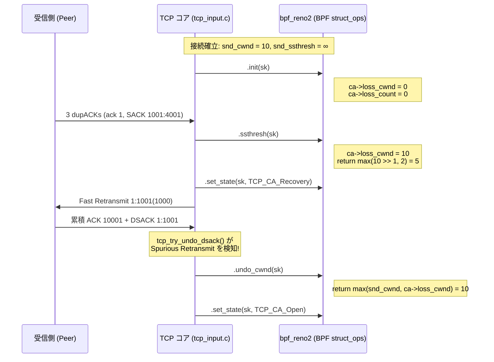

# Step 2: Loss / Fast Recovery と DSACK Undo

## 1. 学習ゴール

[Reno トラックの概要 (`../README.md`)](../README.md) の Step 1 では、パケットロスが一切起きない理想的な環境で Slow Start と Congestion Avoidance を実装しました。しかし現実のネットワークでは、ルータのバッファ溢れによる**パケットロス**や、経路の揺らぎによる**パケットの到着順序逆転（Reordering）**が日常的に発生します。このステップでは、TCP NewReno がパケットロスを検出したときにウィンドウを半減させる仕組み（Multiplicative Decrease）と、そのロス判定が「実は並べ替えによる誤検出（Spurious Retransmission）だった」と DSACK（Duplicate SACK）で判明したときにウィンドウを元のサイズへ復元する仕組み（Undo）を学び、`bpf_reno2` として実装・検証します。

---

## 2. アルゴリズムと背景の解説（まずここを読む）

コードを書く前に、パケットロス発生時と誤検出（Spurious Retransmission）判明時に TCP NewReno と Linux TCP コアがどのように連携してウィンドウサイズを制御するのかを基礎から整理しましょう。

### なぜこの仕組みが必要なのか？（ロスへの対処と「早とちり」の取り消し）

現実のインターネットでは、次の 2 つの現象が頻繁に起こります。

1. **輻輳によるパケットロス**: ボトルネックルータのキューが溢れてパケットが廃棄されます。送信側がこれまで通りのペースで送り続けるとネットワークが崩壊するため、送信ウィンドウ `snd_cwnd` を素早く縮小する必要があります。
2. **パケットの並べ替え（Reordering）**: ECMP（マルチパスルーティング）やルータ内部の並列処理により、先に送ったパケット 1 が少し遅れ、後続のパケット 2・3・4 が先に受信側へ到着することがあります。

TCP は「3 回の重複 ACK（または SACK で 3 パケット分の追い越し）が観測されたら、先頭のパケットがロスしたとみなして即座に再送する（**Fast Retransmit**）」というルールを持っています。しかし、単なる並べ替えでパケット 1 が遅れただけだった場合、少し遅れてオリジナルのパケット 1 も受信側に届き、再送したパケット 1 とあわせて**同じデータが 2 回届く**ことになります。

このとき「本当はネットワークが混雑していなかったのに、早とちりしてウィンドウを半分に減らしてしまった！」と気づき、減らしたウィンドウを元の大きさに戻す操作が **CWND Undo（ウィンドウ縮小の取り消し）** です。

### アルゴリズムのルールと数式

#### ① ロス検出時の乗法的減少（Multiplicative Decrease, RFC 5681）

重複 ACK によって **Fast Recovery（高速回復, `TCP_CA_Recovery`）** に入るか、あるいは再送タイムアウト（RTO）によって **Loss 状態（`TCP_CA_Loss`）** に入るとき、Reno は現在の輻輳ウィンドウ `snd_cwnd` を半分に減らした値を新しいスロースタートしきい値 `snd_ssthresh` とします（ただし RFC 5681 §3.1 に従い、最低値は 2 セグメントとします）。

$$\text{ssthresh} = \max\left(\left\lfloor \frac{\text{snd\_cwnd}}{2} \right\rfloor, 2\right)$$

同時に、あとで「誤検出だった」と判明したときに元のウィンドウサイズへ戻せるよう、縮小前の `snd_cwnd` をソケットごとの変数 `loss_cwnd` に退避しておきます。

$$\text{loss\_cwnd} = \text{snd\_cwnd}$$

#### ② TCP コア（PRR）と輻輳制御フック `.ssthresh` の役割分担

Linux カーネルでは、3 回の重複 ACK で `TCP_CA_Recovery` に入るとき、TCP コアの `tcp_init_cwnd_reduction()` が呼ばれます。ここで重要な設計上のルールがあります。

- **`.ssthresh(sk)` フックの仕事**: CC モジュールは `tp->snd_cwnd` を直接書き換えるのではなく、**新しい `snd_ssthresh` の計算結果を戻り値として返すだけ**です。
- **実際の `snd_cwnd` の縮小は誰がやるのか？**: TCP コア側が Recovery の最中に **PRR（Proportional Rate Reduction, RFC 6937）**（`tcp_cwnd_reduction()`）を使って `snd_cwnd` を `snd_ssthresh` に向けて滑らかに減らし、Recovery を抜ける際の `tcp_end_cwnd_reduction()` で最終的に `tp->snd_cwnd = tp->snd_ssthresh` に揃えます。
- **結果として**: `.ssthresh(sk)` が呼ばれた瞬間には、`tp->snd_cwnd` はまだ**縮小前の値**を保持しています。そのため、`.ssthresh(sk)` の中で `ca->loss_cwnd = tp->snd_cwnd` を記録すれば、確実にロス直前のウィンドウサイズを保存できます。

#### ③ RTO タイムアウト（`TCP_CA_Loss`）遷移時のリセット

Fast Recovery でも回復できないほど深刻なロスが発生し、再送タイマー（RTO）が満了すると、TCP コアはソケットの状態を `TCP_CA_Loss` に遷移させ、`tp->snd_cwnd = 1` にリセットして Slow Start からやり直します。

このとき、ロスが発生する前の大きなウィンドウでの Congestion Avoidance 中に貯めていた端数クレジット `tp->snd_cwnd_cnt` が残っていると、のちほど再び Congestion Avoidance に入った直後に古いクレジットのせいで意図せず早く `snd_cwnd` が `+1` されてしまいます。そのため、`TCP_CA_Loss` へ遷移したタイミングで `tp->snd_cwnd_cnt = 0` にクリアします。

#### ④ DSACK による誤検出の検知と `.undo_cwnd` による復元

再送したパケットが受信側に届いたとき、もしオリジナルのパケットもすでに届いていれば、受信側は **DSACK（Duplicate SACK, RFC 2883 / RFC 3708）** を返します。DSACK とは「累積 ACK 番号よりも小さい（＝すでに受信済みのはずの）シーケンス番号範囲をあえて SACK ブロックに入れて、『この範囲のパケットが重複して 2 回届いたよ』と送信側に知らせる仕組み」です。

DSACK（または TCP タイムスタンプを用いた Eifel Detection, RFC 3522）によって「今回の Recovery / Loss で再送したパケットはすべて不要な再送（Spurious Retransmission）だった」と確認されると、TCP コアの `tcp_try_undo_dsack()` → `tcp_undo_cwnd_reduction()` が CC モジュールの `.undo_cwnd(sk)` フックを呼び出します。

Reno の `.undo_cwnd(sk)` は、現在の `snd_cwnd` とロス前に退避しておいた `loss_cwnd` の大きい方を返します。

$$\text{cwnd}_{\text{undo}} = \max(\text{snd\_cwnd}, \text{loss\_cwnd})$$

なぜ単純に `loss_cwnd` を返すのではなく $\max(\text{snd\_cwnd}, \text{loss\_cwnd})$ を取るのでしょうか？誤検出された Recovery や Loss の最中にも ACK が到着してウィンドウが成長し、Undo が発動した時点の `tp->snd_cwnd` がすでにロス開始時の `loss_cwnd` を上回っているケースがあるからです。$\max$ を取ることで、Undo によってかえってウィンドウが縮んでしまう逆転現象を防ぎます（なお、`snd_ssthresh` 自体は TCP コア側が `tp->prior_ssthresh` から自動的に復元します）。

### 具体例とシーケンス図（`snd_cwnd = 10` からの Reordering と Undo）

初期ウィンドウ `snd_cwnd = 10`（1 セグメント = 1000 バイト）で 10 個のセグメント（`1:10001`）を送信した直後に、先頭の `1:1001` だけが遅れ、後続の 3 セグメント（`1001:2001`, `2001:3001`, `3001:4001`）が先に届いたケースを追ってみましょう。



1. **通常送信（`TCP_CA_Open`）**: `snd_cwnd = 10`。10 セグメント（`1:10001`）を送信します。
2. **3 回の重複 ACK 到着 → Fast Recovery 突入**:
   - 受信側から `ack 1` に SACK ブロック（`1001:4001`）が付いた重複 ACK が 3 つ届きます。
   - TCP コアは `.ssthresh(sk)` を呼び出します。`bpf_reno2` は縮小前の `tp->snd_cwnd`（`10`）を `ca->loss_cwnd = 10` に退避し、`max(10 >> 1, 2) = 5` を返します。
   - `snd_ssthresh` は `5` になり、`1:1001` が再送され、PRR によって `snd_cwnd` も `5` へ縮小されます。
3. **DSACK 到着 → Undo 発動**:
   - 遅れていた本来の `1:1001` と残りの全セグメント、さらに再送された `1:1001` が受信側に届きます。
   - 受信側は「`10001` まで全部届いたよ（`ack 10001`）。あと `1:1001` がダブって 2 回届いたよ（DSACK `sack 1:1001`）」と返します。
   - TCP コアは「さっきの再送は並べ替えによる早とちりだった」と判断して `.undo_cwnd(sk)` を呼び出します。
   - `bpf_reno2` は `max(5, 10) = 10` を返し、`snd_cwnd` は元の `10` に完全復活します。

### カーネルが提供するフィールドとヘルパー（実装に必要な知識のすべて）

Step 2 のコードを書くために必要な、カーネル構造体のフィールドと BPF ヘルパーは以下の通りです。

#### 1. `struct tcp_sock`（`tcp_sk(sk)` で取得）のフィールド

| フィールド | 型 | 読み書き | 役割と意味 |
| :--- | :--- | :--- | :--- |
| `tp->snd_cwnd` | `u32` | 読み書き可 | 現在の輻輳ウィンドウサイズ（単位: パケット数）。`.ssthresh(sk)` 呼び出し時点では**ロス縮小前の値**が入っている。 |
| `tp->snd_ssthresh` | `u32` | 読み書き可 | スロースタートしきい値。ロス検出時は `.ssthresh(sk)` の戻り値で更新され、Undo 時は TCP コアが `tp->prior_ssthresh` から自動復元する。 |
| `tp->snd_cwnd_cnt` | `u32` | 読み書き可 | Congestion Avoidance 用の端数 ACK クレジットカウンタ。`TCP_CA_Loss` 遷移時に `0` にリセットする必要がある。 |
| `tp->snd_cwnd_clamp` | `u32` | 読み取り専用 | `snd_cwnd` の上限値。 |

#### 2. ソケットごとの CC 私有領域 `icsk_ca_priv` と `inet_csk_ca(sk)`

ここで重要なポイントがあります。`struct tcp_sock` には、CC アルゴリズムが独自に `loss_cwnd`（ロス直前のウィンドウ）や `loss_count`（RTO ロス回数）を保存するための専用フィールドは用意されていません。

また、BPF のグローバル変数に保存してしまうと、マシン上の**すべての TCP ソケットが同じ変数を共有して上書きし合う**ため、ソケットごとの状態を保持できません。

そこで Linux カーネルは、各ソケットの `struct inet_connection_sock` の内部に **`icsk_ca_priv` という 104 バイトの専用バイト配列（私有領域）**を用意しています。

- `bpf_cc_helpers.h` が提供するヘルパー `inet_csk_ca(sk)` を呼ぶと、そのソケット自身の `icsk_ca_priv` 配列の先頭アドレス（`void *`）を取得できます。
- BPF プログラム側で独自の構造体（今回は 8 バイトの `struct bpf_reno2_ca`）を定義し、`struct bpf_reno2_ca *ca = inet_csk_ca(sk);` のようにポインタを受け取ることで、ソケットごとに独立した変数を自由に読み書きできます。
- BPF ベリファイア（`bpf_tcp_ca_btf_struct_access()`）は、`struct tcp_sock` の一部フィールド（`snd_cwnd`, `snd_ssthresh`, `snd_cwnd_cnt`）に加えて、この `icsk_ca_priv` 領域への書き込みを明示的に許可しています。

```c
struct bpf_reno2_ca {
	u32 loss_cwnd;   /* ロス検出直前の snd_cwnd を退避 */
	u32 loss_count;  /* TCP_CA_Loss (RTO) に遷移した回数 */
};
```

#### 3. 輻輳状態 `enum tcp_ca_state`（`.set_state(sk, u8 new_state)` の引数）

TCP コアがソケットの輻輳状態（`icsk_ca_state`）を変更するとき、`.set_state(sk, new_state)` フックに以下の定数が渡されます。

- `TCP_CA_Open` (`0`): 通常状態（ロスなし）
- `TCP_CA_Disorder` (`1`): 重複 ACK や SACK を観測したが、まだ Fast Recovery しきい値未満の状態
- `TCP_CA_CWR` (`2`): ECN 等によるウィンドウ縮小中
- `TCP_CA_Recovery` (`3`): 3 重複 ACK による Fast Recovery 中
- `TCP_CA_Loss` (`4`): RTO タイムアウト発火による Loss 回復中

---

## 3. 設計チェックポイント（理解した仕組みをコードに落とし込む）

セクション 2 の解説を踏まえて、`starter.bpf.c` の TODO を埋めるための 4 つの設計の問いを自分の頭で考えてみましょう。

### Q1. ソケットごとの独自状態（`loss_cwnd` と `loss_count`）はどこに保存するか？

ロス判定が誤り（Spurious）だったときに元の `snd_cwnd` へ戻すには、「ロスに入る直前の `snd_cwnd`」や「RTO が何回起きたか」をソケットごとに記憶しておく必要があります。BPF グローバル変数を使わずにソケットごとにこれらを保存するには、どのヘルパー関数を使ってどの領域にアクセスすればよいでしょうか？

<details>
<summary>ヒントと答え</summary>

セクション 2 で確認した通り、`struct inet_connection_sock` 内の私有領域 `icsk_ca_priv`（104 バイト）を使います。`bpf_cc_helpers.h` の `inet_csk_ca(sk)` ヘルパーを使うと、`icsk->icsk_ca_priv` の先頭ポインタを `void *` として取得できます。

`starter.bpf.c` ではすでに以下の 8 バイトの構造体が定義されており、`.init(sk)`（`bpf_reno2_init()`）で `0` に初期化されています。

```c
struct bpf_reno2_ca {
	u32 loss_cwnd;
	u32 loss_count;
};
```

各フック関数の先頭で `struct bpf_reno2_ca *ca = inet_csk_ca(sk);` と書くだけで、そのソケット専用の `ca->loss_cwnd` と `ca->loss_count` を読み書きできます。

</details>

### Q2. `.ssthresh(sk)` フック（TODO 1）では何を保存し、何を返すべきか？

3 回の重複 ACK で Fast Recovery（`TCP_CA_Recovery`）に入るとき、TCP コアから `bpf_reno2_ssthresh()` が呼ばれます。この関数の中で `ca->loss_cwnd` には何を代入し、戻り値としてどの計算式を返すべきでしょうか？また、ここで `tp->snd_cwnd` 自体を半分に書き換える必要はあるでしょうか？

<details>
<summary>ヒントと答え</summary>

セクション 2 の「TCP コア（PRR）と `.ssthresh` の役割分担」で見た通り、`.ssthresh(sk)` が呼ばれた時点では `tp->snd_cwnd` はまだ**縮小前の値**を保っており、実際の `tp->snd_cwnd` の縮小は TCP コアの PRR（`tcp_cwnd_reduction()`）が担当します。

したがって、`bpf_reno2_ssthresh()` で行うべき処理は次の 2 行だけです（`tp->snd_cwnd` 自体は書き換えません）。

1. 縮小前のウィンドウサイズを退避する: `ca->loss_cwnd = tp->snd_cwnd;`
2. 半減させたしきい値（下限 `2U`）を返す: `return max(tp->snd_cwnd >> 1U, 2U);`

</details>

### Q3. `.set_state(sk, new_state)` フック（TODO 2）で `TCP_CA_Loss` 遷移時に何をリセットするか？

パケットロスが Fast Recovery で回復できず RTO（Retransmission Timeout）が発火すると、TCP コアは `tcp_set_ca_state(sk, TCP_CA_Loss)` を呼びます。`bpf_reno2_set_state()` で `new_state == TCP_CA_Loss` を検知したとき、`ca->loss_count++` とあわせて `struct tcp_sock` のどのフィールドを `0` にリセットすべきでしょうか？また、それはなぜでしょうか？

<details>
<summary>ヒントと答え</summary>

`tp->snd_cwnd_cnt = 0;` にリセットします。

`tp->snd_cwnd_cnt` は Congestion Avoidance 中に「1 RTT で `snd_cwnd` を `+1` するための ACK パケット数クレジット（端数）」を貯めているカウンタです。RTO ロスが発生してウィンドウサイズがリセットされた後に、ロス前の大きなウィンドウ時代に貯めた端数クレジットが残っていると、再び Congestion Avoidance に入った直後に意図せず早く `snd_cwnd` が `+1` されてしまうためです。

</details>

### Q4. `.undo_cwnd(sk)` フック（TODO 3）で単純な `ca->loss_cwnd` ではなく `max(tp->snd_cwnd, ca->loss_cwnd)` を返すのはなぜか？

DSACK によって「再送は不要だった」と判明した際、TCP コアから `bpf_reno2_undo_cwnd()` が呼ばれます。このとき `return ca->loss_cwnd;` ではなく `return max(tp->snd_cwnd, ca->loss_cwnd);` とするのは、どのようなエッジケースを防ぐためでしょうか？

<details>
<summary>ヒントと答え</summary>

誤検出された Recovery や Loss の最中に多くの ACK が到着してウィンドウが成長し、Undo が発動した時点での現在の `tp->snd_cwnd` が、すでにロス開始時の `ca->loss_cwnd` を上回っているケースがあり得ます。

もし無条件に `ca->loss_cwnd` を返してしまうと、「Undo した結果かえって `snd_cwnd` が減ってしまう」という逆転現象が起きます。`max(tp->snd_cwnd, ca->loss_cwnd)` を返すことで、現在のウィンドウを決して縮小させずにロス前の水準以上へ安全に復元できます。

</details>

---

## 4. 実装ステップと解説 (`solution.bpf.c`)

それでは、`solution.bpf.c` の各関数を順番に確認しましょう。

### 1. 私有データ構造体 `struct bpf_reno2_ca` と `bpf_reno2_init()`

```c
struct bpf_reno2_ca {
	u32 loss_cwnd;
	u32 loss_count;
};

SEC("struct_ops")
void BPF_PROG(bpf_reno2_init, struct sock *sk)
{
	struct bpf_reno2_ca *ca = inet_csk_ca(sk);

	ca->loss_cwnd = 0;
	ca->loss_count = 0;
}
```

- `inet_csk_ca(sk)` は `(void *)inet_csk(sk)->icsk_ca_priv` を返します。
- ソケット確立時（または `setsockopt(TCP_CONGESTION)` による切り替え時）に呼ばれる `bpf_reno2_init()` で `loss_cwnd` と `loss_count` を `0` に初期化します。

### 2. しきい値の計算と `snd_cwnd` の退避: `bpf_reno2_ssthresh()`

```c
SEC("struct_ops")
u32 BPF_PROG(bpf_reno2_ssthresh, struct sock *sk)
{
	const struct tcp_sock *tp = tcp_sk(sk);
	struct bpf_reno2_ca *ca = inet_csk_ca(sk);

	/* ロス検出時点の cwnd を私有領域に退避し、半減した ssthresh（下限 2）を返す */
	ca->loss_cwnd = tp->snd_cwnd;
	return max(tp->snd_cwnd >> 1U, 2U);
}
```

- ビット右シフト `tp->snd_cwnd >> 1U` で整数の 2 除算（$\lfloor \text{snd\_cwnd} / 2 \rfloor$）を計算し、`max(..., 2U)` で RFC 5681 §3.1 の下限 `2` を保証します。
- 同時に、あとで DSACK Undo が起きたときに戻せるよう、縮小前の `tp->snd_cwnd` を `ca->loss_cwnd` に退避します。

### 3. `TCP_CA_Loss` 状態への遷移処理: `bpf_reno2_set_state()`

```c
SEC("struct_ops")
void BPF_PROG(bpf_reno2_set_state, struct sock *sk, u8 new_state)
{
	struct tcp_sock *tp = tcp_sk(sk);
	struct bpf_reno2_ca *ca = inet_csk_ca(sk);

	if (new_state == TCP_CA_Loss) {
		tp->snd_cwnd_cnt = 0;
		ca->loss_count++;
	}
}
```

- TCP コアの `tcp_set_ca_state()` が `icsk_ca_state` を書き換える直前に呼ばれます。
- `new_state == TCP_CA_Loss`（RTO による Loss 状態突入）のとき、`tp->snd_cwnd_cnt = 0` にリセットして古い端数クレジットを破棄し、`ca->loss_count` をインクリメントします。

### 4. Spurious Retransmission からの復元: `bpf_reno2_undo_cwnd()`

```c
SEC("struct_ops")
u32 BPF_PROG(bpf_reno2_undo_cwnd, struct sock *sk)
{
	const struct tcp_sock *tp = tcp_sk(sk);
	const struct bpf_reno2_ca *ca = inet_csk_ca(sk);

	/* Spurious retransmit と判明した際、ロス前の loss_cwnd まで cwnd を復元する */
	return max(tp->snd_cwnd, ca->loss_cwnd);
}
```

- DSACK や TCP タイムスタンプによって「さきほどの再送は並べ替えによる誤検出だった」と判明した際、`tcp_undo_cwnd_reduction()` から呼ばれます。
- `max(tp->snd_cwnd, ca->loss_cwnd)` を返すことで、半減されたウィンドウをロス前の `loss_cwnd` へ即座に戻します。

### 5. ウィンドウ増加と `struct tcp_congestion_ops` の登録

`bpf_reno2_cong_avoid()` は Step 1 と同じ Slow Start（指数増加）＋ Congestion Avoidance（`snd_cwnd_cnt` を用いた 1 RTT あたり `+1` の線形増加）です。最後に `.init`, `.ssthresh`, `.set_state`, `.undo_cwnd`, `.cong_avoid` を `struct tcp_congestion_ops bpf_reno2` に登録します。

---

## 5. `packetdrill` テストの解説 (`test.pkt`) と実行方法

### `test.pkt` のシナリオ解説

`test.pkt` は、セクション 2 のシーケンス図の通り**パケットの到着順序逆転（Reordering）によって誤って Fast Recovery に入った後、DSACK によってウィンドウが元の 10 に復元される一連の流れ**を検証します。

1. **接続確立と IW10（10 セグメント）の送信（11〜23 行目）**:
   - `<mss 1012,sackOK,TS val 100 ecr 0,nop,wscale 7>` で接続を確立します。TCP Timestamp オプションが 12 バイトを占めるため、1 セグメントあたりのデータペイロードはちょうど `1000` バイトになります。
   - `write(4, ..., 10000)` で 10 セグメント（`1:10001(10000)`）を一気に送信します。この時点で `tcpi_snd_cwnd == 10`、`tcpi_ca_state == TCP_CA_Open` であることをアサートします。
2. **3 回の重複 ACK（SACK）による Fast Recovery 突入（26〜33 行目）**:
   - 先頭セグメント `1:1001` がネットワーク内で遅延し、後続の `1001:2001`、`2001:3001`、`3001:4001` が先に受信側へ届いた状況を模擬します。
   - 受信側が `ack 1` に SACK ブロック `<...,sack 1001:2001>`、`<...,sack 1001:3001>`、`<...,sack 1001:4001>` を付けて 3 回返すと、3 つ目の重複 ACK で Fast Recovery が発動します。
   - カーネルは `1:1001(1000)` を Fast Retransmit し、`bpf_reno2_ssthresh()` が呼ばれて `tcpi_ca_state == TCP_CA_Recovery` および `tcpi_snd_ssthresh == 5` になったことを 31〜32 行目でアサートします。
3. **DSACK 付きの累積 ACK による Undo（37〜41 行目）**:
   - 直後に、遅延していた本来の `1:1001` も残りのセグメントもすべて受信側に届き、さらに再送した `1:1001` が重複して届いたため、受信側は累積 ACK `ack 10001` に **DSACK ブロック `<...,sack 1:1001>`** を添えて返します。
   - カーネルは `tcp_try_undo_dsack()` から `bpf_reno2_undo_cwnd()` を呼び、状態が `tcpi_ca_state == TCP_CA_Open` に戻り、`tcpi_snd_cwnd` が半減した `5` から元の `10` 以上（`tcpi_snd_cwnd >= 10`）に復元されたことを 39〜40 行目でアサートします。

### なぜ `starter.bpf.c` は失敗し、`solution.bpf.c` は成功するのか？

- **`starter.bpf.c` の失敗理由**:
  - `starter.bpf.c` の `bpf_reno2_ssthresh()` は未実装で `return tp->snd_cwnd;`（`10`）をそのまま返してしまうため、32 行目の `assert tcpi_snd_ssthresh == 5` でまず失敗します。
  - さらに、もし `bpf_reno2_ssthresh()` で `5` を返すようにしても、`ca->loss_cwnd` への退避と `bpf_reno2_undo_cwnd()` の `max(tp->snd_cwnd, ca->loss_cwnd)` を実装しなければ、DSACK 受信後も `tcpi_snd_cwnd` が `5` のままとなり、40 行目の `assert tcpi_snd_cwnd >= 10` で失敗します。
- **`solution.bpf.c` の成功理由**:
  - `bpf_reno2_ssthresh()` が `ca->loss_cwnd = 10` を保存しつつ `5` を返すため 32 行目のアサートを通過し、DSACK 到着時に `bpf_reno2_undo_cwnd()` が `max(5, 10) = 10` を返すため 40 行目の `assert tcpi_snd_cwnd >= 10` も通過します。

### テストの実行コマンド

```sh
../../run_test.sh reno/step02-loss-undo starter
../../run_test.sh reno/step02-loss-undo solution
```
